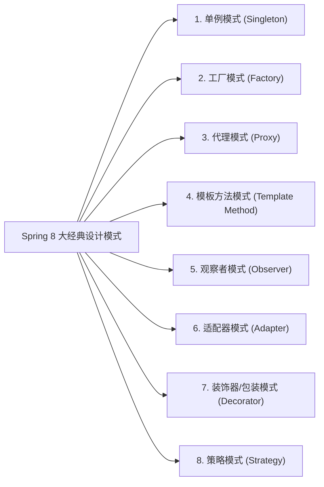

# 🏆 99 · Spring 生态通关总复盘与大厂面试全景图

> **一句话导读**：恭喜你成功穿越了 Spring 帝国的庞大版图！从 IoC 底座内功到 Spring Boot 现代魔法，再到微服务联邦共和国，这里将全章的核心骨架、生动比喻、**8 大经典设计模式**与大厂面试高频必杀题提炼为终极通关秘籍。

---

## 🗺️ Spring 核心宇宙大一统全景图

```mermaid
flowchart TD
    classDef root fill:#ffd666,stroke:#d48806,stroke-width:2px;
    classDef branch fill:#bae7ff,stroke:#1890ff,stroke-width:1px;

    Spring["Spring 生态全景宇宙"]:::root

    Spring --> C1["1. 帝国基石与内功心法"]:::branch
    C1 --> C11["IoC 装配工厂与 Bean 5步生命周期 ([[01-IoC容器与Bean生命周期]])"]
    C1 --> C12["死扣解法：三级缓存与循环依赖破局 ([[13-Spring循环依赖与三级缓存]])"]
    C1 --> C13["AOP 动态代理与自调用失效破解 ([[02-AOP原理与应用]])"]
    C1 --> C14["声明式事务与 7 大失效死穴 ([[03-Spring事务管理]])"]
    C1 --> C15["商场广播：事件解耦与事务后监听 ([[11-Spring事件机制]])"]

    Spring --> C2["2. Web 与数据持久化利器"]:::branch
    C2 --> C21["三甲医院分诊：SpringMVC 11步就医大链路 ([[06-SpringMVC请求处理流程]])"]
    C2 --> C22["万能代购小哥：MyBatis 代理与四大金刚 ([[07-MyBatis原理]])"]
    C2 --> C23["机场多道安检门：Spring Security 认证授权与 JWT ([[12-Spring-Security]])"]

    Spring --> C3["3. 现代 Spring Boot 魔法"]:::branch
    C3 --> C31["全屋智能预装：自动配置原理与条件退让 ([[04-SpringBoot自动配置原理]])"]
    C3 --> C32["即插即用 USB 外设：手写自定义 Starter ([[05-SpringBoot Starter机制]])"]
    C3 --> C33["火箭发射升空：SpringApplication.run 12步时序 ([[10-SpringBoot启动流程]])"]

    Spring --> C4["4. 分布式与前沿演进"]:::branch
    C4 --> C41["微服务联邦共和国治理：Nacos、Feign、Gateway ([[08-SpringCloud组件概览]])"]
    C4 --> C42["自来水管道与背压：WebFlux 与虚拟线程大决战 ([[09-WebFlux与响应式编程]])"]
```

---

## 🎨 大厂面试必考加分项：Spring 内部 8 大经典设计模式盘点

面试官最喜欢问：“你在读 Spring 源码或者日常使用中，见过哪些经典的设计模式？”

| 设计模式 | 现实生活比喻 | Spring 源码中的典型落地点 |
| :--- | :--- | :--- |
| **1. 单例模式** | 太阳只有一个，全局共用一个实例 | 默认的 Bean 作用域（`Scope = "singleton"`），由 `DefaultSingletonBeanRegistry` 统一单例池管理。 |
| **2. 工厂模式** | 顾客不关心汽车怎么造，向工厂要就行 | **`BeanFactory`**、**`FactoryBean`**（负责生产复杂 Bean，如 MyBatis 的 `MapperFactoryBean`）。 |
| **3. 代理模式** | 房产中介代理房东带看签合同 | **Spring AOP**（`JdkDynamicAopProxy` 与 `CglibAopProxy`），为目标对象无侵入织入日志、事务。 |
| **4. 模板方法模式** | 制定好试卷骨架，学生各自答填空题 | **`JdbcTemplate`**、**`TransactionTemplate`**、容器生命周期 `refresh()` 核心骨架。 |
| **5. 观察者模式** | 商场大喇叭广播，各柜台独立响应 | **Spring 事件驱动机制**（`ApplicationEventPublisher` 发布者，`ApplicationListener` 订阅者）。 |
| **6. 适配器模式** | 手机转接头（Type-C 转 3.5mm 耳机孔） | **`HandlerAdapter`**（适配多种不同接口风格的 Controller 处理方法）。 |
| **7. 装饰器模式** | 给奶茶加珍珠、椰果，外壳不变功能增强 | Spring 事务管理的包装器、缓存包装器。 |
| **8. 策略模式** | 导航出行策略（自驾、公交、骑车） | **`InstantiationStrategy`**（根据配置决定反射构造还是 CGLIB 实例化）。 |

---

## ⚡ 30 秒极速秒杀：大厂高频面试速查卡片

| 核心问题 | 一句话秒杀核心答题要点 |
| :--- | :--- |
| **IoC 与 DI** | 控制反转是思想，依赖注入是手段；把对象的创建与装配权从程序员反转交由 Spring 容器管理；强推**构造器注入**（不可变、线程安全、容易暴露坏味道）。 |
| **Bean 生命周期** | **“挖地基（实例化） -> 装水电（属性填充） -> 领门牌（Aware） -> 两头监理（BeanPostProcessor） -> 装修入住（初始化） -> 拆迁（销毁）”**；AOP 代理在后置处理器生成。 |
| **循环依赖与三级缓存** | 一级存成熟成品，二级存半成品早产儿，三级存 AOP 代理工厂；**为什么是三级？** 为了延迟满足，保证在没有循环依赖时不破坏 AOP 在生命周期最后阶段才生成代理的设计原则；**构造器循环依赖无法解决**（用 `@Lazy` 破解）。 |
| **AOP 动态代理** | JDK 代理基于接口（生成兄弟类 `$Proxy0`），CGLIB 基于继承（底层修改字节码生成子类）；Spring Boot 默认优先使用 CGLIB；**自调用失效**是因为 `this.method()` 穿透并绕过了代理对象。 |
| **Spring 事务失效 7 坑** | 1.非 public；2.自调用绕过代理；3.异常被 try-catch 吞了；4.受检异常未配 `rollbackFor = Exception.class`；5.存储引擎不支持（MyISAM）；6.未被容器管理；7.跨线程异步调用。 |
| **SpringMVC 11 步流程** | `DispatcherServlet`（总台） -> `HandlerMapping`（科室定位） -> `HandlerAdapter`（助理翻译参数） -> `Controller`（看病） -> `HttpMessageConverter`（打包 JSON）。 |
| **MyBatis 接口查库原理** | 基于 **JDK 动态代理 `MapperProxy`**，根据接口全限定名+方法名查出 `MappedStatement`；底层由 **四大金刚**（Executor、StatementHandler、ParameterHandler、ResultSetHandler）协同作战；永远无脑选 **`#{}`** 预编译防 SQL 注入。 |
| **Spring Boot 自动配置** | `@SpringBootApplication` 包含 `@EnableAutoConfiguration`；通过 `@Import` 扫描 `AutoConfiguration.imports` 候选清单；利用 **`@Conditional` 家族（尤其是 `@ConditionalOnMissingBean`）** 实现贴心退让与“约定优于配置”。 |
| **微服务治理核心架构** | **Nacos**（注册+配置） + **OpenFeign**（声明式 RPC） + **Gateway**（统一海关网关） + **Sentinel**（保险丝熔断降级防雪崩）。 |
| **WebFlux vs 虚拟线程** | 普通业务无脑拥抱 **Spring Boot 3 + 虚拟线程**（享受同步简单性与高并发）；API 网关和 AI 流式打字推送（SSE）坚守 **WebFlux**。 |

---

## 📜 生产 Spring 开发十大约法三章（血泪规约）

1. **【依赖注入规约】** 坚决废弃 `@Autowired` 字段注入，一律采用 Lombok `@RequiredArgsConstructor` + `final` 属性的**构造器注入**。
2. **【事务回滚规约】** 声明式事务一律显式加上 `@Transactional(rollbackFor = Exception.class)`，杜绝受检异常不回滚事故。
3. **【事务粒度规约】** 严禁在 `@Transactional` 方法中执行耗时长的第三方 HTTP、RPC 调用或发邮件操作，避免打爆数据库连接池！大事务改用 `TransactionTemplate` 编程式事务。
4. **【循环依赖规约】** 架构设计应避免循环依赖，严禁使用构造器循环依赖；Spring Boot 2.6+ 默认已关闭循环依赖允许，必须重构代码。
5. **【Starter 命名规约】** 团队自研起步依赖一律以 `xxx-spring-boot-starter` 命名，严禁使用官方 `spring-boot-starter-xxx` 命名空间。
6. **【全局异常规约】** 统一采用 `@RestControllerAdvice` 集中捕获全局异常并输出统一 Result 结构体，严禁向前端泄露未处理的后端错误堆栈。
7. **【SQL 注入规约】** MyBatis 传参强制使用 `#{}`，严禁随意使用 `${}` 进行文本拼接；动态表名、排序字段必须经过白名单强校验。
8. **【事件事务安全规约】** 涉及数据库写操作的事件监听器，一律使用 `@TransactionalEventListener(phase = AFTER_COMMIT)`，确保数据完全落盘后再触发外部通知。
9. **【微服务超时规约】** 凡是使用 OpenFeign 进行远程调用，必须显式配置连接超时与读取超时时间（建议 1~3 秒），严禁无限死等。
10. **【缓存安全规约】** 生产分布式微服务集群坚决禁用 MyBatis 二级缓存，一律拥抱外部集中式 Redis 缓存。

---

## 🎓 恭喜通关！

至此，你已经完整攻克了 Java 后端开发中最庞大、最重要的基石领域——**Spring 全家桶生态**！
你可以随时通过 [[_index]] 查阅各个关卡的详细实战手册，祝你在技术进阶与面试实战中所向披靡，早日成长为独当一面的技术专家！
