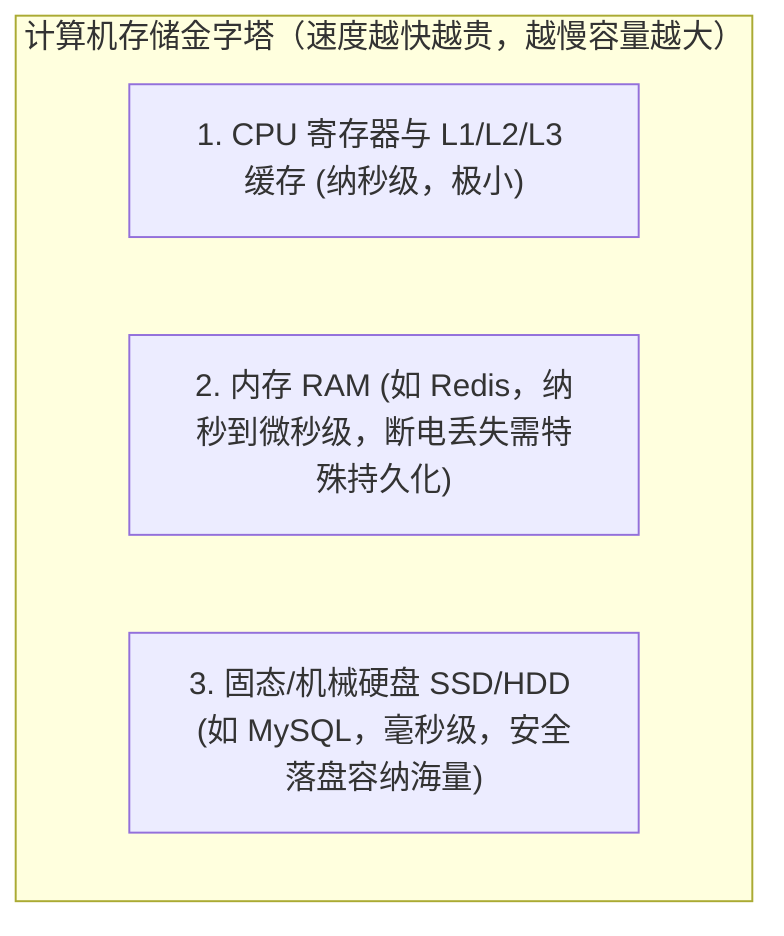
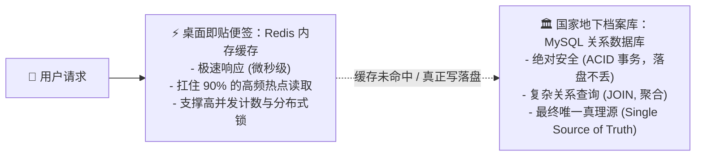
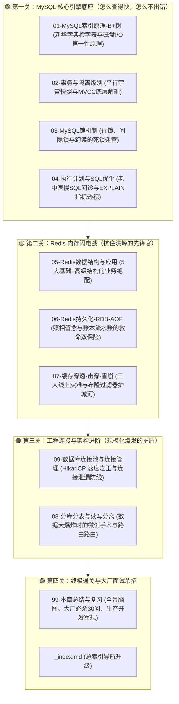

# 🗄️ 00 · 数据库与存储全景与心智模型（双层存储体系全景）

> **一句话导读**：业务代码写得再天花乱坠，只要数据库扛不住，整个系统瞬间归零。掌握关系型数据库（MySQL）与分布式内存缓存（Redis）的“动静结合之道”，你就守住了整个系统性能与数据安全的命脉。

---

## 🏛️ 磁盘持久化（MySQL）与内存缓存（Redis）架构权衡

任何互联网系统的本质，剥离到最底层其实就两个动作：**算力（CPU）与记忆（存储）**。

在海量请求的洪峰面前，计算机硬件的物理规律决定了没有任何一种单一存储介质能同时满足“无限容量、绝对安全落盘、纳秒级读取”：

为了兼顾**性能**与**安全**，现代系统演化出了经典的**“冷热分离、双剑合璧”**架构：

| 存储系统 | 核心技术定位与物理使命 | 架构权衡取舍（Trade-off） | 场景类比说明（辅助理解） |
| :--- | :--- | :--- | :--- |
| **MySQL (关系型数据库)** | **系统事实唯一数据源（Single Source of Truth）**。以 ACID 强事务、MVCC 多版本并发控制与 B+ 树索引为后盾，确保核心数据严格持久化、不可丢失且具备复杂关联查询能力。 | 牺牲了单机极限并发吞吐量（单机并发写受限于磁盘 I/O，通常在数千 TPS 量级）。 | 类比为保底与求真的高可靠金库档案馆 |
| **Redis (内存缓存/键值存储)** | **极速抗洪前置缓存与数据结构服务**。纯内存寻址结合单线程非阻塞 I/O 多路复用，单机轻松抗住 10 万+ QPS 读写，专门应对瞬时并发读取洪峰。 | 牺牲了复杂关系型查询灵活性，需承担内存昂贵成本与双写最终一致性治理开销。 | 类比为极速响应的高频现货取货台 |

---

## 🗺️ 数据库与存储全通关地图（四大核心关卡）

为了让你不再被零散的 SQL 语法和零碎参数搞晕，本章将按**从单机微观到底层引擎，再到分布式架构**的认知规律层层推进：

---

## 🧭 学习指引与心智准备

1. **拒绝死记硬背参数**：我们不背参数，我们要推导“如果让你设计一个磁盘数据库，你为什么也会选 B+ 树？”
2. **带着事故学技术**：每一条性能优化军规（如“严禁左模糊”、“必须建联合索引”、“大事务必须拆分”），背后都是某家大厂几百万甚至上千万的真实线上血泪惨剧。
3. **保持全局链接**：结合前面学过的 [[../03-并发编程/00-并发编程心智模型与学习路线|03-并发编程]] 与 [[../04-Spring生态/03-Spring事务管理|04-Spring事务管理]]，建立完整的数据流全貌。

准备好了吗？让我们进入第一站，揭开 MySQL 查询提速百万倍的基石——[[01-MySQL索引原理-B+树]]！
