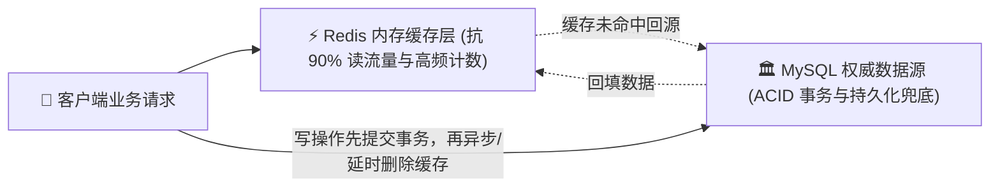
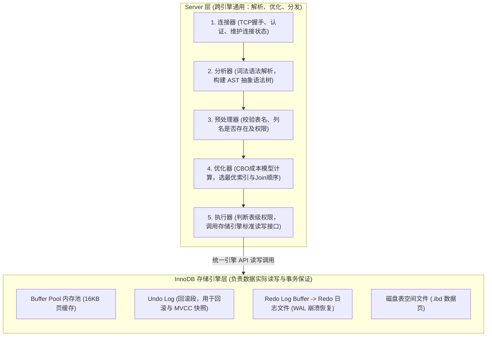
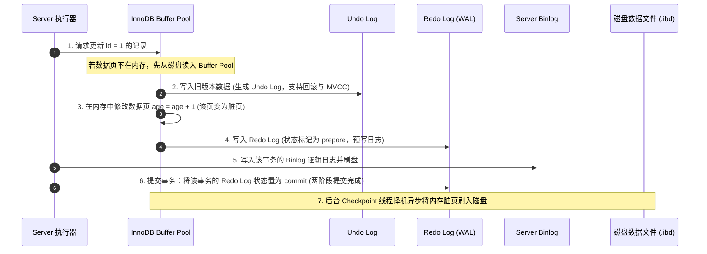
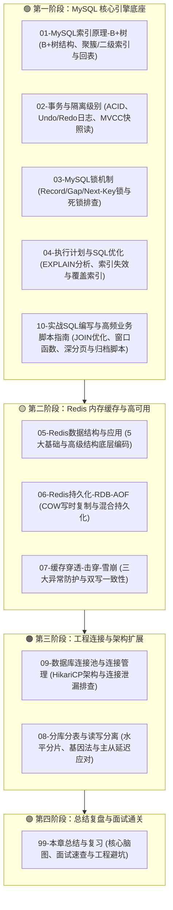

# 🗄️ 00 · 数据库与存储全景与心智模型（双层存储体系与 SQL 执行全链路）

> [!abstract] 一句话第一性原理
> **数据库系统的本质是“在有限的内存与慢速的持久化介质之间，做数据正确性与吞吐延迟的动态权衡”。** 
> 现代高并发后端系统采用 **“MySQL 权威持久化 + Redis 内存高速缓存”** 双层协同架构；而一条 SQL 在 MySQL 内部的生命周期，则是从 **Server 层（连接、语法分析、成本优化、执行调度）** 穿透至 **InnoDB 引擎层（Buffer Pool、Undo/Redo Log、两阶段提交与磁盘刷脏）** 的精密协作流水线。

---

## 🏛️ 一、 关系型数据库（MySQL）与内存缓存（Redis）的架构权衡

### 1. 计算机存储层次结构与物理取舍

| 存储介质 | 访问延迟 | 典型应用 | 设计目标与物理瓶颈 |
| :--- | :--- | :--- | :--- |
| **内存 (RAM)** | $\approx 50 \sim 100 \text{ ns}$ | Redis 数据结构、MySQL Buffer Pool | 极速读写，但断电易失，硬件单价高 |
| **固态硬盘 (SSD)** | $\approx 50 \sim 100\ \mu\text{s}$ | MySQL 数据表空间文件 (`.ibd`)、Redo/Binlog 日志 | 持久化兜底，寻道与随机擦除带来 I/O 瓶颈 |

- **MySQL（InnoDB）**：立足于**权威持久化与 ACID 事务**。通过 $16\text{ KB}$ 数据页管理、B+ 树多级索引、行级并发锁与 MVCC 多版本并发控制，保障高并发下的复杂查询与数据绝对可靠。
- **Redis**：立足于**纯内存高速读写**。采用单线程事件循环无锁设计，配合跳表、哈希表等紧凑内存结构，承接单机 10 万+ QPS 的热点读写与高并发原子操作。

### 2. 双层协同标准模型

---

## ⚡ 二、 核心穿透：一条 SQL 的完整执行链路（高频常考）

理解 MySQL 的第一步，是把散落在各个章节的组件（优化器、索引、Buffer Pool、Redo/Undo/Binlog）像放电影一样完整串联起来。

---

### 1. 查询语句（`SELECT`）全链路拆解

以一条典型查询为例：`SELECT name, age FROM users WHERE user_id = 100;`

1. **连接器（Connectors）**：
   - 客户端建立 TCP 连接，完成账号密码校验与权限读取；
   - 针对当前连接维持一个长连接状态，读取其会话级系统变量。
2. **分析器（Parser）**：
   - **词法分析**：将 SQL 字符串切分为一个个关键字（如识别出 `SELECT` 是查询动作、`users` 是表名、`user_id` 是列名）；
   - **语法分析**：根据 SQL 语法规则校验语句合法性，构建出一棵 **AST（抽象语法树）**。语法有错直接抛出 `You have an error in your SQL syntax`。
3. **预处理器（Preprocessor）**：
   - 校验表名和列名在数据库元数据中是否真实存在；
   - 校验用户对目标表是否具备查询权限。
4. **优化器（Optimizer）**：
   - 面对多个候选索引时，通过 **CBO（基于成本的优化模型）** 估算不同执行路径的 I/O 与 CPU 成本；
   - 决定实际使用哪个索引（如命中聚簇索引还是二级索引），决定多表联查时的驱动表顺序；
   - 最终生成**执行计划**。
5. **执行器（Executor）**：
   - 校验当前操作对该表的执行权限；
   - 根据执行计划，统一调用存储引擎提供的标准接口（如 `read_first_record()` / `read_record()`），循环获取数据行。
6. **InnoDB 引擎层寻址与返回**：
   - **检查 Buffer Pool**：判断包含目标数据的数据页是否已在内存的 Buffer Pool 中；
     - 若命中：直接在内存中读取；
     - 若未命中：发起磁盘 I/O，将目标 $16\text{ KB}$ 数据页从磁盘加载到 Buffer Pool 的 LRU 链表中；
   - **索引寻址**：根据 `user_id = 100` 在 B+ 树上沿非叶子节点定位到叶子节点，读取数据行并返回给执行器；
   - 执行器将结果集汇总通过 Socket 管道流式返回给客户端。

---

### 2. 更新语句（`UPDATE`）全链路与两阶段提交（2PC）

以事务更新语句为例：`UPDATE users SET age = age + 1 WHERE id = 1;`
更新操作的核心任务是：**如何在高性能写入内存的同时，绝对保障数据落盘不丢失且主从复制一致？**

#### 关键机制与经典面试深挖

1. **为什么必须先写 Undo Log？**
   - 保证原子性（A）：事务若主动执行 `ROLLBACK`，可根据 Undo Log 逆向还原数据；
   - 保障隔离性（I）：其他并发事务在 `RR/RC` 级别下执行快照读时，沿着 Undo Log 链条追溯历史快照，实现非阻塞读。
2. **什么是 WAL（Write-Ahead Logging）？**
   - 传统每次修改都直接把数据页刷入磁盘会引发大量随机写，吞吐极低；
   - **WAL 的哲学**：只要先把物理修改按**顺序追加写入（Sequential I/O）** 到 Redo Log 文件中，哪怕内存里的数据页还是脏的、没写进磁盘，更新就算安全完成了！断电后重启通过回放 Redo Log 即可恢复数据。
3. **为什么必须有“两阶段提交（2PC）”？**
   - **Redo Log（InnoDB 物理引擎日志）** 负责单机崩溃恢复（Crash-Safe）；
   - **Binlog（Server 层逻辑日志）** 负责从库主从同步与全量数据恢复。
   - **若不采用两阶段提交的灾难后果**：
     - *先写 Redo 再写 Binlog*：Redo 写完瞬间宕机，重启后主库依 Redo 恢复了更新，但从库根据缺失的 Binlog 无法同步该更新，**主从数据永久不一致**；
     - *先写 Binlog 再写 Redo*：Binlog 写完瞬间宕机，重启后主库因 Redo 缺失判定事务失败回滚，但从库同步了 Binlog 执行了该更新，**从库多出幽灵数据**。
   - **两阶段提交的一致性闭环**：
     崩溃恢复时，InnoDB 检查处于 `prepare` 状态的事务：通过事务的全局唯一标识 **`XID`** 查看 Binlog 中是否存在对应且完整的 Commit Event：若有则自动在 Redo 中 `commit`；若无则自动回滚，确保双日志状态严格对称！

---

## 🗺️ 数据库与存储全体系学习导航

