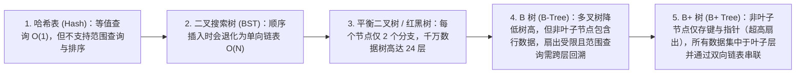
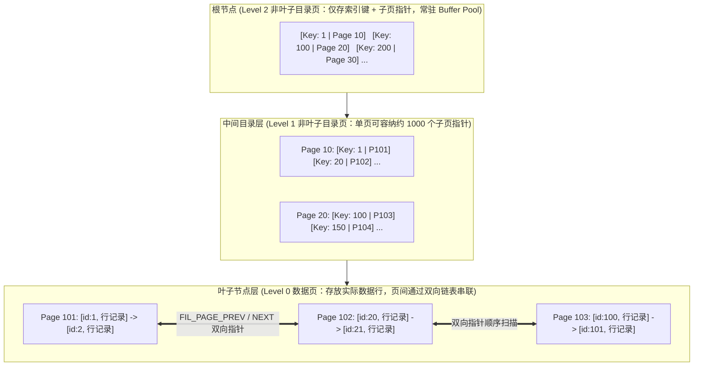
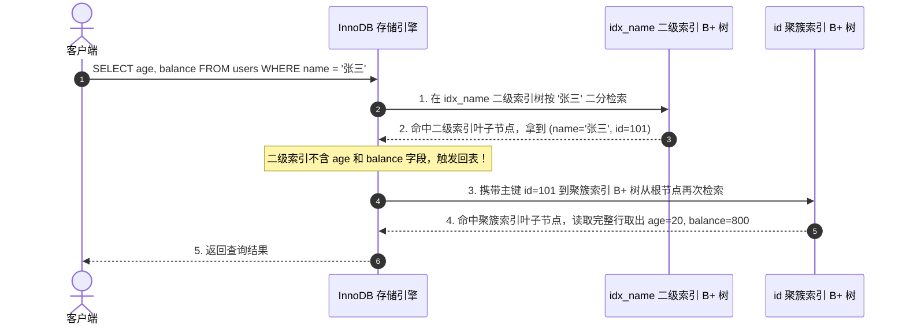
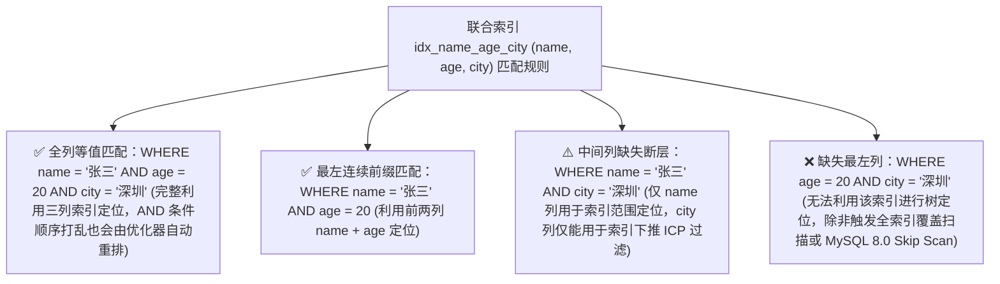

# 🌲 01 · MySQL 索引原理与 B+ 树（索引结构、回表机制与联合索引）

> **一句话导读**：索引通过额外的存储空间与写入维护成本，将随机无序的全表扫描转化为基于有序数据结构的快速定位。深入理解 B+ 树的页组织结构、聚簇索引与二级索引的协同机制，以及联合索引的最左前缀排序原理，是进行数据库设计与 SQL 优化的根基。

---

## 一、为什么数据库需要索引？

当执行按条件查询（如 `SELECT * FROM users WHERE id = 105`）时，是否建立索引决定了存储引擎截然不同的数据检索路径：


> 💡 **索引的核心本质**：
> 索引是存储引擎用于快速定位记录的**排好序的数据结构**。它以额外的磁盘存储空间和增删改时的树结构维护开销为代价，大幅降低查询时的扫描行数与数据页访问次数。

---

## 二、数据结构演进：为什么 InnoDB 选择 B+ 树？

面试高频核心问题：“为什么 MySQL InnoDB 索引不采用哈希表、平衡二叉树（红黑树）或 B 树，而选择 B+ 树？”

评价磁盘数据库索引结构优劣的核心标准有两个：**单次查询需要访问的数据页层级数（决定磁盘随机 I/O 次数上限）** 与 **范围顺序扫描的效率**。



### 1. 哈希表（Hash Index）
- **优势**：通过哈希函数直接计算槽位，单值等值查询（`=`、`IN`）理论时间复杂度为 $O(1)$（InnoDB 内部支持自适应哈希索引 AHI 以加速内存热点页等值访问）。
- **局限**：哈希值完全打乱了键值的原有大小顺序，无法支持范围查询（`>`、`<`、`BETWEEN`）、前缀模糊匹配（`LIKE 'abc%'`）以及 `ORDER BY` 排序，且在大量重复键场景下存在哈希冲突链表遍历开销。

### 2. 平衡二叉树 / 红黑树（AVL / Red-Black Tree）
- **局限**：无论是 AVL 树还是红黑树，每个节点最多只有 **2 个子节点（扇出度为 2）**。当表中存储 $1000\text{ 万}$ 条记录时，二叉树的高达 $\lceil \log_2(10^7) \rceil \approx 24$ 层。由于数据库索引存储在磁盘上并按页读取，若下层节点未命中内存缓存，每深入一层都可能触发一次磁盘随机读取，过高的树深会导致严重的 I/O 延迟。

### 3. B 树（B-Tree）与 B+ 树（B+ Tree）的核心差异
B 树将二叉树改造为**多路平衡查找树**，使单个节点可以容纳多个键值和子指针，从而降低了树的高度。而 **B+ 树**在此基础上针对数据库磁盘页访问与范围查询做了两项关键结构升级：
1. **非叶子节点彻底剥离行数据载荷，实现超高扇出比（Fan-out）**：
   - 在 B 树中，非叶子节点（内部节点）不仅存放索引键和子页指针，还存放对应的数据记录载荷；而 InnoDB 的单个数据页大小固定（默认 $16\text{ KB}$），非叶子节点存入数据载荷后，单页所能容纳的索引键与子指针数量就会大幅减少，导致树高增加。
   - 在 **B+ 树**中，**非叶子节点纯粹作为导航目录，仅存储 `[索引键值 + 下级子页页号指针]`，绝不存储完整行数据**。这让单个 $16\text{ KB}$ 的非叶子节点能够容纳上千个子页指针，仅需 **3~4 层**树高即可管理数千万乃至上亿行数据。
2. **叶子节点处于同一深度并通过双向链表有序连接**：
   - 在 B 树中执行范围查询（如 `WHERE id BETWEEN 10 AND 100`）时，需要在不同层级的内部节点与叶子节点之间反复执行中序遍历回溯；
   - 在 **B+ 树**中，所有数据记录均存放在最底层的叶子节点上，且相邻叶子数据页之间通过头部指针（`FIL_PAGE_PREV` 和 `FIL_PAGE_NEXT`）构成**双向有序链表**。执行范围查询或排序时，只需从根节点二分定位到起始记录所在的叶子页，随后顺着叶子页双向链表直接向后顺序扫描即可。



---

## 三、容量定量推演：一棵 3 层 B+ 树能存多少行数据？

通过 InnoDB 数据页的物理结构进行定量估算，可以直观理解 B+ 树高扇出比带来的容量优势。

### 1. InnoDB 数据页（Page）基础参数
- InnoDB 管理磁盘与内存 Buffer Pool 的基本单位是 **页（Page）**，默认大小为 **`16 KB`（`16384 Bytes`）**。
- 每个数据页除了存放记录本身外，还包含文件页头（File Header 38B）、数据页头（Page Header 56B）、最小与最大伪记录（`Infimum` & `Supremum` 26B）、页目录（Page Directory）以及文件页尾校验（File Trailer 8B）等固定管理开销，实际可用于存储索引项或行记录的空间约为 **`15 KB`** 左右。

### 2. 非叶子节点扇出度（$F$）与叶子节点行数（$R$）估算
1. **非叶子节点（目录页）的扇出度 $F$**：
   - 在聚簇索引的非叶子节点中，每条目录项记录由 **主键键值**（假设采用 `BIGINT`，占 `8 Bytes`）、**子页页号指针**（`Page Number`，占 `4 Bytes`）以及 **记录头信息**（`Record Header`，约 `5 Bytes`）等组成，单条目录项约占 $13 \sim 17\text{ Bytes}$。
   - 因此，单个 $16\text{ KB}$ 的非叶子节点大约可容纳：
     $$F \approx \frac{15\text{ KB}}{15\text{ Bytes}} \approx 1000 \text{ 个子页指针}$$
2. **叶子节点（数据页）的单页记录数 $R$**：
   - 假设业务表平均每行记录（含字段内容、事务隐藏列与记录头）大小约为 **`1 KB`**，则单个 $16\text{ KB}$ 叶子数据页大约可存放：
     $$R \approx \frac{15\text{ KB}}{1\text{ KB}} = 15 \text{ 行记录}$$
   - （若单行字段较少、平均行宽为 $500\text{ Bytes}$，则单页可存放约 $30$ 行记录）。

### 3. 不同树高（$H$）下的聚簇索引容量对照表

| B+ 树高度 $H$ | 树层级结构 | 理论容量计算公式 | 示例承载行数（取 $F=1000, R=15$） |
| :---: | :--- | :--- | :--- |
| **1 层** | 单个根页本身即为叶子数据页 | $R$ | 约 **15 行** |
| **2 层** | 1 个根目录页 $\rightarrow$ $F$ 个叶子页 | $F \times R$ | $1000 \times 15 \approx$ **1.5 万行** |
| **3 层** | 1 个根页 $\rightarrow$ 1 层中间目录页 $\rightarrow$ 叶子页 | $F^2 \times R$ | $1000^2 \times 15 \approx$ **1500 万行**（行宽 500B 时约 3000 万行） |
| **4 层** | 1 个根页 $\rightarrow$ 2 层中间目录页 $\rightarrow$ 叶子页 | $F^3 \times R$ | $1000^3 \times 15 \approx$ **150 亿行** |

> 💡 **工程启示：如何正确看待“单表 2000 万行建议分表”的经验法则？**
> 1. 所谓的“2000 万行”正是源于上述 **3 层 B+ 树（当单行约 $500\text{B}\sim 1\text{KB}$ 时，3 层树容量约在 $1500\text{ 万}\sim 3000\text{ 万}$ 行）** 的理论推算。
> 2. 在生产实践中，**树高并非决定是否分表的唯一硬性指标**：一方面，B+ 树的根节点和上层目录页几乎长期常驻在 InnoDB Buffer Pool 内存中，即使树高从 3 层变为 4 层，增加的通常只是一次内存页寻址而非物理磁盘 I/O；另一方面，真正制约大表性能的是**热数据工作集（Working Set）能否装入 Buffer Pool 内存、Online DDL 变更耗时、备份恢复时长以及单机写 IOPS 上限**。因此，只有当单表容量与并发负载确实超出单机硬件与缓存承载能力时，才需要推进冷热归档或水平分库分表。

---

## 四、聚簇索引 vs 二级索引 与“回表（Table Lookup）”机制

在 InnoDB 中，表数据文件本身就是按 B+ 树组织的一棵索引结构。理解查询性能的关键，在于区分**聚簇索引（Clustered Index）**与**二级索引（Secondary Index，又称辅助索引）**两棵 B+ 树在叶子节点存储内容上的本质差异。

假设有用户表 `users (id PK, name, age, balance)`，其中 `id` 为主键，`name` 上建有普通二级索引 `idx_name(name)`：

### 1. 聚簇索引（主键索引树）
- **生成规则**：
  1. 若表定义了主键（`PRIMARY KEY`），InnoDB 自动使用主键构建聚簇索引；
  2. 若未定义主键，则选择第一个所有列均为 `NOT NULL` 的唯一索引（`UNIQUE KEY`）作为聚簇索引；
  3. 若上述两者均无，InnoDB 会在内部自动生成一个 6 字节的隐藏递增列 `DB_ROW_ID` 构建聚簇索引。
- **物理存储内容**：
  - **非叶子节点**：存储 `[主键 id | 子页页号]`；
  - **叶子节点**：**直接存储完整的业务数据行**（包含 `id, name, age, balance` 以及 MVCC 所需的隐藏列 `DB_TRX_ID` 和 `DB_ROLL_PTR`）。因此，**聚簇索引即数据，数据即聚簇索引**，一张表只能拥有一个聚簇索引。

### 2. 二级索引（辅助索引树，以 `idx_name` 为例）
- **排序规则**：先按索引列 `name` 的字符集排序规则排序；**当多条记录的 `name` 相同时，再按主键值 `id` 从小到大排序**。
- **物理存储内容**：
  - **非叶子节点**：存储 `[索引列 name + 主键 id | 子页页号]`（引入主键 `id` 共同参与非叶子节点比较，是为了在存在大量同名 `'张三'` 记录导致跨页分裂时，能够唯一定位每条记录应当归属的子页）；
  - **叶子节点**：**仅存储 `[索引列值 name + 对应的主键值 id]`**，绝不重复存储整行其他列的数据。

> **第一性原理：为什么二级索引叶子节点只存主键值，而不直接存整行数据或物理地址指针？**
> 1. **节省磁盘与内存空间**：若一张表建有 5 个二级索引且每个索引都存整行数据，表数据存储空间将膨胀 5 倍；
> 2. **降低页分裂时的维护成本（Write Amplification）**：如果二级索引直接保存行的物理磁盘偏移地址，那么每当聚簇索引因插入发生页分裂或行移动时，所有 5 个二级索引树都必须同步修改物理地址指针；而保存逻辑主键值 `id` 后，只要主键不修改，聚簇索引发生页分裂时二级索引完全无需改动。

---

### 3. 核心过程拆解：什么是“回表（Table Lookup）”？

当执行查询 `SELECT age, balance FROM users WHERE name = '张三';` 时，由于二级索引 `idx_name` 的叶子节点上只有 `name` 和 `id`，不包含查询所需的 `age` 和 `balance` 字段，引擎必须分两步走完两棵 B+ 树：



> ⚠️ **回表对查询性能的影响**：
> 在二级索引树上连续相邻的索引项（例如 1000 条 `name = '张三'` 的记录），它们对应的主键 `id`（如 `5, 2048, 89012, 999999`）在聚簇索引上往往是高度离散分布的。每回表一次都需要去聚簇索引定位对应的数据页，当回表行数很大且相关数据页未全部缓存在 Buffer Pool 中时，就会产生大量的**离散随机访问开销**。

---

## 五、消除与减少回表的两大核心利器：覆盖索引与索引下推

### 1. 覆盖索引（Covering Index — 彻底消除回表）
如果将查询语句改为只查询索引中已包含的列，或者建立包含查询所需字段的联合索引（例如建立联合索引 `idx_name_age_balance(name, age, balance)`）：
```sql
SELECT id, age, balance FROM users WHERE name = '张三';
```
- **工作原理**：存储引擎在遍历二级索引叶子节点时，直接就能从二级索引记录中拿到 `name`、`age`、`balance` 和主键 `id` 的全部值，**无需再去聚簇索引执行回表查询**。
- **执行计划标识**：在 `EXPLAIN` 的 `Extra` 列中会明确显示 **`Using index`**。

---

### 2. 索引下推（Index Condition Pushdown, ICP — 大幅减少无效回表）
针对无法完全做成覆盖索引的查询（如 `SELECT *`），MySQL 5.6 引入了 **索引下推（ICP）** 优化。
假设表上建有联合索引 `idx_name_age (name, age)`，执行如下查询：
```sql
SELECT * FROM users WHERE name LIKE '张%' AND age = 20;
```
根据最左前缀原则，`name LIKE '张%'` 属于前缀范围匹配，其右侧的 `age = 20` 无法继续用于 B+ 树缩小区间定位。在有无 ICP 的情况下，执行过程对比如下：


- **执行计划标识**：触发索引下推时，`EXPLAIN` 的 `Extra` 列会显示 **`Using index condition`**。

---

## 六、联合索引物理排序模型与最左前缀原则

为什么联合索引 `(name, age, city)` 必须遵循**最左前缀匹配原则**？为什么范围查询后面的列无法继续使用索引二分定位？从 B+ 树叶子节点的复合排序结构出发，答案一目了然。

### 1. 联合索引在叶子节点中的复合字典序排列
对于联合索引 `INDEX idx_name_age_city (name, age, city)`，InnoDB 会先按第一列 `name` 排序；**只有在 `name` 完全相同的情况下，才按第二列 `age` 升序排列**；只有在 `name` 和 `age` 都相同的情况下，才按第三列 `city` 排序：

| 第一列：`name` | 第二列：`age` | 第三列：`city` | 关联主键：`id` | 排序特征剖析 |
| :--- | :--- | :--- | :--- | :--- |
| **李四** | 19 | 上海 | 102 | 第一列 `name` 全局有序 |
| **李四** | 25 | 北京 | 106 | 在 `name = '李四'` 分组内，`age` (19 $\le$ 25) 局部有序 |
| **张三** | 18 | 北京 | 105 | — |
| **张三** | 20 | 广州 | 101 | 在 `name = '张三'` 分组内，`age` (18 $\le$ 20 $\le$ 20) 局部有序 |
| **张三** | 20 | 深圳 | 104 | 在 `name = '张三' AND age = 20` 分组内，`city` 局部有序 |
| **王五** | 30 | 杭州 | 103 | — |

> 🔍 **第一性原理推导**：
> 1. **第一列全局有序，后续列仅在前序所有列等值固定时才局部有序**：单独看上表的第二列 `age`（`19, 25, 18, 20, 20, 30`），在全局范围内是完全无序的。如果查询条件不带 `name` 而直接查 `WHERE age = 20`，引擎根本无法在树上进行二分查找，这就是**必须从最左列开始匹配**的物理原因。
> 2. **为什么范围查询（`>`、`<`、`BETWEEN`）会截断后续列的索引二分定位？**
>    例如查询 `WHERE name = '张三' AND age > 18 AND city = '深圳'`：
>    - 第一列 `name = '张三'` 是等值条件，在树中精准锁定 `'张三'` 分组，此时分组内的 `age` 是有序的；
>    - 第二列 `age > 18` 是范围条件，可以用二分查找定位到 `age > 18` 的起点，但在 `age > 18` 的结果区间内（可能包含 `age = 19, 20, 25...`），不同 `age` 对应的第三列 `city` 又是散乱无序的，因此 `city = '深圳'` 无法再用于缩小 B+ 树扫描边界，只能退化为扫描区间内的索引下推（ICP）过滤。

### 2. 联合索引匹配规则速查图



---

## 七、生产环境 6 大高频索引失效场景与改写规范

| 序号 | 索引失效场景 | 反面慢 SQL 示例 | 底层失效根因 | 正面优化写法 |
| :---: | :--- | :--- | :--- | :--- |
| **1** | **在索引列上做函数或算术运算** | `WHERE id + 1 = 10`<br/>`WHERE DATE(create_time) = '2026-09-01'` | B+ 树中保存的是索引列的原始值，对列施加函数或表达式后破坏了原有单调有序关系，无法直接按结果值二分查找。 | 将计算移至等号右侧常量端：<br/>`WHERE id = 9`<br/>`WHERE create_time >= '2026-09-01 00:00:00' AND create_time < '2026-09-02 00:00:00'` |
| **2** | **隐式类型转换**（字符串列传数字） | `WHERE phone = 13800138000`<br/>（`phone` 定义为 `varchar`） | MySQL 在比较字符串与数字时，会将字符串列转换为浮点数，等价于 `WHERE CAST(phone AS DOUBLE) = 13800138000`，即在索引列上套了函数。 | 严格保持参数类型与列定义一致：<br/>`WHERE phone = '13800138000'` |
| **3** | **前导通配符模糊查询** | `WHERE name LIKE '%张三'`<br/>`WHERE name LIKE '%张三%'` | 字符串按从左到右的字符顺序排列，以 `%` 开头缺失了确定的前缀字符，无法在 B+ 树中确定检索区间起点。 | 改用右模糊前缀匹配 `LIKE '张三%'`；确需全模糊检索时使用覆盖索引或引入 Elasticsearch 倒排索引。 |
| **4** | **违背联合索引最左前缀** | 索引为 `(a, b, c)`<br/>查询 `WHERE b = 1 AND c = 2` | 缺少第一排序列 `a`，后续列 `b, c` 在全局范围内无序，无法从根节点逐层导航定位。 | 在查询条件中补齐最左列 `a`，或根据高频查询新建以 `b` 开头的索引。 |
| **5** | **`OR` 连接包含无索引列** | `WHERE id = 1 OR age = 20`<br/>（`id` 有索引，`age` 无索引） | 只要 `OR` 的任一分支没有索引，引擎为了找出满足该分支的记录就不得不扫描全表，导致另一分支的索引也失去意义。 | 为 `age` 列也建立索引（触发 `index_merge` 索引合并），或拆分为两条索引查询 `UNION`。 |
| **6** | **筛选比例过大触发优化器回表放弃** | `WHERE status > 0`<br/>（表中 $90\%$ 的记录都满足条件） | 优化器评估发现走二级索引需要离散回表读取绝大多数数据页，总成本高于直接顺序扫描聚簇索引，因而主动选择全表扫描。 | 结合更高区分度的条件联合过滤，或通过覆盖索引避免回表。 |

---

## 🧠 一分钟复盘核心记忆卡

1. **为什么选 B+ 树**：非叶子节点不存行数据，令单个 $16\text{ KB}$ 页具备上千扇出度，3~4 层即可容纳千万至亿级数据；叶子节点通过双向链表串联，范围扫描与顺序排序效率极高。
2. **聚簇索引 vs 二级索引**：聚簇索引叶子节点存完整数据行；二级索引叶子节点存 `[索引列值 + 主键 ID]`。查询非覆盖列时需拿主键 ID 回聚簇索引检索（**回表**）。
3. **两大回表优化**：**覆盖索引**（`Using index`，所需字段全在二级索引中，零回表）与 **索引下推 ICP**（`Using index condition`，在二级索引遍历时提前过滤后续条件，减少无效回表）。
4. **联合索引铁律**：遵循**最左前缀原则**；第一列全局有序，后续列仅在前序所有列等值固定时局部有序，遇到范围条件会截断后续列的 B+ 树二分定位。

---

## 🧭 下一步

索引解决了单次查询的高效检索问题。而在高并发读写场景下，多个客户端同时读写同一批数据时，MySQL 如何通过 ACID 事务、隔离级别、Undo Log 版本链以及 MVCC 实现读写互不阻塞的一致性视图？
请进入下一篇：[[02-事务与隔离级别]]！
