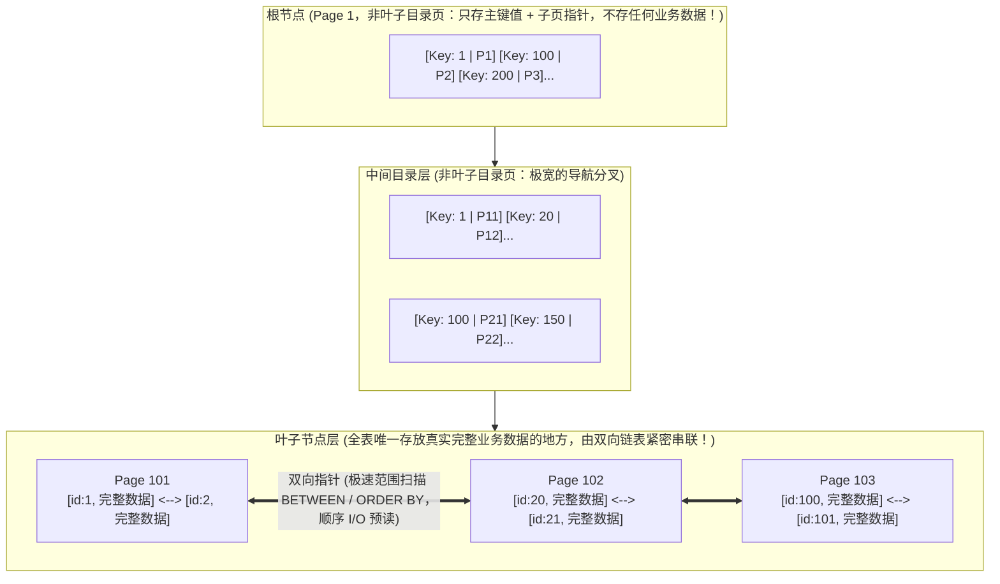
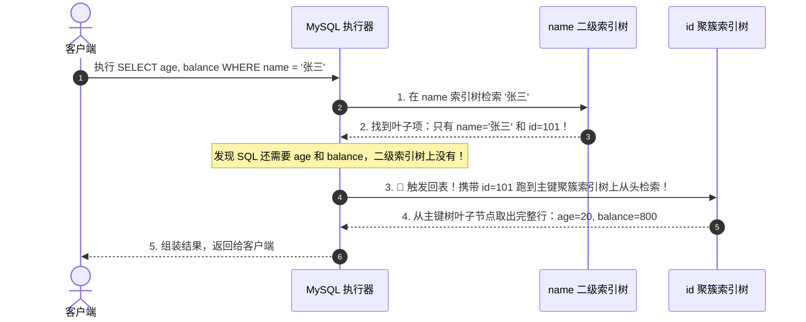
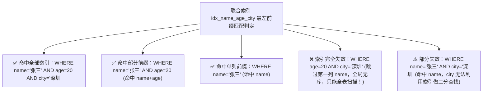

# 🌲 01 · MySQL 索引原理与 B+ 树（新华字典检索与磁盘 I/O 的数学奇迹）

> **一句话导读**：一张拥有 2000 万行数据的订单表，不加索引查询需要全表扫描 20 秒，加了索引只需 2 毫秒，提速整整 1 万倍！索引的本质就是一本**“新华字典的拼音与部首检字表”**。搞懂 B+ 树从磁盘 I/O 出发的第一性原理推导，你就彻底掌握了数据库调优的终极钥匙。

---

## 一、为什么 B+ 树是关系型数据库的最佳索引结构？

想象你手里拿着一本 2000 页的《新华字典》，现在要查一个汉字“**龙**”：


> 💡 **索引的核心本质**：
> 索引是一种**排好序的快速查找数据结构**。它用额外的磁盘存储空间和写入维护成本，换取读取性能质的飞跃。

---

## 二、第一性原理推导：为什么必须是 B+ 树？（淘汰赛全过程）

面试官最喜欢问：“为什么 MySQL 的 InnoDB 引擎不用哈希表、二叉树、红黑树或 B 树，非要选 B+ 树？”

让我们站在数据库架构师的视角，打一场**数据结构大淘汰赛**：


### 1. 淘汰选手一：哈希表（Hash）
- **优点**：按 Key 单点等值查找极快，时间复杂度 $O(1)$。
- **致命弱点**：**完全无法支持范围查询（`WHERE age BETWEEN 20 AND 30`）或排序（`ORDER BY`）！** 哈希计算后的槽位是无序离散的，查范围只能无脑全表扫描。

### 2. 淘汰选手二：平衡二叉树 / 红黑树
- **核心死穴：树太高了，磁盘物理寻道开销极大！**
- 计算机在磁盘读写数据时，**物理磁盘寻道一次通常需要 5~10 毫秒**，这是数据库最昂贵的物理开销。
- 如果表里有 1000 万数据，二叉树的高度至少在 $\log_2(10000000) \approx 24$ 层。这意味着查一条数据，必须沿着指针做 **24 次磁盘 I/O 寻道**（$24 \times 10\text{ms} = 240\text{ms}$），并发稍微一高数据库就会彻底卡死！

### 3. 淘汰选手三：B 树（B-Tree）
- B 树把“二叉”改成了“多叉（几十上百叉）”，大幅压低了树的高度。
- **致命弱点 1：每个节点都塞满整行数据，单页分叉数太少**：
  - InnoDB 每次读写磁盘都是以**“页（Page，默认 16KB）”**为基本物理单位。
  - B 树的每一个节点（无论是根节点还是中间目录节点），都同时存了【索引值 + 整行完整数据】。如果一行数据占用 1KB，一个 16KB 的页只能存 16 个节点，分叉太少，导致树的高度依然无法压到最低。
- **致命弱点 2：范围查询体验极差**：
  - B 树的数据分散在整棵树的各个节点中，要做范围扫描（如 `BETWEEN 10 AND 100`），必须在树的上下层级之间反复做中序遍历与递归回溯，引发大量磁盘随机 I/O。

---

### 🏆 终极王者：B+ 树的精妙架构（矮胖之王）

InnoDB 的 **B+ 树** 针对现代计算机磁盘与缓存特性，做出了两项震撼的结构改造：



1. **非叶子节点纯索引化（极大化分支因子 Fan-out）**：
   - 所有的根节点和中间目录节点**只存主键 Key 和子页指针 Pointer，绝对不存任何一行真实业务数据**。这使得单个 16KB 的目录页能容纳超过 1000 个指针分叉，树变得极其“矮胖”！
2. **叶子节点双向链表化（顺序 I/O 降维打击）**：
   - 全表所有的真实数据都统一沉淀在最底层的叶子节点中，且叶子节点之间通过**双向链表**两两相连并天然排好序。
   - 做范围查询时，只需在树上做一次二分定位找到起点，随后直接顺着底层链表做物理顺序读取（Sequential I/O），完美契合操作系统的磁盘预读机制！

---

## 三、数学算给你看：B+ 树到底能存多少条数据？（容量极限推演）

很多人只知道“B+ 树矮胖”，但它究竟能存多少条数据？为什么业界普遍把“2000 万行”视为单表分库分表的分水岭？

让我们用最纯粹的数学公式进行第一性原理推导：

### 1. 物理基础：什么是“页（Page）”？
- 在 InnoDB 存储引擎中，内存与磁盘交互的**最小物理单位叫做“页（Page）”**，默认大小固定为 **`16 KB`（即 16384 字节）**。
- 无论是根节点、目录节点、还是叶子节点，在磁盘上本质上全都是一个个独立的 16KB 数据页。

---

### 2. 节点容量精确拆解

#### ① 非叶子节点（目录页）：能放多少个“子节点指针”？
很多初学者误以为非叶子节点“只存下一层页的物理地址指针”。**这是绝对不可能的！**
- 如果非叶子节点里只有一堆光秃秃的指针 `[P1, P2, P3...]`，当你要查找 `id = 150` 时，**你根本不知道 150 应该往 P1、P2 还是 P3 走！**
- 计算机在树上查找数据依赖的是**二分查找（Binary Search）**，必须有明确的“数据区间路标（Key）”。
- 因此，非叶子节点里的每一项，都必须由 **`[路标主键值 Key + 子页指针 Pointer]`** 成对绑定组成，称为一个**目录项（Directory Record）**：

```text
┌─────────────────────────────────────────────────────────────────────────────┐
│                       【非叶子节点（目录页，16KB）】                         │
│                                                                             │
│   ┌──────────────┐   ┌──────────────┐   ┌──────────────┐                    │
│   │ 主键: 1      │   │ 主键: 100    │   │ 主键: 200    │                    │
│   │ 指针: 指向P1 │   │ 指针: 指向P2 │   │ 指针: 指向P3 │   ... 约 1170 组   │
│   └──────┬───────┘   └──────┬───────┘   └──────┬───────┘                    │
└──────────┼──────────────────┼──────────────────┼────────────────────────────┘
           ▼                  ▼                  ▼
     ┌───────────┐      ┌───────────┐      ┌───────────┐
     │ Page 1    │      │ Page 2    │      │ Page 3    │
     │ 存放主键   │      │ 存放主键   │      │ 存放主键   │
     │ 1~99 的行 │      │ 100~199行 │      │ 200~299行 │
     └───────────┘      └───────────┘      └───────────┘
```

- **主键值（Key）**：通常使用 `BIGINT` 类型，占用 **`8 字节`**；
- **子页指针（Pointer）**：InnoDB 源码中用于寻址下一层物理页的指针，占用 **`6 字节`**（由 4 字节的物理页号 `FIL_PAGE_OFFSET` + 2 字节的页内偏移量组成）；
- **单个目录项占用空间** = $8\text{B (主键)} + 6\text{B (指针)} = \mathbf{14\text{ 字节}}$。

一个 16KB 的非叶子数据页，扣除页面头部、尾部及槽位等系统元数据（约占用 1KB），纯数据区约为 15KB：
$$\text{单个目录页指针数（分叉数）} \approx \frac{16 \times 1024\text{ 字节}}{14\text{ 字节}} \approx 1170\text{ 个分叉}$$

> 💡 **核心结论**：一个目录项对应一个子页指针，因此一个非叶子节点能产生大约 **1170 个分支**！

---

#### ② 叶子节点（数据页）：一个叶子页能放多少行真实数据？
叶子节点是真正存放全表完整业务数据的地方。
- 假设我们的业务表字段不算特别大，**单行记录平均占用 `1 KB`**（包含各类 varchar、int、datetime 等）；
- 一个 16KB 的叶子数据页扣除元数据后，大约能容纳：
$$\text{单个叶子页记录数} \approx \frac{16\text{KB}}{1\text{KB}} \approx 16\text{ 行数据}$$

---

### 3. 逐层推演：B+ 树高度与数据容量阶梯表

| 树高 ($H$) | 结构层级拆解 | 计算公式 | 理论承载数据总量 |
| :---: | :--- | :--- | :--- |
| **1 层** (仅根页) | 根节点本身就是叶子数据页 | $1 \times 16$ | **16 行** |
| **2 层** | 1 个根目录页（1170 个指针）<br/>➔ 指向 1170 个叶子数据页 | $1170 \times 16$ | **约 1.8 万行** ($18,720$) |
| **3 层** | 1 个根目录页（1170 个指针）<br/>➔ 1170 个二级目录页（每页 1170 个指针）<br/>➔ 指向 $1170 \times 1170 \approx 136.8$ 万个叶子页 | $1170 \times 1170 \times 16$ | **约 2190 万行** ($21,902,400$) |
| **4 层** | 1 个根目录页 ➔ 1170 个二级目录页 ➔ 136.8 万个三级目录页 ➔ 16 亿个叶子页 | $1170 \times 1170 \times 1170 \times 16$ | **约 256 亿行** |

---

### 4. 深度揭秘：为什么阿里规范推荐单表不要超过 2000 万行？

根据上面的数学模型，答案一目了然：
1. **2000 万以内极速的原因**：
   - 数据量在 2190 万以内时，**B+ 树的高度只有 3 层**！
   - 检索全表任意一行数据，**最多只需 3 次磁盘 I/O**。而且因为根节点和第二层目录节点访问极度频繁，它们会长期热点常驻在 MySQL 的 **Buffer Pool 内存缓冲区**中，**物理磁盘寻道往往仅需 1 次**！
2. **超过 2000 万性能产生拐点的原因**：
   - 一旦表数据突破 2190 万，B+ 树必须分裂为 **4 层**；
   - 树高增加一层，每次查询就必须多做一次磁盘 I/O；
   - **致命痛点**：第 3 层的目录页多达 **136.8 万个**，占用了将近 $136.8\text{万} \times 16\text{KB} \approx 21.8\text{ GB}$ 的存储空间！服务器的内存 Buffer Pool 根本不可能全缓存下，导致每次查找目录项都会发生物理磁盘随机 I/O，数据库查询延迟会呈断崖式下跌。
   - 这就是大厂在单表达到 **500万~2000万行**（或表容量超过 20GB）时，坚决推进分库分表的核心物理根源！

---

## 四、聚簇索引 vs 二级索引 与“回表”（物理双树并排图解）

为什么很多开发者分不清二级索引和回表？因为脑海中缺乏**两棵独立的物理 B+ 树**的具象对比！

假设有一张用户表：`users(id PK, name, age, balance)`，其中 `id` 为主键，`name` 建立了普通二级索引：

```text
┌─────────────────────────────────────────────────────────┐     ┌─────────────────────────────────────────────────────────┐
│              【主键索引树（聚簇索引）】                   │     │           【name 普通索引树（二级索引）】                 │
│                 以 primary id 排序                      │     │                 先按 name 排序，再按 id 排序            │
├─────────────────────────────────────────────────────────┤     ├─────────────────────────────────────────────────────────┤
│ 非叶子目录项：只存 [ id | 下级子页指针 ]                 │     │ 非叶子目录项：存 [ name, id | 下级子页指针 ] (带主键仲裁)│
├─────────────────────────────────────────────────────────┤     ├─────────────────────────────────────────────────────────┤
│ 叶子数据项：                                            │     │ 叶子数据项：                                            │
│ 💥 存放【整行完整数据】：                               │     │ 🚨 只存放【当前索引列值 + 对应的主键 id】：             │
│   id = 101 ➔ [ name='张三', age=20, balance=800 ]       │     │   name = '李四', id = 102 ➔ [ id=102 ]                   │
│   id = 102 ➔ [ name='李四', age=25, balance=1200 ]      │     │   name = '张三', id = 101 ➔ [ id=101 ]                   │
│   id = 103 ➔ [ name='王五', age=30, balance=3000 ]      │     │   name = '王五', id = 103 ➔ [ id=103 ]                   │
└─────────────────────────────────────────────────────────┘     └─────────────────────────────────────────────────────────┘
```

### 1. 第一性原理思考：为什么二级索引的叶子节点不存整行数据？
- **空间冗余**：如果一张表建了 5 个二级索引，每个索引叶子都存整行数据，全表数据就在磁盘上拷贝了 5 份，磁盘空间迅速爆炸；
- **写入放大（Write Amplification）**：每次执行 `UPDATE` 修改一个字段，MySQL 必须把这 5 棵索引树的叶子节点全都更新一遍，加锁冲突和磁盘写入会当场瘫痪！
- **权衡折中**：二级索引叶子**只存主键 id**，用极小的空间开销换取快速定位主键的能力。

---

### 2. 🔥 大厂内核深度追问：二级索引的非叶子节点到底存不存主键？

> **绝大多数网文只知道“二级索引叶子节点存主键”，却不知道非叶子节点到底存不存主键。**
> **大厂内核级真相：对于非唯一的二级索引，其非叶子节点中也必须存放主键 ID！**

#### 为什么非唯一二级索引的非叶子节点必须存主键？
思考一个极端场景：
- 假设表里有 1000 万条数据，其中叫“**张三**”的用户有整整 **10 万个**！
- 如果非叶子节点**只存放索引列 `[ name | 指针 ]`**，那么非叶子节点的所有目录项都会变成：
  `[ '张三' | P1 ]`, `[ '张三' | P2 ]`, `[ '张三' | P3 ]`, `[ '张三' | P4 ]`...
- 此时新插入一条记录：`name = '张三', id = 88888`。
- MySQL 拿着 `'张三'` 在非叶子节点做二分查找：**所有的路标全叫“张三”，完全一模一样！MySQL 根本不知道这个新记录该塞到 P1、P2 还是 P3 里面去！B+ 树的二分查找当场瘫痪！**

#### InnoDB 的精妙设计：主键作为天然仲裁者
为了彻底杜绝索引列值重复导致的无序与二分迷失：
- **普通（非唯一）二级索引**：在非叶子节点中，目录项物理结构强制为 **`[ 索引列值, 主键 ID, 子页指针 ]`**；
- **排序规则**：**先按索引列排序；若索引列值相同，则强制按【主键 ID】升序排序！**
- 这样就保证了整棵 B+ 树上每一个目录项在逻辑上**绝对唯一、严格有序**，二分查找永远精准！

> 🌟 **核心架构结论**：
> 在 InnoDB 底层，**非唯一二级索引本质上就是一个把主键追加在末尾的隐式联合索引 `(index_column, primary_key)`**！
> *(注：只有当二级索引被声明为 **唯一索引（Unique Index）** 时，由于索引列值已全局唯一，非叶子节点才无需存储主键。)*

---

### 3. 逐帧拆解：什么是“回表（Table Lookup）”？

当用户执行如下查询时：
```sql
SELECT age, balance FROM users WHERE name = '张三';
```



> ⚠️ **回表的代价为什么极高？**
> 二级索引树查出的记录虽然在 `name` 上是有序的，但它们对应的**主键 `id` 往往是离散杂乱的**（如查出 1000 个张三，id 分别是 5、2048、999999）。
> 这意味着回表需要在聚簇索引上做 **1000 次分散的磁盘随机 I/O**！在没有优化的情况下，性能会甚至慢于全表顺序扫描。

---

## 五、破解回表的两大神技：覆盖索引与索引下推

为了避免昂贵的回表开销，MySQL 提供了两项强大的优化机制：

### 1. 覆盖索引（Covering Index - 根治回表）
如果业务查询语句改为：
```sql
SELECT id, name FROM users WHERE name = '张三';
```
- **核心原理**：在遍历 `name` 二级索引树的叶子节点时，里面正好就存着 `name='张三'` 和 `id=101`！
- **就地结案**：查询所需的所有字段，在当前二级索引树上**全部齐活（已覆盖）**！
- **0 回表！无需跑去主键树二次查找，直接在二级索引树就地返回结果！**
- 执行计划 `EXPLAIN` 的 `Extra` 列会显示 **`Using index`**，性能提升数倍至数十倍。

---

### 2. 索引下推（ICP, Index Condition Pushdown - 减少无效回表）
在 MySQL 5.6+ 引入。假设联合索引为 `(name, age)`，查询语句为：
```sql
SELECT * FROM users WHERE name LIKE '张%' AND age = 20;
```


- 执行计划 `EXPLAIN` 的 `Extra` 列会显示 **`Using index condition`**。

---

## 六、联合索引物理存储模型与最左前缀匹配原则

很多人记“最左匹配原则”靠死记硬背口诀，只要看到底层多列数据在叶子节点里的物理排布，想忘都忘不掉！

假设我们建立了三列联合索引：`INDEX idx_name_age_city (name, age, city)`：

### 1. 联合索引在叶子节点中的真实物理排布表

| name (第一排序列) | age (第二排序列) | city (第三排序列) | 对应主键 id |
| :--- | :--- | :--- | :--- |
| **张三** | 18 | 北京 | 105 |
| **张三** | 20 | 广州 | 101 |
| **张三** | 20 | 深圳 | 104 |
| **李四** | 19 | 上海 | 102 |
| **李四** | 25 | 北京 | 106 |
| **王五** | 30 | 杭州 | 103 |

> 🔍 **第一性原理观察**：
> 1. **`name` 列在全局绝对有序**：张三 ➔ 李四 ➔ 王五；
> 2. **`age` 列全局无序，局部有序**：只有在 `name` 相同（都是张三）的情况下，`age` 才是按 18、20、20 排好序的！如果把 `name` 遮住，整列的 age（18, 20, 20, 19, 25, 30）在全局上是**毫无规律的散乱数据**！
> 3. **`city` 列同理**：只有在 `name` 和 `age` 都相同的前提下，`city` 才有局部排序。

---

### 2. 最左匹配判定规律



> 🚨 **生产铁律：范围查询会阻断后续列使用索引！**
> `WHERE name = '张三' AND age > 20 AND city = '北京'`
> - `name = '张三'`：走索引定位；
> - `age > 20`：走索引范围筛选；
> - **`city = '北京'`：无法再利用索引！** 因为在 `age > 20` 这个开区间内，包含李四、王五等不同人的数据，后面的 `city` 在全局上失去了有序性，索引二分检索在此彻底截断！

---

## 七、大厂面试高频：生产级 6 大索引失效陷阱速查

写 SQL 时即便建了索引，也经常因为不规范的写法导致索引失效。以下 6 大陷阱是大厂面试与线上慢 SQL 排查的必考考点：

| 失效场景 | 错误 SQL 示范 | 索引失效底层根因 | 正确优化写法 |
| :--- | :--- | :--- | :--- |
| **1. 索引列做运算或函数** | `WHERE id + 1 = 10`<br/>`WHERE SUBSTR(name, 1, 3) = 'abc'` | 索引树上存的是原始列值，一旦加了函数计算，整个树上的有序性全被破坏，优化器无法走二分查找。 | `WHERE id = 9`<br/>`WHERE name LIKE 'abc%'` |
| **2. 隐式类型转换** | `WHERE phone = 13800000000`<br/>(phone 字段定义为 varchar) | 字符串与数字比较时，MySQL 会隐式调用 `CAST(phone AS signed)` 函数，再次触发函数失效陷阱！ | `WHERE phone = '13800000000'` (显式加单引号) |
| **3. 前导模糊查询** | `WHERE name LIKE '%三'` | 后缀模糊（`LIKE '张%'`）可以走前缀有序查找；前导通配符（`%三`）导致完全失去前缀排序规律。 | 改用 ES / 倒排索引，或覆盖索引就地扫描。 |
| **4. 违背最左前缀** | 联合索引 `(a, b, c)`<br/>`WHERE b = 1 AND c = 2` | 缺少首列引导字段，后续字段在全局是无序的，无法使用索引定位。 | 调整查询条件或根据业务查询重新建复合索引。 |
| **5. OR 条件未全覆盖** | `WHERE id = 1 OR age = 20`<br/>(仅 id 有索引，age 无索引) | 因为 age 无论如何都要全表扫描，优化器索性放弃 id 索引，直接做全表扫描。 | 涉及 OR 的每一列都必须独立建索引，或改用 `UNION ALL`。 |
| **6. 优化器成本估算反转** | `WHERE age > 1`<br/>(表中 99% 的数据 age 都大于 1) | 优化器评估发现需要回表的数据量过大，直接全表顺序扫描的成本（Cost）反而远低于大量离散随机回表。 | 提高查询过滤精度，或建覆盖索引消灭回表。 |

---

## 🧠 一分钟复盘核心记忆卡

1. **结构胜出**：B+ 树“矮胖多叉”，非叶子节点纯放索引导航，叶子节点双向链表存数据；千万级表仅需 3 层，通常只需 1~3 次 I/O 搞定。
2. **容量极限**：按页大小 16KB、主键 8B、指针 6B 计算，非叶子页可放 1170 个指针；3 层 B+ 树极限容量约 **2190 万行**，超过后裂变为 4 层会导致 I/O 和内存开销剧增。
3. **两类索引**：聚簇索引叶子存整行，二级索引叶子存主键；查未包含列会触发**离散随机回表**。
4. **两大神技**：高频查询利用**覆盖索引**消灭回表；利用**索引下推（ICP）**在存储引擎层就地下沉过滤，腰斩无效回表。
5. **最左原则**：联合索引在底层是自左向右局部有序；范围查询会斩断后续列的索引使用。

---

## 🧭 下一步

知道了数据在磁盘上是怎么排好序高速读取的，当成百上千个事务并发写入、修改同一行数据时，MySQL 是如何保证数据不串台、不发生脏读和超卖的？
请进入第二站：[[02-事务与隔离级别]]！
