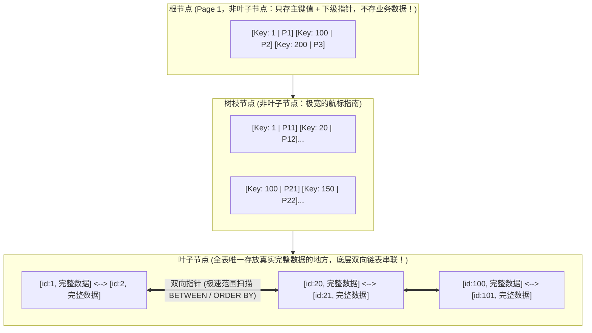
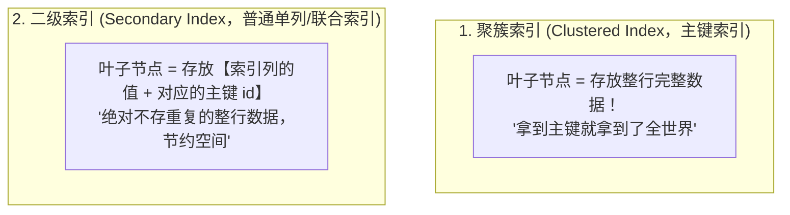
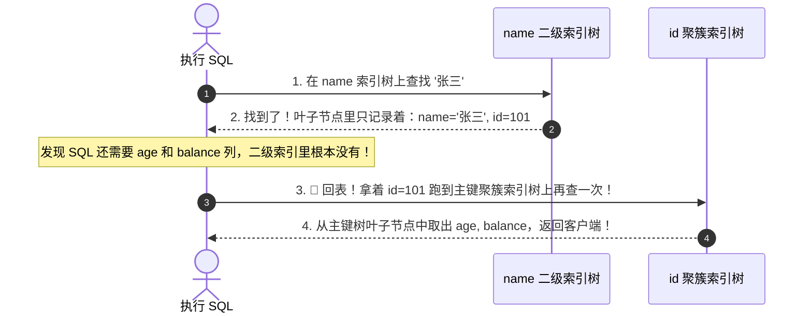
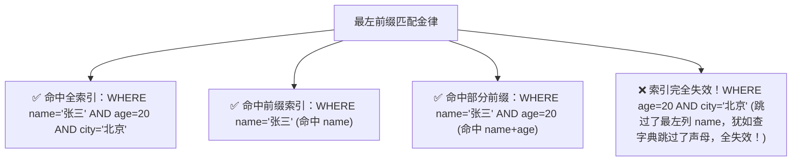

# 🌲 01 · MySQL 索引原理与 B+ 树（新华字典检索与磁盘 I/O 的数学奇迹）

> **一句话导读**：一张拥有 2000 万行数据的订单表，不加索引查询需要全表扫描 20 秒，加了索引只需 2 毫秒，提速整整 1 万倍！索引的本质就是一本**“新华字典的拼音与部首检字表”**。搞懂 B+ 树从磁盘 I/O 出发的第一性原理推导，你就彻底掌握了数据库调优的终极钥匙。

---

## 📖 为什么 B+ 树是关系型数据库的最佳索引结构？

想象你手里拿着一本 2000 页的《新华字典》，现在要查一个汉字“**龙**”：


> 💡 **索引的核心本质**：
> 索引是一种**排好序的快速查找数据结构**。它用额外的磁盘存储空间和写入维护成本，换取读取性能质的飞跃。

---

## 🔬 第一性原理推导：为什么必须是 B+ 树？（淘汰赛全过程）

面试官最喜欢问：“为什么 MySQL 的 InnoDB 引擎不用哈希表、二叉树、红黑树或 B 树，非要选 B+ 树？”

让我们站在数据库架构师的视角，打一场**数据结构大淘汰赛**：


### 1. 淘汰选手一：哈希表（Hash）
- **优点**：按 Key 单点查找极快，时间复杂度 $O(1)$。
- **致命弱点**：**完全无法支持范围查询（`WHERE age BETWEEN 20 AND 30`）或排序（`ORDER BY`）！** 哈希计算后的槽位是无序散列的，查范围只能无脑全表扫描。

### 2. 淘汰选手二：平衡二叉树 / 红黑树
- **核心死穴：树太高了！**
- 计算机在磁盘读写数据时，**物理磁盘寻道一次通常需要 5~10 毫秒**，这是数据库最昂贵的物理开销。
- 如果表里有 1000 万数据，二叉树的高度至少在 $\log_2(10000000) \approx 24$ 层。这意味着查一条数据，必须沿着指针做 **24 次磁盘 I/O 寻道**（$24 \times 10\text{ms} = 240\text{ms}$），慢如蜗牛！

### 3. 淘汰选手三：B 树（B-Tree）
- B 树把“二叉”改成了“多叉（几十上百叉）”，大幅压低了树的高度。
- **致命缺点**：**B 树的每一个节点（无论是根、树枝还是叶子），都同时存了【索引值 + 整行完整数据】！**
- 操作系统和 InnoDB 每次读磁盘都是按一个**“页（Page，默认 16KB）”**为最小单位读入内存。如果每个节点都要装整行大数据，一个 16KB 的页根本塞不下几个节点，导致树的高度依然无法压到最低。

---

### 🏆 终极王者：B+ 树的精妙架构（矮胖之王）

InnoDB 的 **B+ 树** 针对现代计算机磁盘特性，做出了两项震撼的革命性改造：



#### 💡 B+ 树为什么神？数学算给你看：
1. **非叶子节点只存索引 Key 和下级指针**：
   - 假设主键是 `BIGINT`（占 8 字节），指针占 6 字节，一组约为 14 字节；
   - 一个 16KB 的数据页，可以容纳：$16 \times 1024 \div 14 \approx 1170$ 个索引项！
2. **两层树能存多少？**
   - 假设叶子节点一条真实业务数据占 1KB，一个叶子页能存 16 条；
   - 2 层的 B+ 树可以存放：$1170 \times 16 \approx 18720$ 条数据。
3. **三层的 B+ 树能存多少？**
   - 根节点 1170 个项 $\times$ 第二层 1170 个项 $\times$ 叶子节点 16 条 $\approx$ **2190 万条数据！**

> 🌟 **震撼的第一性原理结论**：
> **在一张超过 2000 万行的大表里，B+ 树的高度仅仅只有 3 层！**
> 查任何一条数据，从根节点定位到叶子节点，**只需要做 3 次磁盘 I/O**！配合根节点和上层节点常驻内存缓存，真正物理寻道甚至只需 1 次！这就是 MySQL 毫秒级查询的数学秘密！

---

## 🗂️ 聚簇索引 vs 二级索引（非聚簇索引）与“回表”

在 InnoDB 中，索引分为两大阵营：



### 🚨 什么是“回表”？
假设有一张用户表：`id (主键), name (普通索引), age, balance`。

当你执行查询：
```sql
SELECT age, balance FROM users WHERE name = '张三';
```



> ⚠️ **回表的代价**：
> 相当于查了两次 B+ 树！如果命中了 10000 行记录，就要做 10000 次随机回表 I/O，性能极其低下！

---

## 🛡️ 破解回表的两大神技：覆盖索引与索引下推

### 1. 覆盖索引（Covering Index - 🌟 大厂军规推荐）
如果你把查询改为：
```sql
SELECT id, name FROM users WHERE name = '张三';
```
- 因为在 `name` 二级索引的叶子节点里，**正好同时包含 `name` 和 `id`！**
- 查询所需要的所有列，直接在当前二级索引树上就已经全部齐活了！
- **无需回表！直接就地返回！速度提升数倍！**（EXPLAIN 中的 Extra 会显示 `Using index`）。

### 2. 索引下推（ICP, Index Condition Pushdown）
在 MySQL 5.6+ 引入：
假设联合索引为 `(name, age)`，查询语句为：
`SELECT * FROM users WHERE name LIKE '张%' AND age = 20;`
- **旧版方式**：存储引擎在二级索引里找到所有姓“张”的记录的主键 id，无脑全部回表查整行；查出整行后再由 Server 层判断 `age` 是否等于 20；
- **索引下推**：存储引擎在遍历二级索引树时，**顺手直接判断 `age = 20`**，只有条件完全符合的才去回表！大幅腰斩了无意义的回表次数！

---

## 🏹 最左前缀匹配原则：新华字典的拼音拼读规律

假设我们建立了一个联合索引：`INDEX idx_name_age_city (name, age, city)`。

它的内部组织，就像按拼音查字典：**先按声母排序，声母相同的按韵母排序，韵母也相同的再按声调排序**。



> 🚨 **生产红线：范围查询会阻断后续索引的使用！**
> `WHERE name = '张三' AND age > 20 AND city = '北京'`
> - `name` 走索引；
> - `age > 20` 走索引；
> - **`city` 无法再走索引！** 因为在 `age` 是范围区间的情况下，后面的 `city` 在全局上是无序的，索引利用在此截断！

---

## 🧠 一分钟复盘核心记忆卡

1. **结构本质**：B+ 树“矮胖多叉”，非叶子节点纯放索引导航，叶子节点双向链表存数据；千万级表仅需 3 层，3 次 I/O 搞定。
2. **两类索引**：聚簇索引叶子存整行，二级索引叶子存主键；要查非索引列会触发**回表**。
3. **性能神技**：高频查询利用**覆盖索引**（`SELECT 索引列`）消灭回表；利用**联合索引最左匹配**原则设计索引。

---

## 🧭 下一步

知道了数据在磁盘上是怎么排好序高速读取的，当成百上千个事务并发写入、修改同一行数据时，MySQL 是如何保证数据不串台、不发生脏读和超卖的？
请进入第二站：[[02-事务与隔离级别]]！
