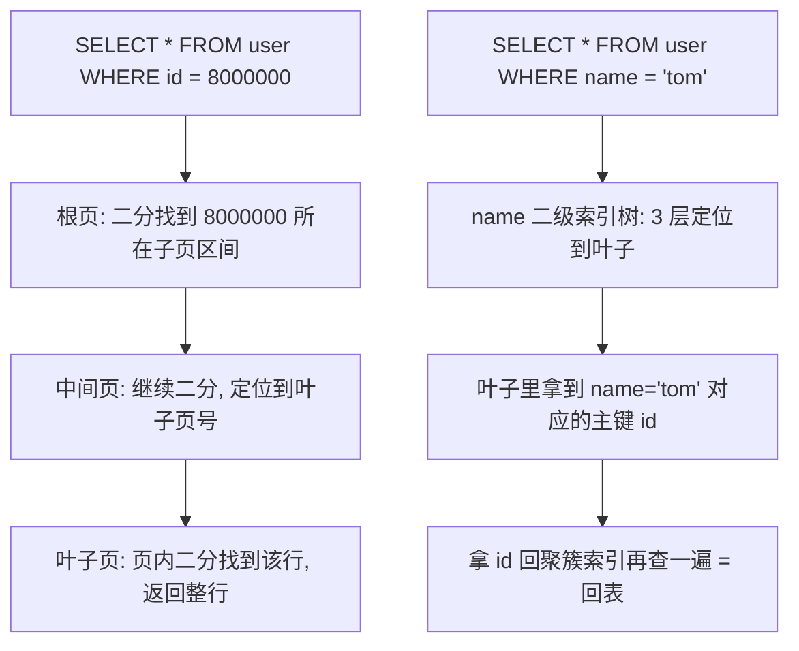

# MySQL索引原理-B+树

> [!abstract] 一句话总结
> InnoDB 用 B+ 树把数据按主键组织成"3 层楼就能装下 2000 万行"的有序结构，查一行只要 3 次磁盘 IO；索引优化的本质就是让 SQL 的查找条件能顺着这棵树"逐层定位"，而不是"逐页翻书"。

## 🗣️ 白话版（先建立直觉）

把数据库表想象成一座**图书馆**：

- **没有索引** = 图书馆的书随便堆。你要找《高性能 MySQL》，只能一排排书架挨个翻（全表扫描），100 万本书就得翻 100 万次。
- **聚簇索引** = 整个图书馆按书号排好，书本身就插在对应位置的书架上。你拿着书号，先看楼层索引牌（根节点）→ 再看书架区域牌（中间节点）→ 直接走到那本书面前（叶子节点就是书本身）。三步到位。
- **二级索引** = 按"作者名"编的一本小册子，册子里只写"作者 → 书号"。你先在册子里查到书号，**再拿书号去主书架取书**——这个"再跑一趟"就是**回表**。
- **覆盖索引** = 你只想知道某作者写过哪些书号，小册子上直接就有，不用去书架了——省掉回表。
- **最左前缀** = 字典按"姓氏 → 名字"排序。你知道姓"张"，能快速翻到张姓区域；但只知道名叫"伟"，对不起，全字典的"伟"散落在张伟、李伟、王伟各处，字典的排序帮不了你——这就是联合索引必须从最左列开始用的原因。

## 📌 这是什么

B+ 树是 InnoDB 组织数据和索引的多叉平衡树：**非叶子节点只存"键 + 指针"用来导航，所有真实数据只放在叶子节点，叶子之间用双向链表串起来**。每个节点就是一个 16KB 的数据页（InnoDB 读写磁盘的最小单位）。

它和普通二叉树的核心区别：二叉树一个节点只有 2 个分叉，100 万数据要 20 层、20 次 IO；B+ 树一个节点能分出上千个叉（扇出大），同样数据 3 层就够，3 次 IO。**索引优化的一切结论都能从"这是一棵按键有序、扇出巨大的树"推出来。**

## 🤔 解决什么问题 / 为什么需要

没有索引，任何查询都是全表扫描：表越大越慢，1 亿行的表一条 `WHERE id = 5` 也要扫 1 亿行。数据在磁盘上，每次随机 IO 约 0.1~10ms，扫描百万页的耗时是灾难性的。

为什么不用别的结构？

- **哈希表**：等值查询 O(1) 很快，但不支持范围查询（`WHERE age > 20`）和排序——哈希把顺序打乱了。
- **二叉/红黑树**：有序，但每个节点太小，树太高，IO 次数太多。
- **B 树**（注意不是 B+ 树）：非叶子节点也存数据行，导致每个节点能放的键变少 → 扇出变小 → 树变高；且范围查询要中序遍历回跳，不如链表顺序扫。
- **B+ 树**：非叶子节点只存键不存数据 → 扇出极大、树矮 → IO 少；叶子链表 → 范围扫描和排序天然高效。这就是 MySQL 的选择。

## 🧩 核心概念

| 概念 | 含义 | 精通要点 |
| ---- | ---- | ---- |
| 数据页 Page | InnoDB 磁盘读写最小单位，默认 16KB | 一个节点 = 一页；页内记录按键有序，有页目录支持页内二分查找 |
| 聚簇索引 | 按主键组织的 B+ 树，**叶子节点就是完整数据行** | 一张表只有一棵；主键应短、递增、不更新（否则页分裂 + 二级索引全部变大） |
| 二级索引 | 按普通列组织的 B+ 树，叶子只存"索引列 + 主键值" | 查其他列需要拿主键回聚簇索引再查一次 |
| 回表 | 二级索引查到主键后，回聚簇索引取整行 | 每次回表是一次额外的 B+ 树查找；回表次数多时优化器可能干脆放弃索引 |
| 最左前缀 | 联合索引 (a,b,c) 按 a 排序、a 相同按 b、再按 c | 跳过 a 直接查 b，数据在树里不连续，无法定位 |
| 覆盖索引 | 查询的所有列都在二级索引里 | 不用回表，EXPLAIN 显示 `Using index` |
| 页分裂 | 页满了插入新记录，要拆成两页 | 随机主键（如 UUID）导致频繁分裂 + 空间碎片，这是推荐自增主键的原因 |

## ⚙️ 工作原理 / 流程

### 1. 一个节点为什么能有上千个分叉

关键设计：**非叶子节点不存数据行，只存"键 + 子页指针"**。

来算一笔账（经典面试推算，背下来）：

- 一页 16KB = 16384 字节
- 非叶子节点每个索引项 = 主键 bigint **8 字节** + 页指针 **6 字节** = 14 字节
- 一页能放的索引项 ≈ 16384 / 14 ≈ **1170 个**

也就是说，一个非叶子节点能指向 1170 个子页——这就是"扇出大"。对比二叉树的扇出 2，差了近 600 倍。

### 2. 三层 B+ 树能存多少行

- 叶子节点存的是完整数据行，假设一行约 1KB，一个叶子页存 16384 / 1024 ≈ **16 行**
- 2 层：1170 个叶子页 × 16 行 ≈ **1.87 万行**
- 3 层：1170 × 1170 × 16 ≈ **2190 万行**

结论：**一张 2000 万行的表，B+ 树只有 3 层，按主键查任意一行最多 3 次 IO**（根页常驻内存时实际更少）。这也是"单表建议不超过 2000 万行"这条经验的由来——超过后树要长到 4 层，每次查询多一次 IO。

### 3. 一次查询怎么走



每一层都是"读一页进内存 → 页内二分查找 → 顺指针下一层"。范围查询（`WHERE id BETWEEN 100 AND 900`）则先定位到 100 所在叶子页，然后**顺着叶子链表向右扫**到 900 为止，不需要回到上层。

### 4. 最左前缀为什么是"必须"而不是"建议"

联合索引 `(a, b)` 在树里的排序规则是：**先按 a 排，a 相同的记录内部再按 b 排**。例如：

```text
(1,3) (1,5) (2,1) (2,4) (3,2) (3,9)
```

- 查 `a=2`：所有 a=2 的记录连续存放，能定位 ✅
- 查 `a=2 AND b=4`：a=2 区间内 b 有序，能继续定位 ✅
- 只查 `b=4`：b=4 的记录散落在 a=1、a=2、a=3 各个区间里，**全局无序**，树帮不上忙 ❌
- 查 `a>1 AND b=4`：a 用了范围之后，命中的多个 a 区间里 b 各自有序但整体无序，b 只能逐条过滤，不能定位 ⚠️

这不是 MySQL 的"规定"，而是**排序结构的数学必然**——就像字典里跳过姓氏直接找名字。

## 🆚 从坏到好（对比案例）

**场景**：订单表 `t_order` 500 万行，`phone` 列是 `VARCHAR` 且已建索引，查询却慢得离谱。

**坏写法 1：索引列上用函数**

```sql
SELECT * FROM t_order WHERE DATE(create_time) = '2026-07-25';
```

**坏写法 2：隐式类型转换**

```sql
-- phone 是 VARCHAR，却传了数字
SELECT * FROM t_order WHERE phone = 13800001234;
```

**EXPLAIN 一看就露馅：**

```text
type: ALL      ← 全表扫描，最差的访问类型
key: NULL      ← 没有用上任何索引
rows: 4980000  ← 预估要扫近 500 万行
Extra: Using where
```

**为什么不行**：B+ 树按"列的原始值"排序。`DATE(create_time)` 的结果、`CAST(phone AS DECIMAL)` 的结果都不是树里排好序的那个值，MySQL 必须把每一行取出来算一遍才能比较——树的有序性作废。隐式转换的规则是**字符串转数字**，所以数字字面量会导致对 `phone` 列做转换，索引失效（反过来"数字列 = 字符串字面量"则不影响索引）。

**好写法：让索引列"裸奔"，把计算挪到等号右边**

```sql
SELECT * FROM t_order
WHERE create_time >= '2026-07-25 00:00:00'
  AND create_time <  '2026-07-26 00:00:00';

SELECT * FROM t_order WHERE phone = '13800001234';  -- 类型对齐
```

**改写后的 EXPLAIN：**

```text
type: range              ← 索引范围扫描（phone 等值则是 ref）
key: idx_create_time     ← 用上了索引
rows: 8500               ← 500 万 → 8500，扫描量降 3 个数量级
Extra: Using index condition
```

## 💻 代码实践

```sql
-- 1. 建表：自增主键（聚簇索引自动建立）
CREATE TABLE t_order (
    id          BIGINT AUTO_INCREMENT PRIMARY KEY,
    user_id     BIGINT       NOT NULL,
    status      VARCHAR(16)  NOT NULL,
    amount      DECIMAL(10,2) NOT NULL,
    phone       VARCHAR(20)  NOT NULL,
    create_time DATETIME     NOT NULL DEFAULT CURRENT_TIMESTAMP
) ENGINE=InnoDB;

-- 2. 联合索引：等值列在前、排序/范围列在后
CREATE INDEX idx_user_status_time ON t_order(user_id, status, create_time);

-- 3. 验证：走索引 + 覆盖索引（只查索引里有的列，Extra 出现 Using index）
EXPLAIN SELECT user_id, status, create_time
FROM t_order
WHERE user_id = 1001 AND status = 'PAID'
ORDER BY create_time DESC LIMIT 20;

-- 4. MySQL 8：看真实执行耗时而非估算
EXPLAIN ANALYZE SELECT * FROM t_order WHERE user_id = 1001 AND status = 'PAID';
```

**EXPLAIN 关键列速查表：**

| 列 | 含义 | 怎么看 |
| ---- | ---- | ---- |
| type | 访问类型 | 好→差：`const` > `eq_ref` > `ref` > `range` > `index` > `ALL`；线上出现 `ALL` 基本就是事故预备役 |
| key | 实际使用的索引 | `NULL` = 没用索引；和 possible_keys 对比看优化器的选择 |
| key_len | 索引使用的字节数 | 判断联合索引用了几列（如 bigint 8 + varchar(16)*4+2 = 用了前两列） |
| rows | 预估扫描行数 | 数量级比精确值重要；几十万以上要警惕 |
| filtered | 过滤后剩余比例 | rows × filtered% ≈ 真正返回的行数 |
| Extra | 附加信息 | `Using index` = 覆盖索引（好）；`Using filesort` = 额外排序（考虑索引顺序）；`Using temporary` = 临时表（差） |

> 完整实验脚本见下方最小验证。

## 🧪 最小验证（10 分钟，做一遍才算学会）

**目标**：亲眼看到索引把查询从"几百毫秒"打到"零点几毫秒"。

```sql
-- ① 造 10 万行测试数据（约 1 分钟）
CREATE TABLE t_bench (
    id BIGINT AUTO_INCREMENT PRIMARY KEY,
    user_id BIGINT NOT NULL,
    remark VARCHAR(64)
) ENGINE=InnoDB;

INSERT INTO t_bench(user_id, remark)
WITH RECURSIVE seq AS (
    SELECT 1 AS n UNION ALL SELECT n + 1 FROM seq WHERE n < 100000
)
SELECT FLOOR(RAND() * 1000000), CONCAT('row-', n) FROM seq;
-- 若报递归深度错误，先执行: SET SESSION cte_max_recursion_depth = 100001;

-- ② 无索引查询：记录耗时 + EXPLAIN
SELECT * FROM t_bench WHERE user_id = 424242;          -- 预期几十~几百 ms
EXPLAIN SELECT * FROM t_bench WHERE user_id = 424242;  -- 预期 type=ALL, rows≈10万

-- ③ 建索引后再查
CREATE INDEX idx_user ON t_bench(user_id);
SELECT * FROM t_bench WHERE user_id = 424242;          -- 预期 <1 ms
EXPLAIN SELECT * FROM t_bench WHERE user_id = 424242;  -- 预期 type=ref, key=idx_user, rows=个位数

-- ④ 亲手复现"索引失效"
EXPLAIN SELECT * FROM t_bench WHERE user_id + 1 = 424243;  -- 又变回 ALL 了
```

**预期结论**：rows 从 10 万 → 个位数；④ 里仅仅加了个 `+1` 索引就失效——函数/表达式毁索引，眼见为实。

## ⚠️ 踩坑与注意事项

- **坑 1：UUID 当主键** → 插入位置随机，页频繁分裂、缓存命中率低、二级索引膨胀 → 用自增 ID 或有序的雪花 ID。
- **坑 2：`LIKE '%abc'` 前导模糊** → 前缀不确定无法在树上定位 → 改 `LIKE 'abc%'`，或上全文索引/ES。
- **坑 3：低选择性列建索引**（如性别） → 命中一半数据，回表成本高于全表扫，优化器直接放弃 → 别建，或纳入联合索引。
- **坑 4：大偏移分页** `LIMIT 1000000, 20` → 扫描并丢弃前 100 万行 → 游标分页：`WHERE id > 上次最大id LIMIT 20`。
- **坑 5：索引不是越多越好** → 每个索引是一棵独立的树，写入时全部都要维护，还挤占 Buffer Pool → 优先联合索引替代多个单列索引。

## 🧠 自测题（先自己答，再展开对答案）

> [!question]- Q1: 为什么 B+ 树的非叶子节点不存数据？如果存了会怎样？
> 参考答案：非叶子节点只存"键 + 指针"（约 14 字节/项），16KB 页能放约 1170 项，扇出巨大，3 层就能索引 2000 万行。如果像 B 树那样在非叶子节点也存数据行（1KB 级别），一页只能放约 16 项，扇出骤降，同样数据量树会高很多层，每多一层就多一次磁盘 IO。此外数据全在叶子层 + 叶子链表，才能保证范围扫描一路顺序读，不用在树上来回跳。

> [!question]- Q2: 场景题——联合索引 (user_id, status, create_time)，SQL 是 `WHERE user_id=1 AND create_time>'2026-07-01'`，索引能用到哪一层？为什么？怎么优化？
> 参考答案：只能用到 user_id 这一列做定位。因为树的排序是"user_id 相同 → 按 status 排 → status 相同 → 按 create_time 排"，跳过了 status，create_time 在 user_id=1 的区间内是按 status 分段有序、整体无序的，只能逐条过滤（或借助索引条件下推 ICP 在索引层过滤，减少回表）。优化：若 status 取值有限可改写为 `status IN (...)` 凑齐最左前缀；或按查询模式另建 (user_id, create_time) 索引。

> [!question]- Q3: 什么时候"有索引反而更慢"？说出至少两种情况。
> 参考答案：① 低选择性查询：命中比例太高（如 30% 的行），走二级索引意味着大量随机回表 IO，还不如全表顺序扫描，优化器通常会自己放弃，但统计信息过期时可能选错。② 写多读少的表：每次 INSERT/UPDATE 都要维护所有索引树，索引越多写放大越严重。③ 强制走了错误索引（FORCE INDEX 或统计信息误导），扫描区间比全表还大。核心判断标准：随机回表 IO 总成本 vs 顺序全扫成本。

## 🎯 面试问题

> [!question] Q: 为什么 MySQL 索引用 B+ 树而不是哈希 / 红黑树 / B 树？
> **30 秒版**：因为 B+ 树扇出大、树矮（2000 万行只要 3 层、3 次 IO），且叶子有序链表天然支持范围查询和排序；哈希不支持范围，红黑树太高 IO 太多，B 树非叶子存数据导致扇出小。
> **2 分钟版**：从磁盘 IO 出发推导——InnoDB 按 16KB 页读写，目标是最少的页访问次数。哈希表等值 O(1) 但范围/排序完全无能。红黑树是二叉的，100 万数据 20 层 = 20 次 IO。B 树非叶子节点存整行数据，一页只能放十几项，树高下不来。B+ 树非叶子只存键+指针，一页放约 1170 项（16KB / (8B主键+6B指针)），三层可存 1170×1170×16 ≈ 2000 万行；数据全在叶子且叶子间有双向链表，范围扫描定位一次后顺链走即可。可补一句：根页和高层页基本常驻 Buffer Pool，实际磁盘 IO 往往少于 3 次。

> [!question] Q: 聚簇索引和二级索引的区别？什么是回表？
> **30 秒版**：聚簇索引叶子存整行数据，表本身就是这棵树，一表一棵；二级索引叶子只存"索引列 + 主键"，查其他列要拿主键回聚簇索引再查一次，这就是回表。
> **2 分钟版**：展开三点。① 回表 = 多走一遍 3 层 B+ 树，且是随机 IO，命中行数多时成本剧增，优化器可能因此放弃索引。② 消除回表的手段是覆盖索引——把查询列都放进联合索引，EXPLAIN 的 Extra 出现 `Using index`；列表页/导出类查询特别适合。③ 因为二级索引叶子存主键值，主键越长所有二级索引越胖，所以主键要短且递增——这一条把"为什么不用 UUID 做主键"也串起来了。

> [!question] Q: 哪些写法会让索引失效？
> **30 秒版**：索引列上用函数或运算、隐式类型转换、前导模糊 `LIKE '%x'`、不满足最左前缀、范围查询之后的列，以及优化器基于成本主动放弃（低选择性）。
> **2 分钟版**：统一的解释框架是——**B+ 树按列的原始值排序，任何让"比较值"偏离"存储值"的写法都会作废树的有序性**。函数/运算改变了值本身；VARCHAR 列与数字比较时 MySQL 把字符串转数字（相当于对索引列套函数）；前导模糊丢失了前缀，无法定位起点；联合索引跳过左列则目标值全局散落。最后强调"失效"分两种：结构上不可用（前几种）和成本上不划算（选择性差、回表太多，优化器算完账放弃），排查时用 EXPLAIN 看 type/key/rows，MySQL 8 可加 EXPLAIN ANALYZE 或 optimizer_trace 看优化器的成本决策。

## 🪝 记忆钩子

- **数字锚点**："**16K 一页，1170 个叉，3 层 2000 万，3 次 IO**"——面试推算题的全部答案就这一串数字。
- **一句口诀**："**非叶只导航，数据全在叶，叶叶手拉手**"——B+ 树三大特征（扇出大、聚簇存储、范围扫描）全在里面。
- **脑内画面**：图书馆找书三步走（楼层牌 → 书架牌 → 书）；查作者小册子后还得跑一趟书架 = 回表；字典跳过姓找名 = 违反最左前缀。
- **失效判断一句话**："**索引列一化妆（函数/转换/运算），B+ 树就不认识它了**"。

## 🔗 关联笔记

- [[_index]]
- [[20-Java后端/00-总览/学习仪表盘]]
- [[../02-JVM/01-JVM内存区域]]（同样是"结构决定性能"的思路：页/区/段 对应 堆的分代布局）

## 📚 参考资料

- MySQL Reference Manual: Optimization and Indexes
- 《High Performance MySQL》（高性能 MySQL）第 3 版第 5 章
- 《MySQL 技术内幕：InnoDB 存储引擎》第 4、5 章
