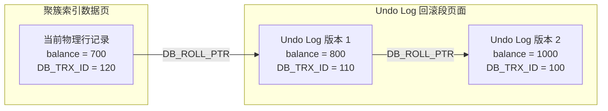

# 02 · 数据库事务 ACID 与 MVCC 多版本并发控制底层实现

> **导读**：在关系型数据库管理系统（RDBMS）中，保证并发访问下的数据一致性与高吞吐量是存储引擎的核心任务。MySQL InnoDB 存储引擎通过 Write-Ahead Logging（WAL）机制保障持久性与原子性，并通过结合多版本并发控制（MVCC）与锁机制实现高隔离性与非阻塞读取。本文深入剖析 ACID 特性的物理日志支撑、三大并发异常现象、SQL 标准四大隔离级别的底层边界、InnoDB 隐藏列与 Undo Log 回滚段架构、ReadView 可见性算法，以及快照读与当前读在幻读防御上的本质差异。

---

## 一、事务 ACID 特性与底层物理日志支撑

事务（Transaction）是数据库执行并发控制与故障恢复的最小逻辑工作单元。一个符合工业级标准的事务必须严格满足 ACID 四大核心属性：

- **原子性（Atomicity）**：由 **Undo Log（回滚日志）** 支撑。在修改物理页前记录反向操作，当事务异常或主动回滚时执行逆向补偿。
- **持久性（Durability）**：由 **Redo Log（重做日志）与 WAL 策略** 支撑。数据变更先顺序写入 Redo Log 刷盘，脏页异步延迟刷盘，宕机时通过 Redo Log 前滚重放（Crash Recovery）。
- **隔离性（Isolation）**：由 **MVCC 多版本并发控制（快照读）与锁机制（当前读）** 协同支撑。通过历史版本链实现非阻塞读写，结合行锁与间隙锁防范写写冲突。
- **一致性（Consistency）**：**事务追求的终极业务目标**。由原子性、持久性、隔离性（AID）共同作为底层技术支撑，结合应用层业务逻辑校验，确保数据完整性与业务守恒规则成立。

| ACID 属性 | 核心定义与要求 | 底层存储引擎物理实现原理 |
| :--- | :--- | :--- |
| **原子性（Atomicity）** | 事务中包含的所有数据库操作要么全量持久化成功，要么全量回滚撤销至操作前的原始状态。 | **Undo Log（回滚日志）**：在对聚簇索引记录进行修改前，先在 Undo Log 页面中写入逆向补偿记录（如 `INSERT` 记录对应的主键 `DELETE`，`UPDATE` 记录被修改字段的旧值）。事务主动回滚或系统发生错误时，逆序执行 Undo Log 恢复数据。 |
| **持久性（Durability）** | 事务一旦提交（Commit），其对数据库中数据的物理修改必须永久保存，即使遭遇突然断电或系统崩溃亦不可丢失。 | **Redo Log（重做日志）与 WAL 策略**：InnoDB 采用预写日志（Write-Ahead Logging）机制。事务提交时仅保证 Redo Log 顺序刷盘（`fsync`），数据脏页可异步延迟刷新到数据文件（ibd）。若系统宕机，重启时通过 Redo Log 执行前滚重放（Crash Recovery）。 |
| **隔离性（Isolation）** | 多个并发事务在同时对相同的数据集进行读写操作时，其内部操作状态与中间修改数据相互隔离，防范并发干扰。 | **MVCC + 锁系统**：针对普通查询采用 MVCC 机制构建历史版本快照，实现“读不加锁、读写并行”；针对增删改及显式锁定查询采用行级锁（Record Lock、Gap Lock、Next-Key Lock）防范并发修改冲突。 |
| **一致性（Consistency）** | 事务执行前后，数据库的完整性约束（实体完整性、参照完整性及业务守恒规则）必须完全满足，数据从一个合法状态跃迁至另一个合法状态。 | 一致性是事务追求的**终极业务目标**。AID 是数据库系统提供的技术保障手段，结合上层应用合理的业务校验共同确保一致性。 |

---

## 二、并发事务三大异象与 SQL 标准隔离级别

当数据库允许多个事务在无隔离或低隔离状态下并发运行时，会产生三种经典的数据一致性破损异象：

### 1. 并发访问三大异象

1. **脏读（Dirty Read）**：
   - **现象**：事务读取到了其他并发事务已修改、但**尚未提交（Uncommitted）**的中间状态数据。
   - **危害**：若该并发事务随后发生异常或主动回滚，当前事务读取到的数据在物理磁盘上从未合法存在过，业务基于虚假数据进行决策将产生严重错账。
2. **不可重复读（Non-Repeatable Read）**：
   - **现象**：在同一事务内多次读取同一行记录，由于其他并发事务在中途提交了 **`UPDATE` 或 `DELETE`**，导致前后两次读取到的**字段数值不一致**或记录离奇消失。
   - **关注重点**：核心是**已有记录的修改或删除（同一行数据的值变了）**。
3. **幻读（Phantom Read）**：
   - **现象**：在同一事务内按特定范围条件多次检索，由于其他并发事务在中途提交了 **`INSERT`**，导致后一次范围查询**凭空多出了符合条件的几行数据**（犹如产生幻影）。
   - **关注重点**：核心是**新增记录（行数变了）**。即便通过行锁锁住了已有数据行，并发事务仍可能在记录间隙中插入新行。

### 2. SQL-92 标准隔离级别矩阵与 InnoDB 特性

| 隔离级别 | 脏读防范 | 不可重复读防范 | 幻读防范 | InnoDB 核心底层实现机制 | 生产级选型建议 |
| :--- | :---: | :---: | :---: | :--- | :--- |
| **读未提交（Read Uncommitted）** | ❌ 发生 | ❌ 发生 | ❌ 发生 | 读取聚簇索引物理页的最新数据，不生成 MVCC ReadView，不施加锁保护。 | 存在致命脏数据风险，**生产环境绝对禁止**。 |
| **读已提交（Read Committed, RC）** | ✅ 杜绝 | ❌ 发生 | ❌ 发生 | **在事务内每次执行普通 SELECT 时均重新生成一个最新的 ReadView**。写操作使用记录锁（无 Gap 锁）。 | **互联网大厂高并发推荐**。减少锁范围，显著降低死锁概率，提升高并发吞吐。 |
| **可重复读（Repeatable Read, RR）** | ✅ 杜绝 | ✅ 杜绝 | 🌟 基本杜绝 | **在事务内仅在第一次执行 SELECT 时生成 ReadView，后续查询持续复用**。写操作默认采用 Next-Key Lock。 | **MySQL InnoDB 默认级别**。快照读依托 MVCC、当前读依托 Next-Key Lock 防范幻读。 |
| **串行化（Serializable）** | ✅ 杜绝 | ✅ 杜绝 | ✅ 杜绝 | 读写操作完全排他串行化。隐式将所有普通 `SELECT` 转换为 `SELECT ... FOR SHARE` 施加共享锁。 | 并发吞吐断崖式下跌，仅在极少数特种审计业务中使用。 |

---

## 三、MVCC 核心底层三基石：隐藏列、Undo Log 与 ReadView

多版本并发控制（Multi-Version Concurrency Control）是 InnoDB 解决并发读写冲突的核心方案。其技术本质是：**利用历史版本链保存数据的历史快照，使只读事务无需加锁即可读取到一致性的历史版本，彻底消除读写互斥**。

### 1. 基石一：InnoDB 记录级隐藏系统列
在 InnoDB 的聚簇索引中，每个数据行除了包含开发者定义的业务字段外，底层固定追加三个隐藏列：

| 隐藏列名称 | 物理字节长 | 核心语义与底层作用 |
| :--- | :---: | :--- |
| **`DB_TRX_ID`** | 6 Bytes | 记录最近一次创建、更新或逻辑删除该行记录的**事务 ID**（单调递增的全局整数）。 |
| **`DB_ROLL_PTR`** | 7 Bytes | **回滚指针（Roll Pointer）**，写入 Rollback Segment 中 Undo Log 对应历史版本的物理地址指针。 |
| **`DB_ROW_ID`** | 6 Bytes | 隐式聚簇索引主键。当表没有定义主键且无非空唯一索引时，由 InnoDB 自动维护生成的递增主键 ID。 |

### 2. 基石二：Undo Log 版本链与 Purge 回收机制
当一条记录被频繁并发修改时，历史数据不会被物理覆盖，而是被序列化推入 Undo Log 页面中，通过每一行的 `DB_ROLL_PTR` 向上逆向串联成一条**从最新版本到最老版本的单向链表**：

- **聚簇索引物理页（最新行数据）**：`balance = 700`，`DB_TRX_ID = 120`，其 `DB_ROLL_PTR` ➔ 指向 Undo Log 版本 1；
- **Undo Log 回滚段（历史版本 1）**：`balance = 800`，`DB_TRX_ID = 110`，其 `DB_ROLL_PTR` ➔ 指向 Undo Log 版本 2；
- **Undo Log 回滚段（历史版本 2 / 基线版本）**：`balance = 1000`，`DB_TRX_ID = 100`，其 `DB_ROLL_PTR` ➔ `NULL`（链表终点）。



> [!NOTE] Undo Log 版本链的物理垃圾回收（Purge 机制）
> 随着事务提交，Undo Log 不会无限膨胀。InnoDB 内部的后台线程 **`purge thread`** 会定期扫描系统中的活跃事务 ReadView。**一旦某条 Undo Log 的版本过老，确认其已低于系统中所有活跃 ReadView 的可见范围时，Purge 线程会将其从回滚段中物理移除并回收存储空间。**

---

## 四、ReadView 结构与一致性可见性判定算法

当事务执行普通快照读（`SELECT`）时，InnoDB 会在当前事务内存中创建或复用一个一致性视图——**`ReadView`**。

### 1. ReadView 四大核心字段
```cpp
class ReadView {
    trx_id_t m_low_limit_id;   // 系统即将分配给下一个事务的 ID，即当前全局已分配最大事务 ID + 1
    trx_id_t m_up_limit_id;    // 当前活跃读写事务列表中最小的事务 ID (min_trx_id)
    trx_id_t m_creator_trx_id; // 创建当前 ReadView 的事务自身的 ID
    ids_t    m_ids;            // 生成 ReadView 瞬间，系统中所有正处于活跃状态（未提交）的读写事务 ID 集合
};
```

### 2. 版本可见性四步严密判别算法
当事务顺着 Undo Log 版本链自头至尾遍历每个版本时，提取该版本的 `DB_TRX_ID`（记为 $T_{rec}$），与自身的 `ReadView` 进行如下逐级比对：

1. **步骤一：判断是否为当前事务自身所修改**
   - **判别条件**：$T_{rec} == m\_creator\_trx\_id$
   - **判定结论**：✅ **完全可见**。
   - **底层逻辑**：该版本就是当前事务自己修改生成的。在事务内，自己做出的修改对自己永远可见。直接读取该版本数据，算法终结。

2. **步骤二：判断是否在 ReadView 生成前已完成提交**
   - **判别条件**：$T_{rec} < m\_up\_limit\_id$（即小于活跃事务 ID 列表的最小值 `min_trx_id`）
   - **判定结论**：✅ **完全可见**。
   - **底层逻辑**：生成 ReadView（快照拍照）的一瞬间，系统中尚未提交的最早事务 ID 为 `m_up_limit_id`。若当前版本的事务 ID 比这个最小值还要小，说明该事务在当前 ReadView 生成之前**早就已经提交落盘**，属于绝对稳定的历史数据。直接读取该版本数据，算法终结。

3. **步骤三：判断是否为 ReadView 生成后才启动的未来事务**
   - **判别条件**：$T_{rec} \ge m\_low\_limit\_id$（即大于等于系统即将分配的下一个事务 ID `max_trx_id`）
   - **判定结论**：❌ **绝对不可见**。
   - **底层逻辑**：该版本的生成事务是在当前 ReadView 拍照建立**之后才启动的“未来事务”**。快照读绝对不能感知未来发生的修改。
   - **处理动作**：沿着当前版本的 `DB_ROLL_PTR` 回滚指针，追溯至上一个更早的 Undo Log 历史版本，重新从步骤一开始检验。

4. **步骤四：判断是否处于 ReadView 生成时的活跃事务列表中**
   - **判别条件**：$m\_up\_limit\_id \le T_{rec} < m\_low\_limit\_id$，此时进一步比对 $T_{rec}$ 是否存在于 `m_ids` 活跃事务集合中：
     - **分支 A（若存在于 `m_ids` 列表中）**：❌ **不可见**。
       - **底层逻辑**：说明在生成 ReadView 拍照的那一瞬间，修改该版本的事务**正处于活跃状态（尚未提交或正在执行）**。若读取则会构成脏读，因此绝对不可见。
       - **处理动作**：沿着 `DB_ROLL_PTR` 指针追溯至上一历史版本，重新从步骤一开始检验。
     - **分支 B（若不存在于 `m_ids` 列表中）**：✅ **完全可见**。
       - **底层逻辑**：虽然该事务 ID 介于系统最小活跃 ID 与最大分配 ID 之间，但它并未出现在活跃未提交名单中，说明在当前 ReadView 生成之前，它**已经正常提交完成**了。直接读取该版本数据，算法终结。

---

## 五、RC 与 RR 的底层本质差异：ReadView 生成时机

在 MVCC 机制下，读已提交（RC）与可重复读（RR）的表现差异，完全取决于 **ReadView 的生成与刷新时机**：

| 隔离级别 | ReadView 生命周期与生成策略 | 为什么能防止不可重复读？ | 为什么存在/不存在幻读？ |
| :--- | :--- | :--- | :--- |
| **读已提交（RC）** | **每次执行普通 `SELECT` 查询时，均全新生成一份最新的 `ReadView`**。 | ❌ **无法防止**。若并发事务提交了更新，下一次 `SELECT` 生成的新 ReadView 中该事务已从 `m_ids` 移除，因此能读到最新数值，导致前后数据不一致。 | ❌ **无法防范**。后续查询能即时感知其他事务新增并提交的数据行。 |
| **可重复读（RR）** | **仅在事务中第一次执行 `SELECT` 时生成一份 `ReadView`，并在整个事务周期内完全复用**。 | ✅ **完全防止**。即使其他事务中途提交修改，当前事务始终复用创建初期的旧 ReadView，比对时最新版本依然被判定为不可见，始终沿版本链读取旧镜像。 | 🌟 **快照读完全防止**。通过复用固定 ReadView 过滤掉后续新插入的行；当前读需借助 Next-Key Lock 协同防范。 |

---

## 六、快照读 vs 当前读：幻读防御的完整拼图

在深入探讨 MySQL InnoDB 是否彻底解决幻读时，必须严格区分两种不同的数据读取模式：

### 1. 读取模式定义与区分
- **快照读（Snapshot Read）**：纯普通的 `SELECT` 语句（不包含任何加锁修饰符）。完全依赖 MVCC 机制读取一致性快照，**全程不施加任何行锁与间隙锁，性能最高**。
- **当前读（Current Read）**：读取目标数据的最新物理提交版本，并对所读取的记录显式加锁：
  - `SELECT ... FOR UPDATE`（施加 X 排他锁）；
  - `SELECT ... FOR SHARE` / `LOCK IN SHARE MODE`（施加 S 共享锁）；
  - 所有写入语句：`INSERT`、`UPDATE`、`DELETE` 在执行前均必须先执行当前读获取物理页最新行。

### 2. RR 级别下幻读的防御实现

在可重复读（RR）隔离级别下，InnoDB 存储引擎并非依赖单一手段，而是通过**“快照读依赖 MVCC，当前读依赖 Next-Key Lock”**的双轨制策略实现对幻读的防御：

1. **快照读场景（普通 `SELECT`）**：
   - **防御机制**：**依托 MVCC 的 ReadView 快照复用**。
   - **底层逻辑**：事务在第一次执行 `SELECT` 时生成一份全局稳定的 ReadView，并在整个事务周期内完全复用。即便其他并发事务在中途执行了 `INSERT` 并成功提交，新插入行的 `DB_TRX_ID` 属于“未来事务”或未在快照中，在版本可见性四步算法中会被严格判定为不可见并直接过滤，因此多次范围查询读取到的结果集完全恒定，杜绝了幻读。
2. **当前读场景（`SELECT ... FOR UPDATE` / `UPDATE` / `DELETE`）**：
   - **防御机制**：**依托 Next-Key Lock（记录锁 Record Lock + 间隙锁 Gap Lock）**。
   - **底层逻辑**：当前读必须读取物理页上的最新记录，无法仅靠历史快照。InnoDB 在扫描检索条件对应的索引范围时，不仅锁住已有的索引行记录，还会将记录之间的**开区间（间隙 Gap）**施加间隙锁。当其他并发事务试图向该区间执行 `INSERT` 插入新行时，会被阻塞挂起，从而从物理根源上彻底消除了幻影记录的诞生。

> [!WARNING] 特殊临界边界：快照读转当前读引发的幻读穿透
> 在 RR 隔离级别下，若事务 A 先执行快照读，随后事务 B 插入新行并成功提交；如果此时事务 A 执行了一条范围更新语句（如 `UPDATE users SET status = 1 WHERE id > 10`），由于 `UPDATE` 属于当前读，事务 A 会直接将事务 B 新插入的数据行一并更新。**这一更新操作导致该新行的 `DB_TRX_ID` 被覆写为事务 A 自身的 ID！**
> 当事务 A 再次执行快照读时，根据规则 1（`T_rec == creator_trx_id`），该行数据被判定为当前事务自身生成而完全可见，导致幻读产生。因此，**在需要杜绝幻读的严格场景下，事务从一开始就应采用当前读加锁（`FOR UPDATE`）**。

---

### 场景演示：不动产权籍档案查阅

- **附带历史回执编号的档案册（Undo Log 版本链 `DB_ROLL_PTR`）**：档案发生变更时不撕毁原件，通过回滚指针串联起由近及远的历史版本；
- **每份档案的修订批准序列号（事务版本号 `DB_TRX_ID`）**：单调递增的事务标识，用于严格比对版本先后的生成时刻；
- **09:00 入场登记核验单（一致性视图 `ReadView`）**：记录生成瞬间正在办理尚未审批的流水（`m_ids` 活跃列表）以及当前最大编号（`max_trx_id`）；
- **每次查阅重新换取新登记单（读已提交 RC 策略）**：每次 `SELECT` 均刷新生成全新 ReadView，实时感知最新提交数据，因而存在不可重复读；
- **一张入场登记单一用到底（可重复读 RR 策略）**：事务内首次 `SELECT` 生成后全程复用，后续无论他人如何提交，眼前永远是 09:00 那个时间切片下的稳定快照；
- **封存展柜防他人插塞新档案（间隙锁与 Next-Key Lock）**：在执行写操作与锁定读时物理锁死索引区间，彻底杜绝幻影记录。

---

## 🧭 下一步

在深入掌握了 MVCC 快照读机制后，当多个并发事务执行 `UPDATE`、`DELETE` 或 `SELECT ... FOR UPDATE` 时，系统将不可避免地从“非阻塞快照读”转入“并发锁互斥”。
InnoDB 是如何通过记录锁（Record Lock）、间隙锁（Gap Lock）与 Next-Key Lock 协同防范幻读的？死锁究竟是如何在两行数据之间形成的？
请进入下一篇核心专题：[[03-MySQL锁机制]]！
