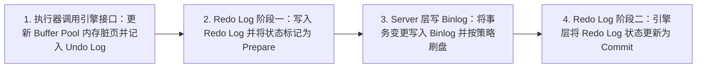
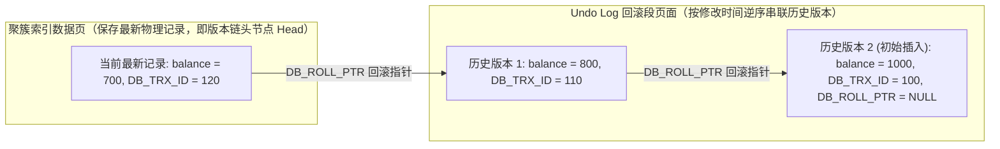
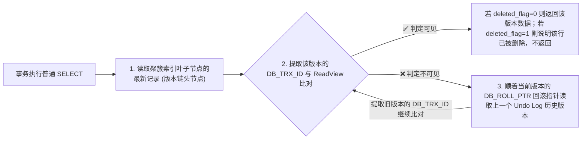
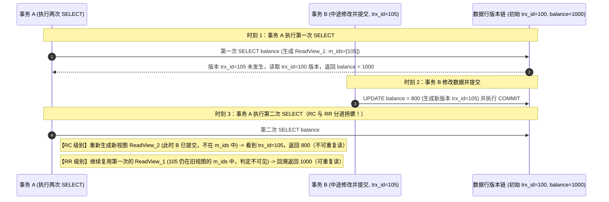

# 🔄 02 · 数据库事务 ACID 与 MVCC 多版本并发控制底层实现

> **一句话导读**：数据库事务需要同时解决“崩溃恢复时的数据完整与持久化”和“高并发读写下的数据隔离”两大核心问题。InnoDB 通过 Undo Log 与 Redo Log（结合 Binlog 两阶段提交）保障原子性与持久性，并通过 MVCC（隐藏列、Undo 版本链、ReadView）与锁机制协同实现不同等级的事务隔离。

---

## 一、事务 ACID 特性与底层物理日志支撑

### 1. ACID 四大核心属性与实现机制

事务（Transaction）是数据库执行并发控制与故障恢复的基本逻辑工作单元。为了确保像银行转账、订单扣库存这类包含多步修改的业务操作可靠执行，数据库定义了 ACID 四大特性：

| ACID 属性 | 解决的核心问题 | InnoDB 底层实现机制 |
| :--- | :--- | :--- |
| **原子性（Atomicity）** | 事务中的所有操作要么全部成功提交，要么在发生异常时全部撤销，绝不遗留改了一半的中间状态。 | **Undo Log（回滚日志）**：在修改聚簇索引记录前，先将修改前的旧值写入 Undo Log。当事务执行 `ROLLBACK` 或在崩溃恢复需撤销未提交事务时，引擎根据 Undo Log 逆向回放将数据恢复原状。 |
| **持久性（Durability）** | 事务一旦成功提交，其对数据的修改必须可靠落盘，即使随后发生进程崩溃或断电也不会丢失。 | **Redo Log（重做日志）与 WAL（预写日志）机制**：修改数据时先更新内存 Buffer Pool 中的数据页（变成脏页），并将物理修改记录顺序写入 Redo Log 落盘；后台线程随后再异步将脏页刷回磁盘表空间。若中途宕机，重启后可通过重放 Redo Log 恢复已提交的修改。 |
| **隔离性（Isolation）** | 多个事务并发读写同一批数据时，彼此的执行过程应当受控隔离，防止出现数据错乱。 | **MVCC（多版本并发控制）+ 锁机制**：在 RC / RR 隔离级别下，普通的非锁定 `SELECT`（快照读）通过 MVCC 读取符合可见性规则的历史版本，无需加行锁；而写操作与显式锁定读（当前读）则通过行级锁（Record / Gap / Next-Key Lock）实现并发互斥。 |
| **一致性（Consistency）** | 事务执行前后，数据库都必须处于满足完整性约束（如主键唯一、外键约束）与业务守恒规则的合法状态。 | **事务的最终目标**。由原子性、持久性、隔离性（AID）共同提供底层机制保障，并配合应用层的业务规则校验一起达成。 |

---

### 2. Redo Log 与 Binlog 的内部两阶段提交（2PC）

#### （1）为什么要引入内部两阶段提交？
在 MySQL 整体架构中，同时存在两套职责不同的日志系统：
- **Redo Log（重做日志）**：属于 **InnoDB 存储引擎层**，记录的是“对哪个表空间、哪个数据页、哪个偏移量做了什么修改”的物理日志，用于保证宕机后的崩溃恢复（Crash-Safe）。Redo Log 文件空间采用固定容量循环复用，随着脏页刷盘推进 Checkpoint 后，已落盘数据对应的旧日志空间即可被回收复用。
- **Binlog（归档日志）**：属于 **MySQL Server 层**，记录的是所有表结构变更与数据修改的逻辑日志（如 Row 格式下记录行的变更前后镜像），按文件顺序追加写满后切换到下一个文件，专门用于 **主从复制（Replication）** 与 **按时间点恢复（PITR）**。

如果在一个事务提交时，只是简单地“先写 Redo Log 再写 Binlog”或“先写 Binlog 再写 Redo Log”，一旦在两次写日志之间发生宕机，就会导致严重的主从数据不一致：
- 若 **先写完 Redo Log，但 Binlog 还没写入就宕机**：重启后 InnoDB 会根据 Redo Log 把该事务恢复出来（主库有这笔修改），但因为 Binlog 中没有记录，从库同步不到这笔修改，导致从库比主库少数据。
- 若 **先写完 Binlog，但 Redo Log 还没写入就宕机**：重启后 InnoDB 因为没有 Redo Log 会将该事务回滚（主库没有这笔修改），但从库却通过已写入的 Binlog 执行了这笔修改，导致从库比主库多数据。

为了保证 Redo Log 与 Binlog 这两份日志在逻辑上严格一致，MySQL 在开启 Binlog 时采用了 **内部两阶段提交（Two-Phase Commit, 2PC）** 协议。

#### （2）两阶段提交的执行步骤与崩溃恢复规则



当数据库在提交过程中异常宕机并重启时，InnoDB 会扫描 Redo Log 并按以下规则裁决事务的最终状态：
1. 如果发现某事务的 Redo Log 已经处于 **`Commit`** 状态，说明整个两阶段提交已全部完成，直接认定事务已提交。
2. 如果发现某事务的 Redo Log 仅处于 **`Prepare`** 状态（即在步骤 2 与步骤 4 之间发生了宕机），存储引擎会提取该事务的内部事务号 `XID`，去核查 Server 层的 **Binlog 中是否存在该 `XID` 对应的完整 Binlog 记录**：
   - **若 Binlog 中已完整存在该事务记录**：说明步骤 3 已经成功，从库可能已经或即将收到该 Binlog，因此 InnoDB 在恢复时自动将该事务补充提交（Commit）；
   - **若 Binlog 中不存在或记录不完整**：说明事务在步骤 3 完成前就已中断，因此 InnoDB 调用 Undo Log 将该事务彻底回滚（Rollback）。

#### （3）生产环境“双 1”持久化参数配置
为了确保已提交事务在操作系统崩溃或断电时真正落盘不丢失，生产环境核心库通常配置“双 1”策略（底层并发事务提交时会通过组提交 Group Commit 机制合并一次磁盘 `fsync` 以提升吞吐）：
- **`innodb_flush_log_at_trx_commit = 1`**：每次事务提交时，都将 Redo Log Buffer 中的日志写入操作系统 Page Cache 并立即调用 `fsync()` 刷入物理磁盘。（若设为 `0`，则事务提交时不写盘，由后台线程每秒刷盘一次；若设为 `2`，则每次提交仅写入操作系统 Page Cache，由后台线程按秒级周期调用 `fsync`，遇到操作系统崩溃或断电时可能丢失尚未落盘的事务）。
- **`sync_binlog = 1`**：每次事务提交组都将 Binlog Cache 中的日志同步刷入物理磁盘（若设为 `0` 则交由操作系统决定刷盘时机；设为 `N` 则每累计 `N` 个事务提交组调用一次 `fsync`）。

---

## 二、并发事务三大异象与 SQL 标准隔离级别

当多个事务并发读写同一批数据且缺乏隔离控制时，由于读写交叉执行，会由浅入深产生三种典型的数据一致性异常：

### 1. 并发访问三大异象

1. **脏读（Dirty Read — 读到了其他事务未提交的数据）**：
   - **产生过程**：事务 A 修改了某行数据但尚未提交，此时事务 B 读取了这行被修改后的新值；随后事务 A 因异常执行了 `ROLLBACK` 回滚，恢复了原来的旧值。
   - **业务危害**：事务 B 读到了一个从未真正提交生效的“临时脏数据”，若据此执行了发货或扣款，将直接引发业务资损。
2. **不可重复读（Non-Repeatable Read — 同一事务内前后两次读同一行，内容不一致）**：
   - **产生过程**：事务 A 先读取了 `id = 1` 的用户余额为 `100`；在事务 A 尚未结束期间，事务 B 修改了 `id = 1` 的余额为 `200` 并成功 `COMMIT` 提交；随后事务 A 再次读取 `id = 1`，发现余额变成了 `200`。
   - **核心特征**：针对的是**同一条已存在的记录**，由于其他事务中途提交了 `UPDATE`（或 `DELETE`），导致当前事务先后两次读取到的行数值发生了变化。
3. **幻读（Phantom Read — 同一事务内前后两次按相同条件查询，匹配的结果集行数发生了变化）**：
   - **产生过程**：事务 A 先执行范围查询 `SELECT * FROM orders WHERE user_id = 10 AND amount > 100`，查出 2 条记录；此时事务 B 插入了一笔满足该条件的新订单并成功 `COMMIT` 提交；随后事务 A 以相同条件再次读取（或执行当前读更新），发现多出了第 3 条“幽灵般”的新记录。
   - **核心特征**：不可重复读关注的是“已知单行记录的字段值被改动”，而幻读关注的是“同一查询谓词匹配出的**记录集合（行数）**发生了增减”。仅仅锁住查询时已存在的行，无法阻止其他事务向查询区间内插入新行。

### 2. SQL 标准四大隔离级别与 InnoDB 实现对比

为了在“数据隔离安全性”与“并发吞吐性能”之间提供不同档位的选择，SQL 标准定义了四个隔离级别：

| 隔离级别 | 脏读 | 不可重复读 | 幻读 | InnoDB 底层实现机制 | 典型适用场景 |
| :--- | :---: | :---: | :---: | :--- | :--- |
| **读未提交（Read Uncommitted, RU）** | ❌ 可能发生 | ❌ 可能发生 | ❌ 可能发生 | 普通 `SELECT` 直接读取数据页上的最新物理版本，不建立 ReadView；写操作仍需加行锁防止并发写覆盖。 | 生产环境几乎不使用。 |
| **读已提交（Read Committed, RC）** | ✅ 已解决 | ❌ 可能发生 | ❌ 可能发生 | **每次执行普通 `SELECT` 时都重新生成一个新的 `ReadView`**；写操作与锁定读一般只对命中记录加行锁，不加间隙锁（外键约束与唯一键冲突检查除外）。 | 互联网高并发 OLTP 业务常用（如 Oracle、PostgreSQL 默认级别），锁冲突与死锁概率较低。 |
| **可重复读（Repeatable Read, RR）** | ✅ 已解决 | ✅ 已解决 | ✅ 已解决（双轨制） | **事务内首次执行普通 `SELECT` 时生成 `ReadView`，后续所有普通 `SELECT` 一直复用该视图**；当前读（`FOR UPDATE` / `UPDATE` / `DELETE`）通过 **Next-Key Lock（记录锁 + 间隙锁）** 锁定扫描区间，阻止新行插入。 | **MySQL InnoDB 默认隔离级别**，适合对事务内多次对账、报表一致性要求高的业务。 |
| **串行化（Serializable）** | ✅ 已解决 | ✅ 已解决 | ✅ 已解决 | 当关闭自动提交（`autocommit = 0`）时，引擎会将所有普通 `SELECT` 自动改写为 `SELECT ... FOR SHARE`（加共享 Next-Key Lock），使读写操作之间也发生锁互斥。 | 并发性能最低，仅用于极端强一致且并发极低的特殊场景。 |

---

## 三、MVCC 核心底层三基石：隐藏列、Undo Log 版本链与 ReadView

如果普通的读请求（`SELECT`）也必须通过加锁来阻止其他事务写入，那么高并发场景下读写请求将严重相互阻塞。为此，InnoDB 引入了 **MVCC（Multi-Version Concurrency Control，多版本并发控制）**。

**MVCC 的核心设计思想**：当数据被修改时，通过 Undo Log 维护数据的历史版本链；当事务执行普通的非锁定 `SELECT`（即**快照读**）时，根据当前事务持有的一致性视图（`ReadView`）从版本链中挑选出对该事务可见的历史版本进行读取。这样一来，**普通的读操作不需要等待写操作释放行锁，写操作也不需要等待普通的读操作完成**，实现了高并发下的读写非阻塞执行。

MVCC 由 **聚簇索引隐藏列**、**Undo Log 版本链** 和 **ReadView 一致性视图** 三大基石共同构成：

### 1. 基石一：聚簇索引记录中的隐藏系统列
在 InnoDB 的 **聚簇索引叶子节点（即存放完整行记录的数据页）** 中，每条记录除了用户定义的业务列外，还包含以下系统隐藏列：

| 隐藏列名称 | 字节长度 | 生成条件与存储位置 | 核心作用 |
| :--- | :---: | :--- | :--- |
| **`DB_TRX_ID`** | 6 Bytes | **必选**（存于聚簇索引叶子节点） | 记录**最近一次插入、更新或标记删除**该行记录的事务 ID。 |
| **`DB_ROLL_PTR`** | 7 Bytes | **必选**（存于聚簇索引叶子节点） | **回滚指针（Roll Pointer）**，指向回滚段（Rollback Segment）中该行记录上一个历史版本的 Undo Log 记录地址。 |
| **`DB_ROW_ID`** | 6 Bytes | **按需生成**（当表存在显式主键或非空唯一索引时不生成） | 隐式自增行 ID。仅当表既未定义 `PRIMARY KEY`，也没有 `UNIQUE NOT NULL` 索引时，由 InnoDB 自动生成作为隐式聚簇索引主键。 |

> 💡 **与 B+ 树结构的联动理解（呼应 [[01-MySQL索引原理-B+树]]）**：
> `DB_TRX_ID` 和 `DB_ROLL_PTR`（共 13 字节）**只保存在聚簇索引的叶子数据页中**；B+ 树的非叶子目录页仅存放 `[主键值 + 子页页号]` 用于二分查找导航，不包含这两个事务隐藏列，因此 MVCC 机制不会降低 B+ 树非叶子节点的扇出度。

---

### 2. 基石二：Undo Log 版本链与 Purge 回收机制

当多个事务先后对同一行聚簇索引记录执行修改时，InnoDB 会在聚簇索引叶子页上原地更新该行（或标记删除），同时将修改前的旧值写入 Undo Log，并利用 `DB_ROLL_PTR` 回滚指针将最新记录与历次修改的 Undo Log 串联成一条**单向历史版本链**。

假设某账户初始由事务 `100` 插入（`balance = 1000`），随后被事务 `110` 更新为 `800`，接着又被事务 `120` 更新为 `700`。此时该行记录的物理版本链结构如下：



> 🔍 **补充说明：Undo Log 的分类、回收与 `DELETE` 的两阶段删除**
> 1. **Undo Log 记录的是按需重建旧版本的差异信息**：`Update Undo Log` 主要记录被修改字段的旧值与主键信息，而非每次修改都完整拷贝整行所有未修改字段；当读取操作需要某个历史版本时，InnoDB 会从聚簇索引当前行出发，顺着 `DB_ROLL_PTR` 依次应用 Undo Log 还原出当时的行映像。
> 2. **两类 Undo Log 的回收时机不同**：
>    - **`Insert Undo Log`**（由 `INSERT` 产生）：因为新插入的行对其他未提交事务本就不可见，不存在其他事务需要回溯到“插入之前”的快照需求，所以**事务一旦提交，其 `Insert Undo Log` 即可立即丢弃回收**。
>    - **`Update Undo Log`**（由 `UPDATE` 和 `DELETE` 产生）：由于事务提交后，系统中更早开启的其他并发事务可能仍然需要通过该 Undo Log 读取旧版本数据（MVCC 快照读），因此提交后**不能立即删除**，而是放入历史链表（History List），交由后台 **Purge 线程** 在确认系统中没有任何活跃 `ReadView` 再需要该版本后统一清理回收。
> 3. **`DELETE` 操作的本质是“两阶段删除”**：
>    - **第一阶段（Delete Mark 原地打标）**：当执行 `DELETE` 语句时，InnoDB 并不会当场把记录从 B+ 树数据页中抹除，而是先写一条 Undo Log，然后将聚簇索引记录头信息中的 **`deleted_flag` 标记位置为 `1`**，并更新该行的 `DB_TRX_ID` 和 `DB_ROLL_PTR`。
>    - **第二阶段（Purge 物理清除）**：等到该删除事务提交、且系统中所有早于该事务的活跃 `ReadView` 都已结束后，后台 Purge 线程才会真正将该记录从 B+ 树数据页中物理移除，并将其占用的空间加入页内空闲链表供后续插入复用。

---

## 四、ReadView 结构与一致性可见性判定算法

有了包含多个历史版本的 Undo Log 版本链之后，当某个事务执行快照读（普通 `SELECT`）时，面临的核心问题是：**版本链上有这么多版本，到底哪一个版本才应该被当前事务看到？**

为此，InnoDB 设计了 **`ReadView`（一致性读视图）**。它记录了生成视图那一刻系统中所有尚未提交的活跃读写事务状态，作为当前事务判断版本链上各个版本是否可见的过滤标尺。

### 1. ReadView 的四个核心成员变量

```cpp
class ReadView {
    trx_id_t m_creator_trx_id; // 创建当前 ReadView 的事务自身的 ID
    ids_t    m_ids;            // 生成 ReadView 这一瞬间，系统中所有“已分配事务 ID 但尚未提交”的其他活跃读写事务 ID 列表
    trx_id_t m_up_limit_id;    // 低水位：m_ids 活跃事务列表中的【最小事务 ID】（若 m_ids 为空，则等于 m_low_limit_id）
    trx_id_t m_low_limit_id;   // 高水位：生成 ReadView 时系统尚未分配的【下一个事务 ID】（即当前已分配最大事务 ID + 1）
};
```

> 💡 **深入理解 ReadView 字段设计的两个关键细节**：
> 1. **为什么只读事务的 `m_creator_trx_id` 初始为 `0`？**
>    在 InnoDB 中，开启一个事务（如执行 `BEGIN` 并只做普通 `SELECT`）时，为了节省全局事务 ID 分配开销，默认视为只读事务，不会立即分配递增的读写事务 ID，此时其 `m_creator_trx_id = 0`；只有当该事务真正执行了 `INSERT`、`UPDATE`、`DELETE` 等修改操作时，InnoDB 才会为它分配一个全局递增的 `trx_id`。
> 2. **为什么有了最小活跃 ID（`m_up_limit_id`）和下一个待分配 ID（`m_low_limit_id`），还必须额外维护一个 `m_ids` 活跃事务集合？**
>    因为**事务分配 ID 的先后顺序，不等于事务提交的先后顺序**。例如：事务 `100` 先做修改拿到了较小的 ID 但迟迟未提交，而事务 `101` 后做修改拿到了较大的 ID 却已经快速提交了。当事务 `102` 生成 `ReadView` 时，事务 `100` 还未提交（不可见），而事务 `101` 已经提交（可见）。因此，对于落在 `[m_up_limit_id, m_low_limit_id)` 区间内的事务号，必须通过查询它是否在 `m_ids` 未提交列表中，才能准确判断它在快照生成时是否已经提交。

---

### 2. 快照读完整寻址流程与四步可见性判别算法

当事务发起普通 `SELECT` 查询某行数据时，InnoDB 首先从 B+ 树聚簇索引叶子节点读出该行的**最新物理记录（即版本链的头节点 Head）**，提取其 `DB_TRX_ID`（记为 `trx_id`），并按照以下四步规则与当前事务的 `ReadView` 进行比对。如果当前版本不可见，则顺着该版本自身的 `DB_ROLL_PTR` 指针跳到上一个 Undo Log 历史版本，继续执行同样的四步比对，直到找到第一个可见版本为止：



**可见性判断的四步比对规则（针对当前检查版本的 `trx_id`）**：

1. **第一步：判断是否为当前事务自身修改（`trx_id == m_creator_trx_id`）**
   - **结论**：✅ **可见**。
   - **原因**：说明这个版本就是当前事务自己刚刚修改生成的，事务内部自己做的修改对自己永远可见。
2. **第二步：判断是否小于低水位（`trx_id < m_up_limit_id`）**
   - **结论**：✅ **可见**。
   - **原因**：`m_up_limit_id` 是生成 ReadView 时系统中所有未提交活跃事务的最小 ID。如果某版本的 `trx_id` 比这个最小值还要小，说明生成该版本的事务在当前 ReadView 创建之前**肯定已经提交完毕**。
3. **第三步：判断是否大于或等于高水位（`trx_id >= m_low_limit_id`）**
   - **结论**：❌ **不可见**。
   - **原因**：`m_low_limit_id` 是生成 ReadView 时系统尚未分配的下一个事务 ID。如果某版本的 `trx_id >= m_low_limit_id`，说明生成该版本的事务是在当前 ReadView 创建**之后**才分配事务 ID 并修改数据的，因此对当前快照不可见，需顺着 `DB_ROLL_PTR` 继续回溯更早的版本。
4. **第四步：判断是否处于高低水位之间（`m_up_limit_id <= trx_id < m_low_limit_id`）**
   - 此时检查 `trx_id` 是否存在于活跃事务列表 **`m_ids`** 中：
     - **若 `trx_id` 在 `m_ids` 列表中**：❌ **不可见**。说明在创建 ReadView 的那一刻，生成该版本的事务还处于未提交的活跃状态（即使它在 ReadView 创建之后提交了，对当时拍下的快照而言依然属于未来提交），需顺着 `DB_ROLL_PTR` 继续回溯。
     - **若 `trx_id` 不在 `m_ids` 列表中**：✅ **可见**。说明在创建 ReadView 的那一刻，生成该版本的事务已经完成提交。

> 📌 **边界处理规则**：
> - 如果顺着版本链找到的**第一个可见版本**其删除标记位 `deleted_flag == 1`，说明在当前快照建立前该行数据就已经被删除，此时直接认定该行不存在（跳过不返回），**不会**再继续往更老的版本回溯。
> - 如果一直顺着 `DB_ROLL_PTR` 遍历到版本链末尾（`NULL`）都没有找到任何一个可见版本，说明该行数据是在当前 ReadView 建立之后才由其他事务新插入的，对当前事务同样不可见。

---

### 3. 二级索引（覆盖索引）如何进行 MVCC 可见性判断？

在 [[01-MySQL索引原理-B+树]] 中我们学过：**二级索引的叶子节点只存储 `[索引列值 + 主键 ID]`，并不存储 `DB_TRX_ID` 和 `DB_ROLL_PTR` 隐藏列**。那么当一条查询命中了覆盖索引（`Using index`）时，InnoDB 不看聚簇索引，怎么知道二级索引上的这条记录对当前 `ReadView` 是否可见呢？

InnoDB 采用了 **“页级最大事务 ID 预判 + 按需回表核验”** 的两步机制：
1. **第一步：检查二级索引页头的 `PAGE_MAX_TRX_ID`（快速放行路径）**：
   - 每个二级索引数据页的页头（Page Header）都维护了一个 `PAGE_MAX_TRX_ID` 字段，记录修改过该二级索引页的最大事务 ID。
   - 当执行覆盖索引读取时，InnoDB 先检查该页的 `PAGE_MAX_TRX_ID` 是否小于当前 `ReadView` 的低水位 `m_up_limit_id`。如果 **`PAGE_MAX_TRX_ID < m_up_limit_id`**，说明修改过这个二级索引页的所有事务在当前快照生成前都已经全部提交！此时只要该二级索引记录未被标记删除（`deleted_flag == 0`），就可以直接从二级索引返回数据，真正实现零回表。
2. **第二步：回表聚簇索引走版本链（兜底精确核验）**：
   - 如果二级索引页的 `PAGE_MAX_TRX_ID >= m_up_limit_id`（说明近期有新事务修改过该页），或者当前二级索引记录被打上了删除标记（`deleted_flag == 1`），仅凭二级索引页已无法判断该行在当前快照下的准确状态。
   - 此时，哪怕 `EXPLAIN` 显示的是 `Using index`（覆盖索引），InnoDB 也会拿着二级索引上的主键 `id` **回表到聚簇索引**，通过聚簇索引叶子节点的 `DB_TRX_ID` 与 `Undo Log` 版本链来查找当前 `ReadView` 可见的真实版本。

---

## 五、RC 与 RR 的底层本质差异：ReadView 的生成时机

为什么同样使用上述完全一致的四步 `ReadView` 判定算法，**读已提交（RC）** 会出现不可重复读，而 **可重复读（RR）** 却能保证事务内前后多次普通 `SELECT` 读到相同的结果？

核心奥秘就在于 **ReadView 生成与复用的时机不同**：



| 对比维度 | 读已提交（Read Committed, RC） | 可重复读（Repeatable Read, RR） |
| :--- | :--- | :--- |
| **ReadView 生成策略** | **语句级快照**：事务内**每一次**执行普通 `SELECT` 语句时，都会重新创建一个全新的 `ReadView`。 | **事务级快照**：事务内**第一次**执行普通 `SELECT` 语句时创建一个 `ReadView`，此后直到事务结束，所有普通 `SELECT` 都一直**复用这同一个 `ReadView`**。 |
| **对其他事务已提交修改的可见性** | 下一次 `SELECT` 创建新 `ReadView` 时，其他刚提交的事务已不再属于活跃事务，因此新提交的修改立即可见（产生不可重复读与幻读）。 | 后续 `SELECT` 始终复用首次创建的旧 `ReadView`，在此视图创建之后才提交或新开启的事务版本一律被判定为不可见（消除了快照读下的不可重复读与幻读）。 |

> 💡 **注意区分 `BEGIN` 与快照建立的真正时刻**：
> 在 RR 隔离级别下，执行 `BEGIN` 或 `START TRANSACTION` 时**并不会立即创建 `ReadView`**，而是等到执行**第一条普通 `SELECT` 语句**时才真正拍照生成 `ReadView`。如果业务希望在事务开启的那一瞬间就立即建立一致性视图，需显式执行 `START TRANSACTION WITH CONSISTENT SNAPSHOT;`。

---

## 六、快照读 vs 当前读：RR 级别下幻读防御的完整机制

在回答面试高频追问“MySQL 的可重复读（RR）到底有没有彻底解决幻读？”时，必须将 InnoDB 的读取操作拆分为 **快照读** 与 **当前读** 两种模式分别阐述：

### 1. 快照读与当前读的对比
1. **快照读（Snapshot Read — 普通非锁定读）**：
   - **对应语句**：普通的 `SELECT * FROM table WHERE ...`（不含 `FOR UPDATE` 或 `FOR SHARE`）。
   - **执行方式**：基于 **MVCC（ReadView + Undo Log 版本链）** 读取历史可见版本，不加任何记录锁或间隙锁，读写互不阻塞。
2. **当前读（Current Read — 锁定读与写操作）**：
   - **对应语句**：
     - `SELECT ... FOR SHARE`（加 S 共享锁）
     - `SELECT ... FOR UPDATE`（加 X 排他锁）
     - `UPDATE ...`、`DELETE ...`（先在索引上执行当前读定位最新记录并加 X 锁，再执行修改）
   - **执行方式**：为什么更新和加锁查询不能读历史旧快照？因为如果基于过期的历史快照去修改数据，就会直接覆盖掉其他事务已经提交的最新修改（即发生**丢失更新 Lost Update**）。因此，当前读**必须读取数据页上最新已提交的物理版本，并对扫描到的索引记录与间隙加锁**，若遇到其他事务持有不兼容的锁则必须排队等待。

### 2. RR 级别防御幻读的双轨机制与特殊边界场景

在 RR 隔离级别下，InnoDB 采用双轨策略防御幻读：
- **在纯快照读场景下**：依靠 **复用首次生成的 `ReadView`**。即使其他事务中途插入了新行并提交，新行的 `DB_TRX_ID` 大于等于 `ReadView` 的高水位（或在 `m_ids` 中），对当前事务的 `ReadView` 不可见，从而不会读出幻影行。
- **在当前读场景下**：依靠 **Next-Key Lock（记录锁 + 间隙锁）**。当事务一开始就使用 `SELECT ... FOR UPDATE` 或 `UPDATE` 扫描某个条件区间时，InnoDB 不仅锁住已存在的记录，还会用间隙锁（Gap Lock）锁住记录之间的空隙，直接阻塞其他事务向该区间内执行 `INSERT`，从源头阻止幻影行的插入。

> [!WARNING] 穿透边界：当“先快照读”遇上“后当前读更新”时，为什么还会出现幻读现象？
> 在 RR 隔离级别下，如果同一个事务**混用了快照读和针对新插入行的当前读更新**，则会突破 `ReadView` 的隔离：
> 1. **时刻 1**：事务 A 开启，执行快照读 `SELECT * FROM users WHERE id > 10;`，此时生成 `ReadView_A`，查询结果为空（0 行）。
> 2. **时刻 2**：事务 B 插入一条新记录 `INSERT INTO users VALUES (15, '张三');` 并成功 `COMMIT`（该行 `DB_TRX_ID = B`）。若此时事务 A 继续执行普通 `SELECT`，因为复用 `ReadView_A`，依然看不到 `id = 15`。
> 3. **时刻 3（关键转折）**：事务 A 执行了一条范围更新 `UPDATE users SET name = '李四' WHERE id > 10;`。由于 `UPDATE` 是**当前读**，它必须扫描物理页上的最新数据，因此找到了事务 B 刚提交的 `id = 15` 这行记录并将其更新，同时**把 `id = 15` 这行记录的 `DB_TRX_ID` 改写成了事务 A 自己的事务 ID**！
> 4. **时刻 4**：事务 A 再次执行普通快照读 `SELECT * FROM users WHERE id > 10;`。在进行 `ReadView` 四步比对的第一步时，引擎发现 `id = 15` 的 `DB_TRX_ID == m_creator_trx_id`（是事务 A 自己修改的记录），于是直接判定为**可见**！结果事务 A 前后两次普通 `SELECT` 分别读到了 0 行和 1 行，出现了幻读现象。
>
> **工程结论**：如果业务需要在 RR 级别下先查询某批数据、再基于查询结果做后续判断与修改，且严禁中途有新数据掺入，应当从**第一次查询时就使用 `SELECT ... FOR UPDATE` 当前读加锁**，而不能先用不加锁的普通 `SELECT` 再去执行范围 `UPDATE`。

---

## 七、长事务（Long Transaction）对 MVCC 与系统资源的危害

在生产环境中，如果一个事务开启后长时间未提交（例如在 Spring `@Transactional` 注解的方法内部夹杂了耗时的远程 RPC 调用、HTTP 请求或大文件处理），会对 InnoDB 存储引擎造成严重的连锁冲击：

1. **阻塞 Purge 线程回收 Undo Log，导致回滚段空间膨胀**：
   - 如前文所述，`Update Undo Log` 必须等到系统中没有任何活跃 `ReadView` 再需要它时，才能被后台 Purge 线程清理。
   - 如果存在一个迟迟不提交的长事务持有一个很早生成的 `ReadView`，那么在这个 `ReadView` 生成之后全库产生的所有 `Update Undo Log` 都可能被该长事务访问，导致 Purge 线程无法推进清理（通过 `SHOW ENGINE INNODB STATUS` 会观察到 **`History list length`** 持续飙升），不仅占用大量表空间，还会拖慢由于未能物理清除 `deleted_flag = 1` 记录而膨胀的 B+ 树索引扫描。
2. **版本链过长导致快照读回溯耗时剧增**：
   - 当某条热点记录被高频更新、同时又因长事务导致旧版本无法回收时，该行的 Undo Log 版本链可能长达数百甚至数千个节点。需要读取旧快照的事务必须顺着 `DB_ROLL_PTR` 逐个节点遍历回溯，导致简单的单行查询退化为大量的随机内存/磁盘页读取。
3. **长时间持有行锁与 MDL 锁，引发连接池雪崩**：
   - 若长事务中包含更新操作，其持有的行级锁与间隙锁必须等到事务提交才释放，极易引发其他并发事务大面积锁等待超时（`Lock wait timeout exceeded`），进而占满应用的 HikariCP 数据库连接池。

> 🛠️ **工程治理规范（联动 [[../04-Spring生态/03-Spring事务管理]]）**：
> - **监控告警**：通过查询 `information_schema.INNODB_TRX` 监控执行时长超过阈值（如 5 秒）的活跃事务，并监控 `History list length` 指标。
> - **收缩事务边界**：严禁在数据库事务内执行远程 RPC / MQ 发送 / 第三方接口调用；应使用编程式事务 `TransactionTemplate` 仅包裹纯粹的数据库读写语句，做到“晚开启、早提交”。

---

## 🧠 一分钟复盘核心记忆卡

1. **日志各司其职**：**Undo Log** 记旧值，负责事务回滚与构建 MVCC 历史版本链（保障原子性与隔离性）；**Redo Log** 记物理页修改，配合 WAL 机制与 **Binlog 内部两阶段提交（2PC）** 保障宕机崩溃恢复与主从数据一致（保障持久性）。
2. **MVCC 三基石**：聚簇索引叶子节点隐藏列（`DB_TRX_ID` + `DB_ROLL_PTR`）+ `Undo Log` 单向版本链 + `ReadView` 一致性视图。
3. **ReadView 四步判断**：① `== creator_trx_id`（自身修改，可见） ➔ ② `< m_up_limit_id`（视图前已提交，可见） ➔ ③ `>= m_low_limit_id`（视图后才开启，不可见） ➔ ④ 在 `[up, low)` 区间内，查 `m_ids` 列表（在列表中未提交不可见，不在列表中已提交可见）。
4. **RC vs RR 与幻读**：RC 每次 `SELECT` 新建 `ReadView`；RR 首次 `SELECT` 建立并一直复用同一 `ReadView`。RR 通过“快照读复用 `ReadView` + 当前读加 `Next-Key Lock`”防御幻读。

---

## 🧭 下一步

掌握了 MVCC 非阻塞快照读的原理后，当多个并发事务同时执行 `UPDATE`、`DELETE` 或 `SELECT ... FOR UPDATE` 当前读时，InnoDB 是如何通过记录锁（Record Lock）、间隙锁（Gap Lock）与临键锁（Next-Key Lock）在 B+ 树索引上精准加锁的？死锁又是如何产生和排查的？
请进入下一篇核心专题：[[03-MySQL锁机制]]！
