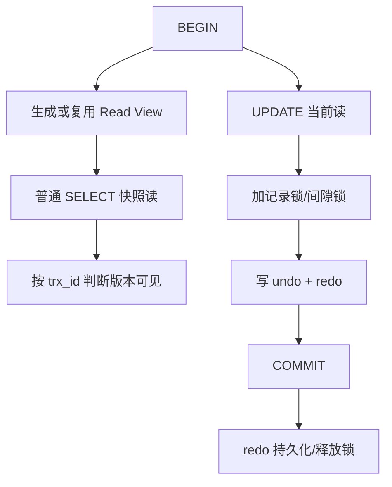

# 事务与隔离级别

> [!abstract] 一句话总结
> 事务用 redo/undo、锁和 MVCC 共同保证 ACID；隔离级别定义并发读写能看到哪个版本以及要承担哪些锁等待。

## 📌 精准定位

- 负责单库内多语句原子性、一致读和并发冲突控制。
- 不负责跨库跨消息系统的自动一致。
- 关键边界：InnoDB 默认 RR 下普通读是快照读，当前读仍会加锁。

## 🧩 核心概念

| 概念 | 具体含义 | 精通要点 |
| ---- | -------- | -------- |
| redo log | 记录页修改，崩溃恢复用。 | 保证持久性，刷盘策略影响性能。 |
| undo log | 保存旧版本和回滚信息。 | MVCC 一致读依赖版本链。 |
| Read View | 判断可见版本的快照。 | RC 每条语句生成，RR 首次一致读生成。 |
| 当前读 | for update、update、delete。 | 读取最新版本并加锁。 |

## ⚙️ 工作原理 / 主流程



1. 原子性靠 undo 回滚，持久性靠 redo 恢复。
2. MVCC 通过隐藏列 trx_id、roll_pointer 和 undo 版本链实现。
3. RC 下不可重复读可能发生，RR 下同一事务普通 select 复用快照。
4. Serializable 会让读也更强约束，并发最低。
5. 长事务会阻止 undo 清理，导致 history list 增长。

## 💻 代码 / 配置 / 伪代码

```sql
SET SESSION TRANSACTION ISOLATION LEVEL REPEATABLE READ;
START TRANSACTION;
SELECT stock FROM sku WHERE id = 1;
SELECT stock FROM sku WHERE id = 1 FOR UPDATE;
UPDATE sku SET stock = stock - 1 WHERE id = 1 AND stock > 0;
COMMIT;
```

## 🔍 源码入口 / 关键组件

- InnoDB 隐藏列与 undo segment
- SHOW ENGINE INNODB STATUS
- information_schema.innodb_trx
- performance_schema.data_locks
- redo/binlog 两阶段提交

## ⚠️ 生产坑与注意事项

- 把快照读误认为能防并发扣减。
- 长事务包含 RPC 或用户交互。
- RC/RR 切换后分页和校验语义变化。
- 先查再改没有锁或条件更新仍会丢失更新。
- DDL 可能隐式提交。

## 🧭 排查路径

- 锁等待查 data_locks、data_lock_waits 和阻塞 SQL。
- 历史版本堆积查长事务和 purge 延迟。
- 读到旧数据确认是否 RR 快照读。
- 提交慢看 redo 刷盘、binlog sync 和磁盘延迟。

## 🎯 面试问题

> [!question] 高频问题
> - Q: ACID 靠什么实现？
>   - A: 原子性 undo，隔离性锁+MVCC，持久性 redo，一致性靠约束和业务规则。
> - Q: RC 和 RR 的 Read View 差异？
>   - A: RC 每条语句生成，RR 首次一致读生成并复用。
> - Q: 快照读和当前读区别？
>   - A: 快照读读历史版本不加锁，当前读读最新版本并加锁。
> - Q: InnoDB 如何缓解幻读？
>   - A: RR 下当前读用 next-key lock 锁记录和间隙。
> - Q: 长事务危害？
>   - A: 占连接和锁，阻塞 purge，增加 undo 与恢复成本。

## ✅ 精通检查清单

- 能画出主流程，并标出最容易失败的节点。
- 能说出至少 3 个源码入口或关键组件。
- 能写出最小配置、SQL、伪代码或状态机。
- 能结合生产故障说明监控指标、排查命令和修复动作。
- 能和相邻方案做取舍对比，而不是只背定义。

## 🔗 关联笔记

- [[_index]]
- [[20-Java后端/00-总览/学习仪表盘]]

## 📚 参考资料

- MySQL Reference Manual: InnoDB Multi-Versioning
- MySQL Reference Manual: InnoDB Transaction Model
