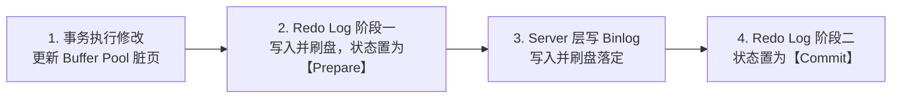
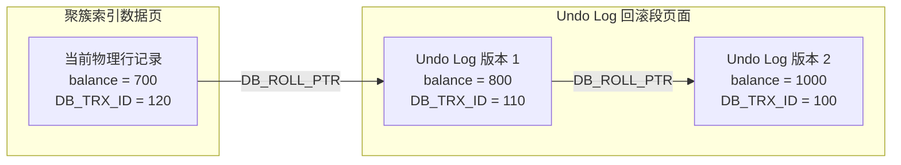
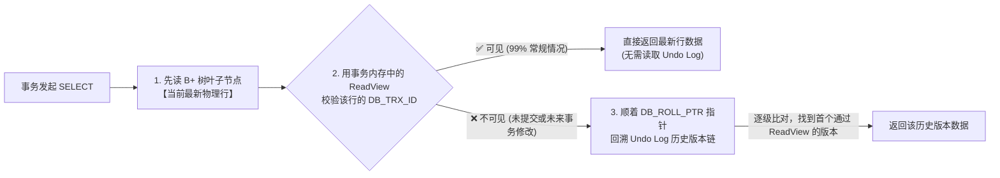

# 02 · 数据库事务 ACID 与 MVCC 多版本并发控制底层实现

> **导读**：在关系型数据库管理系统（RDBMS）中，保证并发访问下的数据一致性与高吞吐量是存储引擎的核心任务。MySQL InnoDB 存储引擎通过 Write-Ahead Logging（WAL）与两阶段提交（2PC）机制保障持久性与原子性，并通过结合多版本并发控制（MVCC）与锁机制实现高隔离性与非阻塞读取。本文深入剖析 ACID 特性的物理日志支撑、Redo/Binlog 两阶段提交、三大并发异常与隔离级别、InnoDB 隐藏列与 Undo Log 架构、ReadView 可见性算法，以及快照读与当前读在幻读防御上的本质差异。

---

## 一、事务 ACID 特性与底层物理日志支撑

### 1. ACID 四大核心属性与实现基石

事务（Transaction）是数据库执行并发控制与故障恢复的最小逻辑工作单元：

| ACID 属性 | 核心定义与要求 | 底层存储引擎物理实现原理 |
| :--- | :--- | :--- |
| **原子性（Atomicity）** | 事务中包含的所有操作要么全量持久化成功，要么全量回滚撤销至操作前的原始状态。 | **Undo Log（回滚日志）**：在修改聚簇索引记录前，先在 Undo Log 页面写入逆向补偿记录（`INSERT` 对应 `DELETE`，`UPDATE` 记录旧值）。回滚时逆序执行恢复。 |
| **持久性（Durability）** | 事务一旦提交（Commit），其对数据的物理修改必须永久保存，即使宕机断电亦不可丢失。 | **Redo Log（重做日志）与 WAL 策略**：采用预写日志（Write-Ahead Logging）。修改内存 Buffer Pool 脏页后先顺序写 Redo Log 刷盘，脏页后台异步刷盘；宕机重启时通过 Redo Log 前滚重放（Crash Recovery）。 |
| **隔离性（Isolation）** | 多个并发事务同时读写相同数据集时，内部状态相互隔离，防范并发干扰。 | **MVCC + 锁系统**：普通查询（快照读）依托 MVCC 读取历史版本链，实现“读不加锁、读写并行”；写操作与锁定读（当前读）依托行级锁（Record / Gap / Next-Key Lock）互斥。 |
| **一致性（Consistency）** | 事务执行前后，数据库的完整性约束与业务守恒规则必须完全满足。 | **事务追求的终极目标**。由原子性、持久性、隔离性（AID）提供底层技术保障，结合应用层业务校验共同达成。 |

### 2. 持久性与主从一致的核心闭环：Redo Log vs Binlog 两阶段提交（2PC）

MySQL 内部同时存在引擎层的 **Redo Log** 与 Server 层的 **Binlog**。为了防止两者在宕机时出现“主库丢数据”或“从库多数据”的不一致，InnoDB 采用**内部两阶段提交（Two-Phase Commit, 2PC）**：

| 对比维度 | Redo Log（重做日志） | Binlog（归档日志） |
| :--- | :--- | :--- |
| **所属层级** | **InnoDB 存储引擎层**独有 | **MySQL Server 层**（所有引擎共用） |
| **日志内容** | **物理日志**：记录“在哪个数据页做了什么物理字节修改” | **逻辑日志**：记录 SQL 语句或行变更前后的镜像（Row 格式） |
| **写入方式** | **循环写**：固定大小文件组（如 4 个 1GB 文件），写满擦除旧日志 | **追加写**：文件写满后新建下一个文件，全量保留历史 |
| **核心用途** | **宕机崩溃恢复（Crash-Safe）**：保证已提交事务的脏页不丢失 | **主从复制（Replication）** 与 **按时间点恢复（PITR）** |



- **崩溃恢复（Crash Recovery）唯一裁决铁律**：
  - 若重启时发现某事务的 Redo Log 已处于 **`Commit`**，直接提交；
  - 若 Redo Log 处于 **`Prepare`** 状态（如在步骤 2 与 4 之间断电），则拿着事务 `XID` 去核查 **Binlog 是否已完整写入**：
    - **Binlog 完整**：说明从库可能已同步该日志，主库**自动提交**该事务；
    - **Binlog 不完整**：说明尚未对外生效，主库通过 Undo Log **自动回滚**该事务。
- **生产环境“双 1”安全配置**：
  - `innodb_flush_log_at_trx_commit = 1`：每次事务提交均将 Redo Log Buffer 强制 `fsync` 刷入磁盘（设为 `0` 或 `2` 在断电时可能丢失约 1 秒事务）；
  - `sync_binlog = 1`：每次事务提交均将 Binlog Cache 强制 `fsync` 刷入磁盘。

---

## 二、并发事务三大异象与 SQL 标准隔离级别

当数据库允许多个事务在无隔离或低隔离状态下并发运行时，会产生三种经典的数据一致性破损异象：

### 1. 并发访问三大异象

1. **脏读（Dirty Read）**：
   - **现象**：事务读取到了其他并发事务已修改、但**尚未提交（Uncommitted）**的中间状态数据。
   - **危害**：若该并发事务随后发生异常或主动回滚，当前事务读取到的数据在物理磁盘上从未合法存在过，业务基于虚假数据进行决策将产生严重错账。
2. **不可重复读（Non-Repeatable Read）**：
   - **现象**：在同一事务内多次读取同一行记录，由于其他并发事务在中途提交了 **`UPDATE` 或 `DELETE`**，导致前后两次读取到的**字段数值不一致**或记录离奇消失。
   - **关注重点**：核心是**已有记录的修改或删除（同一行数据的值变了）**。
3. **幻读（Phantom Read）**：
   - **现象**：在同一事务内按特定范围条件多次检索，由于其他并发事务在中途提交了 **`INSERT`**，导致后一次范围查询**凭空多出了符合条件的几行数据**（犹如产生幻影）。
   - **关注重点**：核心是**新增记录（行数变了）**。即便通过行锁锁住了已有数据行，并发事务仍可能在记录间隙中插入新行。

### 2. SQL-92 标准隔离级别矩阵与 InnoDB 特性

| 隔离级别 | 脏读防范 | 不可重复读防范 | 幻读防范 | InnoDB 核心底层实现机制 | 生产级选型建议 |
| :--- | :---: | :---: | :---: | :--- | :--- |
| **读未提交（Read Uncommitted）** | ❌ 发生 | ❌ 发生 | ❌ 发生 | 读取聚簇索引物理页的最新数据，不生成 MVCC ReadView，不施加锁保护。 | 存在致命脏数据风险，**生产环境绝对禁止**。 |
| **读已提交（Read Committed, RC）** | ✅ 杜绝 | ❌ 发生 | ❌ 发生 | **在事务内每次执行普通 SELECT 时均重新生成一个最新的 ReadView**。写操作使用记录锁（无 Gap 锁）。 | **互联网大厂高并发推荐**。减少锁范围，显著降低死锁概率，提升高并发吞吐。 |
| **可重复读（Repeatable Read, RR）** | ✅ 杜绝 | ✅ 杜绝 | 🌟 基本杜绝 | **在事务内仅在第一次执行 SELECT 时生成 ReadView，后续查询持续复用**。写操作默认采用 Next-Key Lock。 | **MySQL InnoDB 默认级别**。快照读依托 MVCC、当前读依托 Next-Key Lock 防范幻读。 |
| **串行化（Serializable）** | ✅ 杜绝 | ✅ 杜绝 | ✅ 杜绝 | 读写操作完全排他串行化。隐式将所有普通 `SELECT` 转换为 `SELECT ... FOR SHARE` 施加共享锁。 | 并发吞吐断崖式下跌，仅在极少数特种审计业务中使用。 |

---

## 三、MVCC 核心底层三基石：隐藏列、Undo Log 与 ReadView

多版本并发控制（Multi-Version Concurrency Control）是 InnoDB 解决并发读写冲突的核心方案。其技术本质是：**利用历史版本链保存数据的历史快照，使只读事务无需加锁即可读取到一致性的历史版本，彻底消除读写互斥**。

### 1. 基石一：InnoDB 记录级隐藏系统列
在 InnoDB 的**聚簇索引叶子节点（真实数据行）**中，每行记录除业务字段外，底层包含 **2 个必选隐藏列**与 **1 个条件兜底列**：

| 隐藏列名称 | 物理字节长 | 生成条件与存储位置 | 核心语义与底层作用 |
| :--- | :---: | :--- | :--- |
| **`DB_TRX_ID`** | 6 Bytes | **必选**（仅存于聚簇索引**叶子节点**） | 记录最近一次创建、更新或逻辑删除该行记录的**事务 ID**（单调递增的全局整数）。 |
| **`DB_ROLL_PTR`** | 7 Bytes | **必选**（仅存于聚簇索引**叶子节点**） | **回滚指针（Roll Pointer）**，指向 Rollback Segment 中 Undo Log 对应历史版本的物理地址。 |
| **`DB_ROW_ID`** | 6 Bytes | **按需兜底**（有主键或非空唯一索引时**不生成，占 0 字节**） | 隐式聚簇索引主键。仅当表既无 `PRIMARY KEY` 也无 `UNIQUE NOT NULL` 索引时，由 InnoDB 自动生成。 |

- **聚簇索引选型顺位**：`PRIMARY KEY`（显式主键） ➔ 第一个 `UNIQUE NOT NULL`（非空唯一索引） ➔ 隐式生成 6 字节 `DB_ROW_ID`。
- **对 B+ 树空间与分叉数的影响（联动 [[01-MySQL索引原理-B+树]]）**：`DB_TRX_ID` 与 `DB_ROLL_PTR`（共 13 字节）**只存在于聚簇索引的叶子数据页中**（已包含在叶子节点单行如 `1KB` 的宽度预算内）；而 **B+ 树的非叶子节点（目录页）只存 `[主键值 + 子页指针]` 做二分导航，完全不含任何隐藏列**，因此隐藏列不会挤占目录页的分叉容量。

### 2. 基石二：Undo Log 版本链与 Purge 回收机制
当一条记录被频繁并发修改时，历史数据不会被物理覆盖，而是被序列化推入 Undo Log 页面中，通过每一行的 `DB_ROLL_PTR` 向上逆向串联成一条**从最新版本到最老版本的单向链表**：

- **聚簇索引物理页（最新行数据）**：`balance = 700`，`DB_TRX_ID = 120`，其 `DB_ROLL_PTR` ➔ 指向 Undo Log 版本 1；
- **Undo Log 回滚段（历史版本 1）**：`balance = 800`，`DB_TRX_ID = 110`，其 `DB_ROLL_PTR` ➔ 指向 Undo Log 版本 2；
- **Undo Log 回滚段（历史版本 2 / 基线版本）**：`balance = 1000`，`DB_TRX_ID = 100`，其 `DB_ROLL_PTR` ➔ `NULL`（链表终点）。



- **两类 Undo Log 的生命周期差异与 `DELETE` 两阶段删除机制**：
  1. **`Insert Undo Log`（提交即焚）**：`INSERT` 产生的新记录仅对本事务自身可见，其他并发事务无需做 MVCC 回溯，因此**事务一旦 Commit，该日志即可直接丢弃释放**；
  2. **`Update Undo Log`（等待 Purge 回收）**：`UPDATE` 与 `DELETE` 产生的日志必须服务于其他活跃事务的 MVCC 快照读，事务提交后**不可立即删除**，而是挂入 History List，等待后台 **`purge thread`** 确认该版本已早于全系统最老 `ReadView`（`< m_up_limit_id`）后才物理回收；
  3. **`DELETE` 的本质是“原地打标（Delete Mark）”**：执行 `DELETE` 时并不会当场从 B+ 树数据页抹除记录，而是仅将行记录头的 **`deleted_flag` 置为 `1`** 并更新 `DB_TRX_ID` 与 `DB_ROLL_PTR`；直到后台 Purge 线程清理该 Undo Log 时，才会将记录从 B+ 树物理移除并归入垃圾链表复用。

---

## 四、ReadView 结构与一致性可见性判定算法

当事务执行普通快照读（`SELECT`）时，InnoDB 会在**当前事务内存中**创建或复用一个一致性过滤视图——**`ReadView`**（它只是当前事务持有的可见性判别准则，并非数据链表节点，**事务一结束即随之销毁**）。

### 1. ReadView 四大核心字段
```cpp
class ReadView {
    trx_id_t m_low_limit_id;   // 高水位(max_trx_id)：系统即将分配给下一个事务的 ID (全局最大事务 ID + 1)
    trx_id_t m_up_limit_id;    // 低水位(min_trx_id)：当前活跃读写事务列表中最小的事务 ID
    trx_id_t m_creator_trx_id; // 创建当前 ReadView 的事务自身的 ID（若为纯 SELECT 未执行过写操作，则固定为 0）
    ids_t    m_ids;            // 生成 ReadView 瞬间，系统中所有正处于活跃状态（未提交）的读写事务 ID 集合
};
```

- **为什么源码命名把最大 ID 叫 `low`，最小 ID 叫 `up`？**
  InnoDB 源码是按**“可见性区间的边界”**命名的：`< m_up_limit_id` 的历史事务 100% 可见，因此它是**“无条件可见区的上限（Upper Limit）”**；`>= m_low_limit_id` 的未来事务 100% 不可见，因此它是**“无条件不可见区的下限（Lower Limit）”**。
- **为什么不能只靠比大小，必须维护 `m_ids` 列表？**
  因为事务分配 ID 的先后与提交/修改的先后并不一致（例如：慢事务 A 先写别的表拿到 `trx_id=100` 未提交，快事务 B 后开启修改当前行拿到 `trx_id=101` 并立刻提交，随后事务 A 再修改当前行，此时版本链会出现 `最新(100, 未提交) ➔ 旧版(101, 已提交)` 的事务号倒挂），必须结合 `m_ids` 名单才能精准识别谁已提交。

### 2. 快照读完整寻址流程与四步可见性判别算法

快照读**并非一上来就去读 Undo Log**，而是永远**先读取 B+ 树聚簇索引叶子节点上的最新物理行**，用 `ReadView` 校验通过则直接返回；仅当最新行不可见时，才顺着 `DB_ROLL_PTR` 回溯 `Undo Log` 版本链：



无论是校验 B+ 树上的最新行，还是回溯遍历 Undo Log 链上的历史版本，均提取目标版本的 `DB_TRX_ID`（记为 $T_{rec}$），与当前事务的 `ReadView` 执行如下四步比对：

1. **步骤一：判断是否为当前事务自身所修改**
   - **判别条件**：$T_{rec} == m\_creator\_trx\_id$
   - **判定结论**：✅ **完全可见**。
   - **底层逻辑**：该版本就是当前事务自己修改生成的。在事务内，自己做出的修改对自己永远可见。直接读取该版本数据，算法终结。

2. **步骤二：判断是否在 ReadView 生成前已完成提交**
   - **判别条件**：$T_{rec} < m\_up\_limit\_id$（即小于活跃事务 ID 列表的最小值 `min_trx_id`）
   - **判定结论**：✅ **完全可见**。
   - **底层逻辑**：生成 ReadView（快照拍照）的一瞬间，系统中尚未提交的最早事务 ID 为 `m_up_limit_id`。若当前版本的事务 ID 比这个最小值还要小，说明该事务在当前 ReadView 生成之前**早就已经提交落盘**，属于绝对稳定的历史数据。直接读取该版本数据，算法终结。

3. **步骤三：判断是否为 ReadView 生成后才启动的未来事务**
   - **判别条件**：$T_{rec} \ge m\_low\_limit\_id$（即大于等于系统即将分配的下一个事务 ID `max_trx_id`）
   - **判定结论**：❌ **绝对不可见**。
   - **底层逻辑**：该版本的生成事务是在当前 ReadView 拍照建立**之后才启动的“未来事务”**。快照读绝对不能感知未来发生的修改。
   - **处理动作**：沿着当前版本的 `DB_ROLL_PTR` 回滚指针，追溯至上一个更早的 Undo Log 历史版本，重新从步骤一开始检验。

4. **步骤四：判断是否处于 ReadView 生成时的活跃事务列表中**
   - **判别条件**：$m\_up\_limit\_id \le T_{rec} < m\_low\_limit\_id$，此时进一步比对 $T_{rec}$ 是否存在于 `m_ids` 活跃事务集合中：
     - **分支 A（若存在于 `m_ids` 列表中）**：❌ **不可见**。
       - **底层逻辑**：说明在生成 ReadView 拍照的那一瞬间，修改该版本的事务**正处于活跃状态（尚未提交或正在执行）**。若读取则会构成脏读，因此绝对不可见。
       - **处理动作**：沿着 `DB_ROLL_PTR` 指针追溯至上一历史版本，重新从步骤一开始检验。
     - **分支 B（若不存在于 `m_ids` 列表中）**：✅ **完全可见**。
       - **底层逻辑**：虽然该事务 ID 介于系统最小活跃 ID 与最大分配 ID 之间，但它并未出现在活跃未提交名单中，说明在当前 ReadView 生成之前，它**已经正常提交完成**了。直接读取该版本数据，算法终结。

### 3. 二级索引（Secondary Index）如何执行 MVCC 可见性判断？

前面提到：**`DB_TRX_ID` 与 `DB_ROLL_PTR` 只存在于聚簇索引叶子节点，二级索引的叶子节点只存 `[索引列 + 主键 ID]`，根本没有隐藏列**。那么当执行覆盖索引查询（如 `SELECT name FROM users WHERE name = '张三'`）时，InnoDB 如何判断二级索引记录对当前 `ReadView` 是否可见？

InnoDB 采用 **“页级最大事务号（`PAGE_MAX_TRX_ID`）预判 + 隐式回表”** 两级策略：
1. **第一级：检查二级索引页头的 `PAGE_MAX_TRX_ID`（快速放行）**：
   - 每个二级索引数据页的 Page Header 中，都维护了一个 **`PAGE_MAX_TRX_ID`** 字段，记录修改过该数据页的最大事务 ID；
   - 若 **`PAGE_MAX_TRX_ID < ReadView.m_up_limit_id`**（小于全系统最小活跃事务 ID）：说明修改过该页的所有事务在当前快照生成前**早已全部提交**，整页记录 **100% 可见**，直接返回覆盖索引结果，无需回表！
2. **第二级：强制回表聚簇索引（兜底精查）**：
   - 若 **`PAGE_MAX_TRX_ID >= ReadView.m_up_limit_id`**：说明该二级索引页近期被未提交或未来事务修改过，且二级索引行记录头中的 `deleted_flag` 也可能被标记；
   - 此时二级索引自身无法判定单行可见性，**哪怕 SQL 命中了覆盖索引（`Using index`），InnoDB 也必须拿着主键 ID 强制回表到聚簇索引**，通过聚簇索引叶子节点的 `DB_TRX_ID` 与 `Undo Log` 版本链找回可见版本！

---

## 五、RC 与 RR 的底层本质差异：ReadView 生成时机

在 MVCC 机制下，读已提交（RC）与可重复读（RR）的表现差异，完全取决于 **ReadView 的生成与刷新时机**：

| 隔离级别 | ReadView 生命周期与生成策略 | 为什么能防止不可重复读？ | 为什么存在/不存在幻读？ |
| :--- | :--- | :--- | :--- |
| **读已提交（RC）** | **每次执行普通 `SELECT` 查询时，均全新生成一份最新的 `ReadView`**。 | ❌ **无法防止**。若并发事务提交了更新，下一次 `SELECT` 生成的新 ReadView 中该事务已从 `m_ids` 移除，因此能读到最新数值，导致前后数据不一致。 | ❌ **无法防范**。后续查询能即时感知其他事务新增并提交的数据行。 |
| **可重复读（RR）** | **仅在事务中第一次执行 `SELECT` 时生成一份 `ReadView`，并在整个事务周期内完全复用**。 | ✅ **完全防止**。即使其他事务中途提交修改，当前事务始终复用创建初期的旧 ReadView，比对时最新版本依然被判定为不可见，始终沿版本链读取旧镜像。 | 🌟 **快照读完全防止**。通过复用固定 ReadView 过滤掉后续新插入的行；当前读需借助 Next-Key Lock 协同防范。 |

---

## 六、快照读 vs 当前读：幻读防御的完整拼图

在深入探讨 MySQL InnoDB 是否彻底解决幻读时，必须严格区分两种不同的数据读取模式：

### 1. 读取模式定义与区分
- **快照读（Snapshot Read）**：纯普通的 `SELECT` 语句（不包含任何加锁修饰符）。完全依赖 MVCC 机制读取一致性快照，**全程不施加任何行锁与间隙锁，性能最高**。
- **当前读（Current Read）**：读取目标数据的最新物理提交版本，并对所读取的记录显式加锁：
  - `SELECT ... FOR UPDATE`（施加 X 排他锁）；
  - `SELECT ... FOR SHARE` / `LOCK IN SHARE MODE`（施加 S 共享锁）；
  - 所有写入语句：`INSERT`、`UPDATE`、`DELETE` 在执行前均必须先执行当前读获取物理页最新行。

### 2. RR 级别下幻读的防御实现

在可重复读（RR）隔离级别下，InnoDB 存储引擎并非依赖单一手段，而是通过**“快照读依赖 MVCC，当前读依赖 Next-Key Lock”**的双轨制策略实现对幻读的防御：

1. **快照读场景（普通 `SELECT`）**：
   - **防御机制**：**依托 MVCC 的 ReadView 快照复用**。
   - **底层逻辑**：事务在第一次执行 `SELECT` 时生成一份全局稳定的 ReadView，并在整个事务周期内完全复用。即便其他并发事务在中途执行了 `INSERT` 并成功提交，新插入行的 `DB_TRX_ID` 属于“未来事务”或未在快照中，在版本可见性四步算法中会被严格判定为不可见并直接过滤，因此多次范围查询读取到的结果集完全恒定，杜绝了幻读。
2. **当前读场景（`SELECT ... FOR UPDATE` / `UPDATE` / `DELETE`）**：
   - **防御机制**：**依托 Next-Key Lock（记录锁 Record Lock + 间隙锁 Gap Lock）**。
   - **底层逻辑**：当前读必须读取物理页上的最新记录，无法仅靠历史快照。InnoDB 在扫描检索条件对应的索引范围时，不仅锁住已有的索引行记录，还会将记录之间的**开区间（间隙 Gap）**施加间隙锁。当其他并发事务试图向该区间执行 `INSERT` 插入新行时，会被阻塞挂起，从而从物理根源上彻底消除了幻影记录的诞生。

> [!WARNING] 特殊临界边界：快照读转当前读引发的幻读穿透
> 在 RR 隔离级别下，若事务 A 先执行快照读，随后事务 B 插入新行并成功提交；如果此时事务 A 执行了一条范围更新语句（如 `UPDATE users SET status = 1 WHERE id > 10`），由于 `UPDATE` 属于当前读，事务 A 会直接将事务 B 新插入的数据行一并更新。**这一更新操作导致该新行的 `DB_TRX_ID` 被覆写为事务 A 自身的 ID！**
> 当事务 A 再次执行快照读时，根据规则 1（`T_rec == creator_trx_id`），该行数据被判定为当前事务自身生成而完全可见，导致幻读产生。因此，**在需要杜绝幻读的严格场景下，事务从一开始就应采用当前读加锁（`FOR UPDATE`）**。

---

## 七、生产高危避坑：长事务（Long Transaction）如何拖垮 MVCC 与磁盘？

在 RR 隔离级别下，如果一个事务开启并执行了 `SELECT` 后迟迟不提交（例如在 Spring `@Transactional` 方法内部执行了慢 RPC 远程调用、MQ 发送或文件导出），会引发极其严重的连锁雪崩：

1. **阻塞 Purge 线程，打爆 Undo 表空间**：
   - 后台 `Purge` 线程回收历史 `Undo Log` 的前提是：该版本必须早于全系统**最老的 `ReadView`**（即 `MVCC::m_views` 链表尾部节点）；
   - 长事务持有的老 `ReadView` 长期不释放，会导致此后全库所有事务产生的 `Update Undo Log` 与被 `DELETE` 标记删除的记录**全部无法被物理回收**，History List Length 飙升至数百万，最终撑爆磁盘；
2. **版本链极度拉长，拖垮全库普通查询**：
   - 当热点行被高频更新时，其 `DB_ROLL_PTR` 串联的 `Undo Log` 版本链可能长达数万层；长事务（或其他并发查询）每次执行快照读，都必须顺着数万个版本逐一逆向回溯比对，导致简单的主键 `SELECT` 耗时从毫秒级恶化至秒级；
3. **长期霸占行锁与数据库连接**：
   - 若长事务中包含写操作，其持有的行锁/间隙锁直到事务提交才会释放，极易引发大面积锁等待超时（`Lock wait timeout exceeded`）并耗尽 HikariCP 连接池。

- **生产排查与铁律**：
  - 监控 `information_schema.INNODB_TRX` 视图（排查 `trx_started` 超过阈值的长事务）及 `SHOW ENGINE INNODB STATUS` 中的 **`History list length`**；
  - **代码铁律（联动 [[../04-Spring生态/03-Spring事务管理]]）**：严禁在 `@Transactional` 事务块内夹杂任何外部 RPC、HTTP 请求或非 DB 耗时 I/O，优先使用 `TransactionTemplate` 编程式事务精准收缩事务边界。

---

## 🧭 下一步

在深入掌握了 MVCC 快照读机制后，当多个并发事务执行 `UPDATE`、`DELETE` 或 `SELECT ... FOR UPDATE` 时，系统将不可避免地从“非阻塞快照读”转入“并发锁互斥”。
InnoDB 是如何通过记录锁（Record Lock）、间隙锁（Gap Lock）与 Next-Key Lock 协同防范幻读的？死锁究竟是如何在两行数据之间形成的？
请进入下一篇核心专题：[[03-MySQL锁机制]]！
