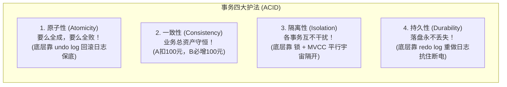
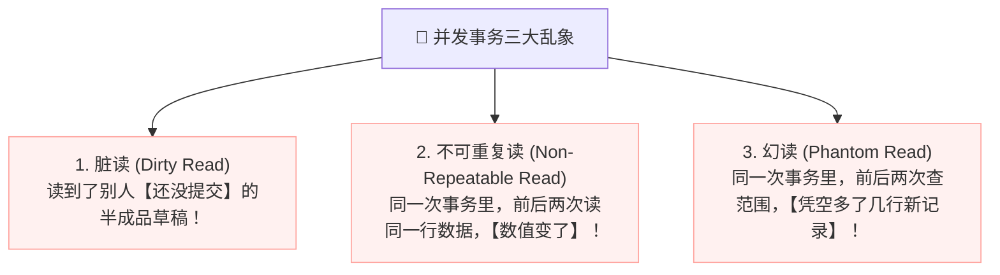
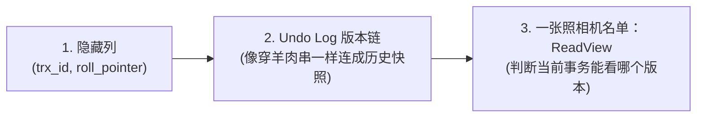
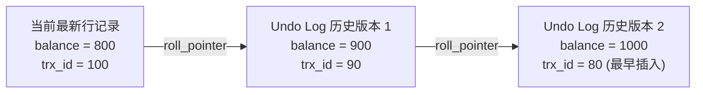
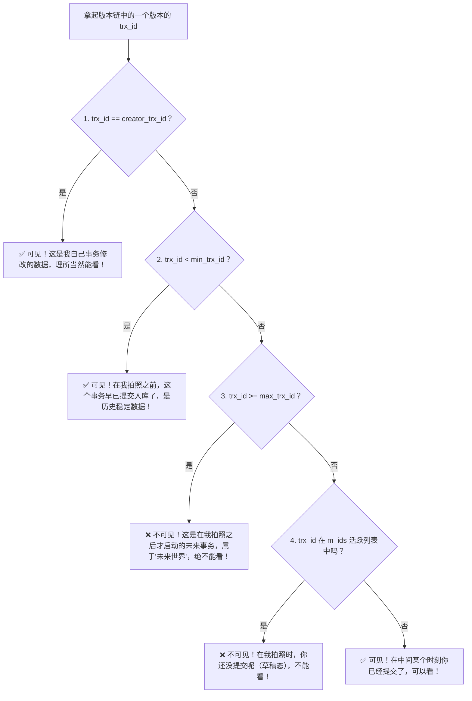

# 📸 02 · 事务与隔离级别（平行宇宙快照机与 MVCC 逐帧大解剖）

> **一句话导读**：当两个用户同时对同一个账户转账时，为什么查询不会互相卡死？MySQL 是怎么做到“读不加锁、写不阻塞读”的？用“平行宇宙拍照机与相片版本链”模型，带你彻底吃透 ACID、三大并发乱象，以及**大厂面试必考的终极底层核心——MVCC 多版本并发控制**。

---

## 🏛️ 核心心智模型：平行宇宙与快照照相机

在关系型数据库中，**事务（Transaction）**就是一组不可分割的操作单元：

如果系统里永远只有一个线程在跑，事务非常简单。
但现实是：**成千上万个事务在同一毫秒内并发读写同一批数据！**
如果没有任何隔离手段，数据库就会瞬间沦为“车祸现场”。

---

## 💥 并发事务的三大灾难现象（现实翻车复盘）

如果不做隔离，多事务并发会引发以下 3 种经典的乱象：

### 1. 脏读（Dirty Read - 最危险！）
- **剧情**：员工 A 发起事务，把老板的工资从 1 万改成了 10 万（**但 A 还没点击 Commit 提交！**）。
- **翻车**：财务 B 此时发起查询，赫然看到老板工资是 10 万！
- **崩溃**：紧接着，员工 A 突然良心发现，执行了 `ROLLBACK`（撤回修改）；
- **后果**：财务 B 拿着刚才读到的“10 万虚假数据”去发了工资，造成巨额资金流失！

### 2. 不可重复读（Non-Repeatable Read - 数值改变）
- **剧情**：张三在 10:00 打开银行 APP，事务内查询余额是 **1000 元**；
- **并发动作**：张三的老婆在 10:01 刷卡消费了 200 元，并**成功提交了事务**（余额变 800 元）；
- **翻车**：张三在同一个事务内、10:02 再次刷新屏幕，发现余额变成了 **800 元**！
- **感受**：张三崩溃：“我这笔业务还没办完呢，怎么同一行数据自己偷偷变了？！”

### 3. 幻读（Phantom Read - 记录凭空冒出）
- **剧情**：班主任发起事务：“把全班 50 个学生的成绩全部标记为及格”；
- **并发动作**：教务老师此时插手，**新插入了一条第 51 个学生的未及格记录并提交**；
- **翻车**：班主任再次查询，发现居然还有 1 个学生没及格！犹如大白天撞见了“幽灵鬼影”！

---

## 🛡️ 四大隔离级别大白话天梯榜

为了在“数据安全”与“系统并发吞吐量”之间做权衡，SQL 标准制定了 4 种隔离级别：

| 隔离级别 | 脏读 | 不可重复读 | 幻读 | 现实生活比喻 | 适用场景 |
| :--- | :---: | :---: | :---: | :--- | :--- |
| **读未提交** *(Read Uncommitted)* | ❌ 发生 | ❌ 发生 | ❌ 发生 | **完全不设防**。别人在草稿纸上乱画你都能偷窥到。 | 生产坚决禁用！ |
| **读已提交 (RC)** *(Read Committed)* | ✅ 解决 | ❌ 发生 | ❌ 发生 | **一手交钱一手交货**。只能读到别人盖章确认（Commit）的数据。 | **互联网大厂高并发推荐！** 配合行锁，锁冲突极少。 |
| **可重复读 (RR)** *(Repeatable Read)* | ✅ 解决 | ✅ 解决 | 🌟 基本解决 | **拍一张封印相片**。只要我的事务不结束，我看到的世界永远定格在第一眼看到的样子。 | **MySQL InnoDB 官方默认级别！** |
| **串行化** *(Serializable)* | ✅ 解决 | ✅ 解决 | ✅ 解决 | **银行单个窗口排队**。所有人必须一个接一个串行执行，读也加锁。 | 性能极差，几乎不用。 |

---

## 🎬 终极核心解密：MVCC（多版本并发控制）到底怎么实现的？

这是大厂面试连环追问的“定海神针”：“为什么 RC 和 RR 级别下普通查询不加锁就能解决脏读和不可重复读？底层原理是什么？”

**答案揭晓：MVCC（Multi-Version Concurrency Control）机制！**

它的底层核心由 **三大基石** 构成：

### 基石一：InnoDB 每行记录的秘密隐藏列
在 InnoDB 的聚簇索引中，除了你定义的字段，系统会自动在每一行塞进两个关键的隐藏字段：
- **`trx_id`（事务 ID）**：最近一次修改（INSERT/UPDATE）这行记录的**事务 ID**（自增整数）。
- **`roll_pointer`（回滚指针）**：指向这条记录上一个旧版本的指针（指向 undo log）。

### 基石二：Undo Log 版本链（羊肉串模型）
当同一行数据被多个事务先后修改时，旧版本数据不会立刻被物理覆盖，而是被推进了 **undo log 日志**，通过 `roll_pointer` 串成了一条**由近及远的历史版本链**：

---

### 基石三：核心照相机名单 —— ReadView

当你的事务执行普通 `SELECT` 查询时，InnoDB 会在当前内存中给你生成一份**“快照相片准入证”——`ReadView`**。

ReadView 里面记着 4 个极其核心的变量：
1. **`m_ids`**：当前系统中**所有正在活跃中、还没提交的事务 ID 列表**（比如 `[90, 95]`）；
2. **`min_trx_id`**：当前活跃事务中**最小的那个事务 ID**（列表里最老的那个）；
3. **`max_trx_id`**：系统即将分配给下一个事务的 ID（也就是**当前出现过的最大事务 ID + 1**）；
4. **`creator_trx_id`**：创建这个 ReadView 的**当前事务自己的 ID**。

---

### 🔍 顺藤摸瓜：相片版本可见性判别算法

当你顺着版本链从头到尾找数据时，拿记录上的 `trx_id` 跟你的 `ReadView` 逐一比对：

> 🌟 **如果某个版本被判定为“不可见”怎么办？**
> 顺着 `roll_pointer` 往前看上一个更老的版本，直到找到第一个可见的版本为止！

---

## ⚔️ RC 与 RR 的终极分水岭：ReadView 是什么时候生成的？

这是决定 RC 与 RR 表现完全不同的**唯一关键差异**：

| 隔离级别 | ReadView 的生成时机 | 为什么能防止不可重复读？ |
| :--- | :--- | :--- |
| **读已提交 (RC)** | **每一次执行 `SELECT` 时，都会重新生成一份全新的 ReadView！** | 别人只要在中间提交了事务，下一次 `SELECT` 重新拍照，就能看到别人最新提交的数据（因此每次读到的数值可能会变，存在不可重复读）。 |
| **可重复读 (RR)** | **只在事务中执行【第一次 `SELECT`】时生成一份 ReadView，之后无论查询多少次，永远复用这一份旧 ReadView！** | 从始至终拿着同一张老相片去版本链里捞数据，看到的历史版本永远雷打不动！**轻松完美解决不可重复读！** |

---

## ⚠️ 快照读 vs 当前读：防止认知混淆

- **快照读（Snapshot Read）**：纯普通的 `SELECT` 查询，完全基于 MVCC 读历史快照，**全程不加锁，性能极高**。
- **当前读（Current Read）**：读取最新提交的真实数据，并强行加锁：
  - `SELECT ... FOR UPDATE`（加排他锁）
  - `SELECT ... LOCK IN SHARE MODE`（加共享锁）
  - 所有的写操作：`INSERT`、`UPDATE`、`DELETE`
  > 🚨 **注意**：如果在 RR 级别下执行了当前读（或者更新了别人新插入的数据），快照会被瞬间打破，这也是为什么在下一篇我们需要研究行锁与间隙锁来彻底防御幻读！

---

## 🧠 一分钟复盘核心记忆卡

1. **ACID 支柱**：A（undo log）保回滚，D（redo log）保落盘，I（MVCC + 锁）保隔离，C 是终极业务目标。
2. **MVCC 铁三角**：隐藏列 `trx_id` / `roll_pointer` 串起 **undo log 版本链**；`ReadView` 照相机根据活跃事务列表判定谁可见。
3. **RC vs RR 本质**：**RC 每次 `SELECT` 重新拍照；RR 事务内第一次 `SELECT` 拍照后一用到底！**

---

## 🧭 下一步

在可重复读（RR）级别下，MVCC 解决了普通查询的快照隔离。
但在执行 `UPDATE` 和 `DELETE` 等“当前读”写操作时，并发写冲突该如何防范？什么是让无数工程师头疼的**间隙锁（Gap Lock）与死锁**？
请进入下一站：[[03-MySQL锁机制]]！
