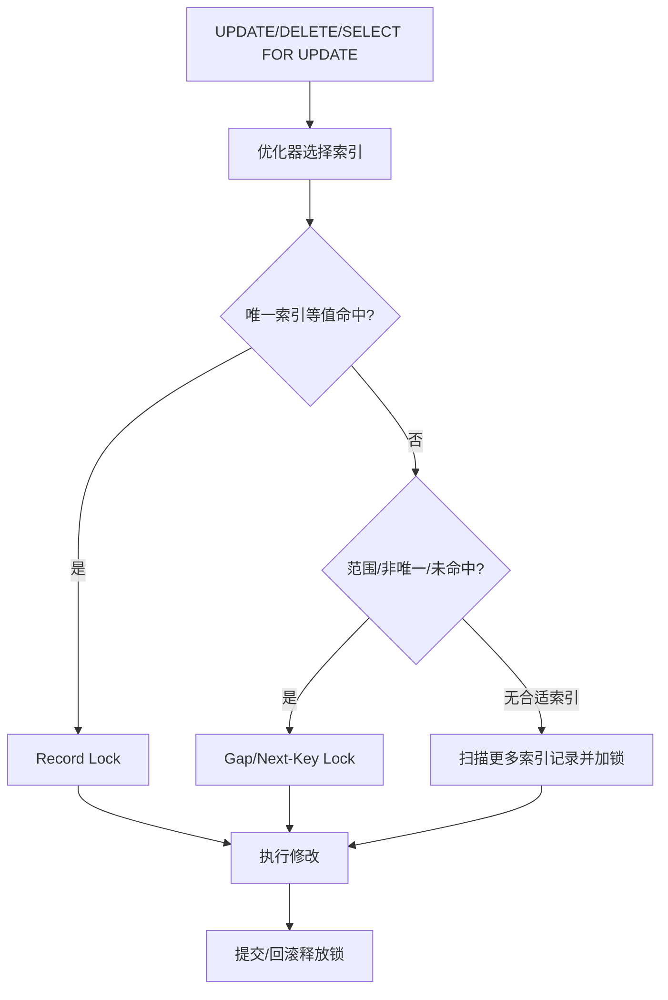
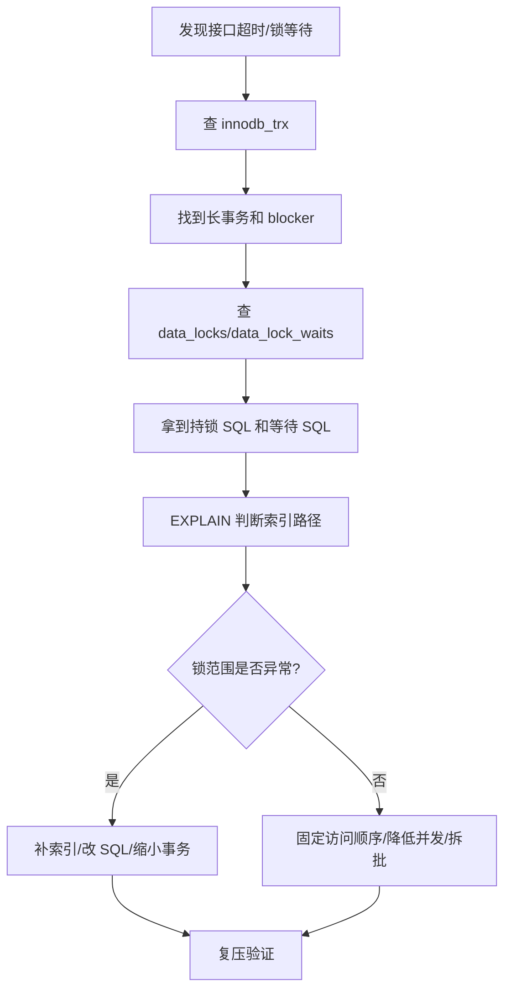

# MySQL锁机制

> [!abstract] 一句话总结
> InnoDB 锁围绕索引记录加锁，记录锁、间隙锁、next-key lock、意向锁共同控制当前读和写写冲突；精通锁机制要能从 SQL、索引和隔离级别推导锁范围。

## 📌 精准定位

- 负责保护并发修改、唯一性检查和范围当前读正确性。
- 不负责让无索引条件高效，无索引更新可能扫描并锁大量记录。
- 关键边界：InnoDB 行锁锁的是索引记录，不是抽象业务行。
- 面试重点：能解释“为什么锁这么多、为什么死锁、为什么 RR 下范围查询会阻塞插入、如何排查锁等待”。

## 🧩 核心概念

| 概念 | 具体含义 | 精通要点 |
| ---- | -------- | -------- |
| Record Lock | 锁住命中的索引记录。 | 唯一索引等值命中常见。 |
| Gap Lock | 锁住索引记录之间间隙。 | 防止范围插入造成幻读。 |
| Next-Key Lock | 记录锁加前间隙锁。 | RR 下范围当前读常见。 |
| 意向锁 | 表级标记事务准备加行锁。 | 用于表锁与行锁兼容判断。 |
| 当前读 | 读取最新并可能加锁。 | `UPDATE`、`DELETE`、`SELECT ... FOR UPDATE`。 |
| 快照读 | 基于 Read View 读历史版本。 | 普通 `SELECT` 多数不加锁。 |

## ⚙️ 工作原理 / 主流程



1. 锁范围由执行计划决定，不由 SQL 文本直觉决定。
2. 唯一索引等值命中存在记录时，通常只锁该记录。
3. 范围查询、非唯一索引、未命中记录可能锁间隙。
4. RR 隔离级别下 next-key lock 用于防止当前读幻读。
5. 死锁检测会构建等待图，发现环后回滚代价较小的事务。
6. lock wait timeout 是等待超时，不等于死锁检测。

## 🔎 当前读与快照读

| 类型 | SQL | 是否加锁 | 说明 |
| ---- | --- | -------- | ---- |
| 快照读 | `SELECT * FROM t WHERE id=1` | 通常不加锁 | 通过 Read View + undo 读一致性视图 |
| 当前读 | `SELECT * FROM t WHERE id=1 FOR UPDATE` | 加锁 | 读最新版本并锁定 |
| 当前读 | `UPDATE t SET ... WHERE id=1` | 加锁 | 修改前先锁定记录 |
| 当前读 | `DELETE FROM t WHERE id=1` | 加锁 | 删除也是当前读 |

> 普通查询是否阻塞，取决于它是不是快照读。很多“为什么 SELECT 不阻塞 UPDATE”的问题，本质是 MVCC 快照读和当前读的区别。

## 🧪 加锁案例

### 案例 1：唯一索引等值命中

```sql
CREATE TABLE user_account (
  id BIGINT PRIMARY KEY,
  phone VARCHAR(32) UNIQUE,
  balance INT
) ENGINE=InnoDB;

BEGIN;
SELECT * FROM user_account WHERE phone = '13800138000' FOR UPDATE;
```

如果 `phone='13800138000'` 存在，通常锁住该唯一索引记录和对应聚簇索引记录，不锁大范围间隙。

面试表达：唯一索引等值命中时，InnoDB 能精确定位一条记录，锁范围较小。

### 案例 2：唯一索引等值未命中

```sql
BEGIN;
SELECT * FROM user_account WHERE phone = '13900000000' FOR UPDATE;
```

如果记录不存在，在 RR 下为了防止其他事务插入同样的 `phone` 造成当前读幻读，可能锁住对应插入位置的间隙。

面试表达：未命中不代表不加锁，RR 下可能锁间隙。

### 案例 3：非唯一索引范围查询

```sql
CREATE INDEX idx_status ON t_order(status);

BEGIN;
SELECT * FROM t_order
WHERE status = 'WAIT_PAY'
FOR UPDATE;
```

`status` 是低选择性非唯一索引，可能锁住多条二级索引记录、对应主键记录，以及范围间隙。并发插入同状态订单可能被阻塞。

修复思路：

- 避免低选择性字段单独作为加锁条件。
- 增加更精确的联合索引，如 `(user_id, status)` 或 `(activity_id, user_id)`。
- 缩小事务范围。

### 案例 4：无索引更新扩大锁范围

```sql
UPDATE t_order SET status = 'CLOSED'
WHERE request_id = 'abc';
```

如果 `request_id` 没有索引，InnoDB 需要扫描大量记录，扫描过程中可能锁住更多记录，造成大面积阻塞。

修复：

```sql
CREATE UNIQUE INDEX uk_request ON t_order(request_id);
```

### 案例 5：库存条件更新防超卖

错误写法：

```sql
SELECT stock FROM sku WHERE id = 100;
-- 应用判断 stock > 0
UPDATE sku SET stock = stock - 1 WHERE id = 100;
```

并发下可能多个线程读到同一个库存值。

正确写法：

```sql
UPDATE sku
SET stock = stock - 1
WHERE id = 100 AND stock > 0;
```

用一条原子条件更新让数据库保证并发正确性。更新行数为 1 表示扣减成功，为 0 表示库存不足。

## 🧱 RC 与 RR 下的锁差异

| 场景 | RC | RR |
| ---- | -- | -- |
| 普通 SELECT | 快照读，每条语句新 Read View | 快照读，事务级 Read View |
| 当前读 | 读最新版本并加锁 | 读最新版本并加锁 |
| Gap Lock | 一般较少，主要用于外键/唯一性检查 | 范围当前读常见，用于防幻读 |
| 幻读防护 | 主要靠当前读加锁或业务约束 | next-key lock 防范围当前读幻读 |

> 注意：MySQL 的 RR 通过 MVCC 解决普通快照读幻读，通过 next-key lock 解决当前读幻读。

## 🔥 死锁复盘

### 典型场景：访问顺序不一致

事务 A：

```sql
BEGIN;
UPDATE account SET balance = balance - 100 WHERE id = 1;
UPDATE account SET balance = balance + 100 WHERE id = 2;
```

事务 B：

```sql
BEGIN;
UPDATE account SET balance = balance - 50 WHERE id = 2;
UPDATE account SET balance = balance + 50 WHERE id = 1;
```

A 持有 id=1 等 id=2，B 持有 id=2 等 id=1，形成死锁。

### 排查命令

```sql
SHOW ENGINE INNODB STATUS\G

SELECT * FROM information_schema.innodb_trx;
SELECT * FROM performance_schema.data_locks;
SELECT * FROM performance_schema.data_lock_waits;
```

### 修复方案

- 所有转账按账户 id 从小到大加锁。
- 缩短事务，避免锁内 RPC。
- 捕获死锁异常后做安全重试。
- 给查询条件补充合适索引，减少锁范围。

## 🧭 锁等待排查路径



## 💻 常用 SQL

```sql
-- 查看事务
SELECT trx_id, trx_state, trx_started, trx_mysql_thread_id, trx_query
FROM information_schema.innodb_trx;

-- 查看锁
SELECT * FROM performance_schema.data_locks;

-- 查看锁等待
SELECT * FROM performance_schema.data_lock_waits;

-- 查看最近死锁
SHOW ENGINE INNODB STATUS\G
```

## ⚠️ 生产坑与注意事项

- 未命中索引的 update 锁范围远超预期。
- 先查库存再更新会超卖，应该用条件更新。
- 事务访问顺序不一致容易死锁。
- 范围条件在 RR 下可能锁住插入间隙。
- 大事务批量更新持锁时间长。
- 事务里调用 RPC 会放大锁等待。
- 低选择性索引用于当前读可能锁住大量记录。

## 🎯 面试问题

> [!question] 高频问题
> - Q: InnoDB 行锁锁什么？
>   - A: 锁索引记录，不是抽象业务行。没有合适索引时会扫描并锁更多记录。
> - Q: Gap Lock 作用？
>   - A: 锁索引记录之间的间隙，防止范围当前读期间插入新记录造成幻读。
> - Q: Record Lock、Gap Lock、Next-Key Lock 区别？
>   - A: Record 锁记录，Gap 锁间隙，Next-Key 是记录锁加前间隙锁。
> - Q: RR 下唯一等值命中加间隙锁吗？
>   - A: 命中存在记录通常是记录锁；未命中、范围查询、非唯一索引更可能出现间隙锁。
> - Q: 死锁怎么处理？
>   - A: 数据库会回滚一个事务，应用要识别死锁错误并安全重试；根因上要统一访问顺序、缩短事务、补索引。
> - Q: 如何降低锁冲突？
>   - A: 短事务、好索引、固定访问顺序、条件更新、拆批、避免事务里 RPC。

## 🎤 面试 3 层回答

### 30 秒版

InnoDB 行锁是加在索引记录上的，锁范围由执行计划决定。唯一索引等值命中通常锁一条记录，范围查询、非唯一索引、未命中或无索引更新可能锁间隙甚至大量记录。排查锁问题要看事务、锁等待、死锁日志和执行计划。

### 2 分钟版

我会先区分快照读和当前读。普通 SELECT 通过 MVCC 读快照，UPDATE、DELETE、SELECT FOR UPDATE 是当前读，会加锁。RR 下范围当前读常用 next-key lock 防幻读。线上如果发生锁等待，我会查 `innodb_trx`、`data_locks`、`data_lock_waits` 和 `SHOW ENGINE INNODB STATUS`，找到 blocker 和等待 SQL，再用 EXPLAIN 判断是不是索引不合适导致锁范围扩大。

### 项目版

在秒杀或订单项目里，库存扣减不能先查再改，而是用 `UPDATE ... WHERE stock > 0` 条件更新。支付回调和超时关单也用状态机条件更新保证互斥。为了降低死锁和锁等待，我会保证事务短、访问顺序固定、关键条件有唯一索引，并避免在事务里调用 RPC。

## ✅ 精通检查清单

- 能解释 InnoDB 行锁锁的是索引记录。
- 能区分快照读和当前读。
- 能说明 Record/GAP/Next-Key Lock 的区别。
- 能推导唯一索引命中、未命中、范围查询、无索引更新的锁范围。
- 能用 `data_locks`、`data_lock_waits`、`innodb_trx` 和死锁日志排查问题。
- 能结合秒杀/订单项目讲条件更新和状态机互斥。

## 🔗 关联笔记

- [[_index]]
- [[20-Java后端/00-总览/学习仪表盘]]
- [[02-事务与隔离级别]]
- [[04-执行计划与SQL优化]]
- [[../04-Spring生态/03-Spring事务管理]]
- [[../09-项目实战/01-项目-高并发秒杀系统]]

## 📚 参考资料

- MySQL Reference Manual: InnoDB Locking
- MySQL Performance Schema Lock Tables
- High Performance MySQL
