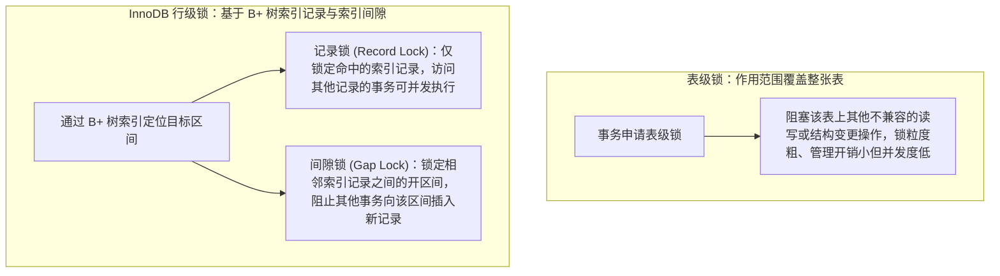
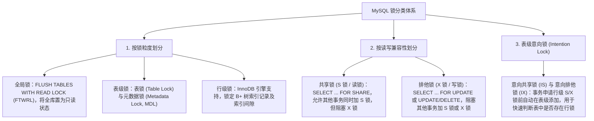
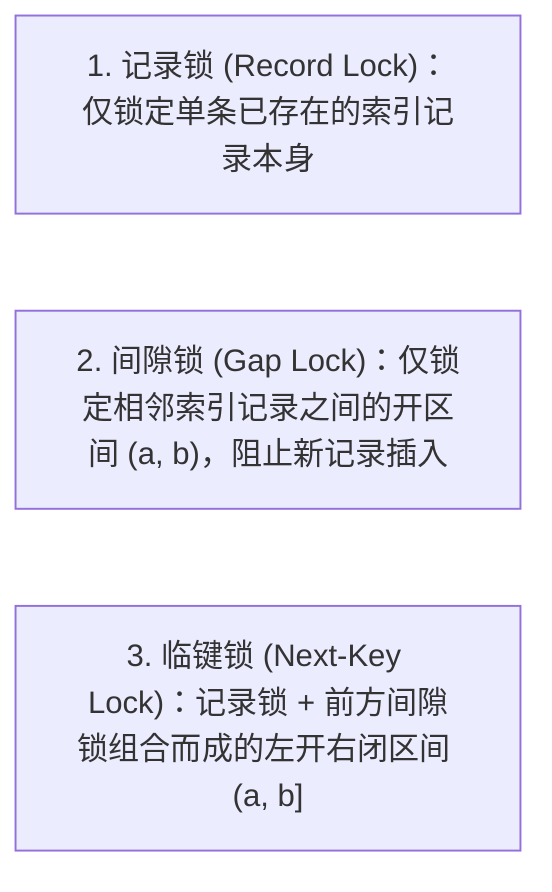
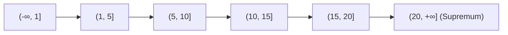
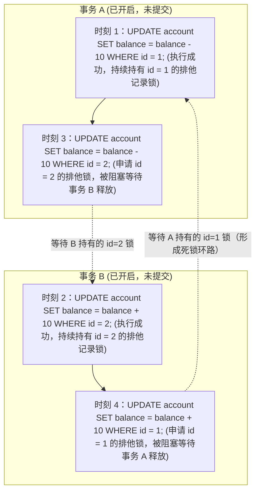

# 🔐 03 · MySQL 锁机制（记录锁、间隙锁与死锁排查）

> **一句话导读**：当多个并发事务执行写操作或锁定读（当前读）时，InnoDB 必须通过锁机制保障数据一致性。理解行锁是如何依托 B+ 树索引项与索引间隙工作的，掌握记录锁、间隙锁、临键锁的加锁边界以及死锁的形成与排查方法，是解决线上并发阻塞的核心基本功。

---

## 一、MySQL 锁体系全景与两大底层铁律

关系型数据库通过锁机制协调并发读写与写写冲突。按锁定范围划分，首先应当区分表级锁与 InnoDB 存储引擎特有的行级锁：



在深入具体的锁类型之前，必须先建立 InnoDB 行锁的**两条底层铁律**（本文默认基于 MySQL 8.0+、InnoDB 引擎、默认的 RR 可重复读隔离级别）：

1. **铁律一：InnoDB 的行锁是加在“索引项”上的，而不是直接加在物理数据行上**
   - InnoDB 的数据本身就是按聚簇索引 B+ 树组织的，行锁本质上是挂载在 B+ 树索引记录上的。
   - 如果一条 `UPDATE`、`DELETE` 或 `SELECT ... FOR UPDATE` 语句的过滤条件**没有命中任何有效索引，导致优化器选择了全表扫描（扫描整棵聚簇索引树）**，那么 InnoDB 在扫描过程中会对全表的所有聚簇索引记录以及所有记录之间的间隙全部加上排他锁，从而阻塞其他事务对该表的任何写入操作（注：此时不加锁的普通 `SELECT` 快照读依然可以通过 MVCC 正常读取）。
2. **铁律二：两阶段锁协议（Two-Phase Locking, 2PL）**
   - 在显式事务（`BEGIN` ... `COMMIT`）中，行锁是在单条 SQL 语句执行并扫描到对应索引项时**按需动态获取**的；
   - 但获取到的所有行锁**并不会在该条 SQL 语句执行完后释放，而是必须一直持有到整个事务执行 `COMMIT` 或 `ROLLBACK` 时才会统一释放**。因此，将高竞争的热点更新语句尽量放在事务的最后一步执行，可以有效缩短热点锁的持有时长。

---

## 二、MySQL 锁分类全景图

MySQL 的锁体系可从**锁粒度**、**读写兼容性模式**以及**表级协调锁**三个维度进行梳理：



### 1. 共享锁（S 锁）与排他锁（X 锁）
- 在 RC 和 RR 隔离级别下，普通的 `SELECT` 语句属于**快照读**，直接基于 MVCC 读取 `ReadView` 可见版本，不申请任何行锁，因此不会被排他锁（X 锁）阻塞。
- 只有显式声明了 `SELECT ... FOR SHARE`（申请 S 锁）或 `SELECT ... FOR UPDATE` / `UPDATE` / `DELETE`（申请 X 锁）的**当前读**操作，才会参与行锁竞争：只有 `S` 锁与 `S` 锁之间相互兼容，只要涉及 `X` 锁（`S` 与 `X`、`X` 与 `X`）均相互互斥。

### 2. 意向锁（IS / IX）为什么要引入？
- **解决的问题**：假设事务 A 锁住了表中的某一行（加了行级 X 锁），此时事务 B 想要申请整张表的**表级锁**（如 `LOCK TABLES ... WRITE`）。如果没有意向锁，事务 B 为了确认表中是否有行被锁住，就必须遍历整张表的几千万行记录去逐一检查，效率极低。
- **工作原理**：InnoDB 规定，任何事务在给某一行加行级 S 锁或 X 锁之前，必须先自动在表级加上对应的 **意向共享锁（IS）** 或 **意向排他锁（IX）**。这样一来，当其他事务想加全表锁时，只需看一眼表级是否存在意向锁即可立即知道表中有无行锁。
- **兼容性要点**：**意向锁之间（包括 IX 与 IX）是完全兼容的**。两个并发事务同时修改不同行时，都会在表级加上 IX 锁，它们在表级不会产生任何冲突，只会在争夺同一行记录的 X 锁时才会互斥。

### 3. 元数据锁（MDL，Metadata Lock）的线上阻塞风险
- **解决的问题**：防止一个事务正在查询表中数据时，另一个会话突然执行 `ALTER TABLE` 删改了表字段，导致查询结果与表结构对不上。
- **工作原理**：执行任何 DML 或查询语句（**包括最普通的 `SELECT` 快照读**）时，MySQL Server 层都会自动申请 **MDL 读锁**（读锁之间互相兼容）；而执行 `ALTER TABLE`、`DROP TABLE` 等 DDL 表结构变更时，则必须申请 **MDL 写锁**（与所有 MDL 读锁、写锁均互斥）。
- **生产事故根因**：MDL 锁同样要等到**事务提交后才释放**。如果线上存在一个未提交的长事务一直持有某张表的 MDL 读锁，此时运维执行了一条 `ALTER TABLE`，该 DDL 线程就会在等待 MDL 写锁时被挂起；更致命的是，由于 MDL 写锁等待在队列中具有高优先级，**排在该 DDL 之后到达的所有普通 `SELECT` 查询也会被全部阻塞**，短短几秒内就会打满数据库连接池！

---

## 三、InnoDB 的三种行级锁算法：Record、Gap 与 Next-Key Lock

在默认的 **可重复读（RR）** 隔离级别下，为了同时解决并发写冲突与当前读场景下的幻读问题，InnoDB 设计了三种行级锁算法：



### 1. 记录锁（Record Lock）
- **锁定范围**：仅锁定 B+ 树上某一条**已经存在的索引记录本身**（在 `performance_schema.data_locks` 监控表中显示为 `REC_NOT_GAP`）。
- **典型场景**：通过主键或唯一索引执行等值查询且记录真实存在，如 `SELECT * FROM users WHERE id = 5 FOR UPDATE;`（表中存在 `id = 5`），此时仅在 `id = 5` 这条记录上加排他记录锁。

### 2. 间隙锁（Gap Lock）与插入意向锁
- **锁定范围**：不锁定任何已存在的记录，而是锁定**两条相邻索引记录之间的开区间**（在监控表中显示为 `GAP`），专门用于阻止其他事务向该区间内 `INSERT` 新记录，从而在当前读下防御幻读。
- **核心特性：为什么两个事务可以同时对同一个区间 `(5, 10)` 加上排他间隙锁（X, GAP）？**
  - **原因剖析**：记录锁之所以需要互斥，是因为两个事务同时修改同一行已有数据会导致数据覆盖错乱；而间隙 `(5, 10)` 里面本来就没有任何数据行，间隙锁唯一的使命就是**“禁止其他事务往这个空隙里插入新行”**。
  - 当事务 A 在 `(5, 10)` 上加了间隙锁，事务 B 也来对 `(5, 10)` 申请间隙锁时，两者的防护目标完全一致（都不让别人往里面插数据），彼此之间不存在写冲突。因此，**纯间隙锁之间是完全兼容的（无论 S 间隙锁还是 X 间隙锁都不会互相阻塞）**。
- **插入意向锁（Insert Intention Lock）与间隙死锁**：
  - 当一个事务执行 `INSERT` 准备向 `(5, 10)` 区间插入 `id = 7` 时，会先申请一种特殊的锁——**插入意向锁**（监控表中显示为 `INSERT_INTENTION`）。如果该区间已被其他事务持有了间隙锁（Gap Lock 或 Next-Key Lock），插入意向锁就会被阻塞。
  - **经典的间隙锁死锁场景**：假设事务 A 和事务 B 都先查询不存在的记录，从而**同时持有了 `(5, 10)` 的间隙锁**（因为间隙锁互相兼容，双方都能成功加锁）；紧接着，事务 A 尝试向该区间执行 `INSERT id = 7`（需要等待事务 B 释放 `(5, 10)` 间隙锁），同时事务 B 尝试执行 `INSERT id = 8`（需要等待事务 A 释放 `(5, 10)` 间隙锁）。双方互相等待对方释放间隙锁，当场触发死锁！

### 3. 临键锁（Next-Key Lock）
- **锁定范围**：临键锁是 InnoDB 在 RR 隔离级别下扫描索引时**默认的基本加锁单位**。它由 **【右边界记录上的记录锁（Record Lock）+ 该记录左边的间隙锁（Gap Lock）】** 组合而成，锁定的是一个 **左开右闭区间 `(a, b]`**（在监控表中显示为 `X` 或 `S`）。
- **为什么临键锁被设计成“左开右闭 `(5, 10]`”，而不是左闭右开？**
  1. **锁在内存中的物理挂载机制**：在 InnoDB 锁管理系统中，每一把锁都必须关联在具体的数据页号（`page_no`）和页内记录堆号（`heap_no`）上。由于两个记录之间的“空白间隙”本身没有物理实体，InnoDB 统一规定将“某条记录前方的间隙锁”挂载在**该间隙右边界的那条真实索引记录**上。因此，挂载在记录 `10` 上的临键锁，天然代表的就是“记录 `10` 左边的间隙 `(5, 10)` + 记录 `10` 本身”，即左开右闭区间 `(5, 10]`。
  2. **利用 `Supremum` 伪记录实现全区间覆盖**：那么表中最后一条最大记录（如 `id = 20`）右边的无穷大区间 `(20, +∞)` 挂在谁身上呢？在 [[01-MySQL索引原理-B+树]] 中我们学过，每个 InnoDB 数据页内部都内置了一条代表正无穷大的虚拟记录——**`Supremum` 伪记录**（`heap_no = 1`）。InnoDB 将 `(20, +∞)` 的锁挂载在 `Supremum` 伪记录上，从而严丝合缝地覆盖整根索引数轴。

---

## 四、行锁加锁规则实战推演

分析一条 SQL 语句在 RR 隔离级别下的具体加锁范围，核心是顺着 **B+ 树索引的实际扫描路径** 看它访问了哪些索引记录与间隙。

假设 `users` 表中目前有 `id`（主键）为 `1, 5, 10, 15, 20` 的 5 条记录，整棵主键索引树被切分为以下 6 个左开右闭的临键区间：



### 场景一：唯一索引（含主键）等值查询
1. **等值查询记录存在**（如 `SELECT * FROM users WHERE id = 5 FOR UPDATE`）：
   - 由于主键/唯一索引具有唯一性约束，既然 `id = 5` 已经存在，其他事务绝不可能再插入另一条 `id = 5` 的记录。因此无需锁定前方间隙，临键锁 `(1, 5]` 直接退化为 **纯记录锁（Record Lock）**，仅锁住 `id = 5` 这一行。
2. **等值查询记录不存在**（如 `SELECT * FROM users WHERE id = 7 FOR UPDATE`）：
   - B+ 树二分查找定位到 `7` 落在 `(5, 10]` 区间内，扫描到右边界记录 `10` 时发现 `10 != 7`。为了防止其他事务在当前事务期间插入 `id = 7`，临键锁 `(5, 10]` 退化为 **纯间隙锁（Gap Lock）`(5, 10)`**，不锁住右边界记录 `10` 本身。

> 📌 **适用前提**：上述退化为纯记录锁的前提是**查询条件完整等值匹配了唯一索引的所有列且值非 `NULL`**。如果联合唯一索引只匹配了部分最左前缀列，由于可能匹配多行，加锁行为将按照普通非唯一索引处理。

### 场景二：非唯一普通索引等值查询
- 假设表上建有普通二级索引 `idx_age(age)`，已有记录的 `age` 值同样为 `1, 5, 10, 15, 20`，执行 `SELECT * FROM users WHERE age = 10 FOR UPDATE;`：
  1. 由于普通索引允许插入重复的 `age = 10` 记录，仅仅锁住已有的 `age = 10` 记录无法阻止其他事务在该记录前后继续插入新的 `age = 10`。
  2. 因此，InnoDB 首先对命中的 `age = 10` 索引项加上 **临键锁（Next-Key Lock）`(5, 10]`**；
  3. 随后继续沿着二级索引叶子链表向右扫描，直到遇到第一个不等于 `10` 的记录（即 `age = 15`）停止，并对该区间加上 **纯间隙锁（Gap Lock）`(10, 15)`**。
  4. 同时，对于扫描命中的 `age = 10` 二级索引记录，InnoDB 还会回表对其关联的**聚簇索引主键记录**加上 **纯记录锁（Record Lock）**。

### 场景三：索引范围查询
- 例如在主键上执行 `SELECT * FROM users WHERE id >= 10 AND id < 20 FOR UPDATE;`：
  1. 首先定位左边界 `id = 10`，由于是唯一索引等值命中，对 `id = 10` 加记录锁；
  2. 随后顺着索引链表向右扫描，扫到 `id = 15` 满足 `< 20`，对其加上 **临键锁 `(10, 15]`**；
  3. 继续向右扫到 `id = 20` 时判断已超出 `< 20` 范围（在 MySQL 8.0.18+ 中，优化器识别到开区间 `< 20` 无需锁住右端点 `20` 本身，将其收敛为 **纯间隙锁 `(15, 20)`**）。最终锁定范围为 `[10, 20)`，任何试图向该范围插入或修改记录的事务均会被阻塞。

---

## 五、死锁（Deadlock）机制与生产排查

### 1. 死锁是如何形成的？
死锁是指两个或多个事务在执行过程中，各自持有对方所需要的锁，同时又在等待对方释放锁，从而在锁等待图（Wait-for Graph）中形成了**有向循环等待环路**。

结合两阶段锁协议（行锁持有至事务结束才释放），最典型的交叉更新死锁过程如下：



### 2. 死锁自动检测（Error 1213）与锁等待超时（Error 1205）的区别
1. **死锁主动检测（`innodb_deadlock_detect = ON`，默认开启）**：
   - 每当有事务因申请不到锁而进入等待状态时，InnoDB 就会遍历锁等待图检查是否出现环路。
   - 一旦检测到死锁环路，InnoDB 会立即挑选环路中**回滚代价最小（即事务内已修改行数最少、产生的 Undo Log 最少）**的那个事务作为受害者，**自动回滚该受害者的整个事务**并释放其持有的全部锁，同时向应用层抛出异常：`ERROR 1213 (40001): Deadlock found when trying to get lock; try restarting transaction`；而另一个事务则立即拿到锁继续正常执行。
2. **锁等待超时（`innodb_lock_wait_timeout`，默认 50 秒）**：
   - 当事务 A 只是单向等待事务 B 释放锁（并未形成环路），且等待时间超过了阈值时，会抛出 `ERROR 1205 (HY000): Lock wait timeout exceeded`。
   - **关键差异注意**：发生 `1213` 死锁时，InnoDB 会自动回滚受害者的**整个事务**；而在默认配置（`innodb_rollback_on_timeout = OFF`）下发生 `1205` 锁等待超时时，MySQL **仅仅回滚当前超时报错的那一条 SQL 语句**，而不会自动回滚该事务内前面已经执行成功的语句！因此在 Java 应用层使用 `@Transactional` 时，务必确保捕获所有 `Exception`（`rollbackFor = Exception.class`）以触发完整事务回滚。

### 3. 线上排查锁阻塞与死锁的标准命令
1. **回溯最近一次死锁的完整现场**：
   ```sql
   SHOW ENGINE INNODB STATUS;
   ```
   在输出结果中查找 **`LATEST DETECTED DEADLOCK`** 段落，其中清晰记录了死锁发生的时间、两个事务各自正在执行的 SQL 语句、各自已持有的锁（`HOLDS THE LOCK(S)`）、正在等待的锁（`WAITING FOR THIS LOCK TO BE GRANTED`）以及最终被 InnoDB 选定回滚的事务编号。
2. **排查当前实时正在发生的锁等待（MySQL 8.0+）**：
   - 查看当前所有已持有及申请中的行锁明细：
     ```sql
     SELECT ENGINE_TRANSACTION_ID, OBJECT_NAME, INDEX_NAME, LOCK_TYPE, LOCK_MODE, LOCK_STATUS, LOCK_DATA
     FROM performance_schema.data_locks;
     ```
     *(其中 `LOCK_MODE` 列：`X,REC_NOT_GAP` 代表排他记录锁，`X,GAP` 代表排他间隙锁，`X` 代表排他临键锁，`X,INSERT_INTENTION` 代表插入意向锁。)*
   - 查看当前谁阻塞了谁（行锁等待关系）：`SELECT * FROM performance_schema.data_lock_waits;` 或 `SELECT * FROM sys.innodb_lock_waits;`。
   - 查看表级元数据锁（MDL）等待关系：`SELECT * FROM sys.schema_table_lock_waits;`。

---

## 六、工程落地：预防死锁与降低锁冲突的四项规范

1. **统一多行更新的加锁顺序（消除交叉等待环路）**：当单个事务内需要批量或分步更新多条记录时，必须在 Java 业务层先按主键或唯一索引 ID 进行**升序排序**（例如 `orderIds.sort(Long::compareTo)`），确保所有并发线程始终按照从小到大的相同顺序申请行锁，从根本上消除交叉死锁。
2. **拆解长事务，缩短锁持有时间**：由于行锁一直持有到事务提交才释放，必须将远程 RPC 调用、HTTP 请求、消息队列发送等非数据库操作移出 `@Transactional` 事务边界，或改用 `TransactionTemplate` 精确包裹写库代码块。
3. **确保所有更新语句命中精准索引**：在上线前对所有 `UPDATE`、`DELETE` 和 `SELECT ... FOR UPDATE` 执行 `EXPLAIN` 审查，严防因缺少索引或隐式类型转换导致全表扫描锁表。
4. **评估采用 RC（读已提交）隔离级别**：对于绝大部分互联网高并发业务，可将事务隔离级别设为 **`READ COMMITTED`（RC）**。在 RC 级别下，普通的条件扫描只锁命中的记录而**不加间隙锁（Gap Lock）**，并且对于扫描过但不满足 `WHERE` 条件的记录会提前释放行锁，能大幅减少间隙锁冲突与死锁概率。

---

## 🧠 一分钟复盘核心记忆卡

1. **两大底层铁律**：InnoDB 行锁加在 **B+ 树索引项**上（无索引全表扫描会锁住全表所有记录与间隙）；行锁遵循**两阶段锁协议**，按需获取并持有到事务 `COMMIT` 或 `ROLLBACK` 才释放。
2. **三种行锁算法**：**记录锁（`REC_NOT_GAP`）** 仅锁单条记录；**间隙锁（`GAP`）** 锁开区间阻止插入（且纯间隙锁之间互相兼容）；**临键锁（`Next-Key Lock`）** 为“前方间隙 + 右边界记录”组成的左开右闭区间 `(a, b]`。
3. **死锁与排障**：死锁源于锁等待环路（如交叉更新或同间隙先持 Gap 锁再并发 Insert），通过 `SHOW ENGINE INNODB STATUS` 与 `performance_schema.data_locks` 定位；通过固定加锁顺序、缩短事务边界、精准命中索引及选用 RC 级别预防。

---

## 🧭 下一步

掌握了索引结构与并发加锁规则后，当线上出现慢查询时，我们如何通过 `EXPLAIN` 看懂查询优化器选择的执行路径？如何系统性地解决索引失效与千万级大表的深分页性能瓶颈？
请进入下一篇：[[04-执行计划与SQL优化]]！
