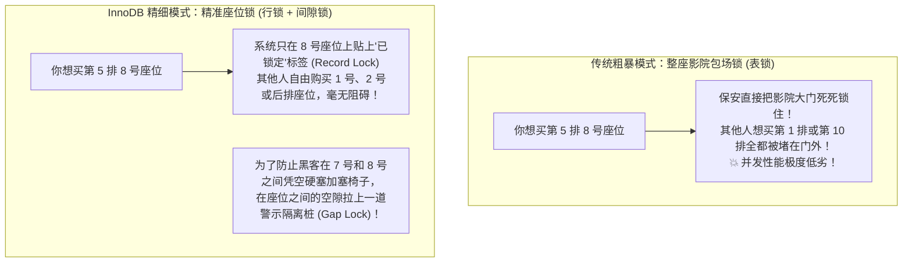
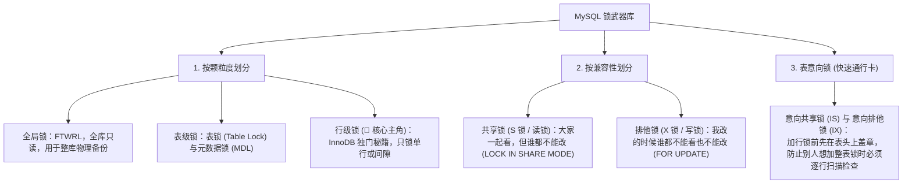
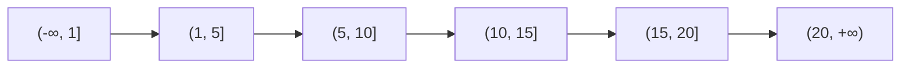
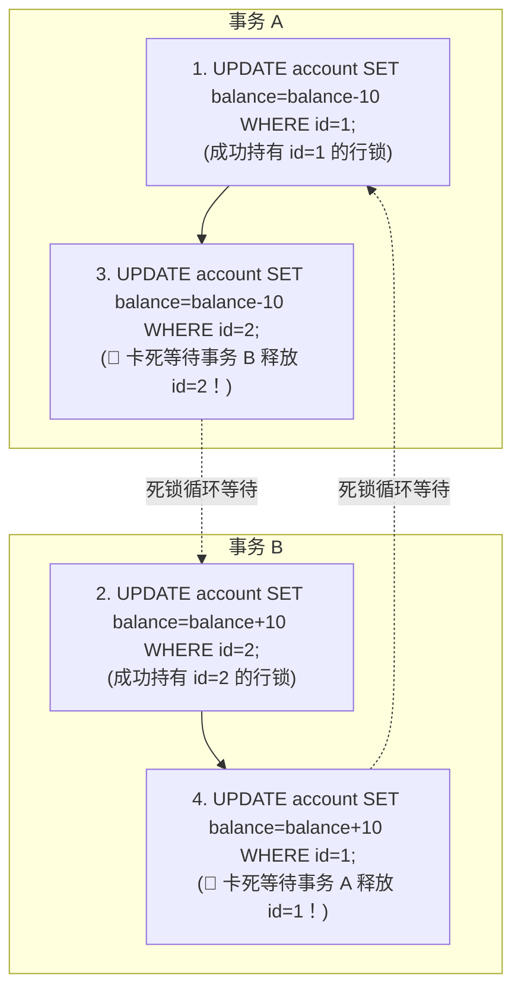

# 🔐 03 · MySQL 锁机制（电影院选座、路障占位与死锁迷宫）

> **一句话导读**：为什么写了一条简单的 `UPDATE` 语句，整张表的所有人都被卡死动弹不得？为什么两个只有几行数据的事务会互相报 `Deadlock` 死锁崩溃？掌握行锁的加锁原则、间隙锁（Gap Lock）的防插队哲学，你就彻底攻破了高并发数据库的至暗迷宫。

---

## 🎟️ 核心心智模型：电影院选座与施工隔离桩

假设你在电影院订票选座：



> 💡 **核心认知前提**：
> **InnoDB 的行锁，锁的从来都不是那行物理数据，锁的是【索引（B+ 树上的索引项）】！**
> 如果你的 SQL 语句没命中任何索引，InnoDB 就只能顺着主键树全表挨个遍历，**导致整张表的所有记录全部被锁死，瞬间退化为事实上的表锁！**

---

## 🏛️ MySQL 锁分类全景鸟瞰图

MySQL 里的锁名词多如牛毛，其实只要按 **3 个维度** 拆解，逻辑非常清晰：



---

## 🔬 InnoDB 行锁三大法宝（大厂必考王炸）

在默认的 **可重复读（RR）** 隔离级别下，InnoDB 祭出了 3 种行级锁：


### 1. 记录锁（Record Lock）
- 精准锁住某一条确切存在的数据行。
- 例如：`SELECT * FROM users WHERE id = 5 FOR UPDATE;`（前提是 `id=5` 这行确实存在），此时只锁住 `id=5` 这一行。

### 2. 间隙锁（Gap Lock - 专防“插队加塞”）
- **间隙锁不针对具体的数据行，它锁的是“不存在数据的空白缝隙”！**
- 假设表里只有主键为 `5` 和 `10` 的两条记录，中间 `(5, 10)` 这个空档没有任何数据。
- 此时如果加了 `(5, 10)` 的间隙锁，**任何其他事务想执行 `INSERT INTO users (id) VALUES (7)` 都会被强行卡住排队！**
- > 🌟 **间隙锁的关键特性**：**间隙锁之间是完全兼容的！** 事务 A 占了 `(5, 10)` 的间隙锁，事务 B 也可以占 `(5, 10)` 的间隙锁。因为大家的目的都是“**一致对外，阻止第三者插队插入**”。

### 3. 临键锁（Next-Key Lock）
- InnoDB 在 RR 隔离级别下的**默认加锁基本单位**。
- 它是一个**左开右闭**的区间，比如 `(5, 10]`（包含了 5 到 10 之间的空白间隙，以及 10 这个记录本身）。

---

## 🎯 行锁加锁实战规则演练（大厂经典面试拆解）

这是大厂 DBA 和高阶面试最爱考察的题目：“以下 SQL 在 RR 级别下到底锁住了哪些范围？”

假设当前表内有主键为 `1, 5, 10, 15, 20` 的记录：



### 规则一：唯一索引等值查询
1. **如果查询的值真实存在**（如 `WHERE id = 5 FOR UPDATE`）：
   - 原本默认加 `(1, 5]` 的临键锁；
   - 因为是主键且唯一定位到了一条数据，不需要防幻读，**临键锁自动降级为【纯记录锁】**，只锁 `id = 5` 这一行！
2. **如果查询的值根本不存在**（如 `WHERE id = 7 FOR UPDATE`）：
   - 定位到所在区间 `(5, 10]`；
   - 因为 `id=7` 不存在，**临键锁自动降级为【纯间隙锁】` (5, 10) `**！此时谁想插入 6、7、8、9 全部被阻塞！

### 规则二：非唯一普通索引等值查询
- 如果字段不是唯一主键，即使该值存在，为了防止别人并发往这个值旁边插入同名记录，**InnoDB 不仅会对该记录加 Next-Key Lock，还会对其右侧相邻的间隙追加一个 Gap Lock！**

### 规则三：无索引全表查询（🚨 生产最高危炸弹！）
```sql
-- 危险代码：status 字段没有建任何索引！
UPDATE orders SET status = 'CANCEL' WHERE status = 'WAIT_PAY';
```
- **后果**：MySQL 无法使用索引定位，只能启动聚簇索引扫描，**将全表所有的间隙和所有记录全部加上排他锁！整个表被彻底完全冻结，所有人的写操作全部卡死！**

---

## 💀 死锁（Deadlock）的经典案发现场与日志抓凶

什么是死锁？**“你拿着我的锁，我拿着你的锁，谁都不肯撒手，双向奔赴地死等。”**



### 🚨 现场发生死锁时 MySQL 会做什么？
- InnoDB 自带**死锁检测机制（Wait-for Graph）**；
- 一旦检测到闭环死锁，系统会**以最小的代价主动发起自救**：选择“undo log 日志量最小、回滚代价最低”的那个事务，**强行让其回滚报错退出**，抛出错误：
  `ERROR 1213 (40001): Deadlock found when trying to get lock; try restarting transaction`；
- 另一个幸运的事务则得以顺利拿到锁提交。

### 🛠️ 线上怎么排查死锁？
在 MySQL 终端中输入最著名的排障神技：
```sql
SHOW ENGINE INNODB STATUS;
```
在输出的大段日志中找到 **`LATEST DETECTED DEADLOCK`** 这一段，里面逐行详细记录着：**事务 1 拿着什么锁在等什么锁、事务 2 拿着什么锁在等什么锁、哪条 SQL 语句是凶手**，一目了然！

---

## 🛡️ 规避死锁与锁超时的四大生产黄金法则

1. **统一加锁顺序**：如果业务需要操作多行数据，代码里**务必先按照主键 id 进行升序排序（`list.sort(Comparator.comparing(Order::getId))`），按固定顺序循环更新**，彻底打破交叉等待死锁环！
2. **严禁大事务**：长事务会长时间霸占行锁不放，把复杂的远程调用（RPC、调短信）移出事务代码（参考第四章 [[20-Java后端/04-Spring生态/03-Spring事务管理|Spring 事务最佳实践]]）。
3. **关键查询必须走索引**：坚决杜绝因为没有索引引发全表行锁。
4. **高并发场景降级为 RC 隔离级别**：在很多超高并发互联网公司（如阿里、美团），会将生产默认隔离级别调整为 **Read Committed（RC）**。在 RC 级别下，除了外键检查外**彻底移除了间隙锁（Gap Lock）**，只保留精确记录锁，死锁和锁冲突概率大幅骤降 80%！

---

## 🧠 一分钟复盘核心记忆卡

1. **锁的本质**：InnoDB 的行锁锁在**索引项**上，无索引更新等于全表锁死。
2. **三大行锁**：**记录锁（锁真实行）**、**间隙锁（锁空白区间防插入）**、**临键锁（合体区间，RR 默认）**。
3. **死锁防范**：多行更新**按主键固定排序**；线上抓凶必用 `SHOW ENGINE INNODB STATUS`。

---

## 🧭 下一步

掌握了索引的快速查询和锁的安全保护，当线上出现慢 SQL 时，我们该如何像老中医一样切脉问诊？
`EXPLAIN` 命令里的几十个字段到底看哪个？
请进入下一站：[[04-执行计划与SQL优化]]！
