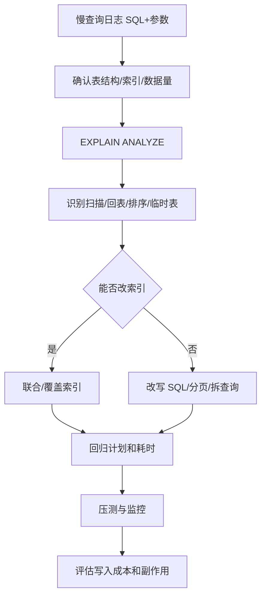

# 执行计划与SQL优化

> [!abstract] 一句话总结
> SQL 优化要用执行计划证明访问路径，把扫描行数、回表、排序、临时表和网络返回量降到可接受范围；面试重点是“拿真实 SQL 和前后指标说话”。

## 📌 精准定位

- 负责定位慢 SQL 为什么慢，并用索引、改写、分页、拆分减少成本。
- 不负责用猜测替代压测，优化必须结合真实参数和数据分布。
- 关键边界：同一 SQL 在不同参数、统计信息和数据量下可能选不同计划。
- 5 年经验表达重点：原 SQL、表结构、数据量、执行计划、优化动作、前后耗时和副作用。

## 🧩 核心概念

| 概念 | 具体含义 | 精通要点 |
| ---- | -------- | -------- |
| type | 访问类型，从 const/ref/range 到 index/all。 | ALL 不一定必坏，但大表高频 ALL 危险。 |
| rows/filtered | 估算扫描行数和过滤比例。 | 估算偏差会导致选错索引。 |
| Extra | Using filesort、temporary、index 等信号。 | 结合 rows 和耗时判断。 |
| 代价模型 | 基于 IO、CPU、统计信息估算。 | ANALYZE TABLE 可刷新统计信息。 |
| 回表 | 二级索引查到主键后再查聚簇索引。 | 返回列多、命中行多时成本高。 |
| 覆盖索引 | 查询列都在索引中。 | 能减少回表，但会增加索引维护成本。 |

## ⚙️ 工作原理 / 主流程



1. 先收集慢查询日志中的真实 SQL、参数、耗时、扫描行数。
2. 确认表结构、现有索引、数据量和数据分布。
3. 用 `EXPLAIN ANALYZE` 看实际执行时间和循环次数。
4. 检查 WHERE、JOIN、ORDER BY、LIMIT 是否能被同一索引服务。
5. 大 offset 改游标分页或延迟关联。
6. 优化后记录前后计划差异并压测。
7. 最后评估新增索引带来的写放大、索引空间和锁影响。

## 💻 常用命令

```sql
EXPLAIN ANALYZE
SELECT id, title FROM article
WHERE author_id = ? AND status = 'PUBLISHED' AND id < ?
ORDER BY id DESC LIMIT 20;

EXPLAIN FORMAT=TREE
SELECT ...;

SHOW INDEX FROM article;

ANALYZE TABLE article;
```

## 🔍 执行计划字段速查

| 字段 | 看什么 | 面试表达 |
| ---- | ------ | -------- |
| type | 访问类型 | `ref/range` 通常可接受，`ALL` 要结合数据量判断 |
| possible_keys | 可能用的索引 | 有索引不代表一定会用 |
| key | 实际使用索引 | 只看 key 不够，要看 rows 和实际耗时 |
| key_len | 用到索引前缀长度 | 判断联合索引用到了几列 |
| rows | 估算扫描行数 | 和真实耗时一起看，估算可能偏差 |
| filtered | 过滤比例 | 低 filtered 说明很多行扫了又丢 |
| Extra | 排序、临时表、覆盖索引等 | `Using filesort/temporary` 是重点信号 |

## 🧪 案例 1：联合索引列顺序优化

### 原 SQL

```sql
SELECT id, amount, created_at
FROM t_order
WHERE user_id = 1001
  AND status = 'PAID'
ORDER BY created_at DESC
LIMIT 20;
```

### 原索引

```sql
KEY idx_status(status),
KEY idx_user(user_id)
```

### 问题

优化器只能选择 `idx_user` 或 `idx_status` 之一，过滤后还需要排序。用户订单多时，会出现扫描行数大、`Using filesort`。

### 优化

```sql
CREATE INDEX idx_user_status_created
ON t_order(user_id, status, created_at DESC);
```

### 优化后

- `user_id`、`status` 做等值过滤。
- `created_at` 直接满足排序。
- `LIMIT 20` 可以尽早停止扫描。

### 取舍

- 写入订单时多维护一个索引。
- 如果 `status` 选择性很低但查询固定带它，仍适合放在等值列中。
- 如果列表页只返回 `id/amount/created_at`，可以考虑覆盖索引，但索引过宽会增加写成本。

## 🧪 案例 2：大分页优化

### 原 SQL

```sql
SELECT id, title, created_at
FROM article
WHERE status = 'PUBLISHED'
ORDER BY id DESC
LIMIT 100000, 20;
```

### 问题

MySQL 需要扫描并丢弃前 100000 行，再返回 20 行。offset 越大越慢。

### 优化 1：游标分页

```sql
SELECT id, title, created_at
FROM article
WHERE status = 'PUBLISHED'
  AND id < ?
ORDER BY id DESC
LIMIT 20;
```

索引：

```sql
CREATE INDEX idx_status_id ON article(status, id);
```

### 优化 2：延迟关联

```sql
SELECT a.id, a.title, a.created_at
FROM article a
JOIN (
  SELECT id
  FROM article
  WHERE status = 'PUBLISHED'
  ORDER BY id DESC
  LIMIT 100000, 20
) t ON a.id = t.id;
```

### 取舍

- 游标分页性能最好，但不能任意跳页。
- 延迟关联适合兼容页码模式，但深分页仍有成本。
- 后台导出类需求应异步任务化，不要在线分页硬扛。

## 🧪 案例 3：隐式转换导致索引失效

### 原 SQL

```sql
SELECT * FROM user_account WHERE phone = 13800138000;
```

表结构：

```sql
phone VARCHAR(32) NOT NULL,
KEY idx_phone(phone)
```

### 问题

字段是字符串，参数是数字，可能触发隐式类型转换，导致索引无法按预期使用。

### 修复

```sql
SELECT * FROM user_account WHERE phone = '13800138000';
```

并在代码层保证参数类型正确。

### 排查点

- `EXPLAIN` 看是否使用 `idx_phone`。
- `SHOW WARNINGS` 看是否存在隐式转换提示。
- 检查 ORM 参数绑定类型。

## 🧪 案例 4：select * 破坏覆盖索引

### 原 SQL

```sql
SELECT *
FROM t_order
WHERE user_id = ? AND status = ?
ORDER BY id DESC
LIMIT 20;
```

即使有索引：

```sql
CREATE INDEX idx_user_status_id ON t_order(user_id, status, id);
```

也可能因为返回列太多，导致大量回表。

### 优化

列表页只查必要字段：

```sql
SELECT id, status, amount, created_at
FROM t_order
WHERE user_id = ? AND status = ?
ORDER BY id DESC
LIMIT 20;
```

必要时建立覆盖索引：

```sql
CREATE INDEX idx_user_status_id_amount_time
ON t_order(user_id, status, id, amount, created_at);
```

### 取舍

- 覆盖索引适合高频列表页。
- 不要为了一个低频查询建立很宽索引。
- 大字段如 text/json 不应放进覆盖索引。

## 🧪 案例 5：JOIN 驱动表选择错误

### 原 SQL

```sql
SELECT o.id, o.amount, u.name
FROM t_order o
JOIN t_user u ON o.user_id = u.id
WHERE u.city = '杭州'
  AND o.status = 'PAID';
```

### 问题

如果 `u.city` 过滤后用户仍很多，而 `o.status` 选择性也低，JOIN 可能产生大量中间结果。

### 优化方向

- 确认驱动表：先过滤结果更小的一方。
- 给连接列和过滤列建合适索引。
- 避免连接字段类型、字符集不一致。

索引示例：

```sql
CREATE INDEX idx_user_city_id ON t_user(city, id);
CREATE INDEX idx_order_user_status ON t_order(user_id, status);
```

### 取舍

- JOIN 优化必须看数据分布，不能只看 SQL 文本。
- 如果跨库或数据量极大，可能需要冗余字段、宽表、ES 或离线数仓。

## ⚠️ 生产坑与注意事项

- 只看 `key` 不看 `rows`、`filtered` 和实际耗时。
- 给每个查询单独加索引导致写入成本暴涨。
- `select *` 破坏覆盖索引。
- JOIN 字段类型或字符集不一致导致隐式转换。
- 开发库数据太少，计划和生产不同。
- 前导模糊 `LIKE '%abc'` 不能用普通 B+ 树前缀定位。
- 低选择性列单独建索引可能被优化器放弃。
- 范围查询后的列通常不能继续用于精确定位，但可能用于索引下推或覆盖。

## 🧭 排查路径

- 计划突然变差：检查统计信息、数据倾斜、MySQL 版本、参数和绑定变量。
- 排序慢：看 `ORDER BY` 是否匹配索引方向，是否有 `Using filesort`。
- JOIN 慢：确认驱动表、连接列索引、字段类型和返回行数。
- CPU 高：查看高频 digest 和应用侧调用次数。
- 锁等待高：确认慢 SQL 是否在事务里长时间执行。

## 🎯 面试问题

> [!question] 高频问题
> - Q: SQL 优化步骤？
>   - A: 先拿真实 SQL 和参数，再看表结构、索引、数据量，用 `EXPLAIN ANALYZE` 定位扫描、回表、排序、临时表等成本点，之后改索引或 SQL，最后用前后计划和耗时验证。
> - Q: `Using filesort` 一定要消除吗？
>   - A: 不一定。小结果集可接受，大结果集、高频接口、分页接口才危险。关键看 rows、实际耗时和是否影响 P99。
> - Q: 联合索引列顺序怎么定？
>   - A: 围绕查询模式设计，一般把等值过滤列放前面，范围/排序列放后面，再考虑覆盖列。不是简单按选择性绝对排序。
> - Q: 优化器为什么不用索引？
>   - A: 可能是选择性低、回表成本高、统计信息偏差、隐式转换、函数计算、返回行数太多或全表扫描更便宜。
> - Q: 大分页怎么优化？
>   - A: 优先游标分页；必须页码时可延迟关联；导出类需求异步化；搜索类需求可交给 ES。

## 🎤 面试 3 层回答

### 30 秒版

SQL 优化不能靠猜，要拿真实 SQL、真实参数和执行计划，看扫描行数、回表、排序和临时表，然后通过联合索引、覆盖索引、SQL 改写或分页改造降低成本，最后用 `EXPLAIN ANALYZE` 和压测验证。

### 2 分钟版

我会先从慢查询日志拿到 SQL、参数和耗时，再确认表结构、索引和数据量。然后看执行计划里的 type、key、rows、filtered、Extra，判断是全表扫描、回表多、排序慢还是 JOIN 中间结果过大。优化时优先让 WHERE、ORDER BY、LIMIT 被同一个联合索引服务，避免 `select *`，大分页改游标。优化后还要评估新增索引带来的写入成本。

### 项目版

在订单列表或秒杀记录查询里，如果用户维度列表页慢，我会基于 `user_id + status + id` 建联合索引，让等值过滤和倒序分页走同一条索引；如果返回列固定，再考虑覆盖索引。验证时记录优化前后 `EXPLAIN ANALYZE`、rows、耗时、P95 和慢 SQL 数量。

## ✅ 精通检查清单

- 能读懂 `EXPLAIN` 和 `EXPLAIN ANALYZE` 的关键字段。
- 能给出至少 3 个真实 SQL 优化案例。
- 能解释联合索引、覆盖索引、大分页、隐式转换、JOIN 优化。
- 能说明新增索引的副作用：写放大、空间占用、锁和维护成本。
- 能结合项目讲清优化前后指标。

## 🔗 关联笔记

- [[_index]]
- [[20-Java后端/00-总览/学习仪表盘]]
- [[01-MySQL索引原理-B+树]]
- [[03-MySQL锁机制]]
- [[02-事务与隔离级别]]

## 📚 参考资料

- MySQL Reference Manual: Optimizing Queries
- MySQL Reference Manual: EXPLAIN Output
- High Performance MySQL
