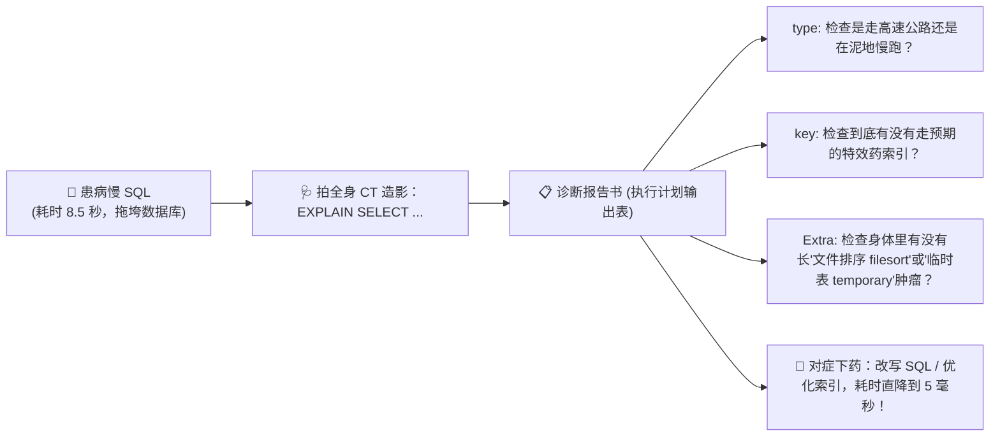
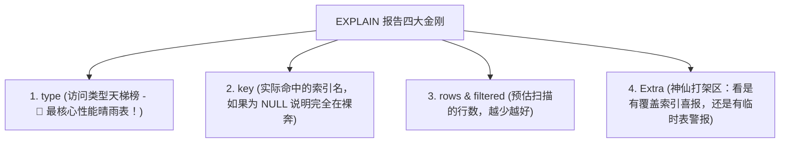
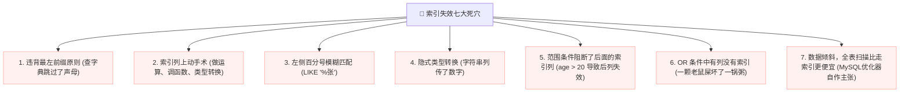

# 🩺 04 · 执行计划与 SQL 优化（老中医慢 SQL 问诊与 EXPLAIN 拍片全解）

> **一句话导读**：线上接口响应突然从 50 毫秒飙升到 10 秒，数据库 CPU 瞬间打满 100%？别慌！`EXPLAIN` 命令就是数据库的**“全身 CT 造影机”**。搞懂 `type` 性能天梯、`Extra` 关键隐患，以及让大厂工程师谈之色变的**“索引失效七大死穴”**，你就能轻松秒杀任何慢 SQL 性能调优难题。

---

## 🏥 核心心智模型：老中医给慢 SQL 拍全身 CT 片

把一条跑得很慢的 SQL 语句想象成一个**面色苍白、走路气喘吁吁的重病患者**：



---

## 🔬 EXPLAIN 拍片核心指标：死磕“四大金刚”

在 SQL 前面加上 `EXPLAIN`，MySQL 不会真正跑业务，而是会返回一张执行计划表。
初学者容易被十几列参数吓退，其实**核心只需盯紧以下 4 个关键列**：



---

### 🥇 第一大金刚：`type` 性能天梯榜（从神级到地狱级）

`type` 列反映了 MySQL 到底是用什么姿势在磁盘上找数据的。
**性能从最优到最差的排列顺序必须倒背如流：**

$$\text{system} > \text{const} > \text{eq\_ref} > \text{ref} > \text{range} > \text{index} > \text{ALL}$$


| type 级别 | 现实生活比喻 | 技术含义与出现场景 | 性能评价 |
| :--- | :--- | :--- | :--- |
| **`system / const`** | **闪现秒取** | 根据**主键或唯一索引**进行等值查询（如 `WHERE id = 1`），最多只匹配 1 行，直接定位。 | 🌟 **神级极速** |
| **`eq_ref`** | **一对一精准配对** | 多表连接查询（JOIN）时，驱动表与被驱动表使用的是**主键或唯一索引关联**。 | 🌟 **极佳** |
| **`ref`** | **翻到同名那一页** | 使用**非唯一普通索引**进行的等值匹配（如 `WHERE name = '张三'`），可能有多行重名数据。 | ✅ **优秀（生产基准线）** |
| **`range`** | **翻看某个章节区间** | 索引列上的**范围扫描**（使用 `BETWEEN`、`IN`、`>`、`<`）。 | ✅ **良好（合格）** |
| **`index`** | **把字典整本目录从头到尾读完** | 虽然走了索引，但**把整棵索引树的所有叶子节点全部扫了一遍**（通常是因为能用覆盖索引避免回表）。 | ⚠️ **及格边缘** |
| **`ALL`** | **在整座图书馆漫无目的地地毯式盲搜** | **全表物理数据扫描（Full Table Scan）！** 数据量稍微破百万，CPU 直接爆炸！ | 🚨 **地狱级灾难！必须消灭！** |

---

### 🏆 第二大金刚：`Extra` 关键特征解码

`Extra` 列藏着很多意想不到的深水炸弹和性能喜报：

- **`Using index`（🌟 顶级喜报）**：
  - 恭喜你！命中了我们在第 01 篇学到的**覆盖索引（Covering Index）**！
  - 想要的数据在二级索引树上全都有，**全程 0 回表**，速度飞快！
- **`Using index condition`（🌟 良好喜报）**：
  - 命中了**索引下推（ICP）**，存储引擎在索引遍历时提前过滤了多余行，减少了回表次数。
- **`Using filesort`（🚨 红色警报！）**：
  - 排序字段没走上索引，MySQL 只能把数据拉到内存或磁盘临时文件里进行**额外的复杂排序计算**！
  - 解决姿势：给 `ORDER BY` 的字段加进联合索引中。
- **`Using temporary`（🚨 黑色警报！）**：
  - MySQL 在执行查询时，在内存或磁盘上**偷偷建立了一张临时表**来暂存数据（最常见于 `GROUP BY` 或 `DISTINCT` 没走索引）。
  - 解决姿势：优化索引让分组字段天然有序。

---

## 💣 导致索引失效的“七大经典死穴”（大厂面试必考血泪榜）

很多初学者纳闷：“我明明在字段上建了索引，为什么 EXPLAIN 出来的 `type` 依然是刺眼的 `ALL`？”
**请将以下让索引瞬间破功的 7 大死穴刻在骨子里：**



### 1. 死穴一：违背最左前缀法则
联合索引 `idx_a_b_c (a, b, c)`，如果你的查询是：
`WHERE b = 1 AND c = 2;`（直接跳过了最左边的 `a`），索引**完全失效，全表扫描**！

### 2. 死穴二：在索引列上“动手术”（计算或函数）
```sql
-- ❌ 翻车！对字段用了函数，B+ 树不知道经过函数后的值到底对应哪个节点！
SELECT * FROM users WHERE SUBSTRING(name, 1, 3) = 'abc';
SELECT * FROM orders WHERE id + 1 = 100;

-- ✅ 正确姿势：手术动在参数上，保持索引字段冰清玉洁！
SELECT * FROM users WHERE name LIKE 'abc%';
SELECT * FROM orders WHERE id = 100 - 1;
```

### 3. 死穴三：隐式类型转换（最隐蔽、最坑人的空指针级失误）
假设 `phone` 字段是 `VARCHAR(20)` 类型，并且建了索引：
```sql
-- ❌ 翻车！传了纯数字 13800000000，MySQL 底层会自动将字段转换：CAST(phone AS signed)
-- 相当于在索引列上加了函数，索引当场失效！全表扫描！
SELECT * FROM users WHERE phone = 13800000000;

-- ✅ 正确姿势：务必老老实实加上单引号！
SELECT * FROM users WHERE phone = '13800000000';
```

### 4. 死穴四：头部模糊查询（`LIKE '%abc'`）
- `LIKE 'abc%'`：**走索引**（因为前缀已知，可以像查字典一样定位）；
- `LIKE '%abc'`：**索引全失效**（不知道以什么开头，只能从第一页一页页翻到最后一页）。

### 5. 死穴五：`OR` 条件包含未索引字段
```sql
-- 如果 id 有索引，但 address 没建索引：
SELECT * FROM users WHERE id = 1 OR address = '北京';
```
- **结果**：因为 `address` 无论如何都要全表扫描，MySQL 索性放弃 `id` 的索引，**直接进行全表扫描**！

---

## 🚀 工业级实战：深分页优化神技（LIMIT 1000000, 10 救命法）

当表数据膨胀到数千万时，如果前端写出深分页：
```sql
-- 🚨 耗时可能长达 15 秒！
SELECT * FROM orders ORDER BY id LIMIT 1000000, 10;
```

> 😱 **为什么深分页慢到令人窒息？**
> MySQL 必须先在磁盘上查出 **1000010 行**完整数据并全部回表加载到内存，然后**残忍地把前面 1000000 行全部丢弃**，只取最后的 10 行！这 100 万次无效回表 I/O 把数据库直接拖垮！

### 🛡️ 优化神技一：子查询延迟关联（推荐首选）
利用覆盖索引，先只查出这 10 行的主键 `id`，再去主表回表 10 次：

```sql
-- ⚡ 耗时瞬间从 15 秒降至 0.05 秒！提速 300 倍！
SELECT o.* 
FROM orders o
JOIN (
    SELECT id FROM orders ORDER BY id LIMIT 1000000, 10 -- 仅查 id，纯走覆盖索引！0 回表！
) AS temp ON o.id = temp.id;
```

### 🛡️ 优化神技二：游标滚动分页（Infinite Scroll）
如果是 APP 瀑布流下拉加载，记住上一页最后一条记录的 `id`：
```sql
-- 无论翻到第几页，永远是瞬时的范围精准查询！
SELECT * FROM orders WHERE id > 1000000 ORDER BY id ASC LIMIT 10;
```

---

## 🧠 一分钟复盘核心记忆卡

1. **看片准则**：`type` 至少达到 `ref` 或 `range`，消灭 `ALL`；`Extra` 追求 `Using index`，警惕 `Using filesort / temporary`。
2. **失效口诀**：**“模型若要走索引，最左前缀要记清；计算转换函数死，左侧模糊全盘崩；范围阻断后列断，OR 有未引全部平。”**
3. **深分页解药**：**子查询延迟关联**消灭百万级无效回表。

---

## 🧭 下一步

学到这里，MySQL 单机的索引优化、事务隔离与并发锁机制你已经全部通关！
但是，哪怕 MySQL 优化到极限，单机写吞吐量通常也就在几千到上万之间。面对每秒数十万的高并发读写洪峰，必须请出我们的**闪电先锋官——`Redis`**！
请进入第二关第一站：[[05-Redis数据结构与应用]]！
