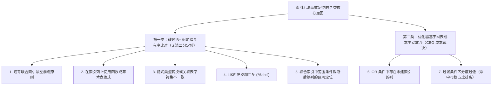

# 🚀 04 · 执行计划与 SQL 优化（EXPLAIN 解析与慢 SQL 调优）

> **一句话导读**：排查慢 SQL 的核心是通过 `EXPLAIN` 读懂查询优化器选择的物理执行路径。本文从 B+ 树底层寻址与基于成本的优化器（CBO）视角出发，系统拆解 `EXPLAIN` 核心指标（`type`、`key_len`、`rows`、`Extra`）、索引无法高效定位的七类底层原因，以及千万级大表深分页的两种标准优化方案。

---

## 一、慢 SQL 排查主线与 EXPLAIN 核心指标

当生产环境出现慢查询告警时，首先要区分是 **“等待耗时”**（如行锁等待、MDL 元数据锁阻塞、连接池排队）还是 **“执行耗时”**（如全表扫描、大量随机回表、磁盘临时文件排序）。针对执行耗时的 SQL 调优，标准闭环流程如下：


### 1. `EXPLAIN` 与 `EXPLAIN ANALYZE` 的使用区分
- **`EXPLAIN`**：仅输出查询优化器基于表统计信息估算出的静态执行计划，**不会真正执行 SQL 语句**，可在生产环境安全用于分析查询路径。
- **`EXPLAIN ANALYZE`**（MySQL 8.0.18+）：**会真正执行一次 SQL 语句**，并按执行算子树输出每个步骤的预估成本、实际首行耗时、实际总耗时、实际返回行数以及循环次数（`loops`）。非常适合在测试环境排查“优化器预估行数与实际行数偏差过大”的问题（注意避免在生产环境直接对高开销慢查询或更新语句执行 `EXPLAIN ANALYZE`）。

### 2. EXPLAIN 重点关注的五组核心列

| 字段名 | 核心含义 | 调优分析要点 |
| :--- | :--- | :--- |
| **`type`** | 数据访问方式（连接类型） | 反映 InnoDB 在 B+ 树上查找记录的具体物理方式，从单点唯一定位到全表扫描。 |
| **`possible_keys` / `key`** | 候选索引 / 实际选用索引 | `possible_keys` 列出所有可匹配的索引，`key` 为优化器经成本计算后最终选定的索引。若 `key` 为 `NULL` 说明未使用索引。 |
| **`key_len`** | 实际使用的索引字节长度 | **用于判断联合索引实际生效了前几列**。常见字节计算规则：<br/>- `INT` 占 4B，`BIGINT` 占 8B，`DATETIME` 占 5B（5.6+）；<br/>- 字段允许为 `NULL` 时，额外增加 **1 字节** 标记位；<br/>- `utf8mb4` 字符集下，`VARCHAR(N)` 占 **$4N + 2$ 字节**（其中 2 字节记录变长长度）。 |
| **`rows` / `filtered`** | 预估扫描行数 / 过滤留存比例 | `rows` 是优化器预估需要扫描的索引记录数；`rows × filtered / 100` 表示经条件过滤后预计留存并传入下一步（如驱动下一张 JOIN 表）的行数。 |
| **`Extra`** | 附加执行细节 | 揭示是否实现了覆盖索引（`Using index`）、索引条件下推（`Using index condition`），或者触发了高开销的额外排序（`Using filesort`）与内部临时表（`Using temporary`）。 |

---

## 二、`type` 访问类型详解（从单点定位到全表扫描）

`type` 字段直接体现了存储引擎检索数据的效率梯度，从最优到最差依次排列如下：

`system ➔ const ➔ eq_ref ➔ ref ➔ range ➔ index ➔ ALL`


| 访问类型 (`type`) | 底层检索机制与触发条件 | 典型 SQL 示例与调优要点 |
| :--- | :--- | :--- |
| **`system / const`** | 通过 **主键（Primary Key）** 或 **唯一索引（Unique Key）** 与常量做等值匹配，最多只返回一行记录。优化器在编译阶段即可直接将其转化为常量读取（`system` 是 `const` 的特例，仅出现在单行系统表中）。 | `SELECT * FROM users WHERE id = 1;`<br/>检索效率最高，B+ 树一次唯一定位即可读取目标行。 |
| **`eq_ref`** | 在多表 `JOIN` 查询中，被驱动表通过 **主键** 或 **非空唯一索引的全部列** 与驱动表关联；对于驱动表的每一行，被驱动表最多只匹配唯一的一行。 | `SELECT * FROM orders o JOIN users u ON o.user_id = u.id;`<br/>（`u.id` 为主键），是多表关联查询中最理想的访问方式。 |
| **`ref`** | 使用 **普通非唯一索引**，或 **唯一索引的最左前缀** 与常量/关联列做等值匹配（`=`），可能匹配到多条连续的二级索引记录。 | `SELECT * FROM users WHERE name = '张三';`<br/>实际耗时取决于该等值条件匹配的记录行数（区分度越高、匹配行数越少，回表开销越小）。 |
| **`range`** | 利用 B+ 树索引扫描一个或多个有序区间，常见于 `>`、`<`、`BETWEEN`、`IN` 或 `LIKE 'abc%'` 右模糊前缀匹配。 | `SELECT * FROM orders WHERE created_at >= '2026-01-01';`<br/>需重点结合 `rows` 关注扫描区间的跨度，以及是否伴随大量随机回表操作。 |
| **`index`** | **全索引扫描（Full Index Scan）**。遍历整棵二级索引树的全部叶子节点，常见于查询字段刚好被二级索引覆盖、但缺乏最左前缀过滤条件，或直接按索引列全表排序。 | `SELECT name FROM users;`（`name` 建有二级索引）<br/>虽然比扫描聚簇索引完整行轻量，但仍需遍历所有二级索引叶子页，大表下开销依然较高。 |
| **`ALL`** | **全表扫描（Full Table Scan）**。直接从头到尾遍历聚簇索引的所有叶子数据页。 | 无可用索引、索引失效，或查询命中的数据行占全表比例过高时触发。线上大表核心查询出现 `ALL` 必须优先治理。 |

---

## 三、`Extra` 关键执行特征深度解析

1. **`Using index`（覆盖索引生效）**：
   - **机制**：查询语句所需的全部字段（包括 `SELECT` 返回列、`WHERE` 过滤列与 `ORDER BY` 排序列）都已经包含在当前使用的二级索引叶子节点中。
   - **收益**：存储引擎直接从二级索引叶子节点读取数据返回，**省去了拿着主键 ID 回表查询聚簇索引的离散随机 I/O 开销**，是高频查询调优的核心手段。
2. **`Using index condition`（ICP，索引条件下推）**：
   - **机制**：假设表上有联合索引 `idx_a_b_c (a, b, c)`，执行查询 `SELECT * FROM t WHERE a = 1 AND b LIKE '%xyz%' AND c = 10;`。由于 `b` 是左模糊匹配，B+ 树只能利用 `a = 1` 定位索引区间。
   - 开启 ICP 后，Server 层将 `b LIKE '%xyz%' AND c = 10` 的过滤条件下推给 InnoDB 存储引擎；引擎在遍历 `a = 1` 的二级索引叶子节点时，**先在二级索引内部比对 `b` 和 `c` 是否满足条件，只有满足条件的记录才执行回表**，从而过滤掉大量无效回表。
3. **`Using filesort`（文件排序 / 额外内存与磁盘排序）**：
   - **机制**：当 `ORDER BY` 的排序字段无法直接利用 B+ 树索引的有序性时，MySQL 必须将满足条件的数据读取到排序缓冲区（`sort_buffer`）中执行排序。
   - **内存快排 vs 磁盘外部归并**：若待排序数据量小于 `sort_buffer_size`，则在内存中直接完成快速排序；一旦数据量超出 `sort_buffer_size`，就必须将数据分块写入磁盘临时文件，再执行多路外部归并排序，这会导致磁盘 I/O 与响应延迟急剧上升。
   - **调优方向**：将过滤列与排序列合并设计为联合索引（例如 `WHERE a = 1 ORDER BY b` 建立联合索引 `(a, b)`），直接借助 B+ 树在 `a = 1` 区间内 `b` 天然有序的特性消除 `Using filesort`。
4. **`Using temporary`（使用内部临时表）**：
   - **机制**：在执行 `GROUP BY`、`DISTINCT` 或 `UNION` 时，如果无法利用索引直接完成分组或去重，MySQL 会创建内部临时表暂存中间结果（优先使用内存 `TempTable` 引擎，超出上限后转为磁盘 InnoDB 临时表）。同样可通过让联合索引覆盖 `GROUP BY` 列来消除临时表开销。

---

## 四、索引无法高效定位的七类常见原因（B+ 树底层视角）

日常开发中常说的“索引失效”，从第一性原理来看只有两类根因：一是 **查询条件破坏了 B+ 树索引键的单调有序性，使得存储引擎无法通过二分查找定位区间起点**；二是 **查询优化器经过成本估算（Cost-Based Optimizer），认为走二级索引再大量随机回表的总代价高于直接顺序扫描聚簇索引，因而主动放弃使用二级索引**。



### 1. 违背联合索引最左前缀原则
- **底层原因**：联合索引 `(a, b, c)` 在 B+ 树中严格按先 `a`、当 `a` 相同时再按 `b`、当 `b` 相同时再按 `c` 的复合字典序排列。若查询条件缺失最左列 `a`（如 `WHERE b = 1 AND c = 2`），则字段 `b` 在整棵树上是全局无序的，无法从根节点逐层二分查找定位（注：在 MySQL 8.0+ 中，若最左列 `a` 的不同值极少，如性别或状态枚举，优化器可触发 **Skip Scan 跳跃扫描** 枚举 `a` 的每个值后再定位 `b`）。

### 2. 在索引列上使用函数或算术表达式
```sql
-- ❌ 无法使用索引定位：B+ 树保存的是 create_time 和 id 的原始值，而非函数计算后的结果值
SELECT * FROM orders WHERE YEAR(create_time) = 2026;
SELECT * FROM orders WHERE id + 1 = 100;

-- ✅ 等价改写：将计算移到等号右侧常量端，保持索引列本身为独立原始字段
SELECT * FROM orders WHERE create_time >= '2026-01-01 00:00:00' AND create_time < '2027-01-01 00:00:00';
SELECT * FROM orders WHERE id = 99;
```
- **工程扩展**：如果业务确实需要高频按固定函数表达式查询，可在 MySQL 8.0+ 中创建 **函数索引（Functional Index）** 或新增 **虚拟生成列（Generated Column）** 并对其建立索引。

### 3. 隐式类型转换与关联字符集不一致
假设 `phone` 字段定义为字符串类型 `VARCHAR(20)` 且建有索引：
```sql
-- ❌ 传入数字参数，触发对索引列 phone 的隐式转换函数 CAST(phone AS DOUBLE)，导致全表扫描
SELECT * FROM users WHERE phone = 13800000000;

-- ✅ 传入与字段类型严格一致的字符串参数，正常命中索引
SELECT * FROM users WHERE phone = '13800000000';
```
- **底层原因**：MySQL 在比较字符串与数字时，规则是将**字符串转换为浮点数**再比对。因此当 `phone` 是 `VARCHAR` 而参数是数字时，相当于在索引列 `phone` 上套了 `CAST(phone AS DOUBLE)` 函数，导致无法在按字典序排列的 B+ 树上二分查找。（反之，若表字段本身是 `INT` 类型而传入参数是字符串 `'100'`，转换函数作用在常量参数 `'100'` 上，索引列本身未受影响，依然能正常走索引）。
- **多表 JOIN 字符集陷阱**：当两张表关联字段的字符集不同（如一张表是 `utf8mb4`，另一张表是 `utf8mb3`）或排序规则（Collation）不一致时，关联查询同样会在被驱动表的连接列上触发字符集转换函数 `CONVERT()`，导致被驱动表索引失效、退化为全表扫描。

### 4. 前导通配符模糊查询（`LIKE '%abc'`）
- `LIKE 'abc%'`：前缀 `'abc'` 确定，可在 B+ 树字典序上精准定位区间起点，正常走 `range` 范围扫描；
- `LIKE '%abc'`：前缀未知，无法在 B+ 树上二分确定查找起点。轻量场景可通过覆盖索引减小扫描数据宽度；高频核心全文检索场景应引入 Elasticsearch 倒排索引。

### 5. 联合索引中范围条件截断后续列的区间定位
- **底层原因**：对于联合索引 `(a, b, c)`，执行 `WHERE a = 1 AND b > 20 AND c = 3` 时：
  1. `a = 1` 是等值匹配，在 `a = 1` 的分组内 `b` 是有序的，因此 `b > 20` 可以通过二分查找定位扫描起点；
  2. 但在 `a = 1 AND b > 20` 的区间内部，不同 `b` 值对应的第三列 **`c` 是局部无序的**（例如 `(1, 21, 5)` 排在 `(1, 22, 3)` 前面），因此 **`c = 3` 无法用来进一步缩小 B+ 树的扫描区间边界**（通过 `EXPLAIN` 的 `key_len` 可验证索引定位长度只计算到了 `a` 和 `b`）。
  3. 尽管 `c = 3` 不能缩小 B+ 树定位区间，但在开启 **ICP（索引条件下推）** 时，存储引擎仍会在扫描 `(a = 1, b > 20)` 的二级索引叶子节点过程中用 `c = 3` 提前过滤记录，减少回表次数。
- **联合索引列序设计原则**：应优先将高频**等值匹配列**放在左边，将**范围查询列**放在右边（如将上述索引调整为 `(a, c, b)`，则三列均可参与 B+ 树区间定位）。

### 6. `OR` 条件中存在未建索引的分支
```sql
-- id 有主键索引，但 address 没有索引
SELECT * FROM users WHERE id = 1 OR address = '北京';
```
- **底层原因**：因为 `address = '北京'` 没有索引，为了找出满足该分支的记录无论如何都必须全表扫描一遍；优化器发现既然全表扫描一次就能同时判断两个条件，便直接采用全表扫描。若 `OR` 两侧字段都建有索引，优化器则可通过 **`Index Merge`（索引合并）** 分别扫描两个索引再合并主键集合。

### 7. 条件区分度过低，优化器基于回表成本主动放弃二级索引
- **底层原因**：当查询条件命中的数据行占全表比例较高（通常超过 20%~30%）时，如果走二级索引，每匹配一条记录都要拿着主键 ID 去聚簇索引做一次**离散随机 I/O 回表**；
- 优化器经成本计算发现，大量随机回表的总开销远高于直接顺着聚簇索引顺序扫描全表（`ALL`），因此主动选择全表扫描。若是因为表统计信息陈旧导致优化器误判行数，可执行 `ANALYZE TABLE` 重新统计。

---

## 五、实战调优：千万级大表深分页优化（`LIMIT 1000000, 10`）

假设订单表 `orders` 有 2000 万行数据，建有联合二级索引 `idx_status_created (status, created_at)`。当业务执行如下大偏移量分页查询时，响应时间会从几毫秒恶化至数秒：

```sql
-- 原始深分页慢 SQL
SELECT * FROM orders
WHERE status = 1
ORDER BY created_at ASC, id ASC
LIMIT 1000000, 10;
```

### 1. 为什么深分页会这么慢？
1. 存储引擎沿着二级索引 `idx_status_created` 顺序扫描满足 `status = 1` 的索引项；
2. 由于查询的是 `SELECT *`，二级索引叶子节点上只有 `(status, created_at, id)`，不包含整行其他字段，因此每扫出一条记录就必须拿着主键 `id` 去聚簇索引执行一次**回表查询**；
3. 为了取出第 `1,000,001` 到 `1,000,010` 这 10 条数据，InnoDB 被迫先扫描并**执行了 `1,000,010` 次随机回表**，将 100 万行完整记录传给 Server 层，最后 Server 层把前 `1,000,000` 行直接丢弃。**这 100 万次无效的随机回表 I/O 就是导致深分页卡死的核心根因！**

---

### 2. 方案一：子查询延迟关联（消除 100 万次无效回表，保留跳页能力）

**核心思路**：先在子查询中只查主键 `id`，让前 100 万行的扫描完全在紧凑的二级索引内部通过**覆盖索引（`Using index`）**完成（零回表）；拿到目标页的 10 个主键 `id` 后，再与原表 `INNER JOIN` **仅执行 10 次主键回表**：

```sql
SELECT o.*
FROM orders o
INNER JOIN (
    -- 子查询仅查主键 id，完全命中 idx_status_created 覆盖索引（Using index），0 次回表！
    SELECT id
    FROM orders
    WHERE status = 1
    ORDER BY created_at ASC, id ASC
    LIMIT 1000000, 10
) AS page ON o.id = page.id
ORDER BY o.created_at ASC, o.id ASC;
```

- **适用场景与优缺点**：无需修改前端页码跳转交互，将回表次数从 `1,000,010` 次骤降至 **`10` 次**，性能通常提升数十倍；但子查询内部仍需在二级索引叶子链表上顺序扫描跨过前 100 万个索引项。

---

### 3. 方案二：游标滚动分页 / Seek 法（彻底消除大 OFFSET 扫描）

**核心思路**：不再使用 `OFFSET` 偏移量，而是由前端每次请求下一页时，携带**上一页最后一条记录的排序字段值与唯一主键 ID** 作为游标起点，直接在 B+ 树上通过 `range` 范围定位到该位置并向后读取 10 条：

```sql
-- 假设上一页最后一条记录为：created_at = '2026-09-01 12:00:00', id = 950088
SELECT * FROM orders
WHERE status = 1
  AND (
      created_at > '2026-09-01 12:00:00'
      OR (created_at = '2026-09-01 12:00:00' AND id > 950088)
  )
ORDER BY created_at ASC, id ASC
LIMIT 10;
```

- **为什么要同时携带 `created_at` 和唯一主键 `id`？**
  因为同一秒内可能存在多条 `created_at` 相同的订单记录。如果只写 `created_at > '2026-09-01 12:00:00'`，就会把同一秒内排在 `id = 950088` 后面的其余订单漏掉；配合唯一主键 `id` 作为联合游标，才能严格保证分页结果不丢不重。
- **适用场景与优缺点**：无论翻到第几万页，每次查询都只在 B+ 树上二分定位起点并扫描 **10 行**、回表 **10 次**，耗时恒定在毫秒级；极其适合移动端无限下拉流、“上一页/下一页”翻页以及后台大批量数据分批导出任务。

---

## 🧠 一分钟复盘核心记忆卡

1. **EXPLAIN 四步看图法**：一看 `type`（确保核心查询达到 `const` / `eq_ref` / `ref` / `range`，消灭大表 `ALL`）；二看 `key` 与 `key_len`（验证联合索引实际命中了几列）；三看 `rows`（评估扫描行数跨度）；四看 `Extra`（善用 `Using index` 覆盖索引与 `Using index condition` 索引下推，消除高开销的 `Using filesort` 与 `Using temporary`）。
2. **索引设计黄金准则**：索引列保持独立原始字段（不套函数、不做运算、严防 `VARCHAR` 传数字的隐式类型转换及关联表字符集不一致）；联合索引遵循最左前缀，坚持 **高频等值列在前、范围列在后**。
3. **千万级深分页调优**：需支持任意跳页用 **子查询延迟关联**（覆盖索引扫描 ID，将百万次回表降为 10 次回表）；顺序翻页或批量导出用 **游标滚动分页**（携带上页末尾游标，将百万行扫描降为 10 行扫描）。

---

## 🧭 下一步

掌握了执行计划分析与索引失效原理后，接下来请进入 SQL 实战编写核心指南，系统梳理增删改语法规范、各类复杂 JOIN 关联、分组聚合与窗口函数以及工业级生产脚本：[[10-实战SQL编写与高频业务脚本指南]]！

