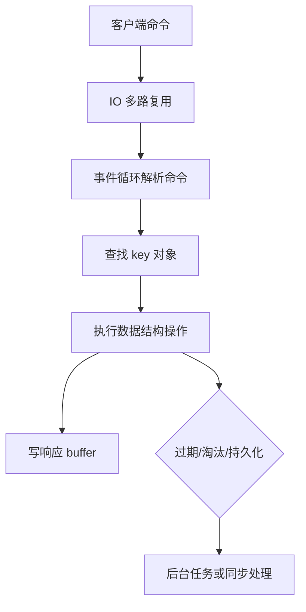

# Redis数据结构与应用

> [!abstract] 一句话总结
> Redis 的低延迟来自单线程事件循环、内存访问和紧凑数据结构；精通点是把业务访问模式映射到 string、hash、list、set、zset、stream 的复杂度和内存模型。

## 📌 精准定位

- 负责低延迟缓存、计数、排行榜、分布式协调辅助和消息流。
- 不负责替代强事务数据库，持久化和复制都有延迟窗口。
- 关键边界：慢命令和大 key 会阻塞事件循环上的其他请求。

## 🧩 核心概念

| 概念 | 具体含义 | 精通要点 |
| ---- | -------- | -------- |
| String | SDS，可存数值、bitmap、简单对象。 | INCR 原子计数，value 不宜过大。 |
| Hash | field-value 集合，适合对象局部更新。 | 小 hash 会用 listpack 节省内存。 |
| ZSet | score 排序集合，跳表+字典。 | 排行榜和延迟队列要控规模。 |
| Stream | 持久化消息流，支持 consumer group。 | 要处理 pending、ack 和裁剪。 |

## ⚙️ 工作原理 / 主流程



1. Redis key 指向 redisObject，内部编码会随大小变化。
2. 过期删除结合惰性删除和定期抽样删除。
3. 淘汰策略只在内存超过 maxmemory 后触发。
4. pipeline 减少 RTT，但返回太大也会撑爆客户端。
5. Lua 原子执行，但长脚本会阻塞事件循环。

## 💻 代码 / 配置 / 伪代码

```text
ZINCRBY rank:daily 1 user:1001
ZREVRANGE rank:daily 0 99 WITHSCORES
HSET user:1001 name Tom level 7
HGETALL user:1001
```

## 🔍 源码入口 / 关键组件

- redisObject、SDS、dict、quicklist、skiplist
- INFO commandstats / SLOWLOG
- MEMORY USAGE / MEMORY DOCTOR
- SCAN 系列游标命令
- Redis latency monitor

## ⚠️ 生产坑与注意事项

- KEYS、大范围 LRANGE、巨大 HGETALL 会阻塞主线程。
- 热 key 集中到单分片。
- 缓存对象无限增长且无 TTL。
- 把 Redis 当可靠消息队列却不处理 ACK。
- 大 key 删除用 DEL 会阻塞，优先 UNLINK。

## 🧭 排查路径

- 延迟尖刺看 slowlog、latency latest、fork/AOF rewrite。
- 内存高抽样 bigkeys、编码和 TTL 覆盖率。
- 命中率低区分 key 设计、过期、容量淘汰。
- 热点统计 key 访问频率并做本地缓存或拆 key。

## 🎯 面试问题

> [!question] 高频问题
> - Q: Redis 为什么快？
>   - A: 内存访问、单线程避免锁竞争、IO 多路复用、紧凑结构。
> - Q: ZSet 怎么实现？
>   - A: 字典查 member，跳表按 score 排序范围查。
> - Q: 大 key 危害？
>   - A: 阻塞、复制慢、迁移慢、删除慢、碎片高。
> - Q: pipeline 和事务区别？
>   - A: pipeline 减少网络往返，MULTI/EXEC 保证队列原子执行。
> - Q: 对象缓存用 String 还是 Hash？
>   - A: 整体读写用 String，局部字段频繁更新用 Hash。

## ✅ 精通检查清单

- 能画出主流程，并标出最容易失败的节点。
- 能说出至少 3 个源码入口或关键组件。
- 能写出最小配置、SQL、伪代码或状态机。
- 能结合生产故障说明监控指标、排查命令和修复动作。
- 能和相邻方案做取舍对比，而不是只背定义。

## 🔗 关联笔记

- [[_index]]
- [[20-Java后端/00-总览/学习仪表盘]]

## 📚 参考资料

- Redis Documentation: Data types
- Redis Source: object.c, dict.c, t_zset.c
