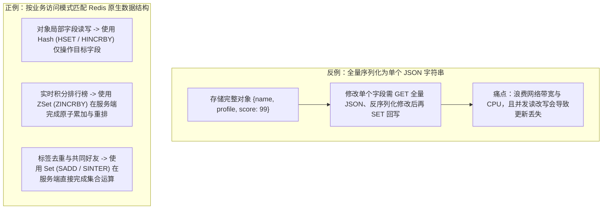
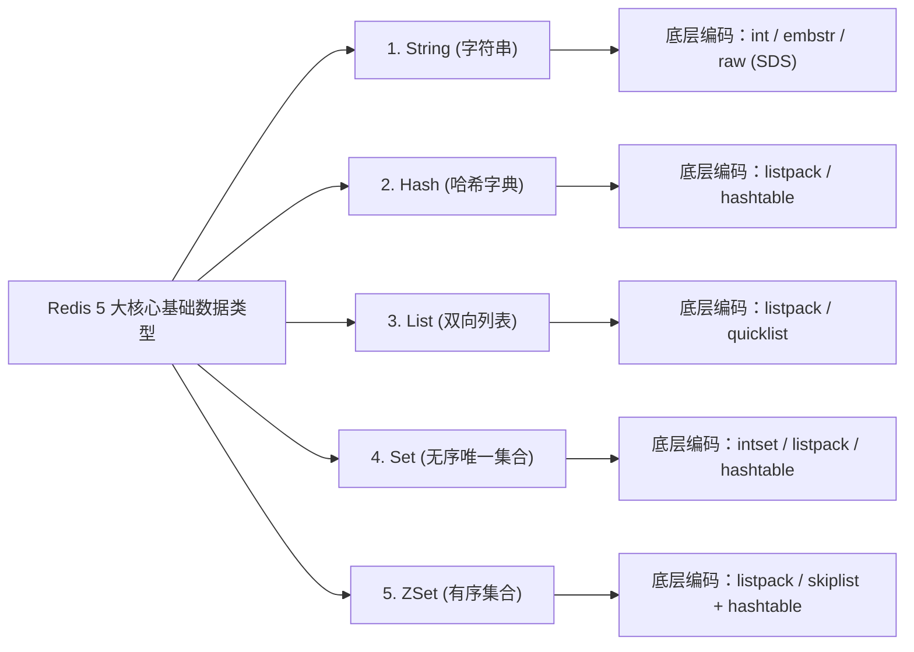

# ⚡ 05 · Redis 数据结构与应用（核心数据结构、底层编码与生产规范）

> **一句话导读**：Redis 提供了丰富的数据结构与原子的服务端操作指令。先理解业务场景中的读写痛点，再根据局部字段更新、集合去重、动态排序等访问模式匹配合适的数据结构与底层编码，既能避免全量数据网络传输开销，又能通过单线程原子指令保障并发安全。

---

## 一、业务痛点：为什么不能把所有数据都存成 JSON 字符串？

在日常开发中，最容易出现的做法是将整个 Java 对象序列化为 JSON 字符串，直接存入 Redis 的 `String` 类型中。这种做法在对象体积小、且每次都是整体读取和整体覆盖时没有问题；但在高频局部更新或集合运算场景下，会暴露出明显的性能与并发缺陷：

1. **网络带宽与序列化开销成倍放大**：假设一个商品或用户对象包含几十个字段（体积约 $4\text{ KB}$），业务需要每次在用户点击时累加其中的积分字段。如果使用单个 JSON 字符串，客户端每次都必须先执行 `GET` 拉取完整的 $4\text{ KB}$ 字符串，在应用内存里反序列化为对象、修改积分、重新序列化为 JSON，最后再执行 `SET` 写回 Redis。
2. **并发读改写导致数据覆盖丢失**：当两个并发线程同时执行“读取 JSON $\rightarrow$ 本地修改属性 $\rightarrow$ 写回 JSON”时，后写回的线程会直接覆盖先写回线程的修改结果。为了解决并发覆盖，又不得不额外引入分布式锁，把原本简单的属性更新变成了沉重的加锁操作。



### Redis 为什么能同时做到高吞吐与低延迟？

在深入各类数据结构之前，先厘清 Redis 支撑每秒数万至十万级读写请求的三项核心架构设计：

1. **纯内存数据访问**：核心数据结构全部常驻内存，读写操作直接在内存中完成，省去了传统磁盘数据库随机 I/O 的寻道与读写延迟。
2. **核心命令单线程串行执行**：Redis 处理客户端读写命令的核心模块采用单线程串行执行。这一设计带来了两大好处：一是完全省去了多线程高频上下文切换的 CPU 开销；二是操作内部哈希表、跳表等复杂数据结构时无需加锁，消除了锁竞争损耗。
   - **关于 Redis 6.0+ 多线程的职责边界**：随着万兆网卡普及，高并发下网络 Socket 数据的读取（`read`）、协议解析以及响应写回（`write`）逐渐成为主线程的 CPU 瓶颈。因此 Redis 6.0 引入了多线程 I/O 机制，专门用多个 I/O 线程并行分担网络收发与协议解析工作；而**读写内存数据结构的命令执行过程本身，依然由主线程单线程串行完成**。
3. **I/O 多路复用模型**：借助 Linux 内核提供的 `epoll`（或 macOS/FreeBSD 的 `kqueue`）多路复用机制，单个线程即可高效监听成千上万个客户端 TCP 连接上的可读、可写事件，哪个连接准备好了数据就分发给主线程处理，避免了传统阻塞 I/O 为每个连接分配独立线程的资源消耗。

---

## 二、5 大核心基础数据结构（业务场景与底层物理编码）

在 Redis 中，**对外暴露的数据类型（Data Type）与底层的物理编码实现（Encoding）是解耦的**。同一个数据类型会根据保存的元素数量和单个元素的字节大小，在“紧凑连续内存结构”与“高性能索引结构”之间自动转换，从而在内存占用率与读写时间复杂度之间取得平衡。



---

### 1. String（字符串）：单值缓存、原子计数与分布式协调

#### 典型业务场景
- **单值对象与状态缓存**：存储登录会话 Token、短信验证码、静态配置信息。
- **高并发原子计数器**：利用 `INCR` / `DECR` / `INCRBY` 指令在服务端直接完成数值增减，常用于文章阅读量统计、接口分钟级调用次数限流、秒杀库存预扣减。
- **轻量级分布式锁**：利用 `SET lock_key unique_token NX PX 30000` 在单条命令内原子地完成“判断锁不存在则加锁 + 设置 30 秒过期时间”。释放锁时通过 Lua 脚本先校验 `unique_token` 是否等于当前线程持有的标识，匹配后再执行 `DEL`，防止业务执行超时导致锁自动过期后误删其他线程刚加上的锁。

#### 底层编码原理
1. **`int` 编码**：当存储的字符串值是可以用 64 位有符号长整型（`long`）表示的纯数字时，Redis 直接将其转化为整数保存在对象结构体（`robj`）的指针字段中，无需额外分配字符串内存。
2. **SDS（Simple Dynamic String，简单动态字符串）**：当存储普通文本或二进制数据时，底层采用自定义的 SDS 结构，而非 C 语言原生以空字符 `\0` 结尾的 `char*` 数组。SDS 显式记录了当前已用字节长度 `len` 和已分配数组容量 `alloc`，解决了原生字符串的三大痛点：
   - **$O(1)$ 获取字符串长度**：直接读取 `len` 属性即可，无需像 C 字符串那样遍历整个数组统计长度；
   - **杜绝缓冲区溢出与减少内存重分配**：拼接字符串前会先检查 `alloc - len` 剩余空间是否足够，不足时自动按预分配策略扩容（小于 $1\text{ MB}$ 时翻倍扩容，大于等于 $1\text{ MB}$ 时每次额外多分配 $1\text{ MB}$），避免频繁修改字符串时每次都触发系统内存重分配；
   - **二进制安全**：SDS 完全依据 `len` 长度属性来读取字节内容，不受中间出现的 `\0` 空字符影响，因此不仅可以存文本，还可以安全地存储序列化字节流、图片片段等任意二进制数据。
3. **`embstr` 与 `raw` 的切换**：当字符串长度小于等于 **44 字节**时，采用 `embstr` 编码，调用一次 `malloc` 分配一块连续内存同时存放 `robj` 对象头和 SDS 数据，CPU 缓存局部性更好且减少内存碎片；当字符串长度超过 44 字节或发生修改时，转为 `raw` 编码，对象头与 SDS 分开独立分配内存。

---

### 2. Hash（哈希表 / 字典）：结构化对象的字段级读写

#### 典型业务场景
- **电商购物车**：以 `cart:{userId}` 作为 Key，商品 `skuId` 作为 Field，购买数量作为 Value。新增商品执行 `HSET cart:1001 8888 1`，增减数量执行 `HINCRBY cart:1001 8888 1`，移除单个商品执行 `HDEL cart:1001 8888`，展示购物车全量商品执行 `HGETALL cart:1001`。
- **多属性对象缓存**：存储需要按字段独立更新的用户资料、商品实时计数详情（如把销量、评论数、收藏数作为不同 Field），彻底解决全量 JSON 读改写的开销。

#### 底层编码原理
1. **小规模紧凑编码 `listpack`（紧凑列表）**：
   - 当 Hash 中的字段数量较少（默认配置 `hash-max-listpack-entries 512`）且每个字段名与值的体积较小（默认 `hash-max-listpack-value 64` 字节）时，底层采用一块连续内存的 **`listpack`** 按顺序紧挨着存放 `Field` 和 `Value`。
   - **为什么 Redis 7.0 用 `listpack` 全面取代了早期的 `ziplist`（压缩列表）？** 在旧版 `ziplist` 中，每个节点都保存了前一个节点的字节长度 `prevlen`（前节点长度小于 254 字节时占 1 字节，大于等于 254 字节时占 5 字节）。如果在 `ziplist` 中间插入或修改了一个较大元素，导致后方相邻节点的 `prevlen` 从 1 字节膨胀到 5 字节，就可能引发一连串后续节点连续扩容重分配内存的**连锁更新（Cascade Update）**。而 `listpack` 改为只记录当前节点自身的长度，彻底消除了节点间的长度耦合，从根源上解决了连锁更新问题。
2. **大规模字典编码 `hashtable`（`dict`）**：
   - 一旦元素个数或单个元素体积超出上述阈值，编码会自动升级为标准哈希表 `dict`，支持 $O(1)$ 时间复杂度的按字段读写。
   - **渐进式 Rehash 机制**：当哈希表负载因子过高需要扩容（或过低需要缩容）时，如果一次性把数百万个键值对从旧表 `ht[0]` 搬迁到新表 `ht[1]`，会导致主线程长时间卡顿。为此，Redis 采用**渐进式 Rehash**：在扩容期间同时维护 `ht[0]` 和 `ht[1]` 两张表，每次客户端对该 Hash 执行增删改查指令时，顺带将 `ht[0]` 中当前哈希桶槽位上的元素搬迁到 `ht[1]`，同时配合后台定时任务分批搬迁，把一次性大开销平摊到无数次日常请求中。

---

### 3. List（双向列表）：双端顺序存取与流式时间线

#### 典型业务场景
- **固定窗口的最新动态时间线**：使用 `LPUSH timeline:{userId} msgId` 将最新发布的动态 ID 压入列表头部，配合 `LTRIM timeline:{userId} 0 99` 只保留最近 100 条动态，前端刷新时通过 `LRANGE timeline:{userId} 0 9` 高效读取最新 10 条。
- **轻量级阻塞任务队列**：生产者执行 `LPUSH` 推入任务，消费者执行 `BRPOP` 阻塞等待弹出任务。如果业务场景需要完整的消费确认（ACK）、多消费者组广播以及崩溃后未确认消息重投（Pending List），则应选用 Redis 5.0 引入的 **`Stream`** 数据类型或专业消息中间件（Kafka / RocketMQ）。

#### 底层编码原理
- 早期版本曾分别使用 `ziplist` 和双向链表 `linkedlist`，但普通双向链表每个节点都需要额外维护前后两个 8 字节指针，内存碎片多且指针自身消耗甚至超过数据本身。
- 现代 Redis（7.0+）在元素很少时直接使用单个 **`listpack`**；当元素增多后，转换为 **`quicklist`（快速列表）**。`quicklist` 是一个以 `listpack` 为节点的双向链表——宏观上通过双向链表连接各个节点，保证首尾两端 `LPUSH` / `RPOP` 的时间复杂度为 $O(1)$；微观上每个节点内部是一个包含多个元素的连续内存块 `listpack`，既大幅降低了指针内存开销，又提升了 CPU 缓存命中率。

---

### 4. Set（无序唯一集合）：集合去重与交并差关系运算

#### 典型业务场景
- **共同好友 / 共同关注 / 兴趣标签匹配**：
  - 将用户 A 关注的人存入集合 `follow:A = {u1, u2, u3}`，用户 B 关注的人存入 `follow:B = {u2, u3, u4}`；
  - 执行 `SINTER follow:A follow:B` 即可在 Redis 服务端直接算出两人的共同关注 `{u2, u3}`；执行 `SDIFF follow:B follow:A` 即可算出“B 关注了但 A 还没关注的人（可能认识的人）”。
- **抽奖活动池**：利用 `SADD lottery:2026 userId` 将参与抽奖的用户加入奖池（自动去重）。开奖时，若允许同一人重复中不同奖项，使用 `SRANDMEMBER lottery:2026 3` 随机抽取 3 人且不移除；若每人限中一次，使用 `SPOP lottery:2026 3` 随机弹出 3 人并从池中移除。

#### 底层编码原理
- **`intset`（整数集合）**：当集合中的所有元素都是整数，且元素个数不超过 `set-max-intset-entries`（默认 512）时，底层采用有序的紧凑整数数组 `intset` 存储，通过二分查找判断元素是否存在，极其节省内存。
- **`listpack` / `hashtable`**：在 Redis 7.2+ 中，若包含非整数字符串但元素个数很少（默认不超过 `set-max-listpack-entries 128` 且单元素不超过 64 字节），会先采用 `listpack` 紧凑存储；当数据规模扩大后，自动转为 Value 为 `NULL` 的哈希表 `hashtable`，实现 $O(1)$ 的单元素增删与存在性判断（`SISMEMBER`）。

---

### 5. ZSet（有序集合 Sorted Set）：动态权重排序与范围检索

#### 典型业务场景
- **实时动态排行榜（游戏战力榜 / 直播间贡献榜 / 热搜榜）**：
  ```text
  > ZADD live_rank 100 "user_A" 80 "user_B"
  > ZINCRBY live_rank 50 "user_B"              # 实时为 user_B 累加 50 分并自动调整排名
  > ZREVRANGE live_rank 0 9 WITHSCORES         # 按分值从高到低获取前 10 名及其分数
  > ZREVRANK live_rank "user_B"                # 查询 user_B 当前的倒序名次（从 0 开始）
  ```
- **滑动时间窗口限流**：以每次请求的唯一标识（UUID）作为 Member，当前毫秒时间戳作为 Score。请求到达时，通过 Lua 脚本原子执行三步：先用 `ZREMRANGEBYSCORE` 清理掉窗口起点（如 60 秒前）之前的过期请求，再用 `ZCARD` 统计当前窗口内的剩余请求总数，若未超限则 `ZADD` 记录本次请求。
- **轻量级延时任务队列**：将任务的到期执行时间戳作为 Score 存入 ZSet。后台调度线程定时调用 `ZRANGEBYSCORE delay_queue -inf <当前时间戳> LIMIT 0 50` 扫描已到期的任务，并通过 Lua 脚本将“查出到期元素 + `ZREM` 移除元素”合并为一个原子操作，确保集群多实例并发拉取时同一个任务只会被唯一一个实例认领执行。

#### 底层编码原理（高频面试考点）
1. **小规模采用 `listpack`**：当元素数量不超过 `zset-max-listpack-entries`（默认 128）且每个成员字符串长度不超过 `zset-max-listpack-value`（默认 64 字节）时，使用连续内存的 `listpack`，按照 `Member, Score` 相邻排列并按分值大小顺序存放。
2. **大规模采用 `hashtable`（字典）+ `skiplist`（跳表）双结构组合**：
   - **为什么 ZSet 要同时使用哈希表和跳表两种结构？**
     - 如果只用**跳表（`skiplist`）**：虽然按分值排序、范围查询（`ZRANGEBYSCORE`）和排名计算很快，但当执行 `ZSCORE key member`（根据成员名称查询它的分值）或插入前判断某个 `member` 是否已存在时，无法按成员名在按分值排序的跳表中二分查找，只能从头遍历，时间复杂度会退化为 $O(N)$。
     - 如果只用**哈希表（`hashtable`）**：虽然按成员查询分值（`ZSCORE`）是 $O(1)$，但哈希表是无序的，无法高效支持按分值区间范围检索和按名次排序。
     - **组合优势**：ZSet 将两者结合——用**哈希表**维护 `Member -> Score` 的映射，使 `ZSCORE` 单点查分值和成员存在性检查达到 **$O(1)$**；同时用**跳表**（多层有序双向链表）按 `Score` 从小到大排列所有元素，使单元素插入、删除、按排名定位的时间复杂度保持在 **$O(\log N)$**，范围查询的时间复杂度达到 **$O(\log N + M)$**（$M$ 为返回的元素个数）。此外，这两种结构通过指针共享底层的成员字符串与分值对象，不会造成数据内容本身的重复拷贝。

---

## 三、3 种特殊高级数据结构与适用场景

除了五大基础类型外，Redis 还针对二值状态标记、亿级基数去重和地理位置检索提供了三种专用结构：

| 高级结构 | 底层实现与核心原理 | 典型业务场景与工程实践要点 |
| :--- | :--- | :--- |
| **Bitmap**（位图） | 基于 `String` 类型封装的按二进制位（Bit）操作指令集（`SETBIT` / `GETBIT` / `BITCOUNT` / `BITOP`），每个比特位仅用 $1\text{ bit}$ 表示 `0` 或 `1` 两种状态。 | **用户全年签到记录 / 连续活跃统计**：记录单个用户 365 天的签到情况仅需 $365\text{ bits} \approx 46\text{ Bytes}$。适合**稠密、连续的整数偏移量**场景；若业务 ID 极其稀疏（如直接把 64 位雪花 ID 当作 offset），会导致位图分配大片全零的空白内存，此时应先将 ID 映射为连续自增序号或改用 Roaring Bitmap。 |
| **HyperLogLog** | 基于伯努利试验与调和平均数的概率型基数估算结构（`PFADD` / `PFCOUNT` / `PFMERGE`），内部固定划分为 16384 个分桶寄存器，每个 Key 最多仅占用 **$12\text{ KiB}$** 内存。 | **亿级页面 UV（独立访客数）去重统计**：如果用 `Set` 存储 1 亿个用户 ID，需消耗数 GB 内存；而使用 HyperLogLog 统计 1 亿 UV 依然只占 $12\text{ KiB}$。需要注意它提供的是**标准误差约 $0.81\%$ 的近似估算值**，且只记录统计特征而不保存原始元素，无法从中取出明细列表或判断单个元素是否出现过。 |
| **GEO**（地理空间） | 将二维经纬度坐标通过 **GeoHash** 算法编码为 52 位整数作为 Score，底层直接复用 **ZSet** 存储。 | **LBS 地理位置服务（附近的人 / 附近的门店）**：通过 `GEOADD` 录入坐标，`GEODIST` 计算两点距离，`GEOSEARCH` 检索指定圆心半径或矩形区域内的目标并按距离排序。由于底层是单个 ZSet，若将全国数百万个坐标点全部塞进同一个 GEO Key 会形成大 Key，生产中应按城市或地理网格前缀对 Key 进行拆分。 |

---

## 四、生产环境三大避坑规范

### 1. 严禁在线上大实例执行 `KEYS *`，统一使用 `SCAN` 渐进式遍历
- **问题根因**：`KEYS *` 会一次性全量遍历整个底层数据库字典，时间复杂度为 $O(N)$。当实例中存有数百万个 Key 时，主线程会被阻塞数秒甚至数十秒，期间所有正常的业务读写请求全部排队超时，甚至引发哨兵误判主节点宕机。
- **工程标准做法**：使用 **`SCAN cursor [MATCH pattern] [COUNT count]`** 进行游标分批迭代，每次只扫描少量哈希桶槽位并返回下一页游标，直到返回的游标重新变为 `0` 代表遍历完成。
  - **使用细节**：`COUNT` 参数指定的是单次遍历底层字典槽位的数量（而非最终匹配返回的 Key 数量，因此某次调用返回空列表但游标不为 `0` 时仍需继续迭代）；同时，若遍历期间恰好发生字典扩容或缩容 Rehash，少数 Key 可能会被重复扫描返回，客户端处理逻辑需要做好幂等去重。

### 2. 大 Key（BigKey）的危害与治理
- **什么是大 Key**：通常将单个 `String` 的 Value 体积超过 **$10\text{ KB}$**，或单个集合类型（`Hash` / `List` / `Set` / `ZSet`）包含的元素个数超过 **$5000$ 个**（或总体积超过 $10\text{ MB}$）的 Key 视为需要治理的大 Key。可在从节点低峰期通过 `redis-cli --bigkeys` 抽样排查，或使用 `MEMORY USAGE key` 精确评估字节占用。
- **三大线上危害**：
  1. **阻塞主线程与打满网卡**：对大集合执行 `HGETALL`、`SMEMBERS` 等全量拉取指令时，单次操作耗时长且瞬间占满网卡出口带宽；
  2. **集群内存严重倾斜**：在 Redis Cluster 分片集群中，同一个大 Key 的所有元素只能保存在某一个具体的分片节点上，导致该节点内存率先耗尽；
  3. **同步删除卡顿**：直接使用 `DEL` 删除包含上百万元素的大 Key 时，主线程需要逐个释放所有元素的内存空间，导致主线程卡死数百毫秒以上。
- **治理三板斧**：
  1. **分片拆分（Sharding）**：将一个包含十万个字段的大 Hash 按业务维度或哈希取模拆分为多个小 Key（例如将 `user_tags:1001` 拆分为 `user_tags:1001:0` ~ `user_tags:1001:15`）；
  2. **按需分批读取**：用 `HSCAN`、`SSCAN`、`ZSCAN` 或 `HMGET` 替代 `HGETALL` 全量读取；
  3. **异步非阻塞删除**：删除大 Key 时使用 **`UNLINK key`** 替代 `DEL`（并推荐在配置中开启 `lazyfree-lazy-expire yes` 和 `lazyfree-lazy-server-del yes`），让主线程只把 Key 从全局字典中摘除，把繁重的物理内存释放工作交给后台 `bio_lazy_free` 线程异步完成。

### 3. 热 Key（HotKey）的探测与治理
- **什么是热 Key**：当某一个具体的 Key（例如突发娱乐大瓜热搜词条、整点开启的秒杀爆款商品详情）在极短时间内承受了每秒数万甚至数十万次的集中访问时，即构成热 Key。
- **为什么 Redis Cluster 分片集群也扛不住单个热 Key？**
  - 因为在分片集群中，**同一个 Key 经过 CRC16 哈希计算后，永远只会固定路由到某一台具体的分片主节点上**。再多的分片节点也无法替它分担流量，超高频的请求会瞬间打满该单节点的 CPU 与网卡带宽，导致该分片节点被打挂并波及同节点的其他正常业务。
- **热 Key 的两种核心治理方案**：
  1. **应用层进程内本地二级缓存（首选方案）**：通过客户端滑动窗口计数（或开源热点探测组件如京东 `hotkey`）识别出热 Key 后，立即将其缓存在各应用服务器的 JVM 本地内存中（如使用 `Caffeine` 设置数秒的短过期时间，详见 [[../06-中间件/02-多级缓存架构实战|02 · 多级缓存架构实战]]）。这样 99% 以上的读请求直接在应用进程内存中返回，完全不再发起网络请求访问 Redis。
  2. **Key 加随机后缀多副本打散**：针对读多写少的热点数据，在写入缓存时将原本的 `hot_key` 同步复制为多个携带不同后缀的副本（如 `hot_key#1`、`hot_key#2` ... `hot_key#N`），使这 $N$ 个副本通过哈希散列分布到 Redis Cluster 的不同分片节点上；客户端读取时随机拼接一个 `1 ~ N` 的后缀发起查询，从而将单节点的热点流量均匀分摊到整个集群。

---

## 🧠 一分钟复盘核心记忆卡

1. **Redis 高性能三大支柱**：纯内存读写省去磁盘 I/O + 核心命令单线程串行执行省去锁竞争与上下文切换（6.0+ 多线程仅负责网络 I/O 收发与协议解析） + `epoll` I/O 多路复用高效管理海量连接。
2. **五大基础类型与底层编码转换**：
   - `String`：整数用 `int`，小于等于 44 字节短字符串用 `embstr`，长字符串用 `raw`（底层基于维护了 `len` 和 `alloc` 的 SDS，支持 $O(1)$ 取长度且二进制安全）。
   - `Hash` / `List` / `Set` / `ZSet`：小数据量优先采用连续紧凑内存的 `listpack`（取代旧版 `ziplist`，彻底消除连锁更新）或 `intset`；大数据量自动转换为 `hashtable`（渐进式 Rehash）、`quicklist` 或 `skiplist + hashtable`（哈希表支持 $O(1)$ 单点查分值，跳表支持 $O(\log N)$ 排序与范围检索）。
3. **生产三大铁律**：遍历用 `SCAN` 替代 `KEYS *`；**大 Key** 通过分片拆分与 `UNLINK` 异步回收治理；**热 Key** 通过 JVM 本地二级缓存（`Caffeine`）或 Key 加随机后缀多副本打散治理。

---

## 🧭 下一步

Redis 将数据保存在内存中以换取极致的读写性能，但如果遭遇服务器断电或进程异常重启，内存中的数据该如何持久化恢复？RDB 快照与 AOF 日志各自的底层工作机制、操作系统写时复制（COW）以及混合持久化是如何协同工作的？
请进入下一篇：[[06-Redis持久化-RDB-AOF]]！
