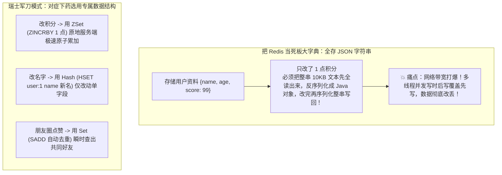
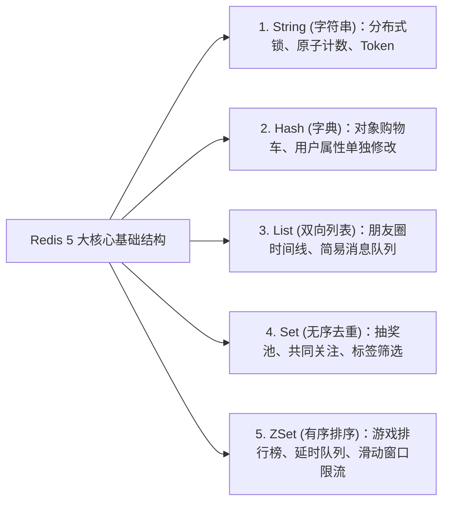

# ⚡ 05 · Redis 数据结构与应用（核心数据结构与业务选型实践）

> **一句话导读**：只把 Redis 当成存键值对的“大字典”？那你就暴殄天物了！Redis 是一套极致精密的高并发**“瑞士军刀百宝箱”**。搞懂 5 大基础结构与 3 大高级神器底层的设计哲学和业务对齐姿势，百万级吞吐量的实时榜单、计数与去重信手拈来。

---

## 🚀 Redis 核心数据结构与底层实现选型

很多初学者问：“为什么我不把所有数据全序列化成一个 JSON 字符串存进 Redis，非要搞什么 Hash、Set、ZSet？”



> 💡 **第一性原理：为什么 Redis 这么快？（单机 10万+ QPS）**
> 1. **绝大部分操作在内存完成**：内存读写在**几十纳秒**级别，比机械磁盘快成千上万倍；
> 2. **核心业务逻辑单线程**：没有多线程上下文切换开销，更没有死锁并发互斥的痛苦；
> 3. **I/O 多路复用（epoll）**：非阻塞 I/O，一个线程轻松同时监听上万个客户端网络连接。

---

## 🧰 5 大经典基础数据结构（业务场景匹配法）



---

### 1. String（字符串）—— 万能胶水
- **底层原理**：并不是 C 语言的字符数组，而是自己研发的 **SDS（简单动态字符串）**，预分配空间防止频繁扩容，自带 `len` 长度 $O(1)$ 获取。
- **经典业务场景**：
  - **常规缓存**：存储验证码、用户 Token 会话、商品详情缓存；
  - **原子计数器**：`INCR / DECR`（阅读量、视频播放量、防刷计数）；
  - **极简分布式锁**：`SET lock_key unique_id NX EX 30`（在第七章会深度剖析）。

---

### 2. Hash（哈希表 / 字典）—— 对象的灵魂伴侣
- **数据结构**：`Map<String, String>`，即键值对集合（`key -> {field1: val1, field2: val2}`）。
- **经典业务场景**：
  - **电商购物车**：`key=cart:userId`, `field=skuId`, `value=购买数量`。
    - 添加商品：`HSET cart:1001 8888 1`
    - 增加数量：`HINCRBY cart:1001 8888 1`
    - 勾选展示：`HGETALL cart:1001`
  - **用户对象详情**：随时只更新单个属性（如修改手机号），无需拉取整行重写。

---

### 3. List（列表）—— 链表流水线
- **底层原理**：底层采用 **QuickList（双向链表 + 紧凑列表）**，两端插入弹出时间复杂度 $O(1)$。
- **经典业务场景**：
  - **朋友圈最新动态时间线**：`LPUSH my_timeline msgId` 往队头塞，`LRANGE 0 9` 取最新 10 条；
  - **轻量级异步任务队列**：`LPUSH` 生产任务，`BRPOP`（阻塞式弹出）等待消费。

---

### 4. Set（集合）—— 唯一去重与交并差运算大师
- **特性**：无序、元素唯一不重复。支持强大的数学集合运算（交集、并集、差集）。
- **经典业务场景**：
  - **共同好友 / 共同关注**：
    - 用户 A 关注列表：`SetA = {小李, 小张, 小王}`
    - 用户 B 关注列表：`SetB = {小张, 小赵, 小王}`
    - **两人的共同关注**：`SINTER SetA SetB` $\rightarrow$ `{小张, 小王}`（底层一句命令秒出！）；
  - **抽奖活动池**：
    - 人员加入奖池：`SADD lottery:101 user_1 user_2`
    - 随机抽出 2 位锦鲤且不放回：`SPOP lottery:101 2`。

---

### 5. ZSet（有序集合 Sorted Set）—— 🌟 大厂面试绝对皇冠主角！
- **特性**：每个元素挂着一个浮点数分值（**Score**），所有元素天然按分数自动排序！
- **底层黑科技（必考）**：**哈希表（查元素时间复杂度 $O(1)$） + 跳表 SkipList（范围查询 $O(\log N)$）**。
- **经典业务场景**：
  - **游戏段位 / 实时带货销售榜**：
    ```text
    > ZADD live_rank 100 "主播李佳琦" 80 "主播罗永浩"
    > ZINCRBY live_rank 50 "主播罗永浩" (又卖了一单，加 50 分！)
    > ZREVRANGE live_rank 0 2 WITHSCORES (查看全网前三名，瞬时秒出！)
    ```
  - **延时任务队列**：将执行时间戳作为 Score，后台轮询 `ZRANGEBYSCORE 0 now_timestamp` 捞出到期任务。

---

## 🔮 3 大高级黑科技数据结构（降维打击利器）

| 高级结构 | 核心黑科技原理 | 现实生活降维应用 |
| :--- | :--- | :--- |
| **Bitmap**<br/>*(位图)* | 每一个 bit 位（0 或 1）代表一个状态，**1 字节能存 8 天**！ | **1 亿用户全年签到打卡**：每个人一年 365 天只需约 46 字节，一亿人仅需约 4.6GB 内存！ |
| **HyperLogLog** | 基于概率基数统计算法（伯努利试验）。 | **千万级网页 UV 统计**：统计 1 亿个独立 IP 访问，内存固定死死锁在 **12KB**！仅允许 0.81% 极微小误差。 |
| **GEO** | 基于两极经纬度计算，底层通过 GeoHash 编码转化为 ZSet。 | **附近的人 / 骑手距离测算**：`GEODIST` 算距离、`GEORADIUS` 查周围 3 公里内的外卖骑手。 |

---

## 💣 生产两大致命红线（稍有不慎当场开除）

### 1. 🚨 严禁在生产线上裸奔执行 `KEYS *`！
- **死因**：`KEYS *` 是无脑线性全局扫描。如果库里有上千万个 Key，单线程的 Redis 会被这个命令**完全卡死数秒甚至数十秒**！
- **后果**：期间全站所有的正常缓存请求全部超时报错，引发应用全面雪崩！
- **解药**：必须使用渐进式迭代命令：**`SCAN cursor MATCH pattern COUNT 100`**。

### 2. 🚨 警惕“大 Key”（BigKey）灾难！
- 什么是 BigKey？单 String 超过 10KB，或者一个集合（Hash/List/Set/ZSet）里塞了超过 5000 个元素。
- **危害**：网络传输耗时极高、集群内存倾斜不均匀、执行 `DEL` 物理删除大 key 时主线程会发生严重阻塞停顿！
- **解药**：
  - 大集合按日期或哈希哈希打散（如 `user:cart:1001:part1`）；
  - 删除大 key 使用异步非阻塞删除：**`UNLINK key`**（代替传统的同步 `DEL`）。

---

## 🧠 一分钟复盘核心记忆卡

1. **核心底座**：纯内存 + 单线程事件循环 + epoll 多路复用成就极致性能。
2. **五大件口诀**：**字符串存单值，哈希存对象，列表跑流水，集合算交并，有序跳表排榜单。**
3. **生产规约**：生产绝不用 `KEYS *`（改用 `SCAN`）；预防大 Key 内存倾斜（删除用 `UNLINK`）。

---

## 🧭 下一步

Redis 的数据全部存放在易失的内存 RAM 中。
如果机房突然断电或服务器意外死机，内存里的百万级数据如何起死回生？
RDB 拍照与 AOF 记流水账是如何相互配合打造“坚不可摧”的安全防线的？
请进入下一篇：[[06-Redis持久化-RDB-AOF]]！
