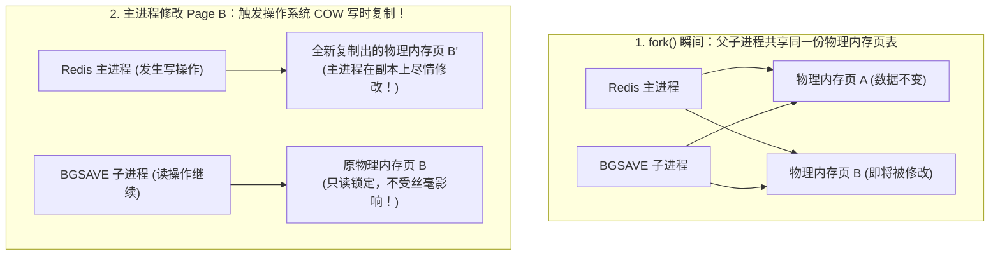
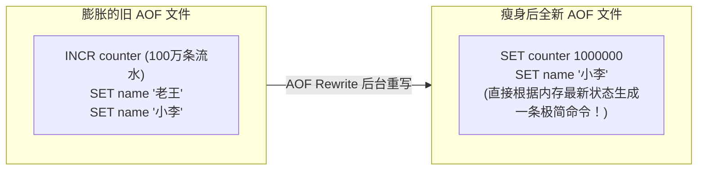
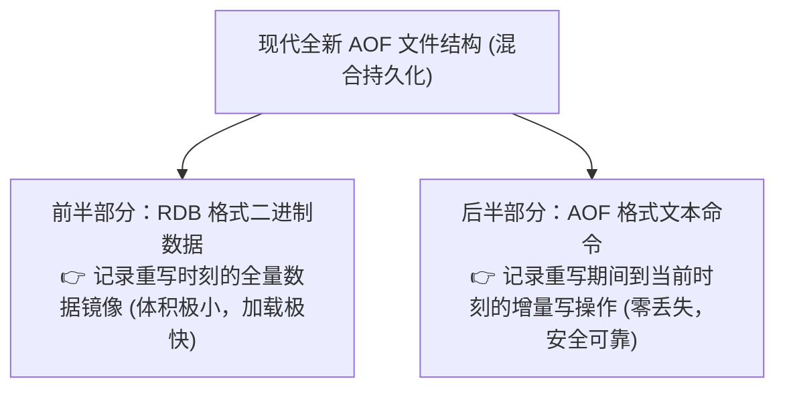

# 💾 06 · Redis 持久化：RDB 与 AOF（全家福照片与会计流水账的双保险）

> **一句话导读**：Redis 速度再快，只要服务器一断电，内存数据瞬间化为乌有！为了在“极速吞吐”与“绝不丢数据”之间达成完美平衡，Redis 打造了**“拍全家福快照（RDB）”**与**“记会计流水账（AOF）”**两大绝技。看懂写时复制（COW）与混合持久化，你就能掌握千万级内存数据的起死回生之道。

---

## 💾 RDB 快照与 AOF 日志持久化机制深度对比

想象你要记录一家公司的全部财务资产变化：

| 对比维度 | RDB（Redis DataBase 快照） | AOF（Append Only File 流水日志） |
| :--- | :--- | :--- |
| **存储内容** | **当前时间点的全量数据二进制压缩镜像** | **所有写操作指令的文本协议追加流水** |
| **数据安全性** | 较低。两次快照之间的数据可能丢失（分钟级） | **极高**。默认 `everysec` 策略，**最多只丢失 1 秒数据** |
| **恢复速度** | **极快**（直接把二进制全量映射进内存） | 较慢（必须逐行重放执行成千上万条命令） |
| **磁盘空间占用** | 极小（紧凑的高效二进制压缩文件） | 较大（随着写命令不断膨胀累加） |

---

## 📸 RDB 深度揭秘：写时复制（COW）的神来之笔

如果要在不阻塞主线程的前提下，把几十个 G 的内存数据保存到磁盘，Redis 是怎么做到的？

### 1. `SAVE` vs `BGSAVE`
- **`SAVE`（🚨 生产坚决禁用！）**：主线程亲自负责写磁盘，期间整个 Redis 彻底被卡死，无法响应任何客户端请求！
- **`BGSAVE`（默认推荐）**：主线程调用操作系统的 `fork()` 系统调用，派生出一个**子进程（Child Process）**，脏活累活全由子进程在后台慢慢写磁盘生成 `.rdb` 文件！

---

### 2. 核心大厂硬核必考：什么是写时复制（Copy-On-Write, COW）？

面试官常问：“在 `BGSAVE` 子进程往磁盘写快照的几秒钟里，如果有成千上万个客户端还在并发修改内存数据，Redis 是如何做到既不读到脏数据、又不需要把几十 G 内存全部再复制一份的？”

> 🔬 **COW 底层真相**：
> 1. `fork()` 出来的那一瞬间，操作系统并**没有**真正复制物理内存，只是**把父进程的虚拟内存页表（指针）复制了一份**，速度在微秒级！
> 2. 此时，操作系统把所有物理内存页全部标记为**“只读（Read-Only）”**；
> 3. **如果期间没有任何写操作**：父子进程相安无事，共享同一份物理内存，额外内存消耗为 0！
> 4. **一旦主进程尝试修改某个数据页（比如 Page B）**：
>    - CPU 触发内存缺页异常中断；
>    - 操作系统立刻把 Page B **复制出一份崭新的副本 Page B'** 供主进程修改；
>    - 子进程依然安然无恙地读取原来的旧 Page B 写入磁盘快照！
> 5. **优势**：内存按需极小颗粒度复制，既保证了快照是 fork 时刻的完美定格，又将内存开销降到了最低！

---

## 📜 AOF 深度解密：三步防线与日志瘦身

AOF 默认关闭，在配置文件中开启：`appendonly yes`。

### 1. 三大刷盘时机（`appendfsync`）
当一条写命令执行完毕后，它先进入操作系统内核的 PageCache 缓冲区，何时真正调用物理磁盘 `fsync` 刷盘？

| 刷盘参数 | 动作与机制 | 性能 | 安全性 |
| :--- | :--- | :--- | :--- |
| **`always`** | 每一个写命令执行完，立刻强制调用 `fsync` 刷盘！ | 惨不忍睹（直接把内存速度拉低到机械硬盘速度） | 100% 不丢数据 |
| **`everysec`** *(🌟 生产黄金默认)* | 由后台子线程**每隔 1 秒调用一次 `fsync` 刷盘**！ | **极高** | **仅丢失最后 1 秒数据**（性价比最高） |
| **`no`** | 不主动刷盘，全权委托操作系统自己决定（通常数十秒一次）。 | 极高 | 机器断电丢失几十秒数据，风险大 |

---

### 2. AOF 文件的“吸脂瘦身”术：AOF 重写（Rewrite）

如果一个计数器被连续执行了 100 万次 `INCR counter`，AOF 文件里就会记录 100 万行日志，占用上百兆磁盘！
但事实上，**当前内存里它只是一行 `counter = 1000000`！**

> 💡 **重写原理**：
> 同样通过 `bgrewriteaof` fork 出子进程。子进程**根本不读旧的 AOF 文件**，而是直接遍历当前内存里的全部数据，为每一个 Key 生成一条“最精简的存入指令”，直接把文件体积缩小 90% 以上！

---

## 🏆 终极无敌组合：Redis 4.0+ 混合持久化（兼得鱼与熊掌）

既然 RDB 恢复快，AOF 数据全，为什么不把它们合二为一？
开启配置：`aof-use-rdb-preamble yes`（现代 Redis 默认开启）。

- **开机恢复时**：
  - 前半截以 **RDB 的极致速度瞬间将 90% 的数据拉起**；
  - 后半截只重放这几十秒内的 AOF 增量流水，**几毫秒执行完毕**！
  - **鱼与熊掌兼得：秒级开机恢复 + 最多只丢 1 秒数据！**

---

## 🧠 一分钟复盘核心记忆卡

1. **两大套路**：RDB 是**全量二进制快照**（恢复快、丢得多），AOF 是**增量命令流水账**（恢复慢、丢得少）。
2. **COW 黑科技**：`BGSAVE` 借助操作系统的**写时复制（Copy-On-Write）**，共享页表不拷贝物理内存，有写操作才复制被改的页。
3. **现代最佳落地**：**开启混合持久化**（`aof-use-rdb-preamble yes`）搭配 `appendfsync everysec`，稳如磐石。

---

## 🧭 下一步

搞懂了内存数据如何安全落盘，在面对互联网高并发流量时，Redis 最常遭遇的“猝死危机”有哪些？
什么是让系统瞬时瘫痪的**缓存穿透、缓存击穿、缓存雪崩**？布隆过滤器是如何建立一夫当关的护城河的？
请进入下一篇大厂面试必考专题：[[07-缓存穿透-击穿-雪崩]]！
