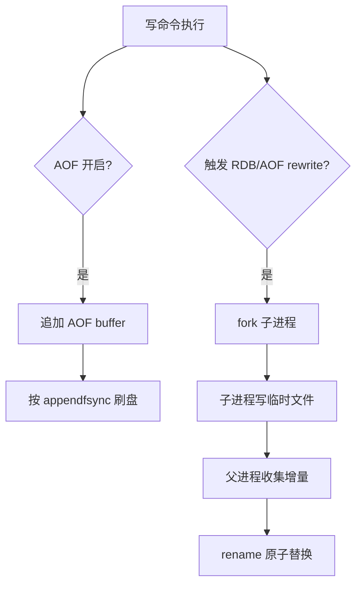

# Redis持久化-RDB-AOF

> [!abstract] 一句话总结
> RDB 是时间点快照，AOF 是命令追加日志；生产可靠性要结合刷盘策略、fork 成本、重写、复制和恢复时间评估。

## 📌 精准定位

- 负责进程重启或机器故障后尽量恢复内存数据。
- 不负责提供零丢失强一致，默认配置通常存在秒级丢失窗口。
- 关键边界：持久化会引入 fork、磁盘 IO、重写缓冲和恢复耗时。

## 🧩 核心概念

| 概念 | 具体含义 | 精通要点 |
| ---- | -------- | -------- |
| RDB | 后台 fork 子进程生成快照文件。 | 恢复快，丢失窗口取决于 save 策略。 |
| AOF | 把写命令追加到日志。 | everysec 常见，最多约 1 秒窗口。 |
| AOF rewrite | 把当前数据重写成更短命令序列。 | 重写期间有增量缓冲。 |
| 混合持久化 | AOF 文件前半 RDB 后半增量 AOF。 | 兼顾恢复速度和数据完整性。 |

## ⚙️ 工作原理 / 主流程



1. RDB fork 时父子共享内存页，写入触发 copy-on-write。
2. 实例越大、写入越频繁，fork 和 COW 风险越高。
3. AOF always 最安全但最慢，everysec 是常见折中。
4. 重启恢复优先加载 AOF，混合持久化能降低恢复时间。
5. 磁盘满或 fsync 卡顿会直接影响写延迟。

## 💻 代码 / 配置 / 伪代码

```text
appendonly yes
appendfsync everysec
aof-use-rdb-preamble yes
no-appendfsync-on-rewrite no
save 900 1 300 10 60 10000
```

## 🔍 源码入口 / 关键组件

- redis.conf save/appendonly/appendfsync
- INFO persistence
- LASTSAVE / BGREWRITEAOF / BGSAVE
- Redis 源码 rdb.c、aof.c
- 系统指标 fork time、used_memory_rss、磁盘延迟

## ⚠️ 生产坑与注意事项

- 大实例 fork 时 COW 内存不足。
- AOF rewrite 长期失败导致磁盘打满。
- 容器没有持久卷，重启数据丢失。
- 把异步复制误认为持久化保障。
- 从未做恢复演练。

## 🧭 排查路径

- 持久化失败看 last_bgsave_status 和 last_aof_rewrite_status。
- 延迟升高对照 fsync、fork、rewrite 时间点。
- 磁盘满检查 AOF 增长和 rewrite 条件。
- 恢复慢评估混合持久化和分片拆分。

## 🎯 面试问题

> [!question] 高频问题
> - Q: RDB 和 AOF 区别？
>   - A: RDB 快照恢复快但丢失窗口大，AOF 日志更完整但文件和重写成本高。
> - Q: AOF everysec 会丢数据吗？
>   - A: 机器故障可能丢最近约 1 秒写入。
> - Q: fork 为什么危险？
>   - A: 大内存 fork 耗时和 COW 内存会引发延迟或 OOM。
> - Q: 混合持久化是什么？
>   - A: AOF 以 RDB 快照开头，后接增量 AOF。
> - Q: 恢复演练怎么做？
>   - A: 隔离环境启动备份，校验 key 数、业务抽样和耗时。

## ✅ 精通检查清单

- 能画出主流程，并标出最容易失败的节点。
- 能说出至少 3 个源码入口或关键组件。
- 能写出最小配置、SQL、伪代码或状态机。
- 能结合生产故障说明监控指标、排查命令和修复动作。
- 能和相邻方案做取舍对比，而不是只背定义。

## 🔗 关联笔记

- [[_index]]
- [[20-Java后端/00-总览/学习仪表盘]]

## 📚 参考资料

- Redis Documentation: Persistence
- Redis Administration: Latency
