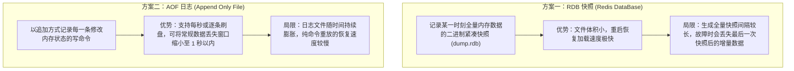
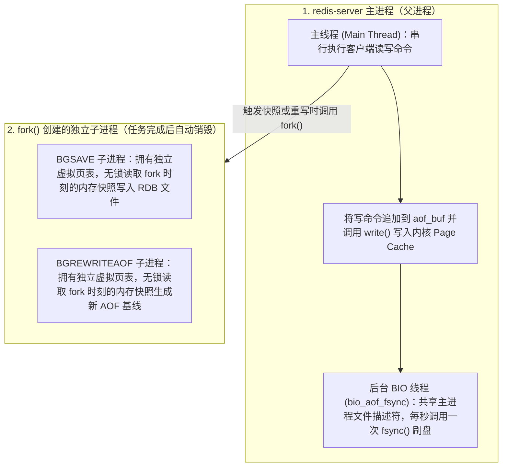
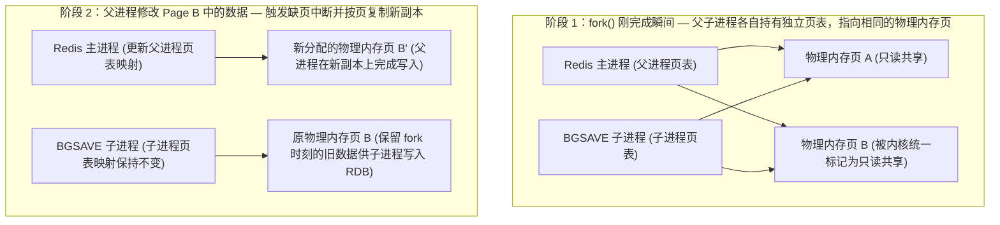
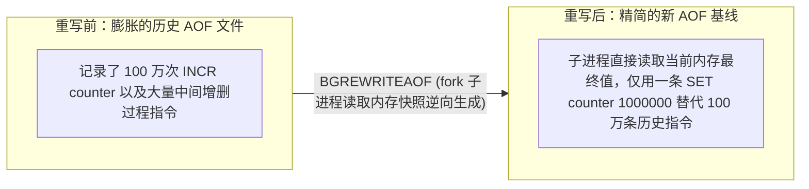
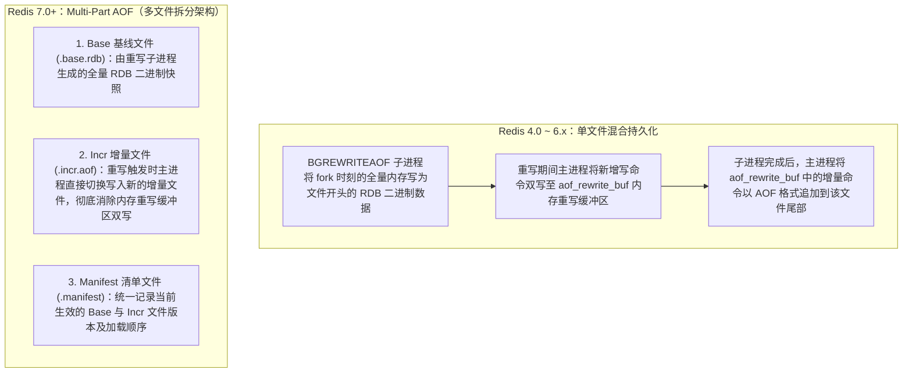

# 💾 06 · Redis 持久化：RDB 与 AOF（快照机制、写时复制与混合持久化）

> **一句话导读**：Redis 的高性能建立在内存读写之上，但内存的易失性意味着一旦进程崩溃或服务器断电，数据就会面临丢失风险。理解操作系统的写时复制（COW）、AOF 三种刷盘策略以及 Redis 4.0/7.0 的混合持久化演进，才能在性能开销、恢复速度与数据安全性之间做出合理的架构权衡。

---

## 一、业务痛点与核心矛盾：内存的高速读写与磁盘的慢速落盘

在生产环境中，Redis 不仅用作加速查询的缓存，还常用于存储购物车、用户会话、排行榜等核心业务状态。如果完全不做持久化，一旦实例因机器故障重启：
1. **业务状态彻底丢失**：排行榜、未同步的计数器和购物车数据全部清零；
2. **引发底层数据库雪崩**：重启后的 Redis 变成空实例，海量线上读请求瞬间全部穿透回源到后端的 MySQL 数据库，极易引发级联宕机。

然而，将数十 GB 的内存数据持久化到磁盘时，工程上面临一个核心矛盾：**磁盘 I/O 比内存读写慢几个数量级，如何在不阻塞 Redis 主线程处理高并发请求的前提下，将不断变化的内存数据安全、一致地写入磁盘？**

围绕这一问题，Redis 提供了两种核心持久化方案，并在后续版本中将二者融合为混合持久化：

| 对比维度 | RDB（全量二进制快照） | AOF（增量写命令日志） |
| :--- | :--- | :--- |
| **持久化内容** | 某一时间点全量键值对的紧凑二进制数据 | 修改数据库状态的写命令序列（开启混合持久化后包含 RDB 基线） |
| **数据安全性（RPO）** | 取决于快照触发周期（如每隔 5~15 分钟一次，宕机可能丢失数分钟数据） | 默认 `everysec` 策略下，常规情况最多丢失约 1 秒的数据 |
| **重启恢复速度（RTO）** | 极快，直接将紧凑二进制数据块解析载入内存 | 纯 AOF 较慢（需逐条重放写命令；开启混合持久化后大幅提速） |
| **文件体积与日常维护** | 经过二进制编码压缩，体积远小于内存实际占用 | 随写操作持续增长，需通过后台 AOF Rewrite 定期归并压缩 |

---

## 二、前置核心厘清：持久化任务中哪些用“线程”，哪些用“子进程”？

在深入 RDB 和 AOF 的工作细节前，需要先从操作系统原理厘清一个高频混淆点：**为什么 AOF 每秒刷盘用的是“后台线程”，而生成 RDB 快照和 AOF 重写却必须用 `fork()` 创建的“独立子进程”？**

| 执行单元 | 操作系统身份 | 负责的持久化工作 | 为什么这样设计？（底层原理） |
| :--- | :--- | :--- | :--- |
| **`redis-server` 主线程** | 主进程内的核心**线程** | 执行客户端读写命令；将写命令追加到 `aof_buf` 缓冲区并调用 `write()` 写入操作系统 Page Cache；在 `always` 策略下同步调用 `fsync()`。 | 命令执行与缓冲区追加必须在主线程串行完成，才能保证日志记录顺序与内存数据状态严格一致。 |
| **`bio_aof_fsync`** | 主进程内的常驻后台**线程** | 在 `appendfsync everysec` 策略下，每隔 1 秒在后台调用一次 `fsync(fd)` 将内核 Page Cache 中的数据强制刷入物理磁盘。 | `fsync` 只是针对已打开的文件描述符执行磁盘同步，**完全不需要遍历内存中的数据结构**；使用同进程内的后台线程即可直接共享文件描述符，创建和通信成本极低。 |
| **`BGSAVE` / `BGREWRITEAOF` 执行者** | 通过 `fork()` 创建的独立**子进程** | 在后台遍历全量内存字典与跳表，生成 RDB 快照文件或重写生成新的 AOF 基线文件，写完后自动退出。 | **为什么不能用多线程？** 因为同一进程内的多个线程共享同一张虚拟页表和同一片内存空间。如果用子线程去遍历内存写 RDB，而主线程同时在修改数据，子线程不仅会读到前后不一致的脏数据，还会因为并发读写未加锁的哈希表/跳表而直接导致进程崩溃。只有通过 `fork()` 创建拥有**独立虚拟页表的子进程**，才能借助操作系统的 **写时复制（COW）** 无锁读取 `fork` 瞬间凝固的内存快照。 |

---

## 三、RDB 快照机制与操作系统写时复制（Copy-On-Write）

### 1. `SAVE` 与 `BGSAVE` 的触发方式
- **`SAVE`（主线程同步执行）**：直接在 `redis-server` 主线程中同步遍历内存并生成 RDB 文件。在写入完成的数秒至数十秒内，主线程无法处理任何客户端请求，因此线上环境严禁执行 `SAVE`。
- **`BGSAVE`（`fork` 子进程后台执行，生产标准方式）**：当满足 `save m n` 配置条件（如 900 秒内至少有 1 次修改）、执行主从全量同步或手动发起 `BGSAVE` 时，主进程调用操作系统的 `fork()` 创建出一个独立的 **`BGSAVE` 子进程**。子进程在后台负责遍历内存并写入 RDB 文件，主进程在 `fork()` 返回后立即继续处理客户端请求。
  - **工程细节**：虽然写磁盘是由子进程异步完成的，但 **`fork()` 系统调用本身是由主进程同步执行的**。在 `fork()` 的瞬间，操作系统内核需要把主进程的虚拟内存页表（Page Table）复制一份给子进程。如果单个 Redis 实例的内存过大（例如达到 $30\text{ GB}$ 以上），仅复制页表这一步就可能阻塞主线程几十到上百毫秒。因此生产环境通常建议将单个 Redis 实例的内存控制在 $10\text{ GB} \sim 20\text{ GB}$ 以内。

---

### 2. 写时复制（Copy-On-Write, COW）底层全流程拆解

在 `BGSAVE` 子进程耗时数秒将几十 GB 内存数据写入磁盘的过程中，Redis 主进程仍在高频接收客户端的 `SET`、`HSET` 等修改请求。**为什么 `fork()` 时不需要把几十 GB 物理内存真地拷贝一份，主进程改数据又不会破坏子进程正在持久化的快照？** 这正是操作系统 **写时复制（COW）** 机制的精妙之处：

1. **`fork()` 瞬间仅复制页表并设为只读**：执行 `fork()` 时，操作系统内核并不复制物理内存中的数据，而是只把父进程（Redis 主进程）的虚拟页表复制一份给子进程。此时父子进程各自的虚拟页表项指向完全相同的物理内存页，同时内核将这些共享物理页的权限统一修改为**只读（Read-Only）**。
2. **只读数据全程零拷贝**：如果某块物理内存页（如图中的 `Page A`）在快照期间只被读取而没有发生修改，父子进程就一直共享同一块物理内存，不产生任何额外的内存拷贝开销。
3. **修改数据触发缺页中断与按页复制**：当父进程接收到客户端写命令，尝试修改 `Page B` 上的某个 Key 时：
   - CPU 的内存管理单元（MMU）检测到正在向一个“只读”物理页写入数据，立即触发**缺页异常中断（Page Fault）**；
   - 操作系统内核捕获该中断后，发现这是一个 COW 共享页，于是立即在物理内存中新分配一个 **$4\text{ KB}$** 的物理页 `Page B'`，将原 `Page B` 中的内容拷贝到 `Page B'`；
   - 内核将**父进程页表**中对应的虚拟地址指向新页 `Page B'`，并将其权限恢复为可写，随后父进程在 `Page B'` 上完成数据修改；
   - 与此同时，**`BGSAVE` 子进程的页表**依然指向原来的 `Page B`，子进程看到的仍然是 `fork()` 发生那一刻丝毫未变的历史快照。
4. **生产环境容量规划与 THP 调优**：
   - **预留内存余量**：COW 是以操作系统内存页（标准页大小为 $4\text{ KB}$）为单位复制的。如果在 `BGSAVE` 或 `AOF Rewrite` 期间业务正处于高频随机写入高峰，大量内存页被修改触发复制，父子进程合计占用的物理内存就会显著增加。因此生产机器需要为 Redis 预留 $30\% \sim 50\%$ 的空闲物理内存，防止触发操作系统 OOM Killer。
   - **关闭透明大页（Transparent Huge Pages, THP）**：Linux 默认开启的透明大页会将单个内存页的大小从 $4\text{ KB}$ 放大到 **$2\text{ MB}$**。一旦开启 THP，哪怕父进程只修改了某页中 10 个字节的计数器，操作系统也不得不在缺页中断中整块复制 $2\text{ MB}$ 的物理内存，既大幅拉长了写请求的停顿延迟，又加速了内存膨胀。因此线上部署 Redis 时应执行 `echo never > /sys/kernel/mm/transparent_hugepage/enabled` 关闭透明大页。

---

## 四、AOF 日志机制：命令追加、三种刷盘策略与后台重写

RDB 快照因为生成周期长（通常数分钟一次），无法做到秒级的数据安全保障。为此，Redis 提供了 **AOF（Append Only File）** 日志机制（通过 `appendonly yes` 开启），将每一次修改内存状态的写命令记录下来。

### 1. AOF 写入的三个阶段与三种刷盘策略（`appendfsync`）

当客户端发送一条写命令（如 `SET k1 v1`）时，AOF 的完整落盘链路分为三步：
1. **命令追加（Append）**：主线程在内存中执行完写命令后，将该命令按照 Redis 通信协议（RESP）格式追加到内存的 `aof_buf` 缓冲区末尾；
2. **写入内核缓存（Write）**：在每次事件循环结束前，主线程调用操作系统的 `write()` 系统调用，将 `aof_buf` 中的数据拷贝到操作系统内核的 **Page Cache（页缓存）** 中。需要注意：此时数据虽然离开了 Redis 用户态进程（如果此时仅 `redis-server` 进程被 `kill -9`，内核 Page Cache 中的数据仍由操作系统保留，不会丢失），但如果此时发生**服务器断电或操作系统内核崩溃**，尚未来得及刷入磁盘介质的 Page Cache 数据依然会丢失；
3. **同步刷入磁盘（Fsync）**：调用操作系统的 `fsync()` 系统调用，强制将内核 Page Cache 中的脏数据真正写入物理磁盘介质。

针对耗时最长的第 3 步 `fsync()`，Redis 提供了三种配置策略供业务按需选择：

| `appendfsync` 配置 | 底层执行过程与线程协作 | 性能表现 | 数据丢失风险窗口 |
| :--- | :--- | :--- | :--- |
| **`always`** | 主线程在每次事件循环调用 `write()` 写入 Page Cache 后，立即由**主线程同步调用 `fsync()`** 强制刷入物理磁盘，刷盘完成后才向客户端返回响应。 | 慢，每次写请求都受限于物理磁盘 I/O 延迟，吞吐量最低 | 最高安全等级，机器断电最多丢失当前正在处理的单个事件循环批次命令 |
| **`everysec`**（生产默认配置） | 主线程每次只负责调用轻量的 `write()` 写入内核 Page Cache 即返回；由专门的**后台线程 `bio_aof_fsync`** 每隔 1 秒异步执行一次 `fsync()` 刷盘。 | 极高，日常写操作不阻塞主线程（仅当磁盘 I/O 严重拥塞导致后台线程上一次 `fsync` 耗时超过 2 秒仍未完成时，主线程才会被迫暂停写入等待） | 兼顾性能与安全，常规情况下机器宕机最多丢失约 1~2 秒的数据 |
| **`no`** | 主线程只调用 `write()` 写入内核 Page Cache，Redis 从不主动调用 `fsync()`，完全交给操作系统内核按默认周期（通常约 30 秒）自动刷盘。 | 性能最高，完全没有刷盘等待开销 | 安全性最低，整机断电时可能丢失多达数十秒的数据 |

---

### 2. AOF 重写机制（AOF Rewrite）：给膨胀的日志文件“瘦身”

由于 AOF 采用不断追加的方式记录每一条写命令，运行一段时间后会出现两个严重问题：一是同一个 Key 被反复修改（例如对计数器执行了 100 万次 `INCR counter`，或对列表反复 `LPUSH` 与 `LPOP`），AOF 文件中会堆积海量早已失效的历史冗余指令，耗尽磁盘空间；二是实例重启重放这上千万条历史指令会耗费数十分钟甚至更久。

为此，Redis 提供了 **AOF 重写机制（`BGREWRITEAOF`）**，在不阻塞线上读写的前提下生成一份体积最小的新 AOF 文件：

- **AOF 重写的核心原理**：
  1. **读取当前内存状态而非解析旧 AOF 文件**：执行 `BGREWRITEAOF` 时，主进程通过 `fork()` 创建出独立的 **`BGREWRITEAOF` 子进程**。子进程完全不需要去读取和解析庞大杂乱的旧 AOF 文件，而是直接遍历 `fork()` 瞬间内存数据库中的所有键值对，根据每个 Key 当前的最新状态，直接生成一条最简恢复命令（例如将包含 50 个元素的列表直接生成一条 `RPUSH key e1 e2 ... e50`）写入临时新文件。
  2. **重写期间的新增写命令如何不丢失？** 在子进程后台重写期间，主进程仍在继续处理客户端发来的新写命令。为了确保这部分增量修改不丢失，主进程会将新执行的写命令继续写入旧 AOF 的同时，额外保存一份增量记录，待子进程完成基线重写后再合并衔接。

---

## 五、混合持久化（Redis 4.0+）与 Multi-Part AOF（Redis 7.0+）

即使经过了 AOF 重写，纯文本格式的 AOF 命令在重启加载时，依然需要经过“词法解析 $\rightarrow$ 伪客户端执行命令 $\rightarrow$ 修改内存结构”的完整过程，恢复速度远不及直接加载二进制内存块的 RDB 快照。

为了**同时拥有 RDB 的极速恢复能力与 AOF 的秒级数据安全性**，Redis 4.0 引入了**混合持久化**（通过 `aof-use-rdb-preamble yes` 控制，Redis 5.0 及以上版本默认开启），并在 Redis 7.0 中进一步演进为更加优雅的 **Multi-Part AOF（多部件 AOF）** 架构：

### 1. Redis 4.0 ~ 6.x 单文件混合模式的痛点
在 Redis 4.0 到 6.x 中，混合持久化生成的仍然是单个 `appendonly.aof` 文件（前半部分是 RDB 二进制格式，后半部分是 AOF 文本格式）。但在重写期间：
- 主进程必须把新收到的写命令同时写入“旧 AOF 缓冲区 (`aof_buf`)”和“重写缓冲区 (`aof_rewrite_buf`)”，造成了**双倍的内存缓冲与 CPU 拷贝开销**；
- 当子进程写完 RDB 基线退出时，如果重写期间写入量很大，`aof_rewrite_buf` 中积攒了上百 MB 的增量数据，主线程必须亲自把这些数据一次性追加写入到新 AOF 文件末尾，这一步又会阻塞主线程。

### 2. Redis 7.0+ Multi-Part AOF 的彻底革新
为了彻底消除 `aof_rewrite_buf` 带来的内存开销与合并阻塞，Redis 7.0 将原本单一的 AOF 文件拆分为三类独立文件（统一存放在 `appenddirname` 目录下）：
1. **Base 文件（基线文件，如 `appendonly.aof.2.base.rdb`）**：由 `BGREWRITEAOF` 子进程生成的重写时刻全量 RDB 二进制快照。
2. **Incr 文件（增量文件，如 `appendonly.aof.2.incr.aof`）**：一旦触发重写，主进程直接打开一个新的 `.incr.aof` 文件顺序追加后续到达的写命令。**主进程不再需要维护内存中的 `aof_rewrite_buf`，子进程写完 Base 文件后也无需主进程去做耗时的文件尾部拼接**。
3. **Manifest 文件（清单文件，`appendonly.aof.manifest`）**：负责追踪当前哪一个 Base 文件和哪几个 Incr 文件是有效状态。当子进程写完新的 Base 文件后，主进程只需原子更新一下 Manifest 清单，然后把旧的 Base 和旧的 Incr 文件交给后台线程异步删除即可。
4. **重启恢复流程**：当 Redis 重启时，先根据 Manifest 清单极速加载二进制的 `.base.rdb` 基线文件恢复绝大部分数据，随后仅需重放最新 `.incr.aof` 中的少量增量命令，既快又稳。

---

## 🧠 一分钟复盘核心记忆卡

1. **线程与子进程的分工逻辑**：
   - **AOF 每秒刷盘（`everysec`）用后台线程 `bio_aof_fsync`**：因为只需对已打开的文件描述符执行 `fsync(fd)`，不涉及遍历内存结构；
   - **RDB 快照（`BGSAVE`）与 AOF 重写（`BGREWRITEAOF`）必须用 `fork()` 独立子进程**：因为需要遍历全量内存，必须依靠子进程独立的虚拟页表与操作系统的 **写时复制（COW）**，才能在不加锁、不阻塞主线程的前提下获取一致的时间点内存快照。
2. **写时复制（COW）与生产调优**：`fork()` 时父子进程共享只读物理页；父进程修改数据时触发缺页中断，由内核按 $4\text{ KB}$ 页复制新副本。线上务必**关闭透明大页（THP）**并预留 $30\% \sim 50\%$ 空闲内存。
3. **混合持久化与 Multi-Part AOF**：结合了 RDB 恢复快与 AOF 丢数据少的优势；Redis 7.0+ 通过拆分 `Base (.rdb)` + `Incr (.aof)` + `Manifest` 彻底消除了重写缓冲区的内存双写与尾部合并阻塞。

---

## 🧭 下一步

持久化机制保障了 Redis 实例重启后的数据恢复。但在高并发线上读写链路中，当查询的数据根本不存在、单个热点 Key 突然过期、或者大批 Key 在同一时刻集中失效时，海量请求会瞬间绕过缓存直击后端的 MySQL 数据库。如何系统性防范缓存穿透、缓存击穿与缓存雪崩，并保障缓存与数据库的双写最终一致性？
请进入下一篇：[[07-缓存穿透-击穿-雪崩]]！
