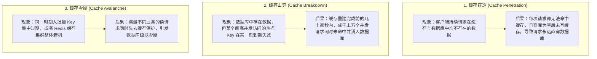
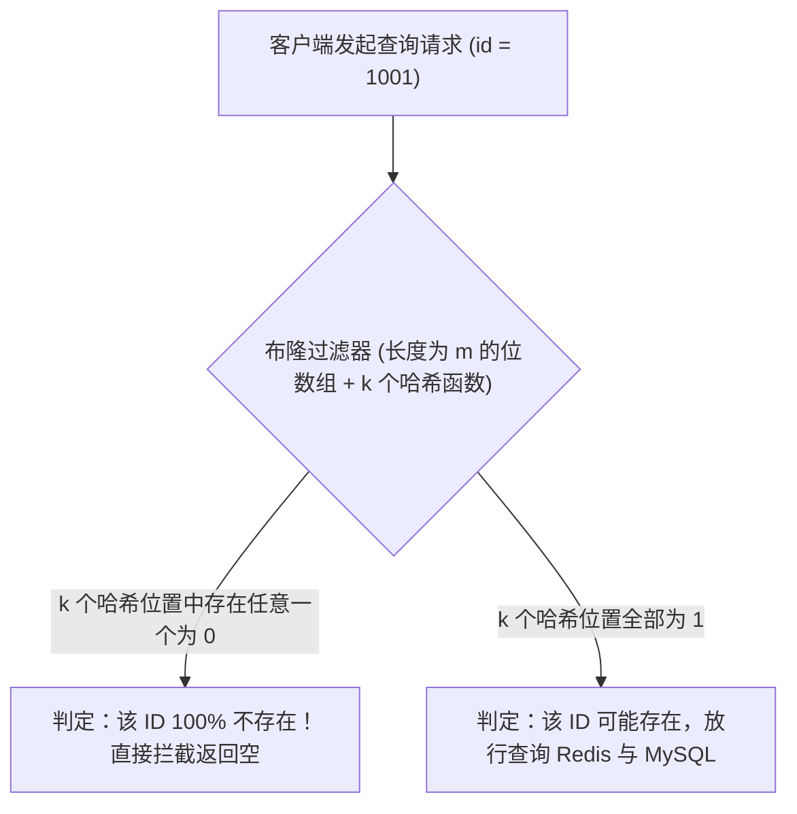
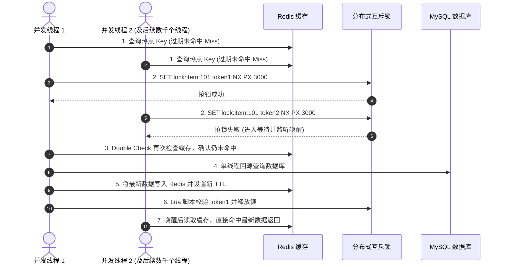
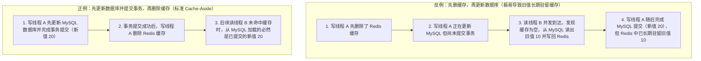

# 🛡️ 07 · 缓存穿透、击穿与雪崩（回源风暴治理与双写一致性）

> **一句话导读**：在高并发系统中，Redis 缓存承担了 90% 以上的读流量。一旦发生缓存穿透（查询根本不存在的数据）、缓存击穿（单个热点 Key 突然过期）或缓存雪崩（大批 Key 集中过期或缓存集群故障），瞬间涌入的回源查询就会直接压垮后端的 MySQL 数据库。厘清这三类问题的本质差异、掌握对应的工程治理手段与 Cache-Aside 双写一致性方案，是构建高可用缓存架构的核心基本功。

---

## 一、业务痛点与三大缓存异常全景对比

在典型的“应用服务 $\rightarrow$ Redis 缓存 $\rightarrow$ MySQL 数据库”架构中，单台 Redis 实例可以轻松支撑数万至十万级 QPS，而单台 MySQL 实例受限于磁盘 I/O、连接池上限与锁开销，能够承受的直接查询并发通常只有数千 QPS。

一旦缓存防线在某个环节失守，原本由 Redis 拦截的海量读请求就会在同一瞬间全部转化为对 MySQL 的直接查询（即**回源风暴**），导致数据库连接池瞬间耗尽、CPU 飙升至 100% 甚至引发全站级联宕机。根据触发原因与影响范围的不同，缓存失守主要分为三类典型故障：



| 故障类型 | 核心成因与特征 | 典型业务触发场景 | 标准工程治理方案 |
| :--- | :--- | :--- | :--- |
| **缓存穿透** | 查询的数据在缓存和数据库中都**根本不存在**，每次请求都绕过缓存直击数据库。 | 恶意攻击者构造随机负数/超大 ID 刷接口、外部爬虫遍历无效商品 ID。 | 1. 接口层参数合法性校验；2. 缓存空对象（Cache Null）+ 短 TTL；3. 布隆过滤器（Bloom Filter）前置拦截。 |
| **缓存击穿** | **单个高并发热点 Key 恰好到期失效**，在缓存重建完成前的短暂窗口内，大量并发线程同时查库重建。 | 秒杀活动中的爆款商品详情 Key 到期、突发热门词条缓存刚好过期。 | 1. 分布式互斥锁（Mutex Lock + Double Check 二次检查）；2. 热点数据逻辑过期（Logical Expiration）异步单飞刷新。 |
| **缓存雪崩** | **大面积 Key 在同一时间点集中过期**，或 **Redis 集群整体故障**，导致全站读流量瞬间压向数据库。 | 凌晨定时任务批量预热缓存时设置了完全相同的固定 TTL、机房网络闪断或节点宕机。 | 1. 过期时间附加随机扰动值（打散 TTL）；2. Redis 高可用集群 + JVM 本地二级缓存；3. 数据库回源限流与服务降级。 |

---

## 二、缓存穿透的工程治理方案

当客户端请求查询 `id = -999` 或一个从未注册过的商品 ID 时，Redis 中自然查不到；请求随后回源查询 MySQL，MySQL 也返回空结果（`null`）。如果业务代码在拿到 `null` 后直接返回给前端而不写任何缓存，那么下一秒针对该 ID 的成千上万次请求依然会重复走一遍“查 Redis 未命中 $\rightarrow$ 查 MySQL 为空”的死循环。

### 1. 方案一：缓存空对象（Cache Null / 空值占位符）
- **实现方式**：当请求未命中 Redis 进而回源查询 MySQL，确认数据库中也不存在该记录（返回 `null`）时，依然向 Redis 写入一个特殊的空值标记（例如 `"NULL_PLACEHOLDER"`），并设置一个**较短的过期时间 TTL（如 $30 \sim 60$ 秒）**。
- **适用场景与局限**：
  - 对于**固定 ID 的重复穿透查询**（比如业务代码 Bug 反复请求同一个不存在的配置 ID，或攻击者拿固定几个无效 ID 刷接口），后续请求在 Redis 层就能直接命中空值标记并立即返回，实现零数据库回源。
  - **局限性**：如果恶意攻击者每次请求都换一个全新的随机 ID（如遍历递增序号或随机 UUID），缓存空对象不仅每次都无法命中，还会在 Redis 内存中塞满数以百万计的无用空值 Key，白白耗尽缓存内存。为了应对海量随机 ID 攻击，需要在查询 Redis 之前引入**布隆过滤器**。

---

### 2. 方案二：布隆过滤器（Bloom Filter）前置拦截

布隆过滤器是一种空间效率极高的概率型数据结构，专门用于在进入 Redis 和数据库之前，以极小的内存代价快速判断“某个元素是否必定不存在”：



#### 布隆过滤器的底层原理与工程使用边界
1. **底层结构与写入过程**：
   - 布隆过滤器底层由一个长度为 $m$ 的二进制位数组（Bit Array，初始全部比特位均为 `0`）和 $k$ 个彼此独立的哈希函数组成。
   - 在系统初始化预热或新增合法业务数据（如新上架一件商品）时，将该数据的主键 `id` 分别通过这 $k$ 个哈希函数计算出 $k$ 个数组下标，并将位数组中这 $k$ 个位置的比特位全部设为 `1`。
2. **为什么“判为不存在”是 100% 准确的，而“判为存在”会有小概率误判？**
   - **存在任意一位为 `0` $\rightarrow$ 必定不存在（无假阴性）**：只要数据库中所有合法数据的主键都已经同步写入了布隆过滤器，那么任何一个真实存在的 ID，它对应的 $k$ 个比特位就必然全部是 `1`。一旦查询时发现其中哪怕只有 1 个比特位是 `0`，就能 $100\%$ 断定这个 ID 从未被录入过，直接拦截返回即可。
   - **全部 $k$ 位都为 `1` $\rightarrow$ 可能存在（有小概率假阳性误判）**：随着录入的数据增多，一个原本不存在的随机 ID `X` 经过哈希计算得到的 $k$ 个位置，有可能恰好被之前录入的其他几个合法 ID 分别置为了 `1`（即发生了哈希碰撞）。因此，通过布隆过滤器校验的请求中会混入极少数误判的无效 ID。工程上通过合理配置位数组长度 $m$ 和哈希函数个数 $k$，可将误判率控制在 $0.1\% \sim 1\%$ 以内，对这极少量漏网的请求再配合“缓存空对象（Cache Null）”兜底，就能形成严密的防护闭环。
3. **为什么标准布隆过滤器不支持直接删除元素？**
   - 因为位数组中的同一个 `1` 比特位可能被多个不同的合法 ID 共同映射共享。如果为了删除某个已下架商品 ID 而直接将它对应的 $k$ 个比特位清零为 `0`，就会连带破坏其他共享这些比特位的正常商品 ID，导致正常商品被误判为“不存在”。如果业务存在频繁物理删除且需要同步从过滤器移除的需求，可选用支持计数删除的 **Counting Bloom Filter**、**布谷鸟过滤器（Cuckoo Filter）**，或者采取定期全量重建布隆过滤器的策略。

---

## 三、缓存击穿的工程治理方案

缓存击穿针对的是**单个超高并发访问的热点 Key**（如双十一零点某爆款手机的详情缓存）。在缓存有效期内，每秒数万次请求全部由 Redis 轻松扛下；但在该 Key **TTL 到期失效的那一瞬间**，如果同时有 5000 个并发请求到达且发现缓存未命中，这 5000 个线程就会在同一毫秒冲进 MySQL 执行一模一样的复杂 SQL 查询，瞬间打挂数据库。

治理缓存击穿的核心思想是：**把成千上万个线程的并发回源，收敛为单个线程的受控回源**。

### 1. 方案一：分布式互斥锁（Mutex Lock + Double Check 二次检查）

当业务线程查询 Redis 发现热点 Key 未命中时，先去争抢该 Key 专属的分布式互斥锁（如执行 `SET lock:item:101 token NX PX 3000`）：
- **抢锁成功的唯一线程**：先执行一次 **Double Check（二次检查 Redis 缓存）**，确认缓存仍未命中后，单独去查询 MySQL 数据库，将查询结果写回 Redis 缓存，最后释放互斥锁；
- **抢锁失败的其余 4999 个线程**：不再去访问数据库，而是等待获锁线程把缓存重建好之后，直接从 Redis 读取结果。



#### 工程深挖：抢锁失败的并发线程，在代码里究竟是如何“等待”的？
原生 Redis 的 `SET key val NX PX 3000` 只是一条简单的原子写指令，Redis 服务端并不会替抢锁失败的客户端维护等待队列。在实际生产编码中，通常有以下三种由浅入深的实现方式：

1. **初级做法：循环 + `Thread.sleep` 轮询退避**
   - 抢锁失败后，在循环中调用 `Thread.sleep(30)` 休眠 30 毫秒，醒来后重新查一次 Redis 缓存，最多重试固定次数。这种方式实现最简单，但休眠时长难以精确把握——设短了会产生大量无效的网络轮询，设长了则会白白拉高接口的响应延迟。
2. **主流做法：使用 Redisson `RLock`（基于 Redis `Pub/Sub` + 本地 `Semaphore` 阻塞队列）**
   - 当调用 Redisson 的 `lock.tryLock(waitTime, leaseTime, TimeUnit)` 抢锁失败时，线程不会盲目轮询，而是先订阅 Redis 中该锁专属的发布订阅频道（`redisson_lock__channel:{lockName}`），随后调用 Java 标准库 `Semaphore`（底层基于 AQS 的 CLH 双向队列）将当前线程在本地内存中挂起（`Park`），期间零 CPU 与网络消耗；
   - 一旦获锁线程重建完缓存并调用 `unlock()`，解锁 Lua 脚本会向该频道发布一条解锁通知，立即精准唤醒等待队列中的线程；被唤醒的线程进入临界区后执行 **Double Check（二次检查 Redis）**，此时直接命中刚写好的缓存并返回，不会再次查库。
3. **高阶做法：JVM 进程内单飞合并（SingleFlight / `CompletableFuture` / `Caffeine.get`）**
   - 在单台应用服务器内部，可以利用 `ConcurrentHashMap<String, CompletableFuture<Item>>`（或直接使用本地缓存 `Caffeine.get(key, k -> loadFromRedisOrDb(k))`）实现进程内请求合并；
   - 同一台机器上同时到达的 1000 个请求同一热点 Key 的线程，通过 `computeIfAbsent` 共享**同一个 `CompletableFuture` 实例**。只有创建该 `Future` 的那 1 个线程去发起分布式锁争抢与查库，其余 999 个线程全部挂起在该 `Future` 上等待；当那 1 个线程拿到数据调用 `future.complete(data)` 的瞬间，本机所有等待线程直接在内存中拿到结果返回，连第二次去查 Redis 的网络开销都一并省去。

---

### 2. 方案二：逻辑过期（Logical Expiration + 异步单飞刷新）

对于首页核心配置、顶流直播间详情等极高并发场景，如果业务要求**任何时候读请求都绝对不能阻塞等待**（哪怕是几十毫秒的等锁也不允许），同时能够接受在缓存刷新窗口期内短暂展示上一版本的旧数据，则可采用**逻辑过期**方案：

1. **物理不设短 TTL，对象内部封装逻辑过期时间**：向 Redis 写入热点数据时，不设置短的物理过期时间（确保 Redis 不会因为到期自动清理该 Key），而是在存储的 JSON 对象内部增加一个逻辑过期时间戳字段：`{"data": {...}, "expireAt": 1790000000}`。
2. **读取时对比时间并异步刷新**：
   - 业务线程从 Redis 读出数据后，判断当前系统时间是否已超过 `expireAt`；
   - 若未过期，直接返回 `data`；
   - 若发现 `now > expireAt`（逻辑已过期），当前线程尝试以非阻塞方式抢占刷新锁（`SET lock:refresh:key token NX PX 3000`）。**无论抢锁成功还是失败，当前请求线程都不阻塞等待，而是立即先把手里已有的旧 `data` 返回给前端**；抢到锁的那个线程只需向后台线程池提交一个异步任务，由后台线程慢慢去查库更新 Redis 并顺延 `expireAt`。

---

## 四、缓存雪崩的工程治理方案

缓存雪崩通常由两类原因引发：一是**大批量 Key 在同一时刻集中过期失效**，二是 **Redis 节点或集群发生整体故障**。工程上需要从“事前预防、事中隔离、事后兜底”三个层面构建纵深防御体系：

### 1. 预防大批量 Key 集中过期：基础 TTL + 随机扰动值（Jitter）
当通过定时任务批量预热商品或活动缓存时，切忌给所有 Key 设置一模一样的固定过期时间（比如全部设为 `3600` 秒，导致 1 小时后所有 Key 在同一秒集体失效），而是在基础过期时间之上附加一段随机散列值：

```java
// 基础过期时间 3600 秒（1 小时） + 随机扰动 0 ~ 599 秒（10 分钟）
long ttlSeconds = 3600L + ThreadLocalRandom.current().nextLong(600);
redisTemplate.opsForValue().set(key, value, ttlSeconds, TimeUnit.SECONDS);
```
通过将过期时间均匀打散在 10 分钟的窗口期内，原本集中在一秒钟爆发的缓存重建流量被平摊稀释，数据库便能从容应对。

### 2. 应对 Redis 故障与极端流量：多级缓存与回源熔断限流
- **Redis 集群高可用**：线上部署 **Redis Sentinel（哨兵主从切换）** 或 **Redis Cluster（多主多从分片集群）**，当单个主节点故障时自动触发从节点晋升，防止单点宕机导致整个缓存层不可用。
- **构建 JVM 本地二级缓存**：针对核心高频热点数据，采用 `Caffeine`（应用进程内本地缓存）+ `Redis`（分布式缓存）的多级缓存架构（完整实现详见 [[../06-中间件/02-多级缓存架构实战|02 · 多级缓存架构实战]]）。即便远端 Redis 遭遇短暂网络闪断或主从切换，应用本地内存中的 `Caffeine` 缓存依然能够拦截绝大部分读请求。
- **数据库回源限流与服务降级（最后一道防线）**：在回源查询数据库的代码入口处配置限流与熔断器（如 Sentinel 或 Resilience4j），严格限制每秒允许真正打到 MySQL 的最大并发请求数。一旦回源流量超过数据库承受阈值，超出部分的请求立即触发降级策略（返回预设兜底默认值、历史静态快照或友好重试提示），确保底层 MySQL 数据库绝对不被打死。

---

## 五、高频面试深挖：缓存与数据库双写一致性（Cache-Aside）

当数据库中的数据发生修改时，如何同步维护 Redis 中的缓存，才能避免缓存里长期残留旧的脏数据？工业界最成熟的标准模式是 **Cache-Aside（旁路缓存模式）：读请求先读缓存、未命中则查库并回写缓存；写请求先更新数据库并提交事务，随后删除缓存**。

围绕这一模式，面试中最常追问以下三个核心问题：

### 1. 写操作时，为什么选择“删除缓存”而不是直接“更新缓存”？
1. **规避并发写乱序覆盖**：假设线程 A 和线程 B 同时更新同一条记录，线程 A 先更新了数据库（值改为 10），线程 B 紧接着更新了数据库（值改为 20）。但由于网络调度波动，线程 B 先把缓存更新为了 20，随后线程 A 的写缓存请求才到达，把缓存覆盖成了旧值 10，导致数据库（20）与缓存（10）长期不一致。而如果采用“删除缓存”，无论谁先删谁后删，缓存最终都是被清空状态，下次读请求自然会从数据库加载最新的 20。
2. **惰性按需加载（Lazy Loading）节省算力**：许多缓存对象是由多张数据库表关联查询并经过复杂计算拼装出来的。如果某个数据在 1 分钟内被修改了 50 次，但期间只有 1 次被用户查询，每次修改都去重新计算并写缓存会造成极大的数据库与 CPU 浪费；直接删除缓存、等真正有读请求时再按需计算加载，效率高得多。

---

### 2. 为什么不能“先删缓存，再更新数据库”？

如果采用“先删缓存，再更新数据库”，在高并发读写交错时，极易发生**并发读请求把数据库尚未更新的旧值重新写回缓存**的事故：



如上图所示，在“先删缓存、再改数据库”的方案中，由于更新磁盘数据库并提交事务的耗时远大于内存操作，在这几十毫秒的空窗期内，只要有任意一个读请求进来，就会立刻把旧值重新填回 Redis，且后续没有任何动作去清理这个旧值。

而采用**“先更新数据库，再删除缓存”**时，即便在写线程更新数据库期间有读请求进来，此时旧缓存尚未被删除，读请求只是在事务提交前正常读到了旧缓存；一旦数据库事务提交完成，写线程立即将旧缓存删除，此后所有读请求读到的就全部是最新数据。

---

### 3. “先更新数据库，再删除缓存”的工程落地细节与最终一致性闭环

要在生产环境中把 Cache-Aside 模式做到严丝合缝，还需处理好以下三个工程细节：

1. **必须在数据库事务提交成功之后再执行删缓存**：
   - 如果在 Spring `@Transactional` 方法内部、数据库事务尚未 `COMMIT` 之前就过早调用了 `redis.del(key)`，此时若有并发读请求进来发现缓存已空，去查数据库读到的依然是未提交前的旧数据，同样会把旧数据回填进缓存。
   - **正确做法**：将删缓存操作放在事务外部，或使用 Spring 的 `TransactionSynchronizationManager.registerSynchronization` 在 `afterCommit()` 回调钩子中触发缓存删除。
2. **如果数据库提交成功了，但第二步删缓存因为网络抖动失败了怎么办？**
   - 为了保证缓存删除指令必达，工程上有两种标准补偿方案：
     - **方案 A（业务侧发送可靠 MQ 重试）**：删缓存失败时捕获异常，向 RocketMQ / Kafka 发送一条缓存失效消息，由消费者携带指数退避策略重试执行 `DEL`，直到删除成功；
     - **方案 B（基于 Canal / Debezium 订阅 MySQL Binlog 异步删缓存，大厂主流）**：业务代码只管更新 MySQL 数据库，完全解耦删缓存逻辑；由独立部署的 Canal 或 Debezium 组件实时监听 MySQL 的 Binlog 提交日志，一旦捕获到数据行变更，立即统一发起 Redis 缓存删除（若失败则在消费端自动重试），同时为所有缓存设置合理的物理 TTL 作为最后兜底。
3. **最终一致性与强一致性的取舍边界**：
   - Cache-Aside 本质上保障的是**最终一致性**（在数据库提交完成到缓存被删除的几毫秒窗口内，读请求仍可能读到旧值）。
   - 如果某项核心业务（如账户余额扣减校验、库存超卖检查）要求绝对的**强一致性**，绝不能依赖读取缓存中的值来做逻辑判断，而应当直接走数据库主库事务加行锁校验，或者使用分布式读写锁（如 Redisson `RReadWriteLock`）将同一 Key 的读写操作严格串行化。

---

## 🧠 一分钟复盘核心记忆卡

1. **三大异常精准区分**：
   - **缓存穿透**：查缓存和数据库里都**不存在**的数据 $\rightarrow$ 用**参数校验 + 缓存空值（短 TTL）+ 布隆过滤器**拦截；
   - **缓存击穿**：**单个高并发热点 Key 到期失效**引发并发查库重建 $\rightarrow$ 用**分布式互斥锁（Double Check）**或**逻辑过期异步刷新**收敛回源；
   - **缓存雪崩**：**大批 Key 集中过期**或 **Redis 集群宕机** $\rightarrow$ 用 **TTL 随机扰动打散 + 集群高可用与本地二级缓存 + 回源限流降级**防御。
2. **布隆过滤器要点**：位数组存在 `0` 则 $100\%$ 不存在；全为 `1` 则可能存在（有极小概率哈希碰撞误判）；原生不支持直接清零删除元素。
3. **双写一致性标准范式**：遵循 **Cache-Aside（先更新数据库并提交事务，再删除缓存）**，通过 `afterCommit` 钩子确保提交后删缓存，并借助 Binlog CDC（Canal）或 MQ 重试保证删除必达。

---

## 🧭 下一步

通过索引调优、SQL 优化与高可用 Redis 缓存体系，我们已经能够支撑绝大多数高并发业务。当业务规模进一步扩张，单台 MySQL 实例在磁盘存储容量、连接数或写事务 IOPS 上达到物理硬件极限时，该如何设计主从读写分离与水平分库分表架构？
请进入下一篇：[[08-分库分表与读写分离]]！
