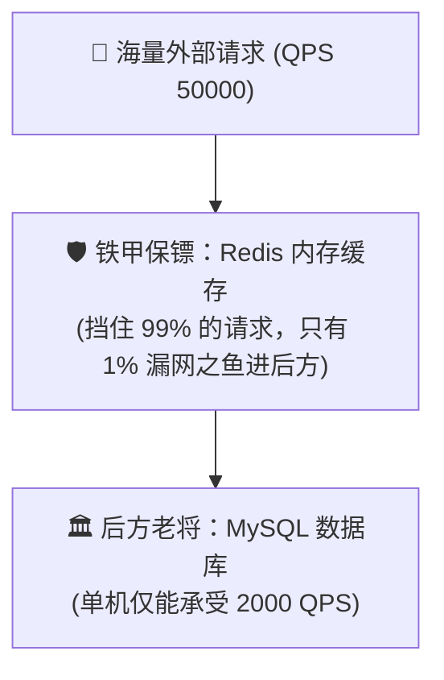
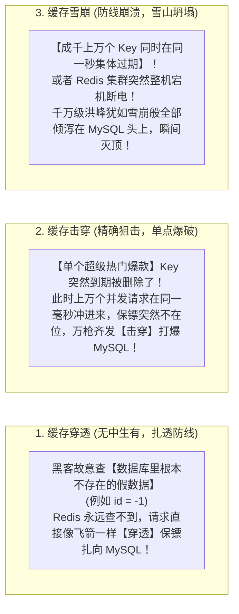
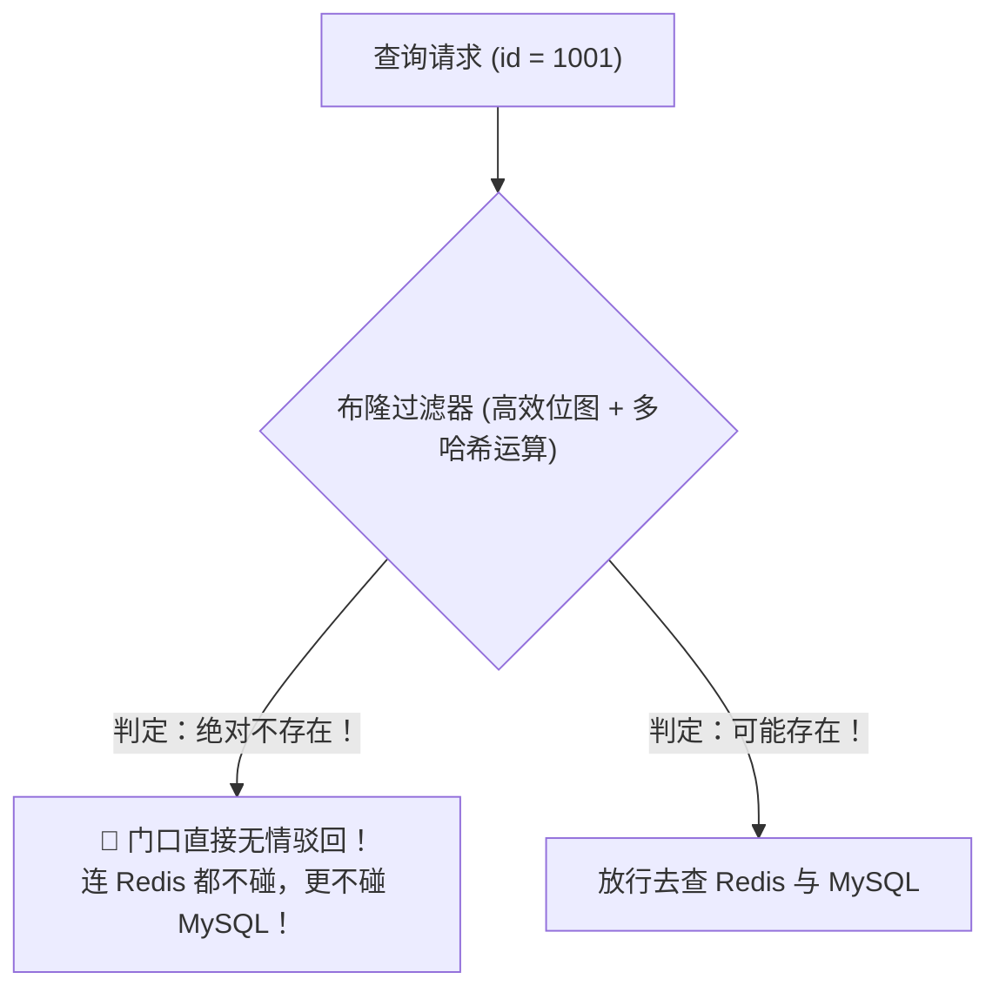
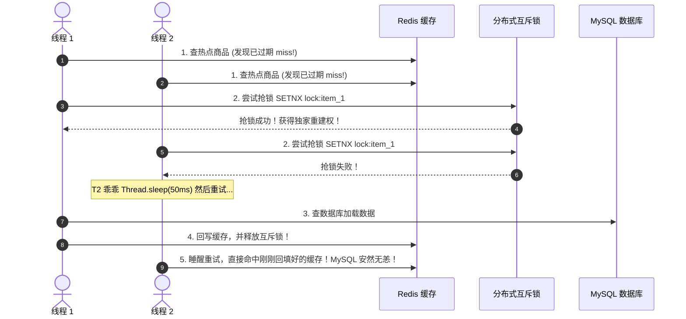
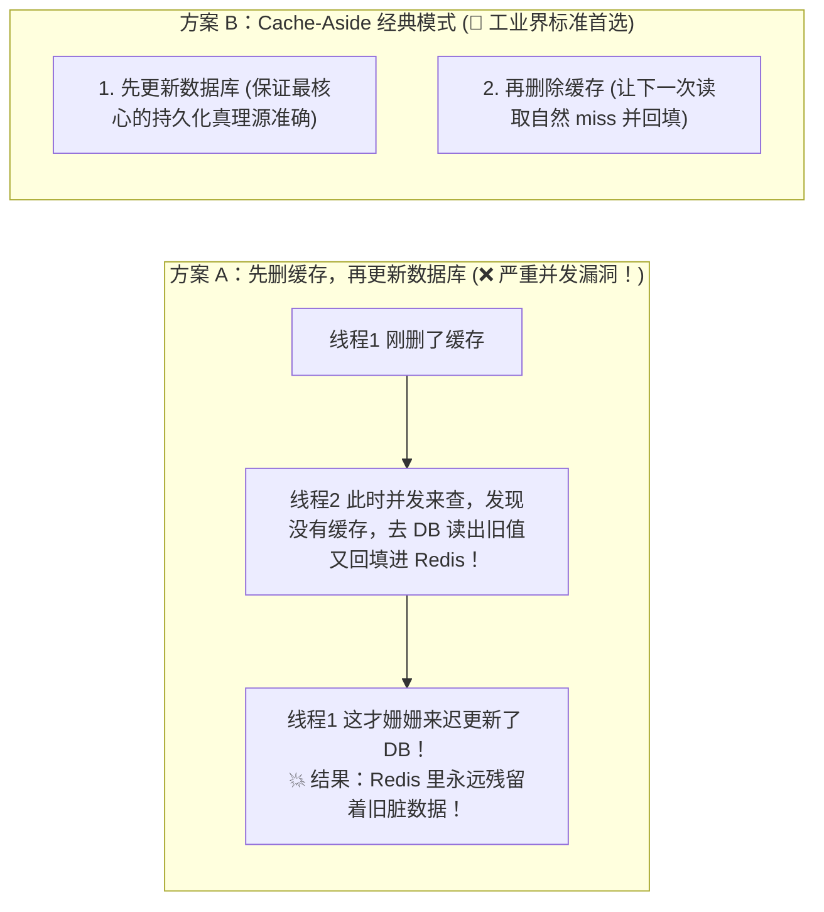

# 🛡️ 07 · 缓存穿透、击穿与雪崩（三大线上灭顶之灾与布隆过滤器护城河）

> **一句话导读**：原本能扛住 10 万并发的系统，为什么会在一瞬间被几千个请求直接打崩瘫痪？90% 的线上数据库崩溃事故，都源自这三兄弟。搞懂“查无此人（穿透）”、“精准爆破（击穿）”与“全体溃退（雪崩）”的底层成因与防线搭建，大厂高并发系统设计便可胸有成竹。

---

## 💥 核心心智模型：保镖防线被突破的三种死法

在现代高并发架构中，Redis 就像站在 MySQL 前面的**“铁甲保镖团”**：



然而在真实生产中，保镖防线会遭遇以下 **3 种不同姿势的突破与暗杀**：



| 灾难类型 | 核心死因 | 形象生活比喻 | 典型场景 |
| :--- | :--- | :--- | :--- |
| **缓存穿透** | 数据在缓存和数据库中**都压根不存在** | **恶意寻衅滋事**。有人故意去药店买“长生不老药”，药店没有，跑去仓库翻个底朝天。 | 恶意黑客攻击、爬虫扫库。 |
| **缓存击穿** | 数据在数据库中存在，但**单个热点 Key 突然过期** | **精准狙击顶梁柱**。整座大楼只靠一根柱子支撑，柱子被炸断的一瞬间，大楼倒塌。 | 明星突发微博热搜、秒杀大促爆品。 |
| **缓存雪崩** | **大量 Key 同时过期**，或 Redis 全面宕机 | **雪山整体坍塌**。整座防雪大坝的所有水泥桩在同一分钟全部风化失效。 | 大促零点活动商品批量设置相同过期时间。 |

---

## 🏹 攻克灾难一：缓存穿透的工业级解药

### 1. 方案一：缓存空对象（Cache Null - 极简实用）
- **策略**：当数据库查出来确实是 `null` 时，**依然往 Redis 里写一个空值（如 `""` 或特殊占位符）**，并设置一个**极短的 TTL（比如 60 秒）**。
- **效果**：短时间内同一个恶意请求再次打过来，直接在 Redis 命中空值返回，挡住后续攻击！
- **缺陷**：如果黑客每次都用一个全新不同的随机不存在 ID 发起攻击，Redis 里会塞满大量无用的垃圾空值 Key。

---

### 2. 方案二：布隆过滤器（Bloom Filter - 🌟 终极护城河）

这是大厂面试的王牌武器：“什么是布隆过滤器？它的数学原理是什么？”



> 🔬 **布隆过滤器的第一性原理**：
> 1. 底层维护一个极其廉价紧凑的 **二进制位图（Bit Array，全由 0 和 1 组成）**；
> 2. 当把一个真实存在的 ID 存进系统时，用 **3 个不同的 Hash 函数**算出 3 个位置，把位图上的这 3 个格子全部涂成 **`1`**；
> 3. **当查验一个 ID 是否存在时**：同样算出 3 个位置，只要其中**有任何一个格子是 `0`**，说明**这个 ID 历史上绝对没有存进去过！**
> 
> 🌟 **大白话金律**：
> - **布隆过滤器说你“不存在”，你就绝对 100% 肯定不存在！**
> - **布隆过滤器说你“存在”，你只是可能存在（有极其微小的哈希碰撞误判率）**。
> - 在系统最外层立一道布隆过滤器，99.9% 的恶意穿透流量在进门一瞬间就被直接斩杀！

---

## 🎯 攻克灾难二：缓存击穿的工业级解药

### 1. 方案一：互斥锁（Mutex Lock - 保证强一致）
- **核心逻辑**：当海量线程发现缓存过期时，**绝不允许所有人蜂拥去查数据库！**
- 只有成功抢到**分布式互斥锁（`SET NX`）**的那个天选之子，才能去查数据库回填缓存；其余拿不到锁的线程只能“稍等 50 毫秒后再来读缓存”：



---

### 2. 方案二：逻辑永不过期（Logical Expiration - 追求极致高可用）
- **适用场景**：双十一秒杀热搜，宁可让用户看到 1 秒前的旧数据，也绝对不能让接口卡顿或报错！
- **做法**：
  - 在 Redis 物理层面**不设置任何 TTL（永不自动过期）**；
  - 但在 Value 对象内部，封装一个字段：`expireAt = 当前时间戳 + 30分钟`；
  - 线程读取数据时，如果发现 `当前时间 > expireAt`，它**不阻塞当前请求**（直接把旧数据返回给用户）；
  - 同时默默通过**后台异步独立线程池**去查库刷新并更新 `expireAt`。
  - **用户体验极度丝滑，响应时间永远在微秒级！**

---

## ❄️ 攻克灾难三：缓存雪崩的防御长城

### 1. 解药一：过期时间加随机扰动（打散 TTL）
- **惨痛教训**：严禁在代码里写死固定的过期时间（如 `expire(24 * 3600)`）！
- **标准姿势**：**基础过期时间 + 随机波动时间**：
  ```java
  // 基础时间 1 小时 + 随机打散 1~10 分钟
  long ttl = 3600 + new Random().nextInt(600);
  redisTemplate.opsForValue().set(key, value, ttl, TimeUnit.SECONDS);
  ```
- **效果**：原本集中在同一秒爆发的百万过期洪峰，被平摊到了十几分钟的漫长时间线上，化险为夷。

### 2. 解药二：构建高可用集群架构
- 使用 **Redis Sentinel（哨兵）** 或 **Redis Cluster（分片集群）**，主节点宕机后秒级自动故障转移选举新 Master；
- 配合本地多级缓存（Caffeine / Guava），即使整个 Redis 出现短暂网络抖动，本地 JVM 内存也能扛住第一波冲击。

---

## ⚖️ 附赠大厂终极面试题：双写一致性（先改 DB 还是先删缓存？）

当业务发生数据修改时，我们究竟该以什么顺序更新数据库和缓存？



> 🛡️ **生产终极闭环方案**：
> **先更新 DB，再删除缓存**；为了防止第二步删缓存偶尔因网络抖动失败，业界标准是**引入消息队列（MQ）重试机制**，或者通过 **Canal 监听 MySQL 的 binlog 日志异步删除缓存**，彻底实现最终一致性！

---

## 🧠 一分钟复盘核心记忆卡

1. **三兄弟死因**：穿透是**查不存在的数据**，击穿是**热点单点过期**，雪崩是**集体同秒过期或宕机**。
2. **三神解药**：
   - 防穿透：**布隆过滤器一夫当关 + 空值缓存**；
   - 防击穿：**互斥锁防并发回源 / 逻辑不过期保可用**；
   - 防雪崩：**TTL 必须加随机打散时间**。
3. **一致性铁律**：**先更新数据库，再删除缓存**，辅以 binlog/MQ 重试保底。

---

## 🧭 下一步

搞定了单体应用与 Redis 的全套配合，当业务飞速膨胀到单表上亿、单库几百 GB 时，单台 MySQL 无论怎么加内存、加索引都彻底撑不住了！
如何对数据库进行外科手术式的**分库分表与读写分离**？
请进入第三关第一站：[[08-分库分表与读写分离]]！
