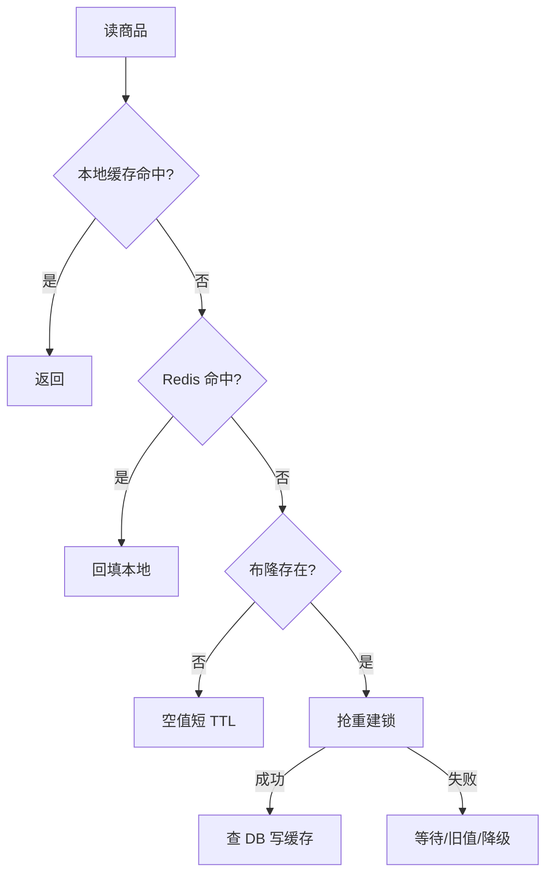

# 缓存穿透-击穿-雪崩

> [!abstract] 一句话总结
> 穿透、击穿、雪崩都是缓存失效导致请求打到后端，但触发条件分别是不存在 key、热点 key 过期、大量 key 或缓存集群同时不可用。

## 📌 精准定位

- 负责识别缓存失效流量形态，并用空值、布隆、互斥构建、随机 TTL、多级缓存保护 DB。
- 不负责掩盖数据库容量不足，缓存策略仍要配合限流和降级。
- 关键边界：缓存保护要考虑一致性、排队、失败重试风暴。

## 🧩 核心概念

| 概念 | 具体含义 | 精通要点 |
| ---- | -------- | -------- |
| 穿透 | 查询不存在的数据，每次落 DB。 | 空值缓存、布隆过滤器、参数校验。 |
| 击穿 | 单个热点 key 过期，大量并发重建。 | 互斥锁、逻辑过期、singleflight。 |
| 雪崩 | 大量 key 同时过期或缓存故障。 | 随机 TTL、多级缓存、限流降级。 |
| 一致性 | DB 与缓存更新顺序。 | 常用先写 DB 后删缓存。 |

## ⚙️ 工作原理 / 主流程



1. 穿透先做非法参数拦截，再考虑布隆和空值。
2. 击穿要保证同一 key 同时只有一个构建者。
3. 雪崩要避免同批 key 同 TTL，并准备本地缓存和限流。
4. cache-aside 写路径常用先 DB 后删缓存。
5. 热点 key 监控命中率、重建耗时和 DB 回源量。

## 💻 代码 / 配置 / 伪代码

```java
Value v = cache.get(id);
if (v != null) return v;
if (!bloom.mightContain(id)) return NULL_SHORT_TTL;
return singleFlight.call('product:' + id, () -> {
  Value db = dao.find(id);
  cache.set(id, db == null ? NULL_VALUE : db, jitterTtl());
  return db;
});
```

## 🔍 源码入口 / 关键组件

- Redis SET NX PX 互斥锁
- Bloom filter / RedisBloom
- Caffeine 本地缓存
- cache hit ratio、db fallback QPS、hot key
- Canal/Debezium binlog

## ⚠️ 生产坑与注意事项

- 空值 TTL 太长影响新数据可见。
- 布隆过滤器有误判，不能当真相。
- 分布式锁无超时或释放校验。
- 所有 key 固定午夜过期。
- 缓存重建慢导致应用线程堆积。

## 🧭 排查路径

- DB 突增按 key 聚合 miss。
- 热点 key 用 Redis 采样和客户端埋点。
- 锁等待高看重建耗时和锁 TTL。
- 一致性问题追踪写 DB、删缓存、读回填时序。

## 🎯 面试问题

> [!question] 高频问题
> - Q: 三者区别？
>   - A: 穿透查不存在，击穿热点过期，雪崩大量 key 或集群不可用。
> - Q: 布隆为什么不能完全防穿透？
>   - A: 有误判且新增删除同步复杂。
> - Q: 击穿怎么处理？
>   - A: 互斥重建、逻辑过期、singleflight、预热。
> - Q: 缓存一致性常用方案？
>   - A: 先写 DB 后删缓存，必要时延迟双删或 binlog 删除。
> - Q: Redis 故障如何降级？
>   - A: 本地缓存、限流、默认值、关闭非核心路径。

## ✅ 精通检查清单

- 能画出主流程，并标出最容易失败的节点。
- 能说出至少 3 个源码入口或关键组件。
- 能写出最小配置、SQL、伪代码或状态机。
- 能结合生产故障说明监控指标、排查命令和修复动作。
- 能和相邻方案做取舍对比，而不是只背定义。

## 🔗 关联笔记

- [[_index]]
- [[20-Java后端/00-总览/学习仪表盘]]

## 📚 参考资料

- Redis Caching Patterns
- Guava BloomFilter / RedisBloom
