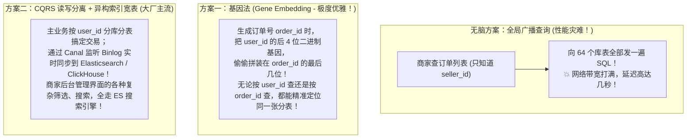
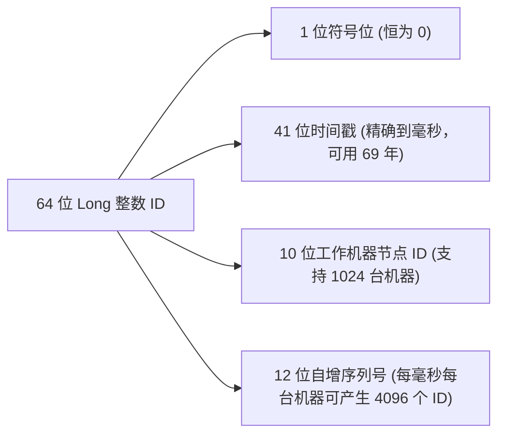

# 🏗️ 08 · 分库分表与读写分离（数据大爆炸时的微创手术与基因路由）

> **一句话导读**：单表突破 2000 万行、单库磁盘被打满、写并发突破数万，单台服务器物理极限已至？此时必须祭出终极架构大杀器——**读写分离与分库分表**。看懂“分片键（Sharding Key）”的选择哲学、解决“买家卖家双向查询”的**基因法**，以及主从延迟“读己之写”的破解之道，千万级架构便可驾轻就熟。

---

## 🏛️ 核心心智模型：董事长签批与跨区域分仓

当一个系统从小作坊演变为超级商业帝国时，单机数据库必然遭遇两大致命瓶颈：
1. **读多写少，读流量打爆单机**；
2. **数据量爆炸，单表上亿行，写并发突破物理上限**。

针对这两种不同的病症，架构师有两种对应的“外科手术”：

```mermaid
flowchart TD
    subgraph M1["手术一：读写分离 (针对【读多写少】性能瓶颈)"]
        W["✍️ 董事长专职签批 (主库 Master，专职负责写入)"]
        R1["📖 1号秘书 (从库 Slave 1)"]
        R2["📖 2号秘书 (从库 Slave 2)"]
        W -->|"主从 Binlog 异步同步"| R1
        W -->|"主从 Binlog 异步同步"| R2
        Note over R1, R2: 所有的查询读请求全部由秘书分摊接待，<br/>主库写压力瞬间暴降！
    end

    subgraph M2["手术二：分库分表 (针对【数据量突破亿级】存储与写并发瓶颈)"]
        B["一本 1 亿行账本写不下了！"] --> C1["水平拆分：拆分为 16 本分册账本 (order_0 ~ order_15)"]
        B --> C2["垂直拆分：财务记财务的、人事记人事的 (按业务拆独立库)"]
    end
```

---

## ✂️ 分库分表的四大拆分刀法

| 拆分维度 | 动作大白话 | 解决什么问题？ | 现实生动比喻 |
| :--- | :--- | :--- | :--- |
| **垂直分库** | 按**业务模块**将原本挤在一起的单库拆成独立的微服务库（用户库、商品库、订单库）。 | 解决不同业务之间争抢数据库连接池与 CPU 资源的问题。 | **各部门独立办公楼**。财务部和市场部各用各的独立办公室。 |
| **垂直分表** | 把一张大表里**长字段、冷门大字段（如 `TEXT` 商品详情长文、大长图 Base64）**拆到一张单独的扩展表里。 | 解决 InnoDB 单页 16KB 塞不下几行数据导致 B+ 树太高的问题。 | **给大胖子抽脂减肥**。只留身份证核心摘要，详细体检长报告放档案袋。 |
| **水平分表** | 表结构完全一模一样，只是把原本 1 亿条数据按规则**平摊拆成 16 张小表**（`t_order_0` ~ `t_order_15`）。 | 解决单表行数超过 2000 万导致 B+ 树变高、索引体积过大、DDL 锁表耗时数小时的绝境。 | **一本大字典太厚，装订成第一册到第四册**。 |
| **水平分库** | 将拆分出来的多张表，**分别存放在不同的物理服务器节点上**。 | 解决单台物理服务器磁盘容量上限和单机并发写入 TPS 极限。 | **在华北、华东、华南建立 3 座独立的物流分拣转运中心**。 |

---

## 🎯 核心生命线：分片键（Sharding Key）的抉择

分库分表的第一核心灵魂：**这笔数据到底该存进哪张表、哪个库？**
由**分片键（Sharding Key）**说了算！

### 1. 经典取模算法（Hash 取模）：
假设我们规划了 **4 个数据库实例，每个库 16 张表（共 64 张分表）**：
以用户 ID 作为分片键：
```java
long userId = 1001;
// 1. 算分表：决定去哪个表
int tableIndex = (int) (userId % 64); // 得到 0~63

// 2. 算分库：决定去哪个物理库
int dbIndex = tableIndex / 16;        // 得到 0~3
System.out.println("目标位置：db_" + dbIndex + ".t_order_" + tableIndex);
```
- **优点**：数据被极其均匀地打散到各个库表，绝不产生数据倾斜。
- **缺点**：未来如果 64 张表也满了，想扩容到 128 张表，**原本取模的映射全被打乱，需要做大规模的数据历史重排迁移！**

---

## 💥 大厂终极架构难题：买家 vs 卖家“双向查询”怎么破？

这是电商系统设计中最经典的技术深水区：
> **如果按 `user_id`（买家 ID）分表**：
> - 买家查“我的订单列表”：直接带上 `user_id`，精准定位单库单表，速度极快！
> - **但是！商家想查“我店铺的所有订单”该怎么办？**
> - 因为没有 `user_id`，分片中间件不知道这笔订单在哪个库，**只能把 64 个库表全部无脑广播查一遍（Scatter-Gather），在内存里归并，直接把数据库拖垮！**



---

## 💣 读写分离最大暗礁：主从延迟与“读己之写”翻车

在读写分离架构中，主从同步是**异步网络复制**的（通常有十几到数百毫秒的微小延迟）：

```java
// 事故代码复现：
userService.updateName(userId, "新名字"); // 1. 写入主库 Master (成功落盘)
User user = userService.getUser(userId);       // 2. 紧接着去从库 Slave 查 (🚨 翻车现场！)
// 此时主从还没同步完毕，从库查出来的依然是"旧名字"！用户刷新页面以为修改失败，疯狂投诉！
```

### 🛡️ 工业级三大破解良方：

1. **核心写后强制走主库（`HintManager`）**：
   - 使用 ShardingSphere 或动态数据源路由：刚执行完写操作的代码段，通过 `HintManager.getInstance().setMasterRouteOnly()`，强制接下来的一两次查询直接读主库。
2. **Redis 标记法（高并发神技）**：
   - 用户更新资料成功后，在 Redis 存一个有效期的临时便签：`SET update_flag:userId 1 EX 2`（保留 2 秒）；
   - 后续读请求进来，先查 Redis 有没有这个标记：
     - 如果有：说明刚改完数据，强制切到主库读；
     - 如果没有：说明早已同步完毕，安心走从库分流！
3. **关键重要业务直接禁走从库**：
   - 比如支付回调核验、余额扣减校验，这类生命线级别的业务从设计之初就**100% 绑定只读主库**。

---

## 🆔 分布式全局唯一 ID：告别自增主键

分库分表后，单机 MySQL 的 `AUTO_INCREMENT` 自增 ID 彻底报废（因为各个分表会独立从 1 开始自增，导致不同表的订单号发生碰撞冲突！）。

### 🌟 现代唯一真理：雪花算法（Snowflake）
Twitter 开源的 64 位整数分布式 ID，纯内存生成，性能高达每秒几百万个，且**天然单调递增**（对 B+ 树聚簇索引追加写入极其友好，绝不产生页分裂！）：



---

## 🧠 一分钟复盘核心记忆卡

1. **分治原则**：读多写少上**读写分离**；单表破亿、写打满上**分库分表**。
2. **路由核心**：分片键取模打散；利用**基因法**或 **ES 异构索引**解决买家卖家双向查询难题。
3. **主从避坑**：防范主从延迟“读己之写”，利用 **Redis 标记法**或强制路由主库保底。
4. **主键选择**：分库分表必须抛弃自增主键，全面拥抱单调递增的**雪花算法 ID**。

---

## 🧭 下一步

恭喜你！到这里，整个《数据库与存储》模块的所有核心基石（MySQL 索引底层、事务、锁、SQL 调优、Redis 数据结构、持久化、缓存三大灾难、连接池、分库分表）已经全线攻破！
最后，让我们把这一章所有的硬核原理、大厂高频面试杀招与生产军规，凝聚成一张终极通关总地图！
请进入终章：[[99-本章总结与复习]]！
