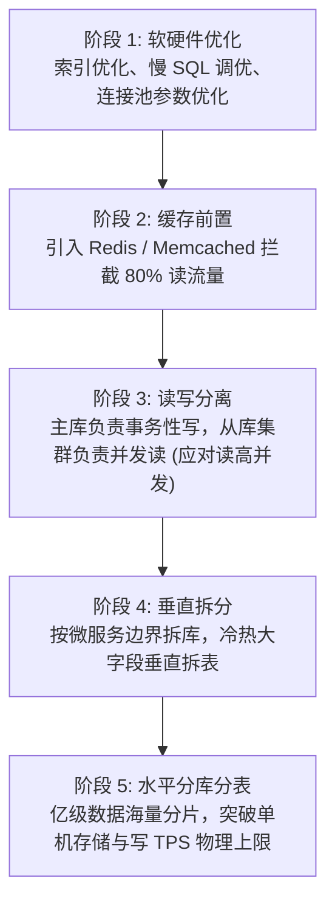
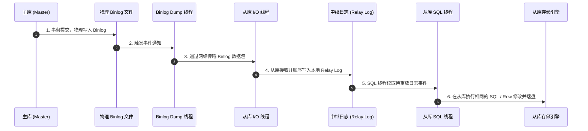
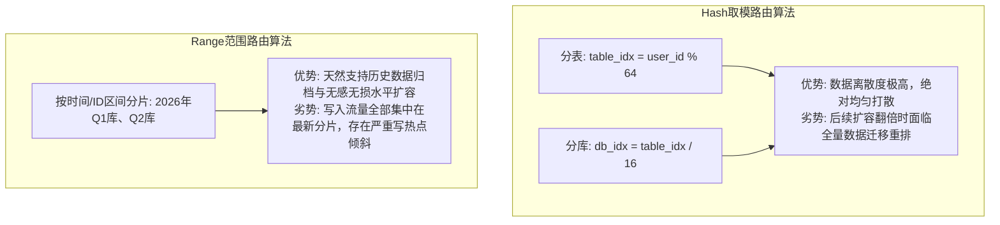
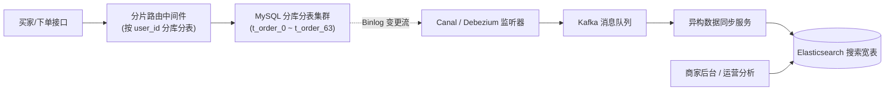
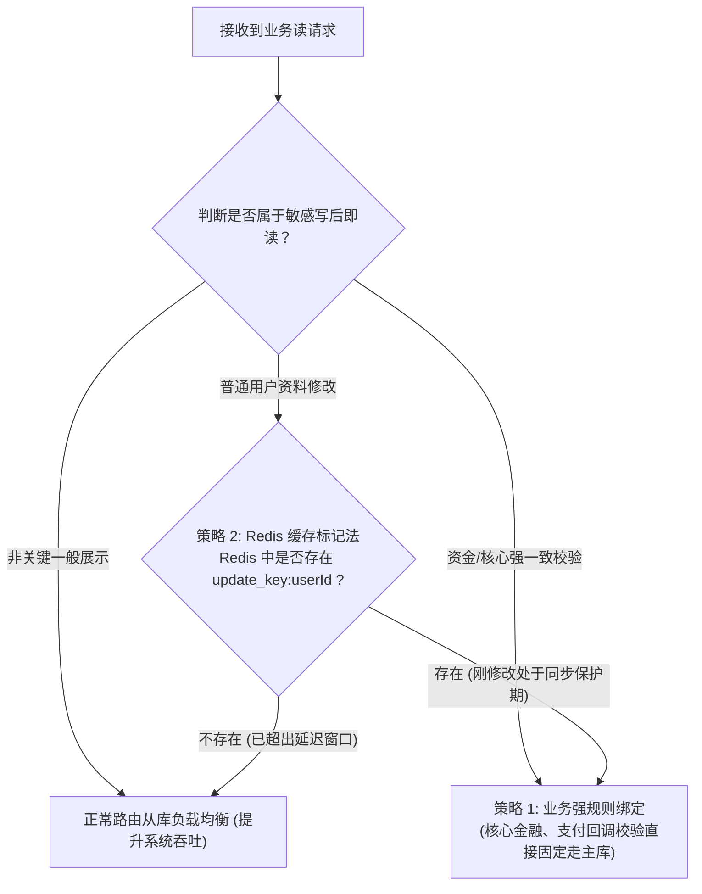

# 08 · 分库分表与读写分离架构设计与工业级实战

> **导读**：当业务数据量突破千万乃至数亿行，单机 MySQL 必然面临 B+ 树层级加深、Buffer Pool 命中率暴跌、DDL 锁表超时以及物理磁盘 I/O 和写并发打满等物理极限。为了突破单机瓶颈，业界演进出了“读写分离”与“分库分表”两大核心架构范式。本文深入剖析主从复制底层流转、四大切分维度、分片键路由算法、基因法消除全表广播、主从延迟“读己之写”破解之道，以及跨库分页与分布式事务的工程应对。

---

## 一、系统吞吐瓶颈演进与架构演进路线

当单机关系型数据库遭遇性能瓶颈时，架构演进通常遵循从轻量级优化到重构式拆分的顺序：



---

## 二、读写分离架构与主从复制底层原理

读写分离建立在数据库主从复制（Replication）机制之上，通过将写流量与读流量在网络层面物理分流，极大释放主库算力。

### 1. MySQL 主从复制底层三线程机制
MySQL 主从复制的物理本质是主库写操作产生的二进制日志（Binlog）在从库的串行重放：



### 2. 读写分离中间件实现形态对比

| 架构形态 | 核心代表 | 运行拓扑与原理 | 优缺点与生产评价 |
| :--- | :--- | :--- | :--- |
| **客户端直连路由**（Client-Side） | ShardingSphere-JDBC、DynamicDataSource | 嵌入在应用代码内部的轻量级驱动包，重写 JDBC `DataSource` 与 `Connection`，在应用进程内直接解析 SQL 并路由。 | **优势**：零额外网络转发开销，延迟极低，运维极其简单。<br>**劣势**：与 Java 语言强绑定，无法跨多语言共享连接池。 |
| **独立代理服务路由**（Proxy-Based） | ShardingSphere-Proxy、MyCat | 部署独立的中间件集群，对外模拟为标准的 MySQL 端口。客户端应用无感知连接 Proxy。 | **优势**：对业务代码零侵入，支持跨多开发语言统一管理连接池。<br>**劣势**：多了一层网络通信跳数（Hop），增加网络延迟与代理层集群运维复杂度。 |

---

## 三、分库分表的四大拆分维度

| 拆分维度 | 核心拆分策略与物理落地 | 核心解决的技术痛点 | 典型适用场景 |
| :--- | :--- | :--- | :--- |
| **垂直分库** | 依据**微服务 DDD 业务领域边界**，将单一大单体数据库拆分为相互独立的业务专用库（用户库、商品库、订单库、支付库）。 | 消除不同业务模块对同一数据库实例 CPU、内存与连接池资源的互锁与恶性抢占，切断故障蔓延链路。 | 单体单库向微服务分布式架构演进的第一阶段。 |
| **垂直分表** | 将一张数据表中**占用字节巨大、访问频次极低的非核心列（如 `TEXT`、富文本、长 JSON）**剥离至独立的副表/扩展表中，通过主键一对一关联。 | 解决 InnoDB 单数据页（16KB）因单行物理尺寸过大导致单页容纳记录过少、B+ 树层高攀升及内存 Buffer Pool 缓存命中率雪崩问题。 | 包含商品详情长描述、用户风控审计快照的宽表。 |
| **水平分表** | 保持表结构不变，按照特定路由算法，将单表数千万甚至上亿行记录，**物理切分到同一库内的多张结构一致的子表中**（如 `t_order_0` ~ `t_order_31`）。 | 解决单表行数突破千万后 B+ 树索引体积过大引发的磁盘随机读性能衰退，以及在线 DDL 锁表导致的数据库卡顿。 | 单库存储空间尚充裕，但单表查询延迟显著上升的场景。 |
| **水平分库** | 将水平切分出的各分片子表，**分散部署到多台独立的物理数据库服务器节点上**。 | 彻底突破单机服务器在磁盘存储容量、网络带宽、并发连接数及物理写 TPS（I/O 吞吐）上的硬件上限。 | 交易订单、支付流水、用户行为埋点等海量高速增长数据。 |

---

## 四、分片键（Sharding Key）路由算法与高并发痛点破解

分片键是分库分表体系中的数据路由坐标轴。选择合适的分片键与路由算法是架构成败的关键。

### 1. 经典路由算法对比



### 2. 电商大厂终极难题：买家与卖家“双向查询”架构解法
在电商交易中，按 `user_id`（买家 ID）分片是最直观的方案，买家端所有订单查询均能精准定位至单个分表。但一旦商家按 `seller_id` 检索所属店铺的订单时，分片中间件因无法推算分片节点，被迫发起**全局全表广播查询（Scatter-Gather）**，同时扫描所有物理库表并在内存中归并排序，严重消耗网络与计算算力。

#### 解决方案一：基因法（Gene Embedding）精准路由
在设计订单号 `order_id` 生成规则时，通过位运算将买家 `user_id` 的末尾 $k$ 位二进制“基因片段”，嵌入到 `order_id` 的末尾：

```
假设系统规划 16 张分表 (2^4 = 16，取 k = 4 位二进制基因):
买家 user_id = 1001 (二进制末 4 位: 1001)
分片路由计算: user_id % 16 = 9 (定位进入 9 号分表)

生成全局 order_id 时:
[ 41 位时间戳 ][ 10 位机器节点 ][ 9 位序列号 ][ 4 位买家基因: 1001 ]
```
- **买家端查询**：直接使用 `user_id % 16 = 9`，精准直达 9 号表；
- **通过订单号查询**：直接提取 `order_id` 末尾 4 位基因（即 9），无需依赖 `user_id`，同样精准直达 9 号分表！彻底消除按订单号查询时的全表广播。

#### 解决方案二：CQRS 读写分离与异构索引宽表（大厂标准落地方案）
针对商家端复杂的统计、多条件组合筛选、导出需求，根本无需强求在关系型分片库中直接实现：
- **交易主流程**：按买家维度严格分库分表，负责高吞吐、强一致性的订单核心创建与履约修改；
- **异构同步**：通过 Canal 或 Debezium 监听分片库的 MySQL Binlog，经由 Kafka 准实时清洗并同步至 **Elasticsearch** 或 **ClickHouse** 建立商家维度异构索引宽表；
- **商家后台与运营端**：所有列表检索、聚合分析请求 100% 走 Elasticsearch，与主交易库实现彻底物理隔离。



---

## 五、读写分离最大暗礁：主从延迟与“读己之写”防范

由于 MySQL 主从复制本质上是网络异步传输与从库单线程/并行回放，从库数据落后于主库存在微小的时间窗口（毫秒到秒级）。

### 1. “读己之写”（Read Your Own Writes）故障时序
用户更新个人昵称为“张三丰”并保存，页面瞬间重定向并请求查询个人资料接口。此时主库已更新成功，但从库尚未完成 Binlog 重放。若查询路由至从库，返回的仍为旧昵称，导致用户误认为系统故障。

### 2. 工业级三大破解策略



- **策略 1：强制主库路由（`HintManager`）**：在执行写操作后的同一线程请求中，通过 ShardingSphere 提供的 `HintManager.getInstance().setMasterRouteOnly()` 强制接下来的读请求穿透访问主库。
- **策略 2：分布式缓存标记法（性能最优）**：用户写入主库成功后，向 Redis 写入一个带短暂 TTL（如 2 秒）的临时标记 `SET update_flag:{uid} 1 EX 2`。后续读请求优先检查该 Key，若存在则路由主库，过期消失后平滑切回从库，兼顾性能与一致性。

---

## 六、分布式全局唯一 ID：雪花算法（Snowflake）

分库分表后，单表原生的 `AUTO_INCREMENT` 自增 ID 无法跨多表维持全局唯一性，必须引入分布式唯一 ID 生成器。

### 1. 雪花算法 64 位比特结构剖析
Twitter Snowflake 算法在纯内存中生成，单机吞吐量达百万级/秒，生成的 ID 具备**时间趋势递增**特性，对 InnoDB 聚簇索引的顺序追加写入极为友好，杜绝 B+ 树数据页频繁分裂。

```
0 - 00000000000000000000000000000000000000000 - 0000000000 - 000000000000
|   |                                           |            |
符号位 (1 bit) 固定为 0，代表正数
    41 位时间戳毫秒数 (可支撑系统稳定运行 69 年)
                                                10 位工作机器节点 ID (支持部署 1024 个节点)
                                                             12 位递增序列号 (同毫秒单机并发 4096 个 ID)
```

> [!CAUTION] 雪花算法的致命死穴：系统时钟回拨（Clock Backwards）
> 若服务器发生 NTP 时间校准导致系统时钟倒退，可能生成重复的 ID。
> **工业级应对**：
> 1. 检测到时钟倒退时间极短（如 $< 5ms$），采用死循环自旋等待时钟追平；
> 2. 若倒退时间较长，触发告警并自动切换到备用 WorkerId 槽位，或拒绝发号快速失败。

---

### 场景演示：现代物流枢纽分拣体系

- **生鲜、家具、普通件独立建仓（垂直分库）**：按业务领域物理隔离数据库，杜绝大件抢占小件资源；
- **单仓内增设 16 条平行分拣流水线（水平分表）**：表结构一致，通过算法将千万级包裹分流至小表，避免单表爆满；
- **多大区设立区域转运中心（水平分库）**：分散到不同物理服务器节点，突破单机磁盘与写入吞吐极限；
- **运单条码末尾嵌入目的地邮编（基因法路由 Gene Embedding）**：生成订单号时嵌入买家 ID 末尾几位基因，扫码无需全库广播即可精准投递单表；
- **总仓卸货与末端代收点无线电通报（主从 Binlog 异步复制）**：主库落盘后异步网络传输重放，存在微弱时延；
- **凭借临时提货码快速核验（分布式缓存标记法 Redis TTL）**：对刚改完资料的用户施加短期标记，直接定向查主库，化解“读己之写”不一致。

---

## 🧭 下一步

至此，Java 后端并发控制、Spring 生态底层架构以及数据库存储引擎的核心骨架已全部夯实。
为了将离散的知识点熔铸为工业级实战战力，我们需要将所有知识沉淀转化为**高频面试实战对决与系统架构设计题**。
请进入终章：[[99-本章总结与复习]]！
