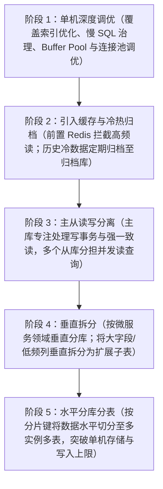
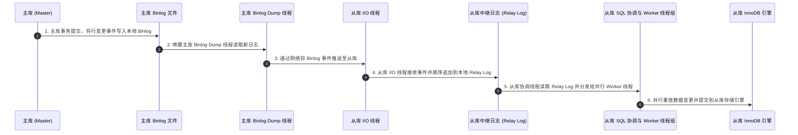
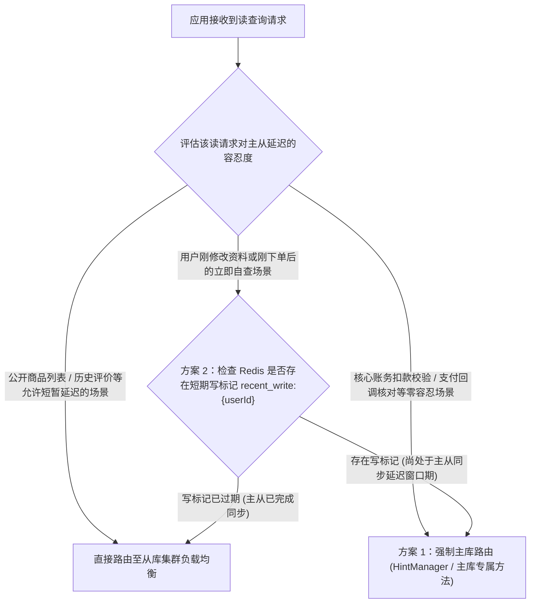
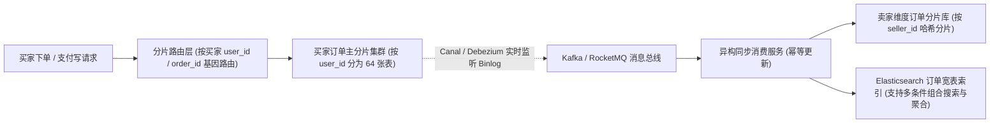
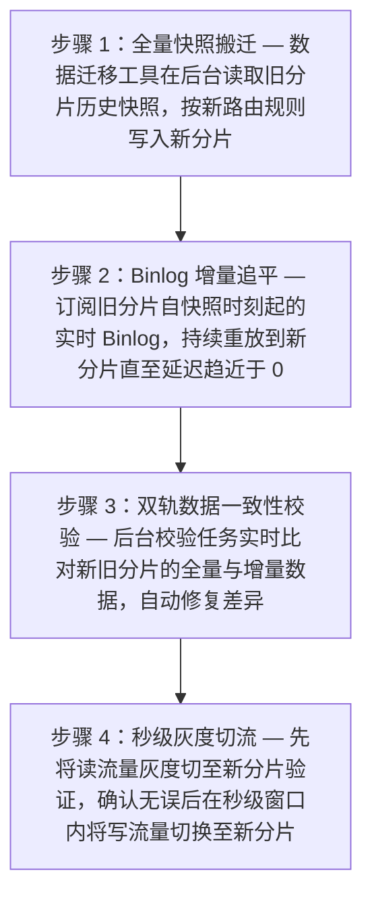

# 🏛️ 08 · 分库分表与读写分离（架构演进、基因法路由、平滑扩容与分布式 ID）

> **一句话导读**：读写分离通过主从复制分担高并发读压力，分库分表通过数据切分突破单台数据库在存储容量、连接数与写事务 IOPS 上的物理极限。深入掌握主从延迟治理、电商多维查询的“基因法”与异构索引、分布式雪花 ID（Snowflake）以及在线平滑扩容迁移方案，是设计大型分布式存储架构的核心能力。

---

## 一、业务痛点：单机数据库在什么情况下会撑不住？

在系统发展初期，一台配置良好的单机 MySQL 配合合理的索引设计，完全可以轻松支撑日均数十万至百万级的订单业务。但随着业务规模持续增长，单机数据库会依次遭遇三道难以逾越的物理瓶颈：

1. **高并发读压力与连接数耗尽**：大促期间读请求量往往是写请求的数十倍，大量复杂的列表查询与统计 SQL 会迅速占满单机 CPU 和活跃连接池，导致正常的下单写事务排队超时。
2. **单表数据量膨胀导致 B+ 树性能退化与维护困难**：当单张订单表的行数突破数千万甚至上亿行、表文件体积达到数百 GB 时，InnoDB Buffer Pool 无法装下全量热点索引，磁盘随机 I/O 显著增加；更棘手的是，在线执行 `ALTER TABLE` 加字段（DDL）或重建索引往往耗时数小时，运维风险极高。
3. **单机磁盘容量与写 IOPS 触及硬件上限**：即便升级到顶配 NVMe SSD，单台物理机每秒能够承受的 Redo Log / Binlog 刷盘次数（写 IOPS）和网卡吞吐也是有上限的。当高频写入流量超过单机极限时，唯有将数据分散到多台数据库服务器上才能继续扩展。

由于分库分表会显著增加跨节点查询与事务的复杂度，工程实践中始终遵循**“由轻到重、先优化后拆分”**的渐进式演进路线：



---

## 二、读写分离架构：主从复制原理与主从延迟治理

读写分离以 MySQL 原生的主从复制（Replication）为基础：应用将所有的写操作（`INSERT` / `UPDATE` / `DELETE`）以及要求强一致性的读操作路由至**主库（Master）**，将绝大部分普通的读查询分发至一个或多个**从库（Replica / Slave）**。

### 1. MySQL 主从复制的三阶段工作链路



1. **主库记录 Binlog**：主库在执行事务提交时，将数据变更按照 `ROW` 格式写入本地的二进制日志（Binlog）。
2. **从库拉取并写入 Relay Log**：从库启动一个专门的 **I/O 线程**连接主库，主库的 **Binlog Dump 线程**将新增的 Binlog 事件通过网络推送给从库 I/O 线程，从库 I/O 线程将其顺序写入本地的中继日志（Relay Log）中。
3. **从库并行重放日志**：从库的 **SQL 线程**读取 Relay Log 中的日志事件并在本地回放。在早期的单线程回放下，主库并发写入高时从库极易落后；现代 MySQL（5.7 / 8.0）引入了基于 `LOGICAL_clock` 和 **`WRITESET`（写集合冲突检测）的多线程并行复制（MTS）**，只要不同事务修改的不是同一行数据，从库的多个 Worker 线程就能并发回放，大幅降低了主从延迟。

---

### 2. 核心痛点：主从复制延迟与“读己之写”异常

即便开启了并行复制，由于网络传输和从库重放终究存在时间差，当主库遇到大事务批量修改或网络波动时，从库数据仍然可能比主库滞后几十毫秒甚至数秒。

这在业务上会引发经典的**“读己之写（Read Your Own Writes）”事故**：例如用户在手机端完成了订单支付（写主库成功），页面立即自动跳转到订单详情页发起查询（读从库）；由于此时从库还没来得及回放完刚才那条支付成功的 Binlog，用户看到的订单状态竟然还是“待支付”，从而引发用户恐慌与重复扣款客诉。

#### 解决主从延迟的三种工程方案



1. **方案一：核心敏感链路强制走主库（Hint 路由）**
   - 对于资金流水扣减前校验、支付状态更新核对、下单后立刻查询详情等强一致场景，直接通过中间件的强制主库路由 API（例如 ShardingSphere 的 `HintManager.setWriteRouteOnly()` 或 `@Master` 注解）将该读请求固定路由到主库执行。
2. **方案二：基于 Redis 的短期“写后标记”路由（Session Sticky）**
   - 当某个用户触发了写操作（如修改个人收货地址或提交订单）后，在 Redis 中记录一个带有短过期时间（例如设置 TTL 为 $2$ 秒，略大于线上 P99 主从延迟时间）的标记 Key：`recent_write:{userId} = 1`；
   - 当该用户发起读请求时，路由切面先去 Redis 检查是否存在该标记：若存在，说明该用户刚刚改过数据，请求直接走主库以保证他本人立即看到最新结果；2 秒后标记自动过期，该用户的后续读请求重新恢复走从库。
3. **方案三：基于 GTID 位点的同步等待（`WAIT_FOR_EXECUTED_GTID_SET`）**
   - 写事务在主库提交后，获取主库为该事务分配的全局事务 ID（`GTID`）；随后的读请求发往从库时，先执行 `SELECT WAIT_FOR_EXECUTED_GTID_SET('gtid_value', 0.1)`，最多在从库等待 $100\text{ ms}$。一旦从库在该窗口内回放完了这个 GTID，就立即从从库读出最新数据返回；若超时仍未追平，再自动降级回主库查询。

---

## 三、分库分表的四大拆分维度与中间件形态

### 1. 垂直拆分 vs 水平拆分全景对比

| 拆分维度 | 物理落地方案 | 解决的核心痛点 | 典型场景与注意事项 |
| :--- | :--- | :--- | :--- |
| **1. 垂直分库** | 按业务领域边界，将不同业务模块的表拆分到独立的数据库实例（如用户库 `db_user`、订单库 `db_order`、商品库 `db_item`）。 | 隔离不同业务的 CPU、内存与连接池资源，防止边缘业务的慢 SQL 把核心交易库拖垮。 | 微服务架构拆分的标准配套动作；拆分后禁止跨库 `JOIN`，改为通过服务间 RPC 接口调用或字段冗余组装数据。 |
| **2. 垂直分表** | 将一张包含几十个字段的宽表，按访问频次与字段大小拆分为“核心主表（`t_item`）”与“扩展详情表（`t_item_detail`）”。 | 减小主表行记录字节大小，使 InnoDB 单个 $16\text{ KB}$ 数据页能装下更多主表行，大幅提升 Buffer Pool 缓存命中率与列表扫描速度。 | 将高频查询的商品标题、价格留在主表，将动辄数十 KB 的图文 HTML 详情、商品参数 JSON 拆到扩展子表。 |
| **3. 水平分表** | 在**同一个数据库实例**内，把单张上亿行的大表按路由规则切分为结构相同的多张子表（如 `t_order_0` ~ `t_order_63`）。 | 降低单张表的行数与 B+ 树高度，解决单表数据过大导致的查询变慢与 DDL 锁表耗时过长问题。 | 由于所有子表仍在同一台物理机上，共享相同的 CPU 和磁盘，因此单纯水平分表无法突破单机的硬件写入上限。 |
| **4. 水平分库** | 将水平切分后的多张子表分布到**多台独立的数据库服务器实例**上（如 4 台分库实例 × 每库 16 张分表 = 64 张物理分表）。 | 真正实现存储容量、最大连接数、网卡带宽与磁盘写 IOPS 的水平线性扩展。 | 核心订单、支付流水、聊天消息等持续高速增长的海量写密集型业务。 |

### 2. 分片中间件的两种架构形态：客户端直连 vs 独立代理层
- **客户端直连模式（如 `ShardingSphere-JDBC`）**：以 Jar 包形式直接内嵌在 Java 应用进程内部，在应用内存中完成 SQL 解析、分片路由改写与结果归并，直接连接后端各个数据库分片。**优势是少一次网络转发跳数、性能高、无需额外部署运维代理集群**；局限是仅限 Java 语言使用，且应用实例数量多时需注意控制每个实例的连接池大小。
- **独立代理层模式（如 `ShardingSphere-Proxy`、`MyCat`）**：作为独立部署的中间件服务，向业务应用伪装成一个标准的 MySQL 服务端，由代理层统一管理后端分片连接。**优势是跨开发语言通用、对应用透明且便于集中管控连接数**；局限是增加了一次网络转发延迟，且代理层自身需要高可用部署。

---

## 四、分片路由设计：基因法（Gene Embedding）与多维异构索引

水平分库分表最核心的设计是选择**分片键（Sharding Key）**与**路由算法**。最常用的两种基础路由方式是：
- **哈希取模路由（`hash(key) % N`）**：数据与写流量能够均匀分散到所有分片，不会出现单点写热点；适合高并发随机读写的交易表（如订单表按 `user_id` 取模）。
- **范围 / 时间区间路由（如按月建表 `t_log_202609`）**：天然支持时间范围查询，历史冷数据归档只需直接移走旧表，且新增分片无需迁移历史数据；局限是所有实时新增写流量全部集中在最新一个月的分表上，存在明显的单表写热点。

### 电商订单分库分表的经典难题：买家、订单号与卖家如何同时高效查询？

假设我们将电商订单表按买家 **`user_id` 对 64 取模**水平拆分为 64 张分表（分布在 4 个分库实例中，每库 16 张表）：
- 当买家在 App 打开“我的订单列表”时，请求参数必然带有买家自己的 `user_id`，中间件通过 `user_id % 64` 可以 100% 精准定位到唯一的一张分表；
- **痛点 1（按订单号查询）**：当买家点击某笔订单查看详情，或者客服在后台输入**订单号 `order_id`** 查询时，如果请求参数里只有 `order_id` 而没有 `user_id`，中间件不知道这笔订单落在哪张表，就会被迫向全部 64 张分表发起广播查询（Scatter-Gather），导致单次点查放大 64 倍！
- **痛点 2（按卖家查询与多条件搜索）**：当商家在卖家后台查看“自己店铺卖出的订单列表”（按 **`seller_id`** 查询），或者运营按“商品名称 + 下单时间 + 订单状态”组合检索时，该如何避免全分片广播？

---

### 1. 解法一：基因法（Gene Embedding）— 让 `order_id` 自带买家分片基因

为了在不查额外映射表的前提下，单凭 `order_id` 就能直接算出它所属的买家分片表，工业界最优雅的方案是**分片基因法**。

#### 基因法的数学原理与构造过程
当总分片表数量为 $2^k$（例如 $64 = 2^6$）时，一个正整数对 $64$ 取模的余数，在二进制层面上**完全取决于该整数最低的 6 个比特位（低 $6$ 位）**，与前面的高位毫无关系。

因此，当买家（`user_id`）下单生成全局唯一的 64 位订单号 `order_id` 时，我们不再让 `order_id` 的最后 6 位随机生成，而是**直接把该买家 `user_id` 的二进制最后 6 位复制过来，作为“分片基因”嵌入到 `order_id` 的最低 6 位中**：

```text
假设系统共分为 64 张订单表 (64 = 2^6，取 k = 6 bit 作为分片基因位)：
1. 买家 user_id = 137，其二进制表示为 ...0010 001001，最低 6 位（分片基因）为：001001（十进制为 9）
   按 user_id 路由：137 % 64 = 9 -> 该买家的所有订单均存入第 9 号分表 (t_order_9)。

2. 在生成该笔订单的 64 位 order_id 时，将最低 6 位固定填充为买家的分片基因 001001：
   [ 1 bit 符号位: 0 ][ 41 bits 毫秒时间戳 ][ 8 bits 机器节点 ID ][ 8 bits 毫秒内序列号 ][ 6 bits 买家分片基因: 001001 ]

3. 最终效果：
   生成的 order_id 最低 6 位同样是 001001！
   因此：order_id % 64 == user_id % 64 == 9！
```

- **路由效果**：通过嵌入这 6 个比特位的买家基因，同一个买家生成的所有 `order_id` 对 64 取模的结果恒等于 `user_id % 64`。无论上游传过来的是 `user_id` 还是单个 `order_id`，中间件只需提取其最低 6 位，就能 **$100\%$ 精准直达同一张物理分表**，零额外存储开销、零网络广播！

---

### 2. 解法二：Binlog CDC 异构索引与读写分离（解决卖家端与复杂组合搜索）

一笔订单同时关联了买家 `user_id` 和卖家 `seller_id`，基因法已经把 `order_id` 的末尾留给了买家基因，自然无法再同时满足按卖家 `seller_id` 路由到同一张表。针对卖家视角与运营多维检索，标准架构是利用 **Binlog CDC 构建异构读库（CQRS 模式）**：



1. **卖家维度异构表**：通过 Canal 或 Debezium 实时解析买家订单分片库的 Binlog，通过 MQ 异步写入一套**按 `seller_id` 分片的卖家订单表**（如果卖家数量极多但单个卖家订单适中，存完整冗余行；若为了节省存储，也可只存 `seller_id -> order_id` 的轻量级索引映射表）。商家在后台查询店铺订单时，直接路由到卖家维度的分片表，同样实现单表精准查询。
2. **Elasticsearch 搜索宽表**：将订单变更同步写入 Elasticsearch 集群，运营后台、客服工单系统的多条件模糊检索、时间区间过滤与导出统计全部由 ES 承接，彻底避免干扰在线交易 MySQL 分片库。

---

## 五、分库分表后的平滑扩容与在线数据迁移

随着业务持续翻倍增长，最初规划的 4 台分库实例可能再次达到磁盘或 IOPS 瓶颈，需要扩容到 8 台甚至 16 台分库实例。**如何在不停机、不阻塞线上正常下单读写的前提下完成分片扩容？**

### 1. 最佳实践一：成倍翻番规划与“逻辑预分片（表多库少）”
- **初期预留充足的逻辑分表**：在最初实施分库分表时，即使硬件上只有 2 台或 4 台物理数据库服务器，也建议提前创建好充足的 $2^n$ 张逻辑分表（例如在 **2 台物理分库**上，每库建立 32 张分表，合计 **64 张物理子表 `t_order_0` ~ `t_order_63`**）。
- **整表搬迁零改写扩容**：当未来需要将 2 台数据库服务器扩容为 **4 台或 8 台**时，由于逻辑分表的总数量（64 张）保持不变，`user_id % 64` 的分表路由算法完全不需要修改！只需通过主从复制，将原本在旧机器上的部分子表（如 `t_order_16` ~ `t_order_31`）整表平移到新机器上，然后切换数据源连接地址即可，完全省去了跨表重新哈希拆分行数据的麻烦。

### 2. 最佳实践二：需要改变分片总数的在线平滑迁移四步法
如果历史分表数量确实不够用，需要将 32 张分表扩容重哈希为 64 张分表，工业界普遍采用**“全量快照同步 + Binlog 增量追平 + 数据校验 + 灰度切流”**的无损迁移流程：



---

## 六、分布式全局唯一 ID：雪花算法（Snowflake）

水平分库分表后，多张物理子表不能再依赖单表各自的 `AUTO_INCREMENT` 自增主键（否则 `t_order_0` 和 `t_order_1` 都会生成 `id = 1`）。同时，由于 InnoDB 聚簇索引按主键顺序组织 B+ 树，如果使用完全无序的 36 字符 `UUID` 作为主键，不仅占用空间大，还会导致每次插入都在 B+ 树中间随机位置触发频繁的**页分裂（Page Split）**与随机磁盘 I/O。

为此，分布式系统需要一种既**全局唯一**、又**随时间单调趋势递增**的 64 位长整型（`bigint`）发号方案，其中最经典的就是 **Snowflake（雪花算法）**。

### 1. 雪花算法 64 位二进制结构拆解

```text
  0 - 0000000000 0000000000 0000000000 0000000000 0 - 00000 00000 - 000000000000
  |   |-------------------------------------------|   |---------|   |----------|
 1位                      41位                            10位          12位
符号位              毫秒级时间戳差值                   机器节点ID     毫秒内递增序列号
(固定0)     (当前时间减去自定义起始纪元，可用约69年)   (最多1024节点)  (单机每毫秒4096个ID)
```

1. **1 bit 符号位**：固定为 `0`，保证生成的 ID 全部为正整数。
2. **41 bits 毫秒时间戳差值**：记录当前系统毫秒时间戳与业务自定义起始时间（Epoch）的差值，$2^{41} - 1$ 毫秒折合约可使用 **69 年**。由于时间戳放在高位，保证了生成的 ID 整体随时间严格趋势递增，天然契合 InnoDB 聚簇索引的顺序追加写入。
3. **10 bits 机器工作节点 ID（WorkerId）**：最多支持 $2^{10} = 1024$ 个发号实例节点（线上微服务实例启动时，通常通过 Redis `INCR` 或 ZooKeeper / Etcd 持久顺序节点自动申领唯一的 `WorkerId`）。
4. **12 bits 毫秒内递增序列号**：同一台机器在同一毫秒内每生成一个 ID，序列号加 1，单机每毫秒最多可生成 $2^{12} = 4096$ 个 ID（理论单机峰值超过 400 万 ID/秒）。若同一毫秒内 4096 个配额用满，线程只需自旋等待至下一毫秒到来即可继续生成。

---

### 2. 雪花算法的核心工程挑战：时钟回拨（Clock Drift）怎么解决？

雪花算法的唯一性强依赖于单机系统时钟单调向前推进。如果服务器在通过 NTP 服务校对时间时，发现本地时钟比标准时间快了，将系统时间向后调慢了几毫秒乃至几秒（即发生**时钟回拨：当前时间戳 `< lastTimestamp`**），此时若直接继续按当前时间发号，就会生成与几毫秒前完全重复的 ID！

**生产级时钟回拨三级防御方案**：
1. **轻微回拨（如回拨差值 $\le 5\text{ ms}$）— 阻塞等待追平**：当前发号线程直接调用 `Thread.sleep` 或自旋等待这几毫秒过去，等系统时钟重新追上并超过 `lastTimestamp` 后再继续正常发号。
2. **中度回拨（如 $5\text{ ms} < \text{回拨} \le 1000\text{ ms}$）— 借用历史最大时间戳或回拨扩展位**：
   - **逻辑时钟自增法（推荐）**：当检测到当前物理时间小于 `lastTimestamp` 时，不采用回拨后的物理时间，而是继续沿用内存中记录的 `lastTimestamp` 并递增 12 位序列号；当该毫秒的 4096 个序列号耗尽时，直接将内存中的 `lastTimestamp` 逻辑加 1（向未来借用 1 毫秒），彻底摆脱对短暂物理时钟倒退的依赖；
   - **回拨版本号扩展位**：从 10 位机器码中拆出 2 个比特位作为“时钟回拨计数器（0~3）”，每次检测到时钟回拨就把这 2 位加 1，即使时间戳相同，由于回拨位不同，生成的 64 位 ID 依然保证全局唯一。
3. **严重异常回拨（如人为误改系统时间，回拨超过数秒）— 告警熔断与备用发号源切换**：立即抛出异常触发高优监控告警，将该节点从负载均衡摘除，或自动降级切换至基于数据库号段模式（如美团 Leaf-Segment）或 Redis 的备用发号器。

---

## 🧠 一分钟复盘核心记忆卡

1. **演进与读写分离**：遵循“单机调优 $\rightarrow$ 缓存与冷热归档 $\rightarrow$ 读写分离 $\rightarrow$ 垂直拆分 $\rightarrow$ 水平分库分表”顺序；针对主从复制延迟导致的“读己之写”问题，采用**核心接口强制主库 Hint、Redis 短期写标记路由或 `WAIT_FOR_EXECUTED_GTID_SET` 位点等待**解决。
2. **基因法与异构索引**：在生成 `order_id` 时将买家 `user_id` 的二进制低 $k$ 位嵌入末尾，使按 `user_id` 与按 `order_id` 对 $2^k$ 取模落入同一张分表；卖家维度查询与多条件搜索则通过 **Binlog CDC 异步同步至卖家分片表与 Elasticsearch（CQRS）** 解决。
3. **平滑扩容与 Snowflake**：初期采用“表多库少”预留逻辑分片，在线迁移遵循“全量快照 + Binlog 增量追平 + 数据校验 + 秒级切流”；Snowflake 由 `1位符号 + 41位时间戳 + 10位机器ID + 12位序列号` 组成，通过短暂休眠、逻辑时钟自增与回拨扩展位解决时钟回拨问题。

---

## 🧭 下一步

在应用服务器与底层的 MySQL 数据库（无论是单机还是分片集群）之间，每一次 SQL 执行都必须通过底层的 TCP 数据库连接完成。为什么高并发系统绝不能每次查询都临时新建连接？Spring Boot 默认的 HikariCP 连接池为何性能遥遥领先，连接池大小究竟该如何科学计算？
请进入下一篇：[[09-数据库连接池与连接管理]]！
