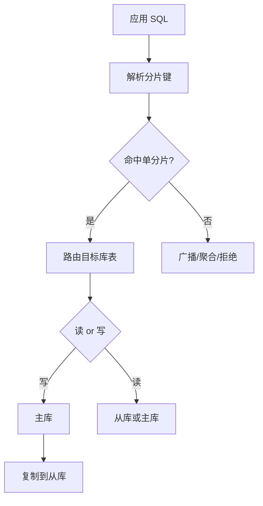

# 分库分表与读写分离

> [!abstract] 一句话总结
> 分库分表按规则拆数据和流量，读写分离把读流量导向副本；精通点是路由、事务、全局 ID、扩容和复制延迟。

## 📌 精准定位

- 负责突破单库容量、写入吞吐或读吞吐瓶颈。
- 不负责让所有 SQL 透明无成本运行，跨分片 join、聚合、事务都要改设计。
- 关键边界：按分片键拆后，查询模型必须围绕分片键重构。

## 🧩 核心概念

| 概念 | 具体含义 | 精通要点 |
| ---- | -------- | -------- |
| 分片键 | 决定数据落在哪个库表。 | 选高频等值查询且分布均匀的业务键。 |
| 路由算法 | 取模、范围、一致性哈希、查表。 | 影响扩容迁移成本。 |
| 读写分离 | 主库写、从库读。 | 处理复制延迟和读己之写。 |
| 全局 ID | 跨分片唯一主键。 | 雪花、号段、序列各有取舍。 |

## ⚙️ 工作原理 / 主流程



1. 先确认瓶颈是容量、写入、读流量还是归档。
2. 按核心访问路径选择分片键，避免高频广播。
3. 设计全局 ID 和时间维度，支持排序、归档和排障。
4. 读写分离要为强一致读提供走主库能力。
5. 扩容方案包含双写、迁移、校验、切流和回滚。

## 💻 代码 / 配置 / 伪代码

```yaml
tables:
  t_order:
    actual-data-nodes: ds$->{0..3}.t_order_$->{0..15}
    table-strategy:
      standard:
        sharding-column: user_id
        sharding-algorithm-name: user-mod-16
```

## 🔍 源码入口 / 关键组件

- ShardingSphere 路由、改写、执行、归并
- MyCat/ProxySQL/Vitess 思路
- MySQL replication binlog/relay log/GTID
- 业务路由层代码
- 数据校验和迁移任务

## ⚠️ 生产坑与注意事项

- 按订单号分片后用户订单列表无法单分片查。
- 跨分片分页排序成本极高。
- 刚写完读从库读不到。
- 大商户或活动 sku 形成热点分片。
- 扩容只考虑迁移不考虑校验和回滚。

## 🧭 排查路径

- 慢查询先看是否广播路由或跨分片归并。
- 读延迟看主从复制延迟和读路由。
- 数据不一致按分片键追落库位置和迁移批次。
- 热点分片统计每个物理库表 QPS、容量、慢 SQL。

## 🎯 面试问题

> [!question] 高频问题
> - Q: 什么时候需要分库分表？
>   - A: 单库容量、写入 TPS、表行数或运维窗口到瓶颈且优化不够。
> - Q: 分片键怎么选？
>   - A: 围绕最高频查询路径，兼顾均匀性和扩容。
> - Q: 读写分离一致性？
>   - A: 关键读走主库、会话粘滞、延迟监控或等待位点。
> - Q: 跨分片事务怎么办？
>   - A: 尽量避免，用最终一致、本地消息表、TCC/Saga。
> - Q: 扩容怎么做？
>   - A: 新旧路由并存、后台迁移、增量同步、校验、灰度切流。

## ✅ 精通检查清单

- 能画出主流程，并标出最容易失败的节点。
- 能说出至少 3 个源码入口或关键组件。
- 能写出最小配置、SQL、伪代码或状态机。
- 能结合生产故障说明监控指标、排查命令和修复动作。
- 能和相邻方案做取舍对比，而不是只背定义。

## 🔗 关联笔记

- [[_index]]
- [[20-Java后端/00-总览/学习仪表盘]]

## 📚 参考资料

- Apache ShardingSphere Documentation
- MySQL Reference Manual: Replication
