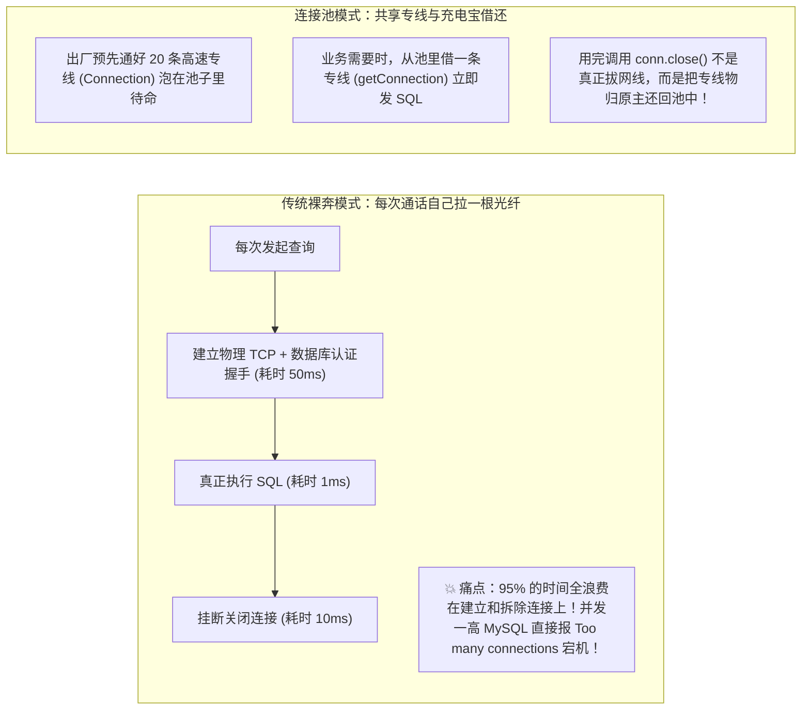
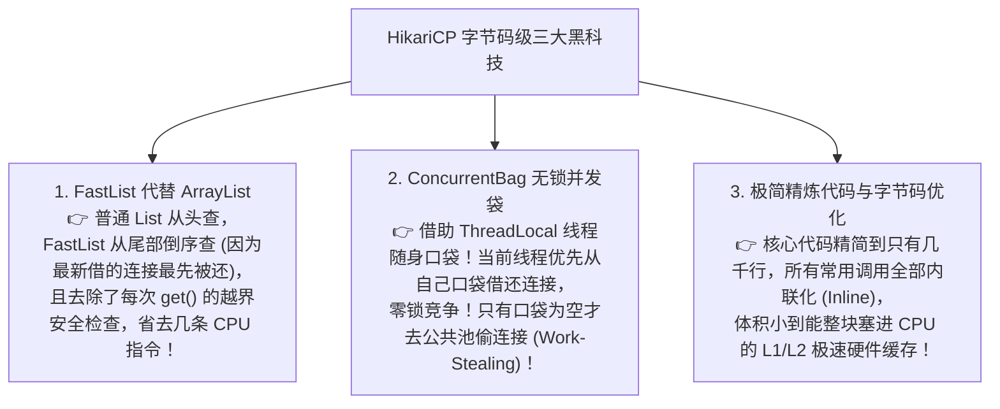

# 🔌 09 · 数据库连接池与连接管理（跨城专线电话与 HikariCP 极速之谜）

> **一句话导读**：为什么明明数据库 CPU 只有 10%，业务接口却大面积超时报错？为什么数据库连接不是设得越多越快，反而设得越多死得越惨？搞懂连接池的池化借还复用哲学、HikariCP 字节码级别的黑科技，以及**反直觉的“连接数计算黄金公式”**，你就能彻底解决线上连接泄漏与假死难题。

---

## 📞 核心心智模型：跨城专线电话与共享充电宝

如果你的系统每次执行一条简单的 `SELECT * FROM users WHERE id = 1`，都要经历：
1. 向远程 MySQL 发起三次握手建立底层 TCP 物理连接；
2. MySQL 服务端进行权限验密、协商字符集编码、初始化 Session 上下文；
3. 执行短短 1 毫秒的查询；
4. 四次挥手销毁关闭网络连接。



---

## ⚡ 性能王中王：为什么 Spring Boot 钦定 HikariCP 为默认连接池？

在早期的 Java 世界中，DBCP、C3P0、Druid 群雄逐鹿。
但从 Spring Boot 2.0 开始，官方毅然决然将日文意为“光（Hikari）”的 **HikariCP** 设为全局默认连接池！
它的速度到底为什么能快到令人发指？



---

## 🧮 颠覆认知的工业级黄金公式：连接池到底该配多大？

90% 的新手工程师在配置 `maximumPoolSize` 时都会犯一个常识性错误：
> *“我们系统并发很高，有 1000 个并发线程，所以我把数据库连接池设为 500 甚至 1000 吧！”*

**大错特错！这会直接把数据库送进 ICU 重症监护室！**

### 为什么连接数越多，系统反而越慢？
- 假设你的物理服务器只有 **4 个 CPU 核心**；
- 物理法则决定：**4 个核心在同一纳秒内最多只能同时执行 4 个线程的计算！**
- 如果你强行开 500 个数据库连接，数据库操作系统就会在 500 个线程之间**疯狂进行上下文切换（Context Switch）**；
- CPU 的算力全浪费在“保存寄存器状态、切换线程栈、恢复现场”上，真正执行 SQL 查磁盘的时间少得可怜，吞吐量断崖式暴跌！

### 🏆 官方权威推荐计算公式（PostgreSQL / HikariCP 联合推荐）：

$$\text{最大连接数 (PoolSize)} = (\text{CPU 核心数} \times 2) + \text{有效磁盘主轴数}$$

```text
举例：一台标配的 8 核 CPU、挂载高速 SSD 固态硬盘的数据库服务器：
推荐连接数 = (8 * 2) + 1 = 17 个连接左右！
```

> 🌟 **震撼结论**：
> **区区 15~20 个连接，就足以让一台 8 核服务器把 CPU 和磁盘 I/O 压榨到极致！**
> 盲目把连接池调大成百上千，只会制造拥堵和锁竞争。调优的真理往往是“**少即是多**”。

---

## ⚙️ 4 大核心参数配置防雷指南

```yaml
spring:
  datasource:
    hikari:
      # 1. 最大连接数 (按上述公式计算，通常设 15~30 足够支撑上千 Web 并发)
      maximum-pool-size: 20
      
      # 2. 最小空闲数 (强烈建议与 maximum-pool-size 设为完全一致！)
      # 防止高峰期频繁向数据库动态申请开辟新连接，避免突发抖动
      minimum-idle: 20
      
      # 3. 借连接的最大等待超时时间 (默认 30 秒太长了，生产推荐 2~3 秒)
      # 如果池子空了，排队等 2 秒借不到立即快速失败，防止把上游 Web 线程全部卡死
      connection-timeout: 2000
      
      # 4. 连接的最大生命周期 (必须比 MySQL服务端的 wait_timeout 小 2~3 分钟)
      # MySQL 默认 8 小时没动静会自动断开连接，如果连接池不知道，拿死连接去查就会报错！
      max-lifetime: 1800000 # 30分钟
```

---

## 🚨 线上排障大杀器：连接泄漏（Connection Leak）捕获

什么是连接泄漏？
**“借了连接去办业务，结果代码跑出一半报错了，或者忘了调用 `close()`，连接被永远握在手里没还回池中！”**
随着时间推移，池里的连接被一个个“有借无还”地掏空，最终整个系统的所有 SQL 全面卡死超时！

### 🛡️ HikariCP 的救命自检侦测器：
只要在配置文件中加上一行配置：
```yaml
spring:
  datasource:
    hikari:
      # 连接泄漏检测阈值：如果借出去超过 3 秒还没还，立刻在日志打印警报！
      leak-detection-threshold: 3000
```

一旦发生连接泄漏，控制台会当场拉响警报并**精确打印出这行连接是在哪一个类的哪一行代码被借走还没还的完整调用栈**：
```text
WARN ... Apparent connection leak detected (borrowed at com.example.OrderService.createOrder(OrderService.java:42))
```
跟着堆栈一枪毙命抓出元凶！

---

## 🧠 一分钟复盘核心记忆卡

1. **池化本质**：消除高昂的 TCP 与握手认证成本，实现安全复用与流量限额。
2. **反直觉法则**：**连接数不是越多越好**，核心公式约为 `(CPU * 2) + 1`，小而精的连接池才能最大化吞吐量。
3. **避坑生产规约**：`minimum-idle` 设为与 `maximum-pool-size` 相同防抖动；开启 `leak-detection-threshold` 抓取连接泄漏。

---

## 🧭 下一步

单机数据库的性能我们已经通过连接池、索引与缓存压榨到了极致。
然而在真正的亿级互联网大厂业务（如海量淘宝订单、微信聊天记录）中，单表突破几千万、几亿行，单库物理磁盘容量被打满！
如何对数据库实施“外科手术”——**分库分表与读写分离**？
请进入下一站：[[08-分库分表与读写分离]]！
