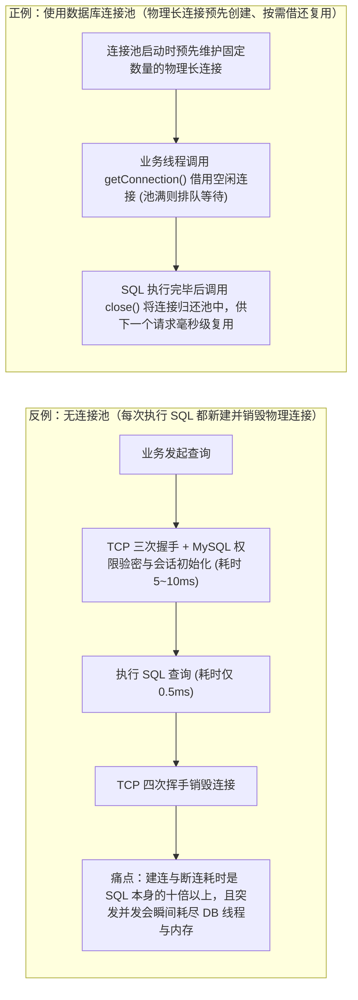
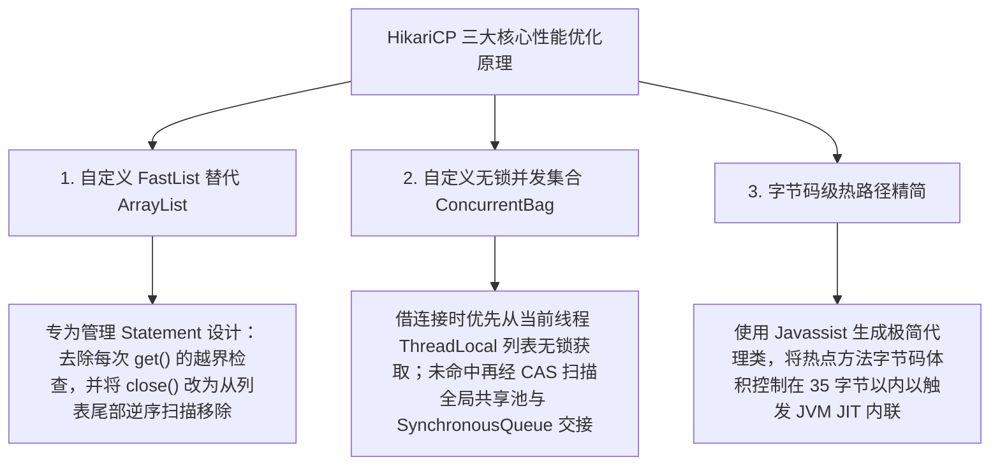

# 🔌 09 · 数据库连接池与连接管理（HikariCP 原理、容量估算与泄漏排查）

> **一句话导读**：数据库连接池通过预先建立并长驻复用物理 TCP 连接，消除了每次执行 SQL 时重复进行网络握手与权限认证的巨大开销，同时充当了保护数据库免受突发流量冲垮的并发闸门。深入掌握 HikariCP 的底层性能优化原理、连接池容量计算公式、核心超时参数配置以及连接泄漏排查手段，是保障后端存储稳定性的关键一环。

---

## 一、业务痛点：为什么高并发系统绝不能每次查询都新建连接？

在应用服务器与 MySQL 数据库交互时，一条简单的主键查询 `SELECT * FROM users WHERE id = 1` 在 InnoDB 引擎内部的执行耗时往往只有 **$0.5\text{ ms}$** 左右。然而，如果不使用数据库连接池，而是每次执行 SQL 都临时去新建并销毁一条物理连接，单次请求将不得不经历以下极其沉重的完整生命周期：

1. **TCP 三次握手**：应用与远程 MySQL 服务器完成网络层握手建立连接（耗时约 $1 \sim 2\text{ ms}$）；
2. **MySQL 认证与会话初始化**：MySQL 服务端为该连接分配专属工作线程与会话内存，双方进行握手协议交互、账号密码挑战响应验密、SSL/TLS 加密协商（若开启）以及字符集与 Session 变量初始化（耗时约 $3 \sim 10\text{ ms}$）；
3. **执行 SQL 语句**：发送 SQL 文本并接收返回结果集（耗时仅 $0.5\text{ ms}$）；
4. **断开连接与资源回收**：发送 `COM_QUIT` 指令并经历 **TCP 四次挥手**关闭连接，MySQL 服务端销毁或回收线程与会话内存。



由此可见，数据库连接池承担着两大核心职责：
- **性能加速（空间换时间）**：将物理连接的创建与销毁从高频业务读写路径中剥离，让每次 SQL 交互直接复用已认证好的长连接；
- **并发限流保护**：通过限制连接池的最大连接数上限，将超出数据库承受能力的突发并发请求挡在应用层的等待队列中，防止海量并发连接直接把数据库 CPU 和内存打崩。

---

## 二、Spring Boot 默认首选：HikariCP 为什么这么快？

在 Java 生态中，常见的连接池有早期的 C3P0、DBCP2，阿里巴巴开源的 Druid（侧重 SQL 监控统计与防火墙扩展），以及自 Spring Boot 2.0 起成为官方默认首选的 **HikariCP**。

HikariCP 之所以能在压测吞吐量与借还延迟上大幅领先，是因为它从**数据结构定制、无锁并发设计到字节码精简**进行了全方位的极致优化：



### 1. 用自定义 `FastList` 替代 `java.util.ArrayList`
按照 JDBC 规范，当一个 `Connection` 关闭归还时，连接池必须自动关闭该连接下打开的所有 `Statement` 对象。因此连接池内部需要用一个列表来记录当前连接创建的全部 `Statement`。如果直接使用 JDK 标准库的 `ArrayList`，存在两个性能损耗点：
1. **每次访问都有越界检查**：`ArrayList.get(int index)` 每次调用都会执行范围越界检查，而在连接池内部受控遍历时这一检查是多余的；
2. **正向扫描移除效率低**：业务代码中如果在同一个连接里依次打开了 `stmt1, stmt2, stmt3`，关闭时往往遵循“先开后关（先关 `stmt3`、再关 `stmt2`）”或者“用完最后一个立即关闭”的规律。而 `ArrayList.remove(Object)` 默认从头部 `index = 0` 开始向后遍历查找，每次关闭最新的 `Statement` 都要扫一遍整个列表。

**HikariCP 的优化**：专门编写了精简的 `FastList`，去掉了不必要的 `get()` 越界检查，并将 `remove(Object)` 改为**从列表尾部向头部逆序扫描**，使关闭 `Statement` 时的查找操作几乎每次都能在第一步命中（$O(1)$）。

---

### 2. 基于 `ConcurrentBag` 实现无锁/低竞争并发借还
传统连接池通常使用一把全局互斥锁或单个阻塞队列来管理所有空闲连接，当数百个业务线程同时借连接和还连接时，线程间在锁上的争抢极其激烈。

HikariCP 自主设计了无锁并发容器 **`ConcurrentBag`**，结合了**线程本地缓存（`ThreadLocal`）+ 共享写时复制列表（`CopyOnWriteArrayList`）+ 原子状态机（CAS）+ 直接交接队列（`SynchronousQueue`）**：
1. **第一级：优先从 `ThreadLocal` 本地列表无锁获取**
   - 每个工作线程在归还连接时，会将刚用完的连接引用顺手存入自己专属的 `ThreadLocal` 列表中。当该线程下一次调用 `getConnection()` 时，首先遍历自己的 `ThreadLocal` 列表，通过 CAS 将连接状态从 `STATE_NOT_IN_USE` 切换为 `STATE_IN_USE`。由于优先访问本地列表，**绝大多数借还操作完全不需要跨线程抢锁，且 CPU 缓存亲和性极佳**。
2. **第二级：扫描全局共享列表（`sharedList`）**
   - 如果当前线程的 `ThreadLocal` 列表里没有可用连接（或是刚启动的新线程），再去遍历全局共享的 `CopyOnWriteArrayList`，尝试用 CAS 抢占其他线程归还的空闲连接（这一步被称为“连接窃取 Work-Stealing”）。
3. **第三级：`SynchronousQueue` 实时交接等待**
   - 如果全局列表里所有的连接也都在使用中，当前线程就会在 `SynchronousQueue` 上阻塞等待（最长等待 `connection-timeout` 毫秒）。一旦有其他线程调用 `close()` 归还连接，归还线程发现有人在排队，就会通过 `SynchronousQueue` 直接把连接交接给等待线程，实现零延迟唤醒。

---

### 3. 字节码级别的极致瘦身与 JIT 内联优化
HikariCP 团队借助预编译期的 Javassist 字节码生成技术替代了传统的 JDK 动态代理，大幅削减了 `Connection`、`Statement`、`ResultSet` 代理包装类的调用层级，并逐行优化热路径方法的字节码指令数，使其严格保持在 JVM 默认的**方法内联阈值（`MaxInlineSize = 35` 字节）**以内。这样 JVM 的 JIT 即时编译器在运行时就能直接将这些高频小方法内联展开，彻底消除方法调用栈帧压入弹出的开销。

---

## 三、连接池容量到底该设多大？（破除“越大越好”的误区）

在生产配置审查中，最常见的一个反模式是：**开发人员看到应用层 Tomcat 的最大工作线程数设为了 500，于是把数据库连接池的 `maximum-pool-size` 也设成了 200 甚至 500，误以为连接池设得越大，并发吞吐量就越高。**

### 1. 为什么连接池设得过大，数据库吞吐量反而会暴跌？
从操作系统与计算机硬件原理来看，单台数据库服务器的物理资源是存在刚性瓶颈的：
1. **CPU 核心数与上下文切换风暴**：一台 16 核 CPU 的数据库服务器，在同一微秒真正能够并行执行指令的线程数最多只有 16 个。如果连接池放任 300 个活跃连接同时向数据库发起查询，数据库内核就必须同时调度 300 个工作线程。这会导致操作系统每秒发生数万次**线程上下文切换（Context Switch）**——CPU 大把的时间被浪费在保存和恢复寄存器上下文、刷新失效的 L1/L2 缓存上，真正用于执行 SQL 的有效算力反而大幅缩水。
2. **锁竞争与磁盘 I/O 争抢加剧**：过多并发事务同时涌入 InnoDB 内部，会成倍放大 Buffer Pool 内部 Latch 锁争用、行锁排队等待以及 Redo Log 刷盘竞争，导致所有 SQL 的平均响应时间从 $1\text{ ms}$ 恶化到数十毫秒。

---

### 2. 官方推荐的连接池容量估算公式与集群总预算核算

由于数据库执行 SQL 时并非 100% 占用 CPU，期间会穿插磁盘读取等待与网络传输等待（当线程 A 等待磁盘 I/O 时，CPU 可以切换去服务线程 B），因此单台数据库的最佳活跃连接数通常会略高于 CPU 核心数。PostgreSQL 与 HikariCP 官方给出的经验估算起点公式为：

$$\text{单台数据库最佳活跃连接数} \approx (\text{数据库物理 CPU 核心数} \times 2) + \text{有效磁盘并发数}$$

- **单机容量计算示例**：
  - 假设线上 MySQL 部署在一台 **16 核 CPU** 的服务器上（使用 SSD 存储），按照公式估算，这台数据库在最高吞吐效率下能够同时处理的活跃连接数大约在 **$32 \sim 40$ 个**左右，而不是几百个！
- **微服务多实例部署下的“集群总连接数核算”（关键工程规范）**：
  - 上述算出的 $32 \sim 40$ 是**这台 MySQL 数据库面对所有上游应用实例时的最佳活跃总连接数**，而绝不是单个微服务节点独自占用的连接数。
  - 假设订单服务在线上水平扩容部署了 **10 个 Pod 实例**，如果每个实例的 `maximum-pool-size` 设为 `20`，那么这 10 个实例满载时就会向 MySQL 建立 $10 \times 20 = 200$ 个物理连接。
  - 因此，在设定单实例 `maximum-pool-size`（通常设置在 **$10 \sim 30$** 之间，再结合压测微调）时，务必核算整个集群的总连接预算，确保满足以下硬性约束：
    $$\sum (\text{微服务实例数} \times \text{单实例 maximum-pool-size}) + \text{运维管理预留连接} < \text{MySQL 的 max\_connections}$$

---

## 四、HikariCP 核心生产参数配置与易混点辨析

在 Spring Boot 的 `application.yml` 中，以下是经过生产检验的标准 HikariCP 参数配置模板：

```yaml
spring:
  datasource:
    url: jdbc:mysql://10.0.0.10:3306/order_db?useUnicode=true&characterEncoding=utf8&connectTimeout=2000&socketTimeout=10000
    hikari:
      # 1. 连接池最大连接数（单实例建议控制在 10 ~ 30 之间，需结合实例总数与 DB 核心数核算）
      maximum-pool-size: 20
      
      # 2. 最小空闲连接数（官方强烈推荐与 maximum-pool-size 设为相同值，保持固定大小的连接池，避免突发流量下临时建连卡顿）
      minimum-idle: 20
      
      # 3. 业务线程从连接池借用连接的最大排队等待超时（单位：毫秒，默认 30000ms）
      # 生产环境建议调小至 1000 ~ 3000ms，池满时快速失败并触发熔断降级，防止把整个 Tomcat 线程池挂死
      connection-timeout: 2000
      
      # 4. 单个物理连接在池中的最大存活寿命（单位：毫秒，默认 1800000ms = 30分钟）
      # 必须比 MySQL 服务端的 wait_timeout 以及云厂商 SLB/NAT 网关的空闲断连时间短 2~5 分钟！
      max-lifetime: 1800000
      
      # 5. 空闲连接的定期保活探测间隔（单位：毫秒，如 120000ms = 2分钟）
      # 定期对池中空闲连接发送轻量级 Ping 校验，防止被中间防火墙静默掐断
      keepalive-time: 120000
      
      # 6. 连接泄漏检测告警阈值（单位：毫秒，如 3000ms = 3秒，用于定位长时间不归还连接的代码堆栈）
      leak-detection-threshold: 3000
```

### 两大高频易混点辨析

1. **`connection-timeout`（借连接排队超时）与 `socketTimeout`（SQL 执行超时）有什么区别？**
   - **`connection-timeout`**：管的是**“进门之前”**——当连接池里的 20 个连接全被借光了，第 21 个线程在池子门外排队等待 `getConnection()` 的最长时间。如果超过 2 秒还没人还连接，直接抛出 `SQLTransientConnectionException (Connection is not available, request timed out)`。
   - **`socketTimeout`**：管的是**“进门之后”**——线程已经顺利借到了连接，把一条慢 SQL 发给了 MySQL，等待 MySQL 返回结果集的最长网络读取时间（在 JDBC URL 中配置）。如果一条慢 SQL 执行了 15 秒还没返回，就会由 `socketTimeout=10000` 在第 10 秒强制中断读取并报错，防止单个死锁或全表扫描慢 SQL 永久霸占这个连接。
2. **为什么 `max-lifetime` 必须比 MySQL 的 `wait_timeout` 短几分钟？**
   - MySQL 服务端（以及云环境下的负载均衡 SLB、NAT 网关）为了回收僵尸连接，会自动主动断开空闲超过 `wait_timeout` 的 TCP 连接。
   - 如果把 HikariCP 的 `max-lifetime` 设得比 MySQL 的 `wait_timeout` 还长，MySQL 服务端就已经单方面把连接关掉了，而客户端连接池还以为这个连接是好的；当业务线程借出这个死连接去执行 SQL 时，就会立刻抛出经典的线上异常：`Communications link failure: The last packet successfully received from the server was ... milliseconds ago`。
   - 因此，将 `max-lifetime` 设置为比数据库及网关超时时间短 $2 \sim 5$ 分钟，并开启 `keepalive-time` 定期保活，就能让连接池在连接被服务端强行掐断之前主动将其平滑退休并替换为新连接。

---

## 五、连接泄漏（Connection Leak）原理与线上排查实战

### 1. 什么是连接泄漏？哪些代码写法最容易引发连接泄漏？
**连接泄漏**是指业务线程从连接池借出 `Connection` 后，未能在操作结束时及时调用 `close()` 将其归还池中，或者因编码不当导致单个线程长时间霸占连接不放。一旦发生连接泄漏，池中的 20 个连接会在几秒钟内被全部借光，随后所有新到达的请求全部在等待 `connection-timeout` 后集体报错崩溃。

**线上最常见的三大诱因**：
1. **在 `@Transactional` 大事务中夹杂远程 RPC / HTTP 调用或发 MQ（头号杀手）**：
   ```java
   @Transactional(rollbackFor = Exception.class)
   public void createOrder(OrderDTO dto) {
       // 1. 执行第一条 SQL 时，Spring 已经从 HikariCP 借出了一个数据库连接并绑定到当前线程 ThreadLocal
       orderMapper.insert(dto);
       
       // 2. 致命操作：带着未提交的数据库事务，去同步调用耗时 3 秒甚至卡死的外部第三方 HTTP 接口！
       // 在这整整 3 秒内，这个珍贵的数据库连接什么 SQL 都没干，却一直被当前线程死死攥在手里无法归还！
       thirdPartyRiskClient.checkRisk(dto);
       
       orderMapper.updateStatus(dto.getId(), "CHECKED");
   } // 直到方法走完提交事务，连接才会被释放归还
   ```
   一旦外部 HTTP 接口出现响应变慢，只需 20 个并发请求就会把整个数据库连接池彻底占满，连带把本服务所有不调外部接口的普通查询也全部卡死！**正确做法是：将远程 RPC/HTTP 调用移出 `@Transactional` 事务外部，采用编程式事务 `TransactionTemplate` 仅包裹纯粹的数据库读写代码**。
2. **手动借用连接后未在 `finally` 块或 `try-with-resources` 中关闭**：在使用原生 `DataSourceUtils.getConnection()` 或手动开启 `SqlSession` 时，若异常分支遗漏了释放逻辑，会导致连接永久丢失。
3. **突发慢 SQL 或数据库行锁等待**：某条未走索引的全表扫描 SQL 或死锁等待耗时数十秒，导致承载该 SQL 的连接迟迟无法返回。

---

### 2. 利用 `leak-detection-threshold` 一键锁定泄漏代码行号

排查连接泄漏最直接、最高效的武器，就是开启 HikariCP 内置的 **`leak-detection-threshold`（连接泄漏检测阈值，例如设为 `3000` 毫秒）**。

它的工作原理非常直观：每当一个线程调用 `getConnection()` 借出连接时，HikariCP 就会在后台启动一个延时 3 秒的定时检查任务并记录当前的调用栈；如果该线程在 3 秒内正常调用了 `close()` 归还连接，定时任务就自动取消；**一旦超过 3 秒还没归还，HikariCP 就会立即在应用日志中打印出当初借出这个连接时的完整业务代码堆栈**：

```text
WARN com.zaxxer.hikari.pool.ProxyLeakTask - Connection leak detection triggered for com.mysql.cj.jdbc.ConnectionImpl@4a8b, 
stack trace follows:
java.lang.Exception: Apparent connection leak detected
    at com.zaxxer.hikari.HikariDataSource.getConnection(HikariDataSource.java:128)
    at com.example.order.service.OrderService.createOrder(OrderService.java:42)
```

拿到这条告警日志后，直接打开 `OrderService.java` 的第 42 行，就能一眼看到是哪段长事务或哪条慢 SQL 卡住了连接，结合 Prometheus 监控指标（`hikaricp_connections_active` 活跃连接数、`hikaricp_connections_pending` 排队等待线程数）即可快速根治问题。

---

## 🧠 一分钟复盘核心记忆卡

1. **连接池双重价值**：复用已认证的物理长连接，省去每次 SQL 的 TCP 三次握手与权限验密开销；通过池容量上限充当并发保护阀门，防止突发高并发压垮数据库。
2. **HikariCP 高性能三大支柱**：`FastList`（去除越界检查 + 尾部逆序移除 `Statement`）+ `ConcurrentBag`（`ThreadLocal` 本地优先无锁借还 + CAS 共享池 + `SynchronousQueue` 交接）+ 字节码精简控制热点方法在 35 字节内触发 JIT 内联。
3. **容量公式与参数规范**：单台 DB 最佳活跃连接数遵循 $(\text{CPU 核数} \times 2) + \text{有效磁盘数}$，且所有微服务实例连接池总和必须小于 DB 的 `max_connections`；区分 `connection-timeout`（借连接排队超时）与 `socketTimeout`（SQL 执行超时），将 `max-lifetime` 设得比 `wait_timeout` 短数分钟，并开启 `leak-detection-threshold` 排查大事务与连接泄漏。

---

## 🧭 下一步

至此，我们已经完整攻克了 MySQL 索引与锁机制、SQL 执行计划调优、Redis 数据结构与持久化、缓存三大故障治理、分库分表以及数据库连接池管理。最后一篇将通过全景知识体系图谱、核心底层机制对照表与 10 道大厂高频深度面试题，带你对整个第 05 阶段进行系统性收官复盘：
请进入终章：[[99-本章总结与复习]]！
