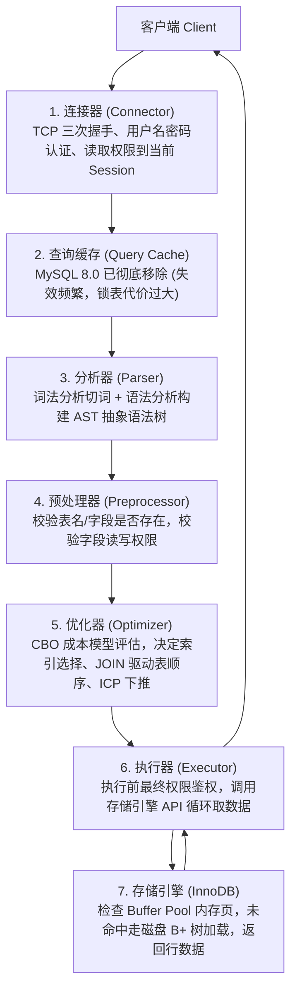
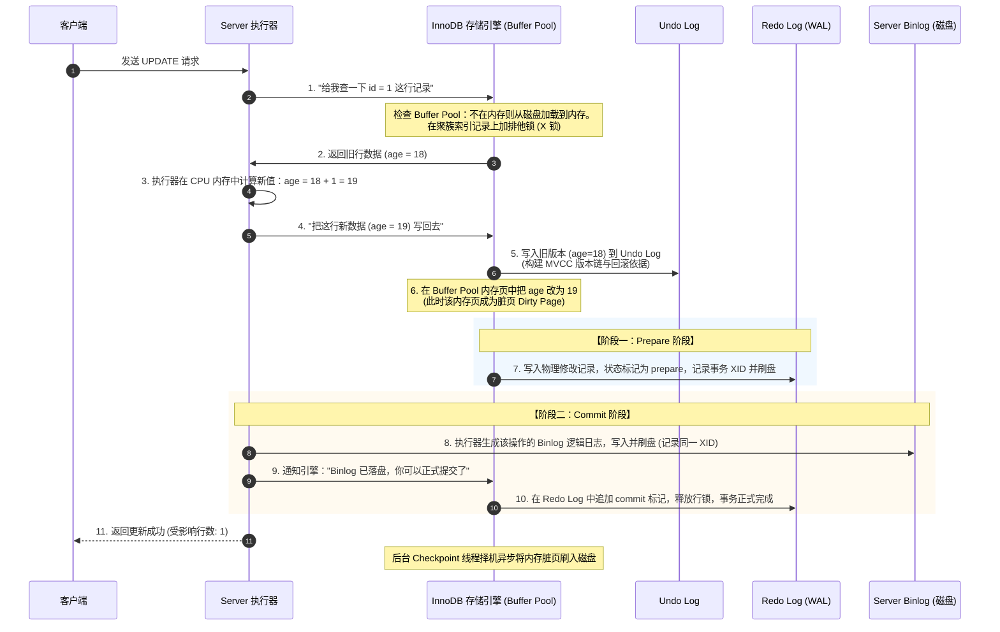
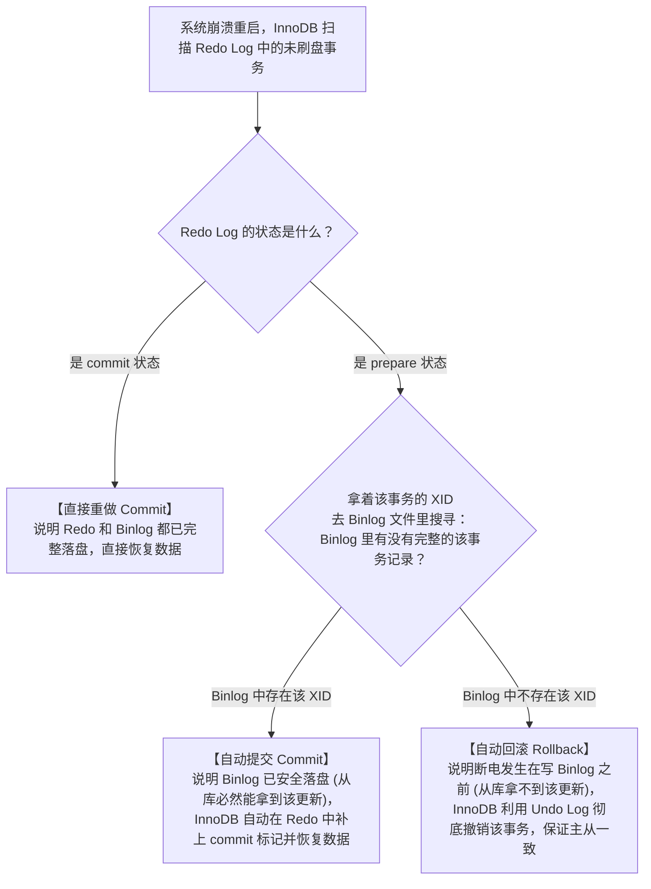
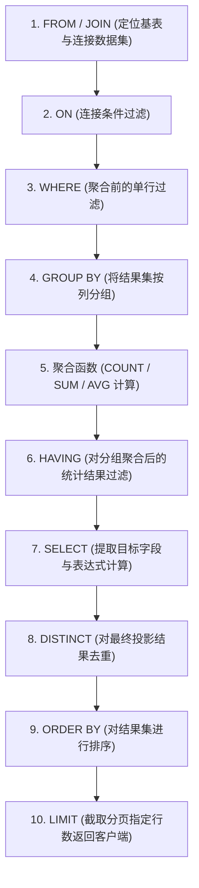
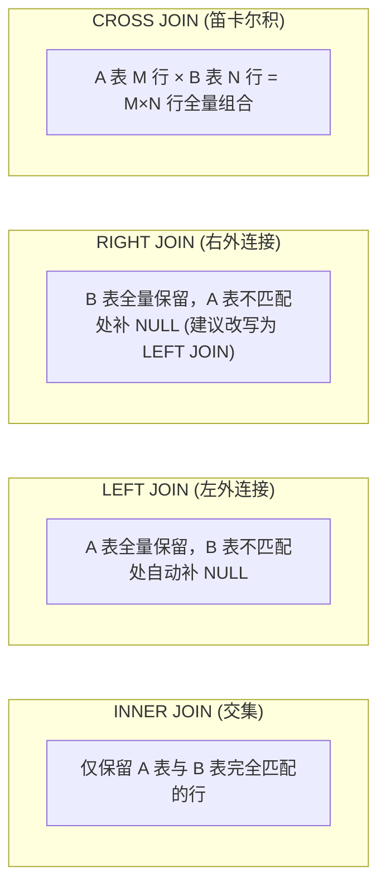

# 10 · 实战 SQL 编写与高频业务查询指南

> [!abstract] 一句话第一性原理
> **写好 SQL 的本质是“用最符合存储引擎 B+ 树物理结构与执行器计算特性的语法表达业务逻辑”。**
> 掌握数据库不仅要懂底层的 B+ 树与 MVCC，更要能在日常开发中熟练设计规整的表结构、编写安全高效的增删改查、掌握各种复杂 JOIN 关联、高频内置函数与窗口函数，并能从容应对千万级大表深分页、海量冷数据平滑分批归档等工业级生产场景。

---

## 目录速览

1. **宏观认知：一条 SQL 的完整执行链路**
   - SELECT 查询执行全链路（Server 层到存储引擎层）
   - UPDATE 更新执行全链路与两阶段提交（2PC）
2. **基础定义与数据操作：DDL、DML 与 TCL**
   - DDL 建表设计规约与核心数据类型选型避坑
   - TCL 线上数据修复事务脚本与隐式提交陷阱
   - INSERT：批量插入、`ON DUPLICATE KEY UPDATE`、间隙锁风险
   - UPDATE：条件保护、乐观锁并发防覆写、JOIN 关联更新
   - DELETE：三种删除（DELETE vs TRUNCATE vs DROP）、大表分批平滑删除
3. **核心查询全景：从单表到各种复杂查询**
   - SQL 语句底层物理执行次序
   - 各种 JOIN 关联查询与 `ON` vs `WHERE` 根本区别
   - 驱动表成本推导与 NLJ 索引嵌套循环
   - 聚合分析（`GROUP BY`、`HAVING`、`CASE WHEN` 动态行转列）
   - 业务高频内置函数实战速查（日期、字符串、空值与行列合并）
   - 子查询与集合操作（`IN` vs `EXISTS`、`NOT IN` 的 NULL 陷阱、`UNION` vs `UNION ALL`）
   - MySQL 8.0 现代查询高级武器（窗口函数 Top N、CTE 递归树）
4. **生产环境实战高频脚本与性能调优技巧**
   - 千万级深分页两种工业级解法（延迟关联与游标分页）
   - `CASE WHEN` 批量单次更新技巧
   - 日常写 SQL 绝不能踩的十大暗坑速查

---

## 一、 宏观认知：一条 SQL 的完整执行链路

在学习具体语法之前，必须先建立一条 SQL 在 MySQL 内部流转的宏观物理心智。MySQL 整体架构划分为两大部分：
- **Server 层**：负责连接管理、SQL 解析、权限校验、执行计划优化（所有存储引擎共用）；
- **存储引擎层（如 InnoDB）**：负责底层数据的物理存储、内存缓存管理、事务日志与真正的数据提取。

---

### 1. 查询语句（`SELECT`）全生命周期执行链路

以最基础的查询为例：`SELECT name FROM users WHERE user_id = 100;`



#### 关键环节底层拆解：
1. **连接器（Connector）**：
   负责与客户端建立 TCP 连接并验证身份。鉴权成功后，连接器会读取该用户的全部权限缓存到当前会话（Session）中。**这意味着即使管理员在中途修改了该用户的权限，已建立的长连接也不会受到影响，必须重新连接才生效**。
2. **查询缓存（Query Cache，MySQL 8.0 彻底废弃）**：
   以 Key-Value 形式缓存 SQL 文本与结果。**为什么必须废弃？** 只要一个表发生任何一次更新，该表所有的查询缓存都会被瞬间全部清空。在写多读少的业务场景下，维护查询缓存的全局互斥锁开销远大于收益。
3. **分析器（Parser）**：
   - **词法分析**：将 SQL 字符串切分为关键词、表名、字段名（识别出 `SELECT` 是动词、`users` 是表名）；
   - **语法分析**：依据语法规则生成 **AST（抽象语法树）**。语法有错在此处抛出 `You have an error in your SQL syntax`。
4. **预处理器（Preprocessor）**：
   分析器只判断语法是否正确，并不判断表和字段是否存在。预处理器负责检查 `users` 表以及 `user_id` 列是否真实存在于元数据字典中，并校验字段访问权限。
5. **优化器（Optimizer）**：
   一条 SQL 可能有多个索引可用，关联查询可能有多种驱动顺序。优化器依据 **CBO（基于成本的优化模型）**，估算不同执行路径的 I/O 与 CPU 代价，生成最优的**执行计划**。
6. **执行器（Executor）与存储引擎交互**：
   执行器通过标准的存储引擎 API（如 `ha_rnd_init` / `ha_rnd_next` / `ha_index_read`）循环向 InnoDB 索要数据行：
   - 优先在内存的 **Buffer Pool** 中查找包含目标数据的数据页（Page，16KB）；
   - 若内存未命中，发起磁盘 I/O 将物理数据页加载至 Buffer Pool 的 LRU 链表中；
   - 沿 B+ 树从根节点二分查找定位叶子节点，读取数据行并返回给执行器，执行器流式返回客户端。

---

### 2. 更新语句（`UPDATE`）全链路与两阶段提交（2PC）

很多资料在讲 `UPDATE` 执行流程时往往一笔带过，导致大家产生大量困惑：“为什么更新一条数据要涉及 3 种日志（Undo/Redo/Binlog）？”、“执行器和存储引擎到底是怎么来回配合的？”、“两阶段到底是谁在和谁两阶段？”、“如果在不同时刻断电，MySQL 凭什么决定回滚还是提交？”

下面我们以一条最简单的更新语句为例，进行**逐帧拆解**：
```sql
UPDATE users SET age = age + 1 WHERE id = 1;
```

---

#### （1）执行器与存储引擎的 7 步交互全流程



---

#### （2）为什么必须要有“两阶段提交（2PC）”？

##### 1. 2PC 的本质是什么？
很多初学者以为 2PC 是分布式微服务里的分布式事务（XA）。其实在单机 MySQL 内部，2PC 解决的是 **Server 层与存储引擎层两个独立日志系统的一致性问题**：
- **谁是协调者？** Server 层执行器。
- **谁是参与者？** InnoDB 存储引擎。
- **要协调什么？** 协调 **Redo Log（引擎物理日志）** 与 **Binlog（Server 逻辑日志）** 必须步调一致。

##### 2. 反证法：如果没有两阶段提交，直接串行写会发生什么？
假设我们不搞两阶段，直接按普通顺序写：
- **情况 A：先写 Redo Log，再写 Binlog**
  - 如果在 Redo Log 刚写完、还没来得及写 Binlog 的那一瞬间，**服务器突然断电宕机**！
  - **重启后结果**：主库重启时，依靠 Redo Log 把内存数据恢复了（`age = 19`）；但是因为 Binlog 没写，从库通过 Binlog 同步时根本不知道发生了这次更新，从库里的 `age` 依然是 `18`！
  - **严重灾难**：**主库有新数据，从库丢失数据，主从永久不一致！**
- **情况 B：先写 Binlog，再写 Redo Log**
  - 如果在 Binlog 刚写完、还没来得及写 Redo Log 的那一瞬间，**服务器突然断电宕机**！
  - **重启后结果**：主库重启时，因为 Redo Log 没写，主库判定事务失败回滚（`age` 依然是 `18`）；但是 Binlog 已经写进去了，从库拉取到这条 Binlog 并执行了更新（`age = 19`）！
  - **严重灾难**：**主库回滚了，从库却多出了幽灵数据，主从再次永久不一致！**

---

#### （3）核心破案：断电崩溃恢复（Crash Recovery）判定三步法

MySQL 的 2PC 是如何通过两阶段消除上述灾难的？关键就在于两者共享了一个全局唯一的事务编号——**`XID`**。

当 MySQL 意外崩溃重启时，InnoDB 会扫描 Redo Log，根据日志状态执行以下**三步判定法**：



1. **时刻 1：Redo 写了 prepare，还没写 Binlog 时断电**
   - 重启时检查：Redo 为 `prepare`，但 Binlog 里找不到这个 `XID`；
   - 判定：判定事务中途夭折，**利用 Undo Log 自动回滚**。此时主库回滚，从库无此记录，主从一致！
2. **时刻 2：Binlog 已经写完落盘，但 Redo 还没来得及改成 commit 时断电**
   - 重启时检查：Redo 虽为 `prepare`，但去 Binlog 里一搜，发现这个 `XID` 已经完整写好了！
   - 判定：既然 Binlog 完整落盘，从库就一定会同步它；因此主库**自动执行提交（Commit）**，把数据重做出来。主从再次完美一致！

---

#### （4）生产高可用铁律：经典的“双 1 配置”

要想让上述两阶段提交在物理上真正做到 **“Crash-Safe（单机零丢失）”**，必须保证两个日志在对应阶段**真正写入了物理磁盘扇区**，而不是仅仅停留在操作系统缓存（OS PageCache）里：

| 参数 | 推荐配置值 | 底层物理含义 | 若配置为非 1 的风险 |
| :--- | :---: | :--- | :--- |
| **`innodb_flush_log_at_trx_commit`** | **`1`** | 每次事务提交（prepare 阶段），必须把 Redo Log 真正调用 `fsync()` **强制刷入物理磁盘**。 | 若配为 `0` 或 `2`，断电可能丢失 1 秒的事务数据。 |
| **`sync_binlog`** | **`1`** | 每次事务提交（commit 阶段），必须把 Binlog 真正调用 `fsync()` **强制刷入物理磁盘**。 | 若配为 `0` 或 `N`，断电可能导致 Binlog 丢失，破坏从库一致性。 |

> [!IMPORTANT] 记忆总结
> - **Undo Log**：写在内存修改前，为回滚和 MVCC 留底牌（防应用出错）；
> - **Redo Log**：顺序物理写，WAL 保单机不丢（防断电宕机）；
> - **Binlog**：追加逻辑写，保从库同步与归档（防灾备不一致）；
> - **2PC + XID 对齐**：用两阶段配合 XID，让两个独立的日志系统做到“要么同时生效，要么同时作废”。

---

## 二、 基础定义与数据操作：DDL、DML 与 TCL

### 1. 数据定义语言（DDL）：标准建表规范与字段选型

日常写 SQL 的第一道关卡是建表。优良的建表设计能从源头规避 80% 的隐式转换与性能灾难。

#### （1）工业级标准建表模板（DDL）
```sql
CREATE TABLE `tb_order` (
    `id` BIGINT UNSIGNED NOT NULL AUTO_INCREMENT COMMENT '主键ID（单库自增/分布式雪花ID）',
    `order_no` VARCHAR(64) NOT NULL COMMENT '业务订单编号（全局唯一）',
    `user_id` BIGINT UNSIGNED NOT NULL COMMENT '下单用户ID',
    `total_amount` DECIMAL(12, 2) NOT NULL DEFAULT 0.00 COMMENT '订单总金额（精确到分）',
    `order_status` TINYINT NOT NULL DEFAULT 0 COMMENT '订单状态：0-待支付 1-已支付 2-已取消',
    `remark` VARCHAR(255) NOT NULL DEFAULT '' COMMENT '用户备注（避免NULL）',
    `is_deleted` TINYINT UNSIGNED NOT NULL DEFAULT 0 COMMENT '逻辑删除标记：0-正常 1-已删除',
    `created_at` DATETIME NOT NULL DEFAULT CURRENT_TIMESTAMP COMMENT '创建时间',
    `updated_at` DATETIME NOT NULL DEFAULT CURRENT_TIMESTAMP ON UPDATE CURRENT_TIMESTAMP COMMENT '更新时间',
    PRIMARY KEY (`id`),
    UNIQUE KEY `uk_order_no` (`order_no`),
    KEY `idx_user_status` (`user_id`, `order_status`),
    KEY `idx_created_at` (`created_at`)
) ENGINE=InnoDB DEFAULT CHARSET=utf8mb4 COLLATE=utf8mb4_general_ci COMMENT='核心订单主表';
```

#### （2）生产建表五大军规与选型避坑：
1. **金额计算严禁使用 `FLOAT` 或 `DOUBLE`**：
   浮点数底层采用二进制科学计数法存储，存在无法避免的精度丢失问题（如 `0.1 + 0.2 = 0.30000000000000004`）。**金额一律使用 `DECIMAL(12, 2)`**，或以“分”为单位存成整型 `BIGINT`。
2. **时间字段优先选用 `DATETIME` 还是 `TIMESTAMP`？**
   - `TIMESTAMP` 占用 4 字节，能自动转换时区，但**上限仅到 2038-01-19 03:14:07**（2038 年溢出问题）；
   - `DATETIME` 占用 8 字节（MySQL 5.6+ 优化为 5 字节），存储范围 `1000-01-01` 至 `9999-12-31`，不受 2038 年限制，应用层统一按 UTC 或 `Asia/Shanghai` 时区写入即可。**生产优先推荐 `DATETIME`**。
3. **尽量将字段声明为 `NOT NULL` 并赋默认值**：
   - `NULL` 会占用额外的 NULL 标志位（NULL Bitmap）；
   - `NULL` 参与加减乘除运算结果全为 `NULL`；
   - `NULL` 会导致 `COUNT(col)` 漏计、`NOT IN` 判定失效，且复合索引包含 NULL 时代价计算更复杂。
4. **严格禁止在生产数据库中使用物理外键（`FOREIGN KEY`）**：
   物理外键会引发级联加锁、外键校验跨表开销，在大高并发写场景下极易造成死锁。**一切业务关联完整性由 Java 应用层 Service 保证**。
5. **字符串字段 `VARCHAR(N)` 中的 N 是字符还是字节？**
   - MySQL 5.0 之后，`VARCHAR(N)` 中的 $N$ **代表字符数，而不是字节数**。定义 `VARCHAR(32)` 可以存 32 个英文字母，也可以存 32 个汉字。在 `utf8mb4` 下最多占用 $32 \times 4 = 128$ 字节。

---

### 2. 事务控制（TCL）与线上数据修复脚本规范

后端工程师在线上执行数据订正、配置更新或跑批时，若裸写 DML 极易因手抖或网络中断导致脏数据半路提交。

#### （1）生产级安全订正脚本模板：
```sql
-- 1. 显式开启事务
START TRANSACTION;

-- 2. 执行预更新操作（严格带上明确的条件与主键范围）
UPDATE tb_order 
SET order_status = 2, updated_at = NOW() 
WHERE order_status = 0 
  AND created_at < '2026-09-01 00:00:00' 
  AND id BETWEEN 10000 AND 50000;

-- 3. 校验影响行数与更新结果（人工执行比对）
SELECT COUNT(*) FROM tb_order WHERE order_status = 2 AND updated_at >= NOW() - INTERVAL 1 MINUTE;

-- 4. 确认无误手动执行 COMMIT；若影响行数异常立即执行 ROLLBACK 回滚
COMMIT;
-- ROLLBACK;
```

> [!CAUTION] DDL 语句的“隐式提交”陷阱
> MySQL 在执行任何 **DDL 语句**（如 `CREATE TABLE`、`ALTER TABLE`、`TRUNCATE TABLE`、`DROP TABLE`）时，**会立即隐式提交当前连接中尚未提交的事务**！因此，绝对不要在一个事务块内混合执行 DML 与 DDL，否则前面的修改将无法回滚。

---

### 3. 数据新增（INSERT）

#### （1）单行插入 vs 批量插入
```sql
-- 1. 单行插入（频繁执行网络 RTT 极高，每次都要走一次事务刷盘）
INSERT INTO users (username, email, status) VALUES ('alice', 'alice@test.com', 1);

-- 2. 批量插入（强烈推荐：合并网络请求，共享单个事务日志，单批次建议 500~1000 条）
INSERT INTO users (username, email, status) VALUES 
('alice', 'alice@test.com', 1),
('bob', 'bob@test.com', 1),
('charlie', 'charlie@test.com', 0);
```

#### （2）插入忽略（`INSERT IGNORE`）
当插入数据可能因主键或唯一索引冲突报错时，使用 `IGNORE` 关键字静默忽略冲突行，其余正常行继续插入：
```sql
INSERT IGNORE INTO user_tag (user_id, tag_id) VALUES (1001, 20);
```

#### （3）存在则更新、不存在则插入（`ON DUPLICATE KEY UPDATE`）
业务高频场景（如商品浏览量累计、每日报表打点），依赖唯一主键或唯一索引实现高并发幂等写入：
```sql
-- 若 (stat_date, page_id) 已存在，则自动执行 UPDATE 将 pv_count + 1
INSERT INTO daily_pv (stat_date, page_id, pv_count)
VALUES ('2026-10-05', 101, 1)
ON DUPLICATE KEY UPDATE pv_count = pv_count + 1;
```

#### （4）子查询插入（`INSERT INTO ... SELECT`）的加锁风险
```sql
INSERT INTO user_archive (user_id, username, create_time)
SELECT id, username, create_time FROM users WHERE status = 0;
```

> [!WARNING] 生产死锁陷阱
> 在默认的可重复读（RR）隔离级别下，`INSERT INTO ... SELECT` 会给被查询表（`users`）扫描到的记录加上**共享读锁（S 锁）以及 Next-Key Lock 间隙锁**！如果此时有并发写事务修改 `users` 表，极易造成严重阻塞或死锁。生产数据迁移应优先分批查询出主键后写入，避免直接联表插入。

---

### 4. 数据更新（UPDATE）

#### （1）基础更新与条件保护
```sql
-- 生产必须带精准 WHERE 条件，开启数据库安全模式 (sql_safe_updates = 1) 拦截无 WHERE 更新
UPDATE users 
SET status = 0, updated_at = NOW() 
WHERE last_login < '2025-01-01' AND status = 1;
```

#### （2）乐观锁条件更新（并发防脏写）
在并发扣减库存、账户余额或状态流转时，必须依托 SQL 自身原子性做条件更新，严禁查出后在 Java 内存改完再写回：
```sql
-- 1. 基于版本号的乐观锁
UPDATE account 
SET balance = balance - 100, version = version + 1 
WHERE user_id = 1001 AND version = 5 AND balance >= 100;

-- 2. 基于业务状态机的条件流转 (影响行数 = 0 则说明被其他事务抢先处理)
UPDATE orders 
SET status = 'PAID', pay_time = NOW() 
WHERE order_id = 2026100501 AND status = 'UNPAID';
```

#### （3）多表关联更新（JOIN UPDATE）
需要根据关联表的信息直接回填主表时使用：
```sql
-- 根据支付流水表，批量将订单表状态更新为已支付
UPDATE orders o
JOIN order_payment p ON o.order_id = p.order_id
SET o.pay_time = p.pay_time, o.status = 'PAID'
WHERE p.pay_status = 'SUCCESS' AND o.status = 'UNPAID';
```

---

### 5. 数据删除（DELETE vs TRUNCATE vs DROP）

| 删除方式 | 命令类别 | 事务与回滚 | 物理底层行为 | 磁盘空间释放 | 适用场景 |
| :--- | :--- | :--- | :--- | :--- | :--- |
| **`DELETE`** | DML | 走事务，记 Undo/Redo，**可回滚** | 逐行扫描并给数据行打上删除标记（墓碑），B+ 树页结构保留 | **不释放磁盘空间**（空洞留在原页重用） | 业务精细化条件删除少量数据 |
| **`TRUNCATE`** | DDL | 不走事务，**不可回滚** | 直接销毁整张表的物理数据页，重置高水位线（HWM）与自增主键 | **立即释放表空间文件** | 清空整张大测试表或临时日志表 |
| **`DROP`** | DDL | 不走事务，**不可回滚** | 彻底删除表结构定义文件与物理 `.ibd` 数据文件 | **立即彻底释放磁盘空间** | 废弃整张业务表 |

#### 生产海量冷数据平滑分批删除脚本：
一次性 `DELETE FROM orders WHERE create_time < '2024-01-01'` 会产生长事务、锁住大量数据并产生海量 Undo Log，导致主从同步严重延迟。正确做法是**按主键小批量删除**：
```sql
-- 每次删除 5000 条，结合应用循环调用并休眠 500ms
DELETE FROM orders 
WHERE create_time < '2024-01-01' 
ORDER BY id ASC 
LIMIT 5000;
```

---

## 三、 核心查询全景：从单表到各种复杂查询

### 1. SQL 语句底层物理执行次序（心智模型）

SQL 语句的语法书写顺序与数据库内核的真实执行顺序完全不同：



> **经典考点解释**：
> - 为什么 `WHERE` 条件里**不能直接使用 `SELECT` 中定义的字段别名**？因为步骤 3（WHERE）执行时，步骤 7（SELECT）尚未发生，执行器根本不认识别名；
> - 为什么 `ORDER BY` 中**可以使用别名**？因为步骤 9（ORDER BY）发生在步骤 7（SELECT）之后。

---

### 2. 各种关联查询（JOIN 关系图解与深度剖析）



#### （1）六大关联类型实战语法

##### ① 内连接（`INNER JOIN`）
两表必须同时满足连接条件，任何一方不匹配即被丢弃：
```sql
SELECT o.order_no, u.username, o.total_amount
FROM orders o
INNER JOIN users u ON o.user_id = u.id;
```

##### ② 左外连接（`LEFT JOIN`）
以左表为主表，左表数据 100% 全部保留；右表不匹配处所有列自动置为 `NULL`：
```sql
-- 查询全量用户及其对应的最新订单信息（无订单的用户也会展示，订单列为 NULL）
SELECT u.id, u.username, o.order_no, o.total_amount
FROM users u
LEFT JOIN orders o ON u.id = o.user_id;
```

##### ③ 右外连接（`RIGHT JOIN`）
以右表为主表。**工程规范建议**：业务代码中统一改写为 `LEFT JOIN`，保持从左到右阅读习惯。

##### ④ 全外连接（`FULL JOIN` 模拟）
MySQL 原生不支持 `FULL OUTER JOIN` 关键字，工业界通过 `LEFT JOIN` 与 `RIGHT JOIN` 配合 `UNION` 模拟：
```sql
SELECT a.id, a.name, b.score FROM table_a a LEFT JOIN table_b b ON a.id = b.id
UNION
SELECT a.id, a.name, b.score FROM table_a a RIGHT JOIN table_b b ON a.id = b.id;
```

##### ⑤ 交叉连接（`CROSS JOIN` 笛卡尔积）
用于生成全量组合（如商品 SKU 规格全组合：颜色 3 种 $\times$ 尺码 4 种 = 12 种规格）：
```sql
SELECT c.color_name, s.size_name
FROM colors c
CROSS JOIN sizes s;
```

##### ⑥ 自连接（Self Join）
同一张表自己在逻辑上当成两张表进行关联。典型业务场景：**员工与直属领导都在同一张员工表**：
```sql
-- 查询每个员工的名字及其直属领导的名字（最高领导没有上级，用 LEFT JOIN）
SELECT 
    e.emp_name AS employee_name,
    m.emp_name AS manager_name
FROM employee e
LEFT JOIN employee m ON e.manager_id = m.emp_id;
```

---

#### （2）`ON` 与 `WHERE` 的根本区别（高频面试必考暗坑）

在 `LEFT JOIN` 下将过滤条件写在 `ON` 还是 `WHERE` 会产生完全不同的结果：

```sql
-- 写法 A：将过滤条件写在 ON 后面
SELECT u.id, u.username, o.order_no, o.total_amount
FROM users u
LEFT JOIN orders o ON u.id = o.user_id AND o.status = 'PAID';

-- 写法 B：将过滤条件写在 WHERE 后面
SELECT u.id, u.username, o.order_no, o.total_amount
FROM users u
LEFT JOIN orders o ON u.id = o.user_id
WHERE o.status = 'PAID';
```

#### 底层本质差异：
- **`ON` 是生成连接中间表时的规则**：
  在 `LEFT JOIN` 中，`ON` 只决定右表是否能匹配上。即便右表 `o.status = 'PAID'` 不成立，**左表 `users` 依然会被全部返回**，只是右表字段显示为 `NULL`；
- **`WHERE` 是在中间表生成完毕后的终极过滤**：
  写法 B 中，没有订单或者订单未支付的用户，在连接后其 `o.status` 字段为 `NULL`。在执行 `WHERE` 时，`NULL = 'PAID'` 判定为 False，**导致这些用户被全部剔除，`LEFT JOIN` 彻底隐式退化成了 `INNER JOIN`！**

---

#### （3）多表关联底层驱动表与 NLJ 物理成本推导

MySQL 常用 **`Index Nested-Loop Join (NLJ)`** 算法执行关联查询：
- 假设驱动表有效行数为 $N$，被驱动表行数为 $M$（且关联键建有 B+ 树索引）；
- **执行过程**：外层遍历驱动表获取 $N$ 行；内层拿关联键去被驱动表的 B+ 树上做 $O(\log M)$ 快速查找。
- **总计算开销**：
  $$\text{Cost} = N + N \times \log_2 M$$
- **结论**：外层循环的 $N$ 对总开销起到了主导放大作用。**驱动表的有效记录数 $N$ 越小，内层在被驱动表上做 B+ 树寻址的次数就越少**。

> [!TIP] JOIN 生产两项铁律
> 1. **永远让“小表”驱动“大表”**（这里的“小表”指经过 `WHERE` 条件过滤后结果集更小的表）；
> 2. **被驱动表的关联字段必须建立索引**，否则 NLJ 会退化为低效的 Block Nested-Loop Join（BNL，依赖内存 Join Buffer 全表暴力比对，导致 CPU 100%）。

---

### 3. 聚合与高级统计查询

#### （1）`COUNT(*)` vs `COUNT(1)` vs `COUNT(column)` 物理本质

| 语法 | 底层物理行为 | 性能对比 | 统计 NULL 表现 |
| :--- | :--- | :--- | :--- |
| **`COUNT(*)`** | 优化器自动选择体积最小的辅助索引页进行扫描，不读物理行数据 | 最好（与 `COUNT(1)` 性能完全一致） | **包含 NULL**（统计行总数） |
| **`COUNT(1)`** | 扫描索引页，对每一行放常量 1 进行累加 | 最好（官方建议直接用 `COUNT(*)`） | **包含 NULL**（统计行总数） |
| **`COUNT(col)`** | 必须读取该列的值，判断是否为 NULL，跳过 NULL 值 | 较慢（需解析列值并判断） | **自动忽略 NULL 行** |

#### （2）`GROUP BY` 与 `HAVING` 的严格过滤次序
```sql
-- 统计 2026 年内，下单总金额超过 10,000 元的用户及其实际消费金额
SELECT 
    user_id, 
    COUNT(order_id) AS order_count,
    SUM(total_amount) AS total_spent
FROM orders
WHERE created_at >= '2026-01-01'  -- 1. WHERE: 聚合前执行，利用索引过滤裁剪数据
GROUP BY user_id                 -- 2. GROUP BY: 对过滤后的数据进行分组
HAVING total_spent > 10000;      -- 3. HAVING: 对聚合统计后的指标做二次过滤
```

#### （3）`CASE WHEN` 动态行转列报表
业务需求：统计每个用户在 2026 年四个季度的充值总额（一行展示）：
```sql
SELECT 
    user_id,
    SUM(CASE WHEN QUARTER(pay_time) = 1 THEN amount ELSE 0 END) AS q1_amount,
    SUM(CASE WHEN QUARTER(pay_time) = 2 THEN amount ELSE 0 END) AS q2_amount,
    SUM(CASE WHEN QUARTER(pay_time) = 3 THEN amount ELSE 0 END) AS q3_amount,
    SUM(CASE WHEN QUARTER(pay_time) = 4 THEN amount ELSE 0 END) AS q4_amount
FROM recharge_records
WHERE pay_time >= '2026-01-01' AND pay_time < '2027-01-01'
GROUP BY user_id;
```

---

### 4. 业务高频内置函数实战速查

日常业务 SQL、报表开发与数据清洗最常用的四大类内置函数：

#### （1）日期与时间函数（高频报表统计利器）

```sql
-- 1. 当前时间与格式化输出
SELECT NOW(), CURDATE(), DATE_FORMAT(NOW(), '%Y-%m-%d %H:%i:%s');

-- 2. 日期加减与区间筛选（近 7 天有效订单）
SELECT * FROM orders 
WHERE created_at >= DATE_SUB(NOW(), INTERVAL 7 DAY);

-- 3. 按天/按月聚合统计
SELECT DATE_FORMAT(created_at, '%Y-%m-%d') AS stat_day, COUNT(*) AS daily_orders
FROM orders
GROUP BY stat_day
ORDER BY stat_day DESC;

-- 4. 计算两个时间点的时间差（单位：小时）
SELECT order_id, TIMESTAMPDIFF(HOUR, created_at, pay_time) AS pay_wait_hours
FROM orders;
```

#### （2）字符串处理与脱敏函数
```sql
-- 1. 字符串拼接（推荐 CONCAT_WS，自动跳过 NULL 且统一分隔符）
SELECT CONCAT_WS('-', province, city, district) AS full_address FROM user_address;

-- 2. 手机号脱敏（保留前 3 后 4，中间 4 位用 * 替换）
SELECT phone, CONCAT(LEFT(phone, 3), '****', RIGHT(phone, 4)) AS masked_phone FROM users;

-- 3. 字段截取与替换
SELECT SUBSTRING(email, 1, INSTR(email, '@') - 1) AS email_prefix FROM users;
```

#### （3）空值安全处理函数（防 NPE 与计算异常）
```sql
-- 1. IFNULL(expr1, expr2)：若 expr1 为 NULL 则返回 expr2
SELECT username, IFNULL(nickname, '未设置昵称') FROM users;

-- 2. COALESCE(v1, v2, v3, ...)：返回参数列表中第一个非 NULL 的值（多级回退首选）
SELECT order_id, COALESCE(receiver_mobile, contact_phone, '13800000000') AS notify_phone FROM orders;
```

#### （4）多行聚合为单行文本（`GROUP_CONCAT`）
业务场景：查询每个用户拥有的所有角色名称（用英文逗号拼接）：
```sql
SELECT 
    u.id, 
    u.username,
    GROUP_CONCAT(r.role_name ORDER BY r.id ASC SEPARATOR ', ') AS user_roles
FROM users u
JOIN user_role ur ON u.id = ur.user_id
JOIN roles r ON ur.role_id = r.id
GROUP BY u.id, u.username;
```

---

### 5. 子查询与集合操作（技巧与避坑）

#### （1）`IN` vs `EXISTS` 选型准则
```sql
-- 方案 A：使用 IN
SELECT * FROM orders WHERE user_id IN (SELECT id FROM users WHERE status = 1);

-- 方案 B：使用 EXISTS
SELECT * FROM orders o WHERE EXISTS (SELECT 1 FROM users u WHERE u.id = o.user_id AND u.status = 1);
```
- **选型公式**：
  - **外表大、子查询表小时，优先使用 `IN`**（先执行子查询得出小集合，外表走索引高效匹配）；
  - **外表小、子查询表大时，优先使用 `EXISTS`**（外表驱动内表，每次在内表大索引树上做 $O(\log N)$ 存在性探测）。

> [!CAUTION] `NOT IN` 遇 NULL 的致命黑洞
> 若子查询结果集中**包含任意一个 NULL 值**，例如 `SELECT id FROM table_b` 返回了 `(1, 2, NULL)`：
> `val NOT IN (1, 2, NULL)` 在逻辑上等价于 `val != 1 AND val != 2 AND val != NULL`。根据 SQL 三值逻辑，任何值与 NULL 比对都返回 UNKNOWN，导致整条语句**永远返回空结果集（查不出任何数据！）**。
> **对策**：生产严禁使用 `NOT IN`，统一改用 **`NOT EXISTS`** 或 **`LEFT JOIN ... WHERE right.id IS NULL`**。

#### （2）`UNION` vs `UNION ALL`
- **`UNION`**：对两个结果集做合并，并在内存中创建临时表执行全字段排序与去重，开销大；
- **`UNION ALL`**：直接纯粹追加合并两个结果集，**零排序、零去重开销**。只要业务允许重复或已知两数据集无交集，**必须强制使用 `UNION ALL`**。

---

### 6. MySQL 8.0 现代查询高级武器

#### （1）窗口函数（Window Functions）：分组取 Top N
```sql
-- 业务需求：查询每个部门薪资最高的前 3 名员工详情
WITH ranked_employees AS (
    SELECT 
        dept_id,
        emp_name,
        salary,
        -- 按部门分组，按薪水倒序排列并标上名次序号
        DENSE_RANK() OVER (
            PARTITION BY dept_id 
            ORDER BY salary DESC
        ) AS salary_rank
    FROM employee
)
SELECT dept_id, emp_name, salary, salary_rank
FROM ranked_employees
WHERE salary_rank <= 3;
```

#### 常用排名窗口函数区别：
- **`ROW_NUMBER()`**：连续自然数递增，从不重复（如 `1, 2, 3, 4`）；
- **`RANK()`**：并列同名次跳跃递增（如薪水相同并列第 1 名，后续为 `1, 1, 3, 4`）；
- **`DENSE_RANK()`**：并列同名次连续递增（后续不跳号，如 `1, 1, 2, 3`）。

---

#### （2）CTE 递归查询树形组织结构（`WITH RECURSIVE`）
针对多级分类、无限层级机构组织树查询，一条递归 SQL 搞定：
```sql
-- 业务需求：查询组织架构中某个根部门 (dept_id = 1) 及其名下所有层级的子孙部门
WITH RECURSIVE sub_departments AS (
    -- 1. 锚点基础查询：查出顶层目标部门
    SELECT dept_id, dept_name, parent_id, 1 AS level
    FROM department 
    WHERE dept_id = 1

    UNION ALL

    -- 2. 递归成员查询：将上一轮查出的部门作为 parent_id 逐级向下关联
    SELECT d.dept_id, d.dept_name, d.parent_id, sd.level + 1
    FROM department d
    INNER JOIN sub_departments sd ON d.parent_id = sd.dept_id
)
SELECT * FROM sub_departments ORDER BY level, dept_id;
```

---

## 四、 生产环境实战高频脚本与性能调优技巧

### 1. 千万级大表深分页两种工业级解法

#### 痛点分析
`SELECT * FROM orders WHERE user_id = 1001 ORDER BY id DESC LIMIT 1000000, 10;`
- **为什么慢？**：MySQL 优化器必须先扫描出 `1,000,010` 行数据，每行都回表拉取全部字段，最后扔掉前 100 万行，仅返回 10 行。发生了 100 万次无效回表 I/O！

#### 解决方案一：延迟关联（Deferred Join，最通用）
先走覆盖索引快速定位出目标主键 ID，再回原表做一次关联：
```sql
SELECT o.*
FROM orders o
JOIN (
    -- 走覆盖索引，只取主键 id，零回表开销直接跳过前 100 万行
    SELECT id 
    FROM orders 
    WHERE user_id = 1001 
    ORDER BY id DESC 
    LIMIT 1000000, 10
) AS lim ON o.id = lim.id;
```

#### 解决方案二：游标分页（Cursor Pagination，App/无限滚动首选）
客户端记录上一页最后一条记录的主键 ID，下一页直接通过 B+ 树定位：
```sql
-- 前端翻页时传入上一页最后一条的 last_seen_id
SELECT *
FROM orders
WHERE user_id = 1001 AND id < 18920192  -- 直接通过 B+ 树指针定位，耗时恒定 1ms
ORDER BY id DESC
LIMIT 10;
```

---

### 2. `CASE WHEN` 批量单次更新技巧（告别循环单个 UPDATE）

若业务需要将 100 个不同用户的状态同时更新为不同的值，在 Java 代码里 `for` 循环执行 100 次 `UPDATE` 会产生 100 次网络通信与锁开销。
- **单条 SQL 批量提交技巧**：
```sql
UPDATE users
SET 
    status = CASE id
        WHEN 1 THEN 10
        WHEN 2 THEN 20
        WHEN 3 THEN 30
    END,
    updated_at = NOW()
WHERE id IN (1, 2, 3);
```

---

### 3. 日常写 SQL 绝不能踩的十大暗坑速查

| 序号 | 错误写法 / 危险操作 | 导致后果 | 正确规范写法 |
| :---: | :--- | :--- | :--- |
| **1** | `WHERE phone = 13800000000`（字符串未加引号） | 触发**隐式类型转换**，索引失效导致全表物理扫描 | `WHERE phone = '13800000000'` |
| **2** | `WHERE DATE(create_time) = '2026-10-05'` | 索引列包含**函数调用**，破坏 B+ 树单调性致使索引失效 | `WHERE create_time >= '2026-10-05' AND create_time < '2026-10-06'` |
| **3** | `WHERE a = 1 AND b > 10 AND c = 2` | 联合索引 `(a, b, c)` 中 **范围查询导致右侧列断点**，字段 c 无法使用索引 | 将等值字段放前面建索引 `(a, c, b)` |
| **4** | `WHERE user_id = 1 OR mobile = '138...'` | 若两列中有一列无索引，会导致**全表扫描** | 分别建索引，改写为 `UNION ALL` 合并 |
| **5** | `WHERE username LIKE '%jack'` | **前导通配符**无法利用 B+ 树最左前缀匹配 | 改用右通配 `LIKE 'jack%'`，或引入全文检索 ES |
| **6** | 两表关联字段字符集不一致（如 `utf8` 与 `utf8mb4`） | 触发**隐式字符编码转换**，被驱动表索引失效 | 统一建表字符集为 `utf8mb4_general_ci` |
| **7** | `SELECT *` | 无法利用覆盖索引，产生额外回表 I/O 与传输带宽消耗 | 严格按需列出查询字段 `SELECT id, name` |
| **8** | `SELECT id FROM a WHERE id NOT IN (SELECT pid FROM b)` | 若表 b 中包含一个 NULL，**整条语句永远返回空结果集** | 改用 `NOT EXISTS` 或 `LEFT JOIN ... IS NULL` |
| **9** | 分页 `ORDER BY update_time LIMIT 0, 10` | 若排序字段有大量重复值，MySQL 内部排序不稳定导致**翻页出现重复数据** | 追加唯一主键排序 `ORDER BY update_time DESC, id DESC` |
| **10** | `SELECT COUNT(score) FROM exam` 统计及格人数 | `COUNT(col)` 会**自动跳过 NULL 行**导致漏计 | 统计总行数必须用 `COUNT(*)`，特殊空值用 `COALESCE` 转换 |

---

## 🔗 上下篇导航
- **上一篇**：[[04-执行计划与SQL优化]]
- **下一篇**：[[05-Redis数据结构与应用]]
