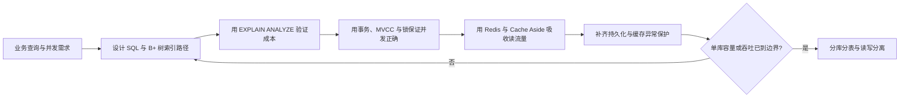

# 数据库与存储：本章总结与复习

> [!abstract] 一句话总结
> 数据库与存储的主线是先用索引和执行计划控制访问成本，用事务、MVCC 与锁保证并发正确，再用 Redis 和缓存保护吸收读流量，只有单库优化确实到达边界后才进入分库分表与读写分离。

## 核心知识概览

| 模块 | 核心问题 | 关键结论 | 对应笔记 |
| --- | --- | --- | --- |
| MySQL 访问路径 | 数据如何组织，SQL 为什么快或慢 | InnoDB 聚簇索引用 B+ 树按主键组织数据；索引设计要围绕真实谓词、排序和返回列，并用执行计划验证 | [[01-MySQL索引原理-B+树]]、[[04-执行计划与SQL优化]] |
| 事务与并发控制 | 并发读写如何兼顾一致性与吞吐 | redo、undo、MVCC 和锁共同实现事务语义；快照读看版本，当前读按实际索引路径加锁 | [[02-事务与隔离级别]]、[[03-MySQL锁机制]] |
| Redis 数据模型 | 如何把业务访问模式映射到低延迟结构 | 按整体读写、局部更新、排序、集合和消息流选择数据结构，同时控制慢命令、大 key、热 key 与 TTL | [[05-Redis数据结构与应用]] |
| 持久化与缓存保护 | Redis 故障或缓存失效时如何控制数据与流量风险 | RDB/AOF 要在丢失窗口、恢复速度和运行成本间取舍；穿透、击穿、雪崩分别治理，并配合一致性补偿、限流和降级 | [[06-Redis持久化-RDB-AOF]]、[[07-缓存穿透-击穿-雪崩]] |
| 水平扩展 | 单库到达容量或吞吐边界后如何扩容 | 分片键决定路由与查询模型，读写分离必须处理复制延迟；扩容还要覆盖全局 ID、迁移、校验、切流和回滚 | [[08-分库分表与读写分离]] |

## 全章主线

## 快速复习

1. InnoDB 聚簇索引的叶子节点保存整行，二级索引叶子保存索引列和主键；非覆盖查询需要回表，联合索引要遵守最左前缀形成的有序性。
2. SQL 优化从真实 SQL、参数、表结构和数据分布开始，重点看 `type`、`key`、`rows`、`filtered`、`Extra` 与实际耗时；优化后还要评估新增索引的写放大和空间成本。
3. 原子性主要依赖 undo，持久性依赖 redo，隔离性依赖 MVCC 与锁；RC 每条语句生成 Read View，RR 通常复用首次一致读的 Read View。
4. 普通 `SELECT` 多为快照读，`UPDATE`、`DELETE`、`SELECT ... FOR UPDATE` 是当前读；InnoDB 锁的是索引记录，锁范围由执行计划、索引类型、命中情况和隔离级别共同决定。
5. Redis 的低延迟来自内存访问、事件循环和紧凑数据结构，但慢命令、大 key、长 Lua 脚本与热 key 会阻塞或压垮单线程执行链路。
6. RDB 是时间点快照，AOF 是命令追加日志；`everysec`、fork、COW、重写和混合持久化分别影响丢失窗口、延迟、内存与恢复时间，必须做真实恢复演练。
7. 穿透是持续查询不存在的数据，击穿是单个热点 key 失效，雪崩是大量 key 同时失效或缓存集群不可用；对应使用参数校验/空值/布隆、互斥重建/逻辑过期、TTL 抖动/多级缓存/限流降级。
8. Cache Aside 常用“读缓存，未命中查 DB 回填；写 DB 后删缓存”，删除失败和并发回填仍需重试或补偿；缓存不能掩盖数据库容量不足。
9. 分库分表前先确认单库优化已经到边界；分片后跨分片 JOIN、聚合、分页和事务都会变贵，读写分离还要为“读己之写”等强一致场景保留走主库能力。

## 自测问题

1. 面对一个带等值过滤、范围条件、排序和分页的列表 SQL，你会如何设计联合索引，并用哪些执行计划字段证明访问路径有效？
2. 为什么 RR 下普通查询可能不阻塞更新，而范围 `SELECT ... FOR UPDATE` 却可能阻塞插入？请结合 Read View、当前读和 next-key lock 解释。
3. 当数据库 QPS 因缓存 miss 突增时，如何区分穿透、击穿和雪崩，并为读路径、缓存重建和写后失效分别设计保护？
4. 哪些证据说明系统确实需要分库分表或读写分离？实施时为什么必须同时设计分片键、全局 ID、一致性读、迁移校验和回滚？

## 下一章衔接

下一章进入 [[../06-中间件/_index|中间件]]：在掌握数据库与缓存的存储边界后，继续学习消息队列、注册配置、API 网关和分布式缓存如何把这些能力组织成可治理的分布式基础设施。

## 相关编号双链

- MySQL 基础与优化：[[01-MySQL索引原理-B+树]] · [[02-事务与隔离级别]] · [[03-MySQL锁机制]] · [[04-执行计划与SQL优化]]
- Redis 与缓存：[[05-Redis数据结构与应用]] · [[06-Redis持久化-RDB-AOF]] · [[07-缓存穿透-击穿-雪崩]]
- 数据扩展：[[08-分库分表与读写分离]]

