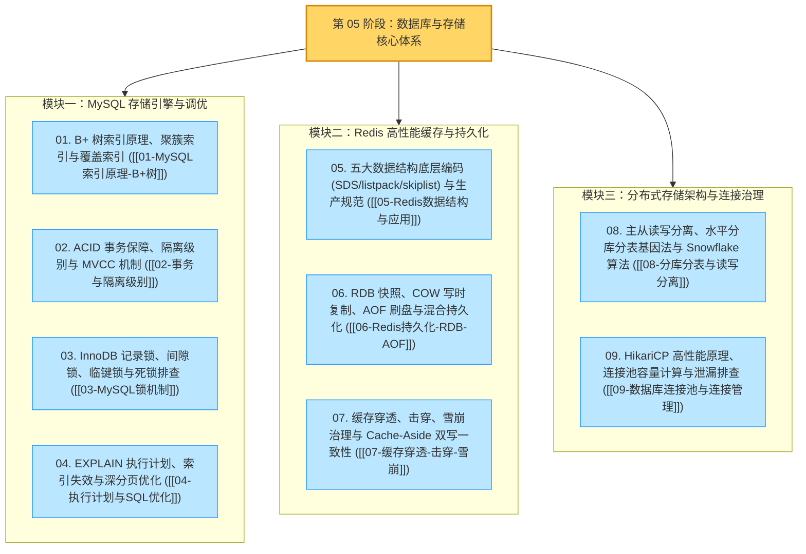

# 🏆 99 · 数据库与存储：全景总结与高频面试复盘

> **一句话导读**：本文系统梳理第 05 阶段（MySQL 核心存储机制、Redis 高性能缓存与持久化、分布式分库分表与数据库连接池管理）的知识体系图谱、核心机制对照表以及 12 道大厂高频深度面试题，帮助你在日常复习与面试冲刺中快速串联前因后果。

---

## 一、数据库与存储核心知识体系图谱

---

## 二、核心组件与底层机制全景对照表

| 核心组件 / 机制 | 解决的业务痛点 | 底层原理与核心工作机制 | 工程实践要点 |
| :--- | :--- | :--- | :--- |
| **B+ 树索引** | 消除全表扫描的磁盘随机 I/O，加速等值与范围检索 | 非叶子节点仅存放索引键值与子页指针（高扇出比使千万级数据树高仅 3~4 层），所有完整行数据或主键值统一存放在叶子节点，且叶子节点之间通过双向链表顺序相连。 | InnoDB 单页默认 $16\text{ KB}$；非叶子节点常驻 Buffer Pool 内存，等值查询通常只需 1~3 次数据页访问，叶子双向链表天然支持高效范围扫描与顺序排序。 |
| **聚簇索引 vs 二级索引** | 区分数据物理存储组织方式与辅助检索路径 | 聚簇索引（主键索引）叶子节点直接存储完整的数据行；二级索引（辅助索引）叶子节点存储“索引列值 + 主键 ID”。 | 通过二级索引查询未包含在索引中的列时，需拿主键 ID 再次到聚簇索引 B+ 树检索完整数据行（即**回表**）。 |
| **覆盖索引与索引下推（ICP）** | 消除或大幅减少二级索引的随机回表开销 | 覆盖索引指查询所需的所有列均可直接从二级索引叶子节点获取，无需回表（`Using index`）；索引下推（ICP）指在存储引擎遍历二级索引时直接过滤索引中包含的查询条件（`Using index condition`）。 | 高频接口应按需取列并建立联合覆盖索引；遵循最左前缀原则，将等值过滤列放在前、范围或排序列放在后。 |
| **MVCC（多版本并发控制）** | 实现读写并发不阻塞，在不加锁的前提下提供一致性快照读 | 依托聚簇索引记录中的隐藏列（`DB_TRX_ID`、`DB_ROLL_PTR`）、Undo Log 历史版本链以及事务的 `ReadView`（一致性读视图）比对可见性。 | RC 隔离级别在每次执行快照读 `SELECT` 时重新生成 `ReadView`；RR 隔离级别仅在事务内首次快照读时生成并一直复用同一 `ReadView`。 |
| **间隙锁与临键锁** | 在 RR 隔离级别下执行当前读时阻止新行插入，防止幻读 | 间隙锁（Gap Lock）锁定两条索引记录之间的开区间 `(a, b)`；临键锁（Next-Key Lock）由“前方间隙锁 + 右边界记录锁”组合成左开右闭区间 `(a, b]`。 | 不同事务持有的纯间隙锁之间互相兼容；但若两个事务同时持有同一区间的间隙锁后又各自尝试向该区间执行 `INSERT`，会因插入意向锁互相等待而触发死锁。 |
| **Redis ZSet（有序集合）** | 兼顾按成员 $O(1)$ 查分值与按分值高效排序及范围检索 | 元素较少且较小时采用连续紧凑内存的 `listpack`（取代旧版 `ziplist` 消除连锁更新）；规模扩大后同时使用 **`hashtable`（字典）+ `skiplist`（跳表）**。 | 字典维护 `Member -> Score` 映射保证 $O(1)$ 单点查分值；跳表通过多层有序双向链表保证 $O(\log N)$ 插入/删除与 $O(\log N + M)$ 范围查询。 |
| **写时复制（Copy-On-Write）** | 在不阻塞 Redis 主线程读写的前提下，生成一致的时间点内存快照 | 执行 `BGSAVE` 或 `BGREWRITEAOF` 时通过 `fork()` 创建独立子进程。父子进程初始共享相同的只读物理页；当父进程修改某页数据时触发缺页中断，由内核按 $4\text{ KB}$ 页复制新副本供父进程写入。 | 线上需关闭操作系统透明大页（THP，防止单次复制放大至 $2\text{ MB}$），并为实例预留 $30\% \sim 50\%$ 空闲内存应对写入高峰。 |
| **布隆过滤器（Bloom Filter）** | 在进入缓存和数据库前，以极小内存开销拦截恶意随机 ID 穿透攻击 | 由长度为 $m$ 的二进制位数组（Bit Array）与 $k$ 个独立哈希函数组成，写入合法主键时将对应的 $k$ 个比特位置为 `1`。 | 只要有任意一位为 `0` 则 **$100\%$ 不存在**；全部 $k$ 位为 `1` 则可能存在（有极小概率哈希碰撞误判，配合缓存空值兜底）；标准实现不支持直接清零删除比特位。 |
| **分片基因法与异构索引** | 解决分库分表后按买家 ID、订单号与卖家 ID 多维度精准查询难题 | 生成 64 位 `order_id` 时，将买家 `user_id` 的二进制低 $k$ 位嵌入 `order_id` 末尾，使 `order_id % 2^k == user_id % 2^k`，落入同一物理分表。 | 基因法实现买家 ID 与订单号的双条件精准直达；卖家维度查询与运营多条件检索则通过订阅 Binlog 异步同步至卖家分片表或 Elasticsearch（CQRS）解决。 |
| **HikariCP 连接池** | 消除每次 SQL 的 TCP 握手与认证开销，并限制进入数据库的最大并发数 | 通过 `FastList`（去除越界检查、尾部逆序关闭 Statement）、`ConcurrentBag`（`ThreadLocal` 本地优先无锁借还 + CAS + 交接队列）及字节码精简实现高吞吐。 | 单台 DB 最佳活跃连接数遵循 $(\text{CPU 核数} \times 2) + \text{有效磁盘数}$；需确保集群所有实例连接池总和小于 DB 的 `max_connections`，并将 `max-lifetime` 设得比 `wait_timeout` 短数分钟。 |

---

## 三、大厂高频深度面试 12 问（标准演进答题模板）

> [!question]- Q1：为什么 MySQL InnoDB 索引选择 B+ 树，而不选择红黑树（平衡二叉树）或 B 树？
> **标准答题逻辑**：
> 数据库索引存储在磁盘上，评价索引结构好坏的核心指标是**磁盘 I/O 次数**与**范围查询效率**：
> 1. **为什么不用红黑树 / 平衡二叉树？** 二叉树每个节点最多只有 2 个分支，在千万级数据量下树高会达到 20 多层。由于每次向下查找子节点都可能触发一次磁盘随机 I/O，几十次磁盘寻道延迟在生产环境中完全无法接受。
> 2. **为什么选择 B+ 树而不是 B 树？**
>    - **单页扇出比极高，树高更矮胖**：InnoDB 单个数据页默认大小为 $16\text{ KB}$。B 树的非叶子节点同时存放索引键和完整行数据，导致单个页能存放的子节点指针很少，树高较高；而 **B+ 树的非叶子节点只存放索引键和页指针（不存行数据）**，单页可容纳上千个指针，只需 3~4 层即可支撑数千万级数据，且非叶子节点可常驻内存，等值检索通常只需 1~3 次数据页访问。
>    - **天然支持高效范围扫描与顺序排序**：B 树做范围查询需要在不同层级的节点之间反复中序回溯遍历；而 **B+ 树所有数据都集中在同一层的叶子节点上，且叶子节点之间通过双向链表按顺序串联**，定位到范围起点后只需顺着双向链表向后顺序读取即可，完美契合 SQL 中高频的 `BETWEEN`、`>`、`ORDER BY` 等操作。

> [!question]- Q2：什么是回表？如何利用覆盖索引和索引下推（ICP）优化 SQL 查询？
> **标准答题逻辑**：
> 1. **回表（Table Lookup）**：InnoDB 的二级索引叶子节点只保存“索引列值 + 主键 ID”。当查询语句需要获取二级索引未包含的其他表字段（例如 `SELECT *`）时，引擎必须先从二级索引查出主键 ID，再拿着主键 ID 回到聚簇索引 B+ 树中检索完整的数据行，这一过程就叫回表。如果二级索引匹配了上万行数据，就会触发上万次离散回表 I/O。
> 2. **覆盖索引（Covering Index）**：如果为高频查询设计的联合索引已经包含了 `SELECT`、`WHERE` 和 `ORDER BY` 所需的全部列，引擎直接读取二级索引叶子节点就能组装完整结果集返回，**彻底省去回表操作**（在 `EXPLAIN` 的 `Extra` 列中显示为 `Using index`）。
> 3. **索引下推（Index Condition Pushdown, ICP）**：当查询无法完全避免回表（如 `SELECT *`），但 `WHERE` 条件中包含了联合索引的后续列（例如联合索引为 `(name, age)`，查询为 `WHERE name LIKE '张%' AND age = 20`）时，MySQL 5.6+ 会在遍历二级索引叶子节点时直接判断 `age = 20` 是否成立，先把不满足条件的记录过滤掉，只对真正满足条件的少数记录执行回表（`Extra` 列显示为 `Using index condition`）。

> [!question]- Q3：请完整阐述 InnoDB MVCC（多版本并发控制）的底层实现原理，以及 RC 与 RR 隔离级别的核心差异？
> **标准答题逻辑**：
> MVCC 用于在 `READ COMMITTED`（RC）和 `REPEATABLE READ`（RR）隔离级别下实现非阻塞的**快照读（普通 `SELECT`）**，其底层由三个核心组件协同完成：
> 1. **聚簇索引记录的隐藏列**：每条聚簇索引记录都包含 `DB_TRX_ID`（最近一次修改该行的事务 ID，6 字节）和 `DB_ROLL_PTR`（回滚指针，7 字节，指向该行上一个历史版本的 Undo Log 记录）。
> 2. **Undo Log 版本链**：每次事务修改记录前，都会把修改前的旧值写入 Undo Log，并通过 `DB_ROLL_PTR` 串联成一条从最新记录指向历史旧版本的单向链表。
> 3. **ReadView（一致性读视图）与可见性判断规则**：
>    - 执行快照读时，InnoDB 读取聚簇索引中最新物理行的 `DB_TRX_ID`，将其与当前 `ReadView` 的四个核心属性（当前事务 ID `creator_trx_id`、生成视图时的活跃未提交事务集合 `m_ids`、最小活跃事务 ID `min_trx_id`、下一个待分配事务 ID `max_trx_id`）进行比对：
>      - 若 `DB_TRX_ID == creator_trx_id`（自己改的）或 `DB_TRX_ID < min_trx_id`（开启视图前早已提交的），该版本直接可见；
>      - 若 `DB_TRX_ID >= max_trx_id`（开启视图后才启动的未来事务）或 `DB_TRX_ID` 在 `m_ids` 列表中（开启视图时尚未提交的活跃事务），则该版本不可见，此时顺着 `DB_ROLL_PTR` 沿着 Undo Log 版本链依次往前找，直到找到第一个满足可见性条件的历史版本返回。
>    - **RC 与 RR 的核心分水岭**：RC 隔离级别在**每次执行快照读 `SELECT` 时都会重新生成一个新的 `ReadView`**，因此能读到其他事务期间新提交的数据；而 RR 隔离级别**只在事务内第一次执行快照读时生成 `ReadView`，后续所有快照读都一直复用这个视图**，从而保证了可重复读。

> [!question]- Q4：InnoDB 的记录锁、间隙锁（Gap Lock）和临键锁（Next-Key Lock）有什么区别？为什么两个事务同时持有相同间隙锁会引发死锁？
> **标准答题逻辑**：
> 1. **三种行锁的定义**：
>    - **记录锁（Record Lock）**：仅锁定单条已存在的索引记录本身（如唯一索引等值查询且命中存在记录时）；
>    - **间隙锁（Gap Lock）**：仅锁定两条相邻索引记录之间的开区间 `(a, b)`，不锁边界记录本身，专门用于阻止其他事务往这个空隙里 `INSERT` 新数据，以防止幻读；
>    - **临键锁（Next-Key Lock）**：由“前方间隙锁 + 右边界记录锁”组合成的**左开右闭区间 `(a, b]`**，是 RR 隔离级别下范围加锁与普通索引加锁的默认基本单位。
> 2. **为什么不同事务可以同时持有同一区间 `(5, 10)` 的间隙锁，却又容易导致死锁？**
>    - 因为间隙里本来就没有数据行，不同事务同时给 `(5, 10)` 加间隙锁的唯一目的都是“防止别人插数据进来”，彼此之间没有冲突，所以**纯间隙锁与间隙锁之间是完全兼容的**；
>    - 但如果事务 A 和事务 B 都先通过查询拿到了 `(5, 10)` 的间隙锁，紧接着事务 A 尝试往 `(5, 10)` 插入一条 `id = 7` 的记录（需申请插入意向锁，被事务 B 的间隙锁阻塞），而事务 B 也尝试往 `(5, 10)` 插入一条 `id = 8` 的记录（被事务 A 的间隙锁阻塞），双方互相等待对方释放间隙锁，就会立刻触发经典的**并发间隙插入死锁**。

> [!question]- Q5：生产环境中导致 MySQL 索引失效的常见原因有哪些？深分页 `LIMIT 1000000, 10` 为什么慢，如何优化？
> **标准答题逻辑**：
> 1. **五大常见索引失效原因**：
>    - **违背最左前缀原则**：查询条件跳过了联合索引的最左列（如索引为 `(a, b, c)`，查询只带 `WHERE b = 1`）；
>    - **在索引列上做函数计算或算术运算**：如 `WHERE DATE(create_time) = '2026-09-01'`，破坏了索引值的原有有序性，应改写为常量范围查询 `create_time >= '2026-09-01 00:00:00' AND create_time < '2026-09-02 00:00:00'`；
>    - **隐式类型转换**：最典型的是把字符串类型的列（`varchar`）直接和数字比较（如 `WHERE phone = 13800138000`），MySQL 会把表里的字符串列全部转为数字再比对，等价于给索引列套了转换函数导致全表扫描；
>    - **前导模糊查询**：`LIKE '%keyword'` 因缺失固定前缀无法在 B+ 树中二分定位；
>    - **区分度过低或匹配行数占比过高**：当优化器评估走二级索引需要回表的行数超过全表约 $20\% \sim 30\%$ 时，会认为顺序扫全表比随机回表更快而放弃走二级索引。
> 2. **深分页慢查询根因与两大优化方案**：
>    - **根因**：执行 `SELECT * FROM orders WHERE status = 1 ORDER BY created_at LIMIT 1000000, 10` 时，即使走了 `(status, created_at)` 二级索引，引擎也需要把前 `1,000,010` 条记录逐一拿到主键去做 **`1,000,010` 次随机回表**，最后再把前 100 万行完整数据丢掉。
>    - **方案一（延迟关联 / 子查询覆盖索引，支持跳页）**：先在子查询中只查主键 `SELECT id FROM orders WHERE status = 1 ORDER BY created_at LIMIT 1000000, 10`（走覆盖索引，0 次回表），拿到目标页的 10 个主键 ID 后，再与原表 `INNER JOIN` 查出完整行，将回表次数从 100 万次直接降为 **10 次**。
>    - **方案二（游标分页 / Seek Method，下拉流式翻页首选）**：带上上一页最后一条记录的排序列与主键值 `WHERE status = 1 AND (created_at > ? OR (created_at = ? AND id > ?)) ORDER BY created_at ASC, id ASC LIMIT 10`，直接在 B+ 树二分定位到上一页末尾顺序向后读 10 行，耗时恒定为毫秒级。

> [!question]- Q6：Redis 的 5 大基础数据结构底层分别采用了什么物理编码？为什么 ZSet 要同时使用哈希表和跳表？
> **标准答题逻辑**：
> 1. **五大基础结构的物理编码演进**：
>    - `String`：整数采用 `int`；小于等于 44 字节的短字符串采用一次内存分配的 `embstr`；长字符串采用 `raw`。底层基于 **SDS（简单动态字符串）**，显式维护 `len` 与 `alloc`，支持 $O(1)$ 获取长度、空间预分配且二进制安全。
>    - `Hash`：元素少且小时采用连续紧凑内存的 **`listpack`**（Redis 7.0 取代了旧版存在连锁更新隐患的 `ziplist`）；规模扩大后转为 **`hashtable`**（支持分摊到日常操作中的渐进式 Rehash）。
>    - `List`：元素少时用单个 **`listpack`**，元素多时转为以 `listpack` 为节点的双向链表 **`quicklist`**。
>    - `Set`：纯整数且数量少时用有序整数数组 **`intset`**，少量短字符串用 **`listpack`**，大规模转为 **`hashtable`**。
>    - `ZSet`：小规模用 **`listpack`**，大规模同时组合使用 **`hashtable` + `skiplist`（跳表）**。
> 2. **为什么 ZSet 要同时组合哈希表和跳表？**
>    - 如果只用跳表，虽然范围检索和按分值排序是 $O(\log N)$，但执行 `ZSCORE key member` 按成员查分值时需要从头遍历，退化为 $O(N)$；
>    - 如果只用哈希表，虽然单点查分值是 $O(1)$，但哈希表无序，无法高效支持按分值范围查询（`ZRANGEBYSCORE`）和排名计算；
>    - 组合使用后，哈希表负责 $O(1)$ 按成员查分值，跳表负责 $O(\log N)$ 排序与 $O(\log N + M)$ 范围查询，且两者通过指针共享底层字符串对象，不重复占用数据内存。

> [!question]- Q7：Redis 处理命令的主线程是单线程的，为什么还能这么快？Redis 6.0 引入的多线程是做什么的？
> **标准答题逻辑**：
> 1. **单线程依然极快的三大原因**：
>    - **纯内存读写**：数据常驻内存，没有磁盘随机寻道 I/O 开销；
>    - **单线程串行执行消除并发损耗**：避免了多线程高频上下文切换，同时操作内部哈希表、跳表时完全不需要加锁，零锁竞争开销；
>    - **I/O 多路复用模型**：基于操作系统内核的 `epoll` / `kqueue` 事件驱动机制，单线程即可同时监听数万个客户端连接上的网络可读/可写事件。
> 2. **Redis 6.0+ 多线程的作用边界**：
>    - 在高并发场景下，从网卡 Socket 读取请求字节流（`read`）、解析命令协议以及将响应结果写回 Socket（`write`）的网络 I/O 过程会消耗大量 CPU 时间；
>    - 因此 Redis 6.0 引入了多线程 I/O，用多个 I/O 线程**并行分担网络数据的收发与协议解析**，而**读写内存数据结构的命令执行本身依然由主线程单线程串行完成**，既突破了网络 I/O 瓶颈，又保持了无锁的单线程安全模型。

> [!question]- Q8：简述 Redis 的 RDB、AOF 与混合持久化机制，并讲清楚 `BGSAVE` 写时复制（COW）的底层原理？
> **标准答题逻辑**：
> 1. **RDB 与 AOF 的对比**：
>    - **RDB** 记录某一时刻全量内存数据的紧凑二进制快照，文件体积小、重启恢复极快，但生成周期较长（通常数分钟一次），宕机时会丢失最后一次快照后的增量数据；
>    - **AOF** 追加记录每一条修改内存的写命令，配合生产默认的 `appendfsync everysec`（由后台线程 `bio_aof_fsync` 每秒调用一次 `fsync` 刷盘），可将常规故障的数据丢失窗口控制在 1 秒左右，但文件体积大、纯命令重放恢复慢。
> 2. **混合持久化（Redis 4.0+ / 7.0+ Multi-Part AOF）**：
>    - 结合两者优势，在触发 `BGREWRITEAOF` 重写时，子进程先将当前全量内存以 **RDB 二进制格式**写成基线，后续新增写命令继续以 **AOF 文本格式**追加在尾部。
>    - Redis 7.0 进一步升级为 **Multi-Part AOF**，将 AOF 拆分为 **Base 基线文件（`.rdb`）+ Incr 增量文件（`.incr.aof`）+ Manifest 清单文件**。触发重写时主进程直接打开一个新的 `.incr.aof` 顺序写入，彻底消除了旧版 `aof_rewrite_buf` 重写缓冲区的内存双写与文件尾部合并阻塞。
> 3. **写时复制（Copy-On-Write, COW）原理**：
>    - `BGSAVE` 通过 `fork()` 创建独立子进程。`fork()` 瞬间内核仅复制父进程的虚拟页表，父子进程共享相同的物理内存页并统一标记为**只读**；
>    - 快照期间，若父进程收到写命令修改某个 Key，会触发 CPU **缺页异常中断（Page Fault）**，操作系统内核立即为该页分配一个新的 $4\text{ KB}$ 物理页副本供父进程修改，而子进程页表仍指向原物理页读取历史数据写入 RDB。线上需关闭透明大页（THP）并预留 $30\% \sim 50\%$ 空闲内存。

> [!question]- Q9：高并发下如何区分并治理缓存穿透、缓存击穿和缓存雪崩？
> **标准答题逻辑**：
> 1. **缓存穿透（查询在缓存与数据库中都根本不存在的数据）**：
>    - **现象**：恶意请求或非法参数导致每次查缓存都未命中，请求持续直穿数据库。
>    - **解法**：① 接口层严格校验参数合法性；② 对数据库查空的 ID 写入**短 TTL（如 30~60 秒）的空值占位符（Cache Null）**；③ 在查询 Redis 前部署**布隆过滤器（Bloom Filter）**，拦截所有必定不存在的随机 ID。
> 2. **缓存击穿（单个超高并发访问的热点 Key 突然到期失效）**：
>    - **现象**：热点 Key 过期的瞬间，成千上万个并发请求同时未命中缓存，一起冲进数据库查同一条数据。
>    - **解法**：① **分布式互斥锁（Mutex Lock + Double Check）**，如使用 Redisson `RLock`（基于 Pub/Sub + 本地 Semaphore 队列）或 JVM 进程内 `CompletableFuture` 单飞合并，只让唯一抢到锁的线程查库重建缓存，其余线程等待复用结果；② **逻辑过期（Logical Expiration）**，热点 Key 物理不设短 TTL，在 JSON 内部封装逻辑到期时间戳，发现过期时异步单飞刷新缓存，当前读请求立即返回旧值实现零阻塞。
> 3. **缓存雪崩（大批量 Key 在同一时刻集中过期，或 Redis 集群宕机）**：
>    - **现象**：全站大批不同 Key 同时失效或缓存层不可用，海量读流量全部压向数据库。
>    - **解法**：① 批量设置过期时间时在基础 TTL 上附加**随机扰动值（Jitter）**打散过期时刻；② 部署 Redis Sentinel / Cluster 高可用集群，并配合应用层 `Caffeine` 构建**进程内本地二级缓存**（详见 [[../06-中间件/02-多级缓存架构实战|02 · 多级缓存架构实战]]）；③ 在数据库回源入口配置**限流与降级兜底策略**。

> [!question]- Q10：在缓存与数据库双写场景中，为什么标准实践是“先更新数据库，再删除缓存”（Cache-Aside）？
> **标准答题逻辑**：
> 1. **为什么选择“删除缓存”而不是“更新缓存”？**
>    - 并发写场景下若两个线程先后更新数据库，可能因网络延迟出现“先改数据库的线程后更新缓存”，把缓存覆盖成错误的旧值；此外，对于拼装成本高的缓存，直接删除、等真正有读请求时再按需加载（Lazy Loading）可避免无效计算。
> 2. **为什么不能“先删缓存，再更新数据库”？**
>    - 如果写线程 A 先删了缓存，在它完成数据库更新提交之前的几十毫秒窗口内，一旦有并发读线程 B 进来发现缓存为空，就会从数据库读出尚未修改的旧值并重新写回 Redis；随后写线程 A 提交数据库，导致 Redis 中长期驻留脏旧数据。
> 3. **“先更新数据库并提交事务，再删除缓存”的工程闭环**：
>    - 确保在数据库事务 `COMMIT` 完成后（如通过 `afterCommit` 回调）再执行删除缓存；
>    - 为防止删缓存那一步因网络抖动失败，可通过可靠 MQ 重试，或使用 **Canal / Debezium 订阅 MySQL Binlog** 异步统一删除缓存，并配合缓存物理 TTL 兜底，保障最终一致性。

> [!question]- Q11：在电商订单水平分库分表时，如果按买家 `user_id` 分片，如何同时支持按订单号 `order_id` 和按卖家 `seller_id` 高效查询？如何平滑扩容？
> **标准答题逻辑**：
> 1. **买家 `user_id` 与订单号 `order_id` 双维精准路由 — 基因法（Gene Embedding）**：
>    - 假设订单表按 `user_id` 对 $64$（$2^6$）取模分为 64 张表。由于一个整数对 $2^6$ 取模的结果完全取决于其二进制的**最低 6 个比特位**，因此在买家下单生成 64 位全局唯一 `order_id` 时，直接把该买家 `user_id` 的二进制最后 6 位复制嵌入到 `order_id` 的最低 6 位中；
>    - 这样生成的 `order_id` 满足 `order_id % 64 == user_id % 64`，单凭 `order_id` 无需查任何映射表就能 $100\%$ 精准定位到目标分表，彻底消除 64 张表广播查询。
> 2. **卖家 `seller_id` 与多条件组合检索 — Binlog CDC 异构索引（CQRS）**：
>    - 通过 Canal / Debezium 实时监听买家订单分片库的 Binlog，经 MQ 异步同步写入一套**按 `seller_id` 分片的卖家维度订单表**（供商家后台精准查询），同时同步至 **Elasticsearch 订单宽表**（供运营与客服进行多条件模糊组合检索）。
> 3. **在线平滑扩容方案**：
>    - 初期采用“表多库少”预留充足逻辑分片（如 4 库 64 表），机器翻倍扩容时只需通过主从复制整表平移并切流，无需修改取模规则；
>    - 若需改变分片总数，则遵循**“全量历史快照搬迁 + Binlog 增量实时追平 + 双轨数据一致性校验 + 秒级灰度切流”**四步法无损迁移。

> [!question]- Q12：为什么 HikariCP 连接池性能极高？数据库连接池的大小究竟该如何科学计算，如何排查连接泄漏？
> **标准答题逻辑**：
> 1. **HikariCP 高性能的三大核心设计**：
>    - **自定义 `FastList` 替代 `ArrayList`**：去除了每次 `get()` 的越界检查，并将关闭 `Statement` 时的 `remove()` 改为**从列表尾部向头部逆序扫描**，契合 JDBC“先开后关”顺序；
>    - **自定义无锁集合 `ConcurrentBag`**：借连接时优先从当前线程的 **`ThreadLocal` 本地列表**无锁获取刚归还的连接；未命中再通过 CAS 扫描全局共享列表（Work-Stealing），最后通过 `SynchronousQueue` 直接交接；
>    - **字节码级精简**：利用 Javassist 生成极简代理类，将热点方法字节码控制在 35 字节以内，触发 JVM JIT 方法内联。
> 2. **连接池容量计算与核心参数**：
>    - 连接池并非越大越好，过大只会导致数据库 CPU 陷入高频上下文切换与锁争抢。单台数据库最佳活跃连接数基准公式为：$\text{最佳连接数} \approx (\text{CPU 核数} \times 2) + \text{有效磁盘数}$（如 16 核服务器约为 32~40）；
>    - 微服务多实例部署时，必须保证 $\sum (\text{实例数} \times \text{单实例 maximum-pool-size}) < \text{数据库 max\_connections}$；同时将 `max-lifetime` 设得比 MySQL 的 `wait_timeout` 短 2~5 分钟，防止借出已被服务端单方面掐断的死连接。
> 3. **连接泄漏原因与排查**：
>    - 最常见诱因是在 `@Transactional` 大事务中夹杂了耗时的远程 RPC / HTTP 调用，导致连接在远程调用期间一直被占着无法归还；
>    - 排查时只需开启 `leak-detection-threshold: 3000`（如 3 秒），HikariCP 就会在日志中直接打印出借出该连接超时未还的完整业务代码行号堆栈，将远程调用移出事务即可根治。

---

## 四、生产环境存储架构十条核心军规

1. **【按需取列与覆盖索引】**：高频查询接口严禁无脑写 `SELECT *`，只取必要字段，并建立联合覆盖索引消除回表开销。
2. **【剥离长事务外部调用】**：数据库行锁、MDL 锁与物理连接均持有至事务结束，严禁在 `@Transactional` 事务内夹杂远程 RPC、HTTP 调用或慢 I/O 操作。
3. **【上线必审执行计划】**：所有核心 SQL 上线前必须经过 `EXPLAIN` 检验，确认 `type` 达到 `range` / `ref` / `eq_ref` 级别，杜绝隐式类型转换与索引列函数计算。
4. **【深分页改造】**：大偏移量分页（如 `LIMIT 100000, 10`）必须采用“子查询覆盖索引延迟关联”或“基于 `(排序列, 唯一ID)` 的游标连续翻页”改造。
5. **【Redis 禁用阻塞指令】**：线上严禁执行 `KEYS *`、`FLUSHALL` 或对大集合直接执行 `HGETALL` / `SMEMBERS`；遍历统一用 `SCAN`，删除大 Key 统一用 `UNLINK` 异步回收。
6. **【COW 内存余量与关闭 THP】**：部署 Redis 的服务器必须关闭透明大页（THP），并为实例预留 $30\% \sim 50\%$ 空闲物理内存，防止 `BGSAVE` / `AOF Rewrite` 期间写时复制引发 OOM。
7. **【构建缓存立体防线】**：批量缓存 TTL 必须附加随机扰动值打散；高频热点 Key 需配置互斥锁重建或逻辑过期；数据库回源入口必须配置限流降级兜底。
8. **【连接池全局预算管控】**：单实例 `maximum-pool-size` 通常控制在 10~30 之间，所有微服务实例连接池上限总和不得超出数据库 `max_connections`；`max-lifetime` 必须短于数据库的 `wait_timeout`。
9. **【主从延迟敏感路由】**：读写分离架构下，对“写后即读”和强一致敏感的请求，必须通过主库 Hint 路由、Redis 短期写后标记或等待 GTID 位点避免读到从库旧数据。
10. **【克制分库分表与基因路由】**：优先通过索引优化、多级缓存与冷热归档解决单表瓶颈；确需水平分库分表时，用基因法解决买主/订单号双维路由，用 Binlog 异构同步（ES / 卖家表）解决多维检索。

---

## 🧭 下一阶段预告

攻克了关系型数据库与高性能缓存底座后，在分布式微服务架构中，如何构建抗住百万 QPS 的多级缓存架构？如何利用消息队列实现跨服务的异步解耦、突发流量削峰填谷以及分布式事务最终一致性？
请进入第 06 阶段（中间件核心原理与实战）：[[../06-中间件/00-中间件全景与心智模型|00 · 中间件全景与心智模型]]、[[../06-中间件/01-消息队列基础与核心问题处理|01 · 消息队列基础与核心问题处理]]、[[../06-中间件/02-多级缓存架构实战|02 · 多级缓存架构实战]]！
