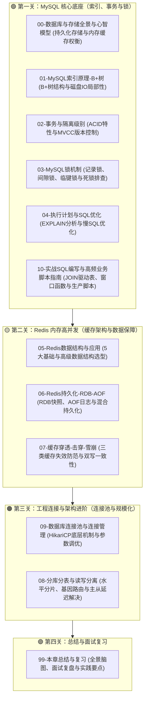

# 🗄️ 05 · 数据库与存储（学习指南与知识地图）

> **一句话导读**：围绕后端核心数据存储体系，系统梳理 MySQL 索引结构、事务隔离、行锁机制与 SQL 优化，以及 Redis 高并发数据结构、持久化策略、缓存高可用防护，最后延伸至数据库连接池管理与分库分表架构演进。

---

## 🗺️ 四部分学习导航

---

## 📚 知识清单与核心问题

### 📋 关卡打卡清单
- [ ] [[00-数据库与存储全景与心智模型]] — 双层存储架构权衡与心智模型
- [ ] [[01-MySQL索引原理-B+树]] — B+树结构与磁盘 IO 局部性
- [ ] [[02-事务与隔离级别]] — ACID 特性与 MVCC 多版本控制
- [ ] [[03-MySQL锁机制]] — 记录锁、间隙锁、临键锁与死锁排查
- [ ] [[04-执行计划与SQL优化]] — EXPLAIN 分析与慢 SQL 调优
- [ ] [[10-实战SQL编写与高频业务脚本指南]] — CRUD规范、各种JOIN关联、ON vs WHERE、窗口函数与工业级脚本
- [ ] [[05-Redis数据结构与应用]] — 5 大基础与高级数据结构选型
- [ ] [[06-Redis持久化-RDB-AOF]] — RDB 快照、AOF 日志与混合持久化
- [ ] [[07-缓存穿透-击穿-雪崩]] — 三类缓存失效防范与双写一致性
- [ ] [[09-数据库连接池与连接管理]] — HikariCP 底层机制与参数调优
- [ ] [[08-分库分表与读写分离]] — 水平分片、基因路由与主从延迟解决
- [ ] [[99-本章总结与复习]] — 全景脑图、面试复盘与实践要点

### 📊 核心技术机制与面试速查

| 关卡编号 | 文档名称 | 核心技术机制与关键要点 | 需要掌握的面试问题 |
| :---: | :--- | :--- | :--- |
| **00** | [[00-数据库与存储全景与心智模型]] | **双层存储架构权衡** | 为什么后端架构普遍采用 MySQL + Redis 组合？两者各自解决什么核心问题？ |
| **01** | [[01-MySQL索引原理-B+树]] | **B+树与索引检索机制** | 为什么选 B+ 树而不是 B 树或红黑树？什么是回表与覆盖索引？最左前缀匹配底层原理？ |
| **02** | [[02-事务与隔离级别]] | **ACID 特性与 MVCC 机制** | Redo Log 与 Binlog 两阶段提交怎么协同？MVCC 与 ReadView 怎么判断可见性？RC 与 RR 的本质区别？ |
| **03** | [[03-MySQL锁机制]] | **行锁算法与死锁防范** | 记录锁、间隙锁、临键锁的区别是什么？无索引更新为何会锁全表？死锁如何排查与防范？ |
| **04** | [[04-执行计划与SQL优化]] | **EXPLAIN 分析与索引调优** | EXPLAIN 核心字段怎么看？常见索引失效的底层原因是什么？千万级深分页如何优化？ |
| **10** | [[10-实战SQL编写与高频业务脚本指南]] | **执行链路、DDL/DML规范与核心查询技巧** | 一条 SQL 的执行全链路（SELECT/UPDATE 2PC）？各种 JOIN 区别与 ON/WHERE 过滤时机差异？小表驱动大表物理推导？如何用延迟关联优化深分页？ |
| **05** | [[05-Redis数据结构与应用]] | **核心数据结构与业务选型** | 5 大基础结构底层编码与适用场景是什么？为什么禁用 KEYS *？如何排查与治理 BigKey？ |
| **06** | [[06-Redis持久化-RDB-AOF]] | **持久化可靠性与重写机制** | RDB 写时复制（COW）原理是什么？AOF 重写如何运作？混合持久化如何兼顾恢复速度与数据安全？ |
| **07** | [[07-缓存穿透-击穿-雪崩]] | **高并发缓存保护与双写一致** | 穿透、击穿、雪崩的成因与防护方案分别是什么？Cache-Aside 模式下如何保障数据库与缓存双写一致性？ |
| **09** | [[09-数据库连接池与连接管理]] | **连接池原理与泄漏检测** | 为什么连接池大小不是越大越好？如何确定合理的连接池容量？线上连接泄漏如何定位？ |
| **08** | [[08-分库分表与读写分离]] | **分库分表与多维度查询** | 单表什么情况下需要分库分表？如何用基因法与异构索引解决非分片键查询？主从复制延迟怎么应对？ |
| **99** | [[99-本章总结与复习]] | **全景复盘与总结** | 数据库与存储全景脑图、高频面试题与工程实践要点。 |

---

## 🔗 进阶知识串联

- [[../03-并发编程/00-并发编程心智模型与学习路线|03-并发编程]]（与数据库行锁、Redis 线程模型的理论交汇）
- [[../04-Spring生态/03-Spring事务管理|04-Spring事务管理]]（Spring 声明式事务与 MySQL 本地事务的结合）
- [[../10-知识串联与专题/04-从Spring事务到分布式一致性|10-知识串联：从Spring事务到分布式一致性]]

---

## 🧭 返回

[[../00-总览/学习仪表盘|Java 学习仪表盘]]
