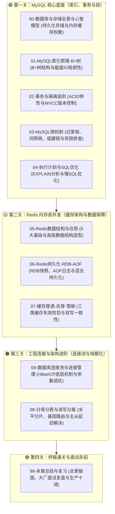

# 🗄️ 05 · 数据库与存储（通关指南与知识地图）

> **一句话导读**：业务代码写得再华丽，数据库挂了系统瞬间归零。本章带你从单机 MySQL 索引底层与锁，到 Redis 内存闪电战，再到分库分表与连接池调优，全面构建千万级高并发数据存储的硬核护城河。

---

## 🗺️ 四大通关关卡导航

---

## 📚 关卡知识清单与核心灵魂拷问

| 关卡编号 | 文档名称 | 核心技术机制与关键要点 | 读完能秒杀的大厂面试题 |
| :---: | :--- | :--- | :--- |
| **00** | [[00-数据库与存储全景与心智模型]] | **双层存储架构权衡** | 为什么单靠 MySQL 或单靠 Redis 都无法构建现代大型系统？ |
| **01** | [[01-MySQL索引原理-B+树]] | **B+树与索引检索机制** | 为什么选 B+ 树而不是 B 树或红黑树？什么是回表与覆盖索引？最左匹配底层原理？ |
| **02** | [[02-事务与隔离级别]] | **ACID 特性与 MVCC 机制** | MVCC 怎么实现的？ReadView 怎么判断可见性？RC 与 RR 生成 ReadView 的区别？ |
| **03** | [[03-MySQL锁机制]] | **行锁算法与死锁防范** | 记录锁、间隙锁、临键锁的区别是什么？怎么防范死锁？没索引为何会导致全表锁？ |
| **04** | [[04-执行计划与SQL优化]] | **EXPLAIN 分析与索引调优** | EXPLAIN 核心字段怎么看？type 性能天梯怎么排？索引失效场景与深分页调优？ |
| **05** | [[05-Redis数据结构与应用]] | **核心数据结构与业务选型** | 5 大基础结构分别适用什么业务？为什么不用 KEYS *？怎么治理 BigKey？ |
| **06** | [[06-Redis持久化-RDB-AOF]] | **持久化可靠性与重写机制** | 什么是写时复制（COW）？AOF 怎么重写？混合持久化为什么能兼顾秒开与不丢数据？ |
| **07** | [[07-缓存穿透-击穿-雪崩]] | **高并发缓存保护与双写一致** | 穿透、击穿、雪崩区别是什么？布隆过滤器数学原理？双写一致性先改库还是先删缓存？ |
| **09** | [[09-数据库连接池与连接管理]] | **连接池原理与泄漏检测** | 连接池为什么不是越大越好？HikariCP 黄金连接数公式是什么？怎么抓连接泄漏？ |
| **08** | [[08-分库分表与读写分离]] | **分库分表与多维度查询** | 什么时候分库分表？买家卖家双向查询如何用基因法解决？主从延迟读己之写怎么破？ |
| **99** | [[99-本章总结与复习]] | **全景复盘与总结** | 数据库与存储全景脑图、大厂高频面试题速查卡、生产调优十诫。 |

---

## 🔗 进阶知识串联

- [[../03-并发编程/00-并发编程心智模型与学习路线|03-并发编程]]（与数据库行锁、Redis 线程模型的理论交汇）
- [[../04-Spring生态/03-Spring事务管理|04-Spring事务管理]]（Spring 声明式事务与 MySQL 本地事务的结合）
- [[../10-知识串联与专题/04-从Spring事务到分布式一致性|10-知识串联：从Spring事务到分布式一致性]]

---

## 🧭 返回

[[../00-总览/学习仪表盘|Java 学习仪表盘]]
