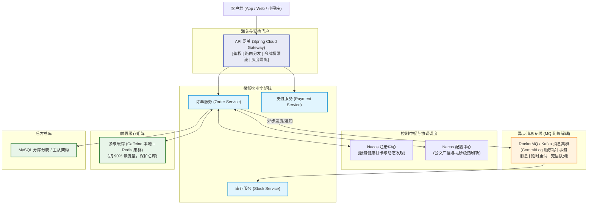
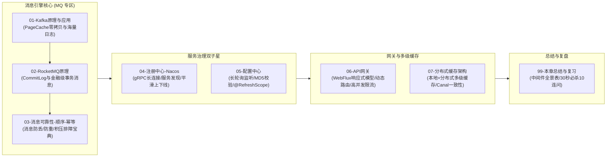

# 中间件全景与心智模型

> [!abstract] 一句话心智模型
> 如果把你的单体 Java 应用拆分为成百上千个微服务，相当于把原本**一家自给自足的小作坊，扩建成了跨国分布式商贸物流生态圈**：
> - **消息队列（MQ: Kafka / RocketMQ）** 是**跨国自动化专线物流网与集装箱中转港**，负责**削峰填谷、异步解耦、最终一致**。下游消费慢不要紧，货物先整齐码在港口（CommitLog），谁有空谁来提货；
> - **注册中心（Nacos Discovery）** 是**全国商户动态工商黄页与总机**，上万家商铺（服务实例）开业、关店、搬家，一律自动打卡登记，客户查黄页即可拨通直连电话；
> - **配置中心（Nacos Config）** 是**集团中央广播电视台与政令传达系统**，一条策略变更，全系统上千个节点瞬间无感热更新，无需停机重新盖章发文；
> - **API 网关（Gateway）** 是**整个生态圈的海关关卡与智能安检门**，负责统一验票鉴权、流量整形限流、黑白名单拦截与精准分流；
> - **分布式缓存与多级缓存** 是**社区前置专柜与前置仓**，热销爆品放在离用户最近的货架上，绝不轻易去打扰大后方的中央数据库总库。

---

## 🎯 为什么需要中间件？单体走向分布式的阵痛与破局

在单体应用时代，所有模块跑在同一个 JVM 进程中：
- 模块之间通信靠**方法调用**（零延迟，内存指针直达）；
- 事务保证靠**本地数据库事务 ACID**（原子性一行代码搞定）；
- 配置变更靠**修改本地配置文件后重启**。

一旦业务爆发进入微服务时代，进程被彻底撕裂在成百上千台不同机器上：
1. **网络不可靠**：RPC 远程调用随时可能发生网络抖动、超时、丢包；
2. **流量洪峰冲击**：秒杀大促瞬间涌入几十万并发，若直接打到下单、履约、扣库存服务，系统瞬间雪崩；
3. **依赖强耦合**：下单成功后要发短信、加积分、通知仓储、推送大数据，若全部同步调用，耗时将从 20ms 飙升到 2 秒，任何一个下游接口故障都会导致下单失败！

**中间件（Middleware）的终极使命**：作为胶水层与缓冲垫，**为分布式系统的通信、路由、调度、削峰、缓存提供高可用与高吞吐的基础设施**！

---

## 🗺️ 中间件全家桶核心定位与选型对照

| 中间件角色 | 工业现实比喻 | 核心技术代表 | 第一性原理解决的根本痛点 |
| :--- | :--- | :--- | :--- |
| **消息队列 (MQ)** | **跨国自动化专线物流枢纽** | **Kafka** (海量吞吐、大数据日志) **RocketMQ** (金融级业务、事务/延时消息) | **削峰填谷**（万级 QPS 缓冲）、**异步解耦**（核心下单链路与非核心链路剥离）、**最终一致性**（跨微服务分布式事务方案）。 |
| **注册中心** | **全国商户动态工商黄页** | **Nacos** (阿里系主流，AP/CP动态可切) **Consul / Eureka** | 解决服务实例动态伸缩（扩缩容、重启、容器漂移）时，**调用方如何快速、准确获得下游可用 IP 端口列表**，配合负载均衡（LoadBalancer）。 |
| **配置中心** | **集团中央广播电视台** | **Nacos Config** **Apollo** (携程开源顶级配置平台) | 解决分布式集群中配置碎片化、修改需要重新打包发布的低效痛点，实现**配置集中管控、版本比对、秒级推送到端、动态热刷新**。 |
| **API 网关** | **生态园区智能化海关关卡** | **Spring Cloud Gateway** (响应式 WebFlux) **Higress / Apache APISIX** | **统一南向流量入口**。实现鉴权 Token 校验、统一跨域、动态路由、请求改写、Sentinel / Redis 令牌桶限流、熔断降级。 |
| **分布式缓存** | **前置专柜与现货小仓** | **Redis** (单线程 I/O 多路复用) **Caffeine** (极速本地缓存) | 弥补关系型数据库磁盘 I/O 慢的物理瓶颈，通过内存高并发读写承载 90% 以上的热点读取流量。 |

---

## 🚀 本章学习拓扑与精通路线

### 🧭 章节通关指南
1. **消息队列三大关卡**：
   - 研读 [[01-Kafka原理与应用]]：搞懂 Kafka 为什么单机能抗每秒数十万写请求（PageCache 顺序写、`sendfile` 零拷贝网络传输、分区分批累积）。
   - 研读 [[02-RocketMQ原理]]：掌握阿里双十一核心基石——CommitLog 与 ConsumeQueue 的物理存储分离、二阶段事务消息底层原理。
   - 通关 [[03-消息可靠性-顺序-幂等]]：这是大厂面试与工业实战中最常被拷问的实战篇（**如何确保一条消息绝不丢失？如何通过业务唯一键设计幂等？遇到几千万消息线上严重积压，如何紧急自救？**）。
2. **微服务调度枢纽**：
   - 研读 [[04-注册中心-Nacos]]：弄懂 Nacos 2.x gRPC 双向流长连接心跳，理解 AP 模式（Distro）与 CP 模式（Raft）的切换权衡，掌握微服务平滑无损上下线。
   - 研读 [[05-配置中心]]：剖析配置中心长轮询监听机制，理解 Spring 的 `@RefreshScope` 是如何实现不重启热更新 Bean 的。
3. **安全入口与高性能护城河**：
   - 研读 [[06-API网关]]：理解基于 Reactor/Netty 的非阻塞网关模型，掌握断言、全局过滤器与令牌桶限流算法。
   - 研读 [[07-分布式缓存架构]]：从单级 Redis 跨越到“Caffeine 本地缓存 + Redis 分布式缓存 + Canal 监听 MySQL Binlog 异步同步”的超高并发企业级架构。
   - 通关 [[99-本章总结与复习]]：全模块复盘脑图与大厂 30 秒必杀 10 连问。
