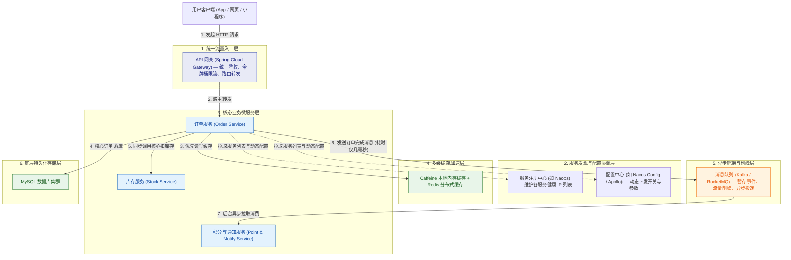

# 00 · 中间件全景与心智模型

> **核心结论**：中间件（Middleware）不是业务代码本身，而是位于操作系统/数据库与上层业务应用之间的**通用基础设施组件**。当系统从“单机单体应用”演进到“多机分布式系统”时，原本在进程内部轻松解决的方法调用、流量控制和配置读取都会变成跨网络难题，中间件正是为了标准化解决这些共性难题而诞生的。

---

## 一、 为什么需要中间件？从单体应用到分布式系统的演进痛点

在单体应用（Monolith）阶段，订单、库存、支付、积分所有模块的代码都打包在同一个 `.jar` 包里，运行在同一个 JVM 进程中，连接同一个 MySQL 数据库：
1. **模块通信极简单**：订单模块调库存模块，直接执行一行 Java 方法调用 `stockService.deduct()`，耗时不到 1 微秒，不存在网络丢包。
2. **数据一致性极简单**：在方法上加一个 `@Transactional`，借助 MySQL 本地事务就能保证订单、库存、积分同时成功或同时回滚。
3. **改配置极简单**：改一下本地的 `application.yml` 文件，重启这一个进程即可。

但是，当业务流量增长、团队规模扩大，系统被拆分为几十个独立部署的微服务（订单服务、库存服务、支付服务、通知服务，每个服务部署 10 台机器）后，原本简单的事情立刻面临**四大跨网络痛点**：

| 序号 | 分布式场景下的真实痛点 | 如果没有中间件会怎样？ | 对应的中间件解决方案 |
| :--- | :--- | :--- | :--- |
| **痛点 1** | **同步调用链太长 & 突发流量扛不住** 用户下完单后，还要发短信、加积分、推报表；大促第 1 秒涌入 10 万个下单请求。 | 订单服务挨个同步调用短信、积分、报表接口，总耗时累加到几秒；一旦短信服务卡死，下单也跟着报错；10 万请求直接打进数据库，MySQL 瞬间连接耗尽崩溃。 | **消息队列（Message Queue）** 先把消息暂存到队列中立即返回成功，后台按数据库能承受的速度慢慢消费（**异步、解耦、削峰**）。 |
| **痛点 2** | **服务机器 IP 动态变化，怎么互相找到对方？** 库存服务有 10 台机器，随时可能扩容加机器或宕机重启换 IP。 | 订单服务在配置文件里写死库存服务的 10 个 IP 地址，一旦某台库存机器挂了或换了 IP，必须手动改配置并重启所有订单服务。 | **服务注册中心（Service Registry）** 所有服务启动时自动去注册中心登记 IP，下线时自动摘除；调用方实时订阅健康机器列表。 |
| **痛点 3** | **几十台机器怎么统一改配置？** 线上需要紧急调整风控阈值或关闭某个降级开关。 | 运维人员挨个 SSH 登录 50 台服务器修改配置文件并逐台重启，耗时长达半小时，故障早已扩大。 | **分布式配置中心（Config Center）** 在管理后台修改一次配置并发布，所有机器在 1 秒内自动感知并热刷新内存中的变量，无需重启。 |
| **痛点 4** | **外部请求怎么统一鉴权、路由和限流？** App 端需要调用后端的几十个微服务接口。 | 客户端直接记住几十个微服务的地址；每个微服务各自重复写一套登录 Token 校验、跨域配置和防刷限流代码。 | **API 网关（API Gateway）** 作为全站唯一的流量入口，统一完成登录认证、接口限流、路由转发与访问日志记录。 |

---

## 二、 一次真实请求在中间件体系中的完整流转图

通过下面这张图，可以直观看到一个用户请求进入后端系统时，各个中间件是在哪个位置协同工作的：

---

## 三、 五大核心中间件职责与关键关注点对照表

在学习和使用任何一种中间件时，都不需要先陷入源码细节，而是先抓住它的**核心职责**与**最容易出问题的工程关注点**：

| 中间件类型 | 核心职责（它帮我们干什么） | 最核心的工程问题（用它时必须考虑什么） | 主流技术代表 |
| :--- | :--- | :--- | :--- |
| **消息队列 (MQ)** | 把“同步直接调用”变成“发消息异步处理”，实现**异步提速、服务解耦、流量削峰**。 | 1. 消息怎么保证不丢？ 2. 消息重复投递了怎么保证业务不重复执行（幂等）？ 3. 消息顺序怎么保证？ 4. 消息积压了几千万条怎么处理？ | Kafka、RocketMQ、RabbitMQ |
| **多级缓存** | 在数据库前面挡一层“进程内本地缓存 + Redis 分布式缓存”，扛住高并发读请求。 | 本地缓存和 Redis 缓存的数据怎么和 MySQL 保持一致？热点 Key 打穿单台 Redis 怎么防？ | Caffeine + Redis + Canal |
| **服务注册中心** | 充当微服务之间的“动态通讯录”，自动感知服务实例上线与宕机剔除。 | 注意**业务请求不经过注册中心**（客户端拿了 IP 列表后直连调用）；注册中心自身挂了，客户端能不能靠本地缓存继续工作？ | Nacos、Eureka、Consul |
| **分布式配置中心** | 集中管理多环境（开发/测试/生产）配置文件，支持在线修改并秒级推送到各机器。 | 客户端是怎么实时感知服务端配置修改的（长轮询 / gRPC 推送）？Spring 是怎么在不重启的情况下刷新 Bean 里的值的？ | Nacos Config、Apollo |
| **API 网关** | 挡在所有微服务最前面的统一大门，负责路由转发、身份认证、防刷限流与跨域处理。 | 网关需要承载全站所有流量，为什么必须用非阻塞 I/O 模型？怎么用令牌桶算法拦截突发恶意流量？ | Spring Cloud Gateway、Kong、APISIX |

---

## 四、 本章怎么学最轻松高效？

按照符合直觉的认知顺序，建议按以下步骤阅读本章：
1. **第一步（最重要）**：先读 [[01-消息队列基础与核心问题处理]]。不关心 Kafka 还是 RocketMQ 的内部文件格式，先把“消息队列是什么、五大核心问题（防丢、幂等、顺序、积压、延时/事务）怎么解决”彻底搞懂。
2. **第二步**：依次阅读 [[02-多级缓存架构实战]]、[[03-服务注册与配置中心原理]]、[[04-API网关与流量治理]]，掌握缓存、注册配置、网关的通用工作机制。
3. **第三步（按需深潜）**：当你需要了解某款具体中间件是怎么实现的，再去查阅后置的 [[05-Kafka架构原理与实战手册]]、[[06-RocketMQ架构原理与实战手册]] 和 [[07-Nacos架构原理与实战手册]]。

---

## 🔗 下一篇导航
- 接下来，我们直接进入最核心、面试与实战最常考的第一篇：[[01-消息队列基础与核心问题处理]]。
