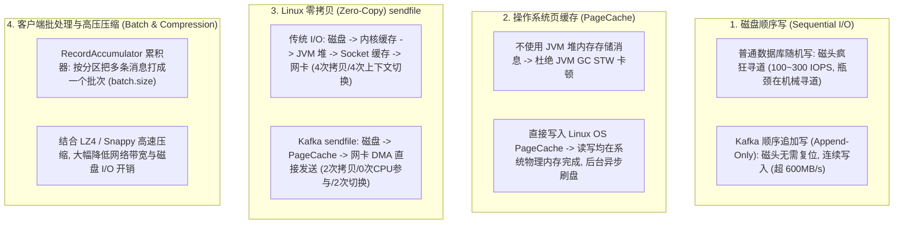
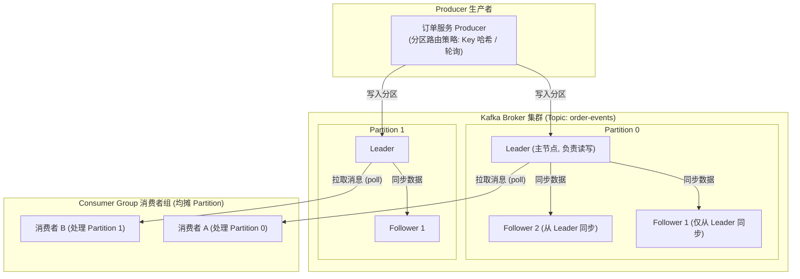
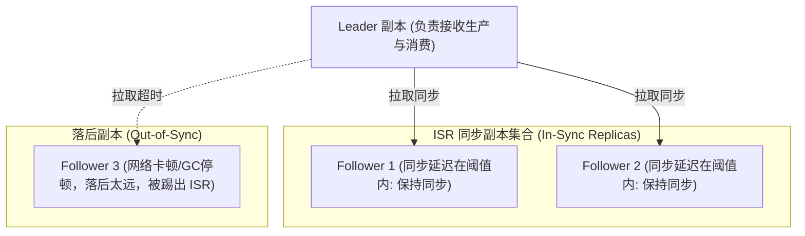
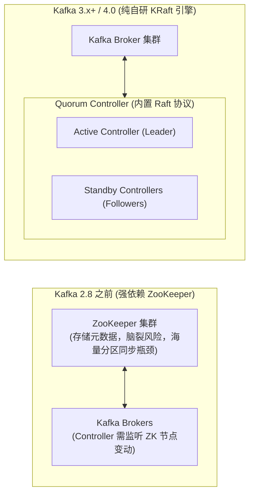

# Kafka 原理与应用

> [!abstract] 一句话心智模型
> 如果把数据流比作物流体系，Kafka 就是**跨国重载铁路运输专线**：
> - **Topic（货运专线目的地）** 拆分成多条并行的**铁轨（Partition 分区）**，每条铁轨上的货车皮只能单向**顺序追加挂载（Append-Only Log）**；
> - 货车皮上的序号就是 **Offset（偏移量）**，消费者拉着自己的小推车按顺序提货，并在货运清单上签字（提交位点）；
> - **为什么 Kafka 能够单机抗数十万吞吐？** 靠的是**磁盘顺序写（堪比内存）**、**充分利用操作系统 PageCache（不占 JVM 堆，零 GC 负担）**、**Linux `sendfile` 零拷贝（数据直接从内核缓冲区滑向网卡）** 以及 **批量打包压缩（Batching）** 四大底层黑科技！

---

## ⚡ 一、Kafka 极限性能四大底层黑科技（第一性原理）

很多人误以为“写磁盘一定比写内存慢几千倍”，但 Kafka 证明了：**只要姿势正确，磁盘顺序写的吞吐量可以完全碾压网络随机内存访问！**



### 1. 深入零拷贝（Zero-Copy）对比
传统网络 I/O 把磁盘上的文件通过网络发给客户端，需要历经 4 次数据拷贝和 4 次用户态与内核态的上下文切换：
```
传统数据流转路径：
[磁盘文件] --(1.DMA拷贝)--> [操作系统 PageCache] --(2.CPU拷贝)--> [JVM 用户堆内存]
                                                                      │
[网卡设备] <--(4.DMA拷贝)-- [Socket 缓冲区 (内核)] <--(3.CPU拷贝)─────┘
```

**Kafka 借助 Linux `sendfile()` 达成的零拷贝奇迹**：
```
Kafka 零拷贝流转路径：
[磁盘文件] --(1.DMA拷贝)--> [操作系统 PageCache (内核态)]
                                  │
                                  │ (2. 底层仅传递文件描述符指针，无真实数据复制！)
                                  ▼
[网卡硬件] <--(3.DMA拷贝直接把 PageCache 数据推送到网卡)
```
- **核心收益**：**完全消除了 CPU 把数据在用户空间与内核空间来回搬运的开销！** 数据在内核层直通网卡，CPU 占用率无限接近于 0！

---

## 🏗️ 二、Kafka 核心架构与核心术语



### 核心术语剖析：
1. **Topic（主题）与 Partition（分区）**：
   - Topic 是逻辑分类；每个 Topic 被水平切分成若干个 **Partition**。
   - **单分区内绝对有序**：Kafka **只保证单个 Partition 内的消息严格按照 Offset 顺序追加并单调递增**，**不保证跨分区的全局顺序**！
2. **Consumer Group（消费者组）与并发度铁律**：
   - 消费者组实现发布-订阅与点对点模型：**同一条消息只会被组内某一个消费者处理，但会被所有不同组广播消费**。
   - **并发度铁律**：**一个 Partition 在同一时刻只能被同组内的一个 Consumer 消费！**
     - 如果 Topic 有 4 个 Partition，组内有 4 个 Consumer，正好一人分一个，效率最高；
     - 如果组内增加到 6 个 Consumer，**多出的 2 个 Consumer 将完全闲置（摸鱼），无法提升吞吐量**！
     - **扩容结论**：想要提升消费者吞吐量，**必须先增加 Topic 的 Partition 数量，然后才能增加 Consumer 实例数**！

---

## 🛡️ 三、ISR 机制与消息零丢失黄金铁三角

在分布式环境下，如果 Leader 副本所在服务器突然断电宕机，如何保证数据绝对不丢？



### 1. 什么是 ISR（In-Sync Replicas）？
- **AR（Assigned Replicas）**：该分区所有的副本集合。
- **ISR**：与 Leader 副本**保持紧密同步的副本集合**（如果 Follower 超过 `replica.lag.time.max.ms` 阈值未向 Leader 发起同步请求，就会被无情踢出 ISR）。
- **选举军规**：当 Leader 宕机时，**只有身处 ISR 集合内的健康 Follower 才有资格被选为新 Leader**！

### 2. 消息零丢失的“黄金配置组合”（生产必背）
生产环境想要实现金融级“绝不丢失一条消息”，必须同时配置三项铁律：

```properties
# 1. 生产者端：必须等待 ISR 全体成员均写入成功
acks=all  # (或 acks=-1)

# 2. 生产者端：开启重试与幂等
retries=2147483647
enable.idempotence=true

# 3. Broker 端：ISR 集合中最少必须有几个可用副本写入成功才算成功
min.insync.replicas=2

# 4. Broker 端：禁止非 ISR 副本竞选 Leader (宁可拒绝服务，也绝不丢数据)
unclean.leader.election.enable=false

# 5. 消费者端：关闭自动提交，业务成功后再手动提交
enable.auto.commit=false
```

> [!CAUTION] 深度避坑：为什么只设 `acks=all` 依然会丢数据？
> 如果你只配置了 `acks=all`，但没有配置 `min.insync.replicas=2`：
> - 假设此时所有 Follower 全部因为网络抖动被踢出了 ISR，**ISR 里只剩 Leader 自己**！
> - 此时生产者发消息，Leader 自己写完就认为“ISR 全体写完了”，向生产者返回 ACK 成功。
> - 紧接着 Leader 物理机断电宕机，这条消息由于从未同步给任何 Follower，**当场永久丢失**！
> - 因此，**`acks=all` 必须配合 `min.insync.replicas=2`**，保证至少有 2 个副本写入成功才确认，否则抛出异常拒绝写入，坚守数据安全性！

---

## 🌪️ 四、消费组重平衡（Rebalance）与线上避坑

### 1. 什么是 Rebalance？
当某个 Consumer Group 内的分区分配策略发生变动，需要**重新将各个 Partition 分配给组内的各个 Consumer** 的过程，称为 Rebalance。

#### 触发 Rebalance 的三大条件：
1. **组内成员变动**：有新消费者加入、或者某个消费者崩溃下线；
2. **心跳超时**：某个 Consumer 进程被长时间 GC 停顿或假死，未在 `session.timeout.ms` 内发送心跳；
3. **消费严重超时**：Consumer 单次 `poll()` 下来的批量数据量太大，**业务代码执行时间超过了 `max.poll.interval.ms`（默认 5 分钟）**，Broker 认为该 Consumer 已经卡死挂掉，直接将其踢出消费组，引发 Rebalance！

### 2. Rebalance 的可怕危害：STW 停顿与重复消费风暴！
- 在早期的 Eager 协议中，Rebalance 发生时，**整个消费组的所有消费者必须全部暂停消费（STW）**，放弃手中的所有分区，等待协调者重新分配。
- 更可怕的是：因为上一个消费者被误判踢出，其未提交 Offset 的消息会被分配给新消费者，导致**海量消息被重复消费**，加剧系统负载，甚至引发连锁雪崩！

### 3. 如何在生产中杜绝频繁 Rebalance？
1. **合理设置业务处理时间与批次大小**：
   - 将 `max.poll.records` 设小一点（比如默认 500 调低到 100），确保业务能在几秒内处理完毕。
   - 适当增大 `max.poll.interval.ms`（如调为 10 分钟），给长耗时业务留足处理时间。
2. **引入静态成员机制（Static Membership，Kafka 2.3+）**：
   - 为消费者配置唯一的 `group.instance.id=worker-01`。
   - 当 Pod 升级重启时，只要在 `session.timeout.ms` 时间内重启完毕重新连上，Broker 会认为这是同一个静态老员工，**完全不触发任何 Rebalance**！
3. **升级为 Cooperative Sticky 协同粘性分配器**：
   - 渐进式重新分配，只调整需要变动的分区，未受影响的分区继续正常消费，杜绝全组 STW！

---

## 🏛️ 五、架构演进：从 ZooKeeper 到 KRaft（新时代）

在 Kafka 2.8 之前，Kafka 强依赖 Apache ZooKeeper 存储集群元数据（Broker 列表、Topic 分区分布、Controller 选举）。



- **ZooKeeper 的历史痛点**：
  - 双重维护开销与运维复杂度；
  - 集群分区数达到几万时，ZooKeeper 的 Watch 机制和元数据同步成为严重性能瓶颈，Controller 选举往往耗费数分钟，导致服务长时间中断。
- **KRaft 架构的革命性优势**：
  - **彻底移除 ZooKeeper（Kafka 4.0 起正式为唯一支持模式）**；
  - 元数据被作为一条特殊的内部日志直接存储在 Kafka 内部，通过 Raft 协议在 Controller 节点之间复制；
  - **Controller 选举切换进入毫秒级，单集群轻松支撑上百万级 Partition！**

---

## ⚡ 一分钟面试必杀卡

> [!NOTE] 面试高频问题标准答题套路
> 
> **Q1：Kafka 为什么读写速度这么快？**
> - **A**：
>   1. **顺序写磁盘**：采用单向追加写入（Append-Only Log），利用顺序 I/O 避免机械磁头寻道，写入性能堪比内存。
>   2. **PageCache 缓存加速**：充分利用操作系统的页缓存，写入和读取优先命中内存，规避了 JVM GC 停顿。
>   3. **零拷贝（Zero-Copy）技术**：底层调用 Linux 的 `sendfile()` 系统调用，数据直接从操作系统 PageCache 直传网卡，不经过 JVM 用户空间，消除了 CPU 拷贝与多余的上下文切换。
>   4. **批量操作与数据压缩**：客户端使用累加器打包分批发送，结合压缩算法大幅节省带宽与 I/O。
> 
> **Q2：Kafka 如何保证消息不丢失？**
> - **A**：
>   - **生产端**：配置 `acks=all`（必须 ISR 中所有副本都确认写入才返回成功），配置 `retries=Integer.MAX_VALUE` 和 `enable.idempotence=true` 保证失败重试与幂等写入。
>   - **Broker 端**：配置 `min.insync.replicas=2`（保证至少两个存活副本写入），配置 `unclean.leader.election.enable=false`（禁止非同步副本抢当 Leader）。
>   - **消费端**：关闭自动提交 `enable.auto.commit=false`，严格在本地业务处理完全成功后再手动 `commitSync` 或异步批量提交位点。
