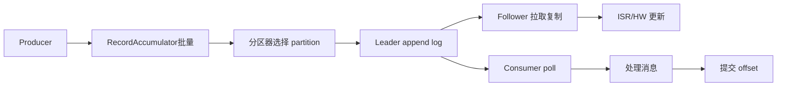
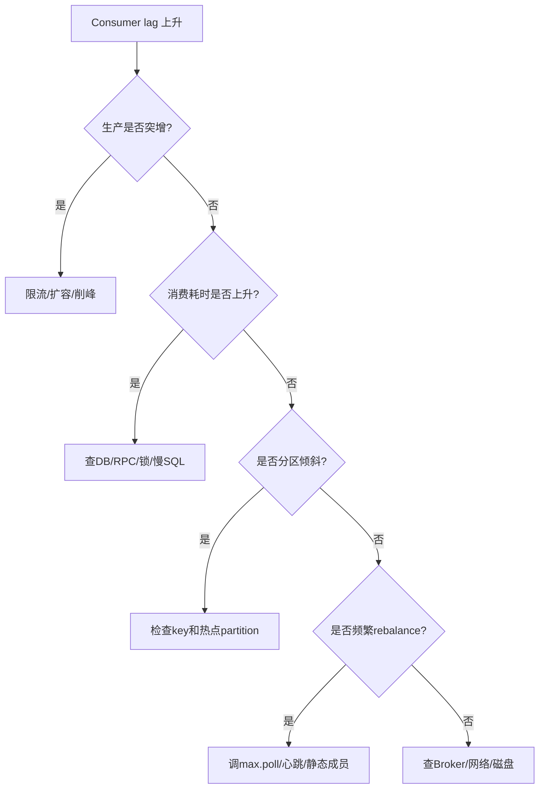

# Kafka原理与应用

> [!abstract] 一句话总结
> Kafka 用 append-only 分区日志承载高吞吐消息流，可靠性由 producer ack、broker ISR、consumer offset、幂等和事务共同决定；面试重点是吞吐、可靠性、顺序、堆积和重复消费边界。

## 📌 精准定位

- 负责高吞吐事件流、异步解耦、日志收集和流处理输入。
- 不负责低延迟点对点 RPC，单条强实时不是 Kafka 优势。
- 关键边界：同一 partition 内有序，跨 partition 不保证全局顺序。
- 业务侧仍要做幂等、补偿和状态机，不能把可靠性全交给 Kafka。

## 🧩 核心概念

| 概念 | 具体含义 | 精通要点 |
| ---- | -------- | -------- |
| Topic/Partition | topic 拆成多个有序日志分区。 | partition 数决定并行度和顺序边界。 |
| ISR | 与 leader 同步的副本集合。 | `acks=all` 依赖 ISR 承诺。 |
| Consumer Group | 组内分摊 partition。 | 一个 partition 同时只给组内一个消费者。 |
| Offset | 消费进度。 | 提交时机决定重复或丢失风险。 |
| Producer Batch | 批量发送。 | `linger.ms`、`batch.size`、压缩影响吞吐延迟。 |
| Rebalance | 分区所有权重新分配。 | 可能导致短暂停顿和重复消费。 |

## ⚙️ 工作原理 / 主流程



1. Producer 批量发送，受 `linger.ms`、`batch.size`、压缩影响。
2. Broker 追加写 page cache，顺序 IO 提供高吞吐。
3. `acks=all + min.insync.replicas` 控制写入可靠性。
4. Consumer 主动 poll，rebalance 时 partition 所有权转移。
5. 幂等 producer 用 producer id + sequence 防生产端重复写。
6. Kafka 事务可绑定多分区写和 offset 提交。

## ⚙️ 推荐配置口径

```properties
# producer
enable.idempotence=true
acks=all
retries=2147483647
max.in.flight.requests.per.connection=5
compression.type=lz4
linger.ms=10
batch.size=32768

# consumer
enable.auto.commit=false
max.poll.records=500
max.poll.interval.ms=300000
```

说明：

- `acks=all` 不等于绝对不丢，还要配 `min.insync.replicas`。
- 自动提交 offset 简单但风险高，业务失败可能跳过消息。
- `max.poll.interval.ms` 太小，业务处理慢会触发 rebalance。

## 🔐 可靠性边界

| 阶段 | 风险 | 方案 |
| ---- | ---- | ---- |
| Producer | 发送超时、网络失败、重复发送 | ack、重试、幂等生产者、业务 key |
| Broker | leader 宕机、副本落后 | ISR、replication.factor、min.insync.replicas |
| Consumer | 处理失败、offset 提交错误 | 手动提交、幂等消费、DLQ/重试主题 |
| Rebalance | 分区迁移、重复消费 | 幂等、合理 poll 参数、静态成员 |

## 🔁 Offset 提交策略

| 策略 | 优点 | 风险 |
| ---- | ---- | ---- |
| 自动提交 | 简单 | 业务失败但 offset 已提交会丢处理 |
| 处理前提交 | 延迟低 | 进程崩溃会丢消息 |
| 处理后提交 | 更安全 | ack/commit 失败会重复消费 |
| 批量提交 | 吞吐高 | 失败回放范围更大 |

推荐：业务处理成功后手动提交 offset，并保证业务幂等。

## 🔥 堆积排查



关键指标：

- consumer lag 总量和增长速度。
- 单 partition lag 是否倾斜。
- 消费 TPS 和单条处理耗时。
- rebalance 次数。
- Broker 磁盘、网络、请求队列。
- 下游 DB/RPC 延迟。

## 🧪 典型案例

### 案例 1：自动提交 offset 导致消息丢处理

消费者 poll 到消息后自动提交 offset，但业务处理时进程崩溃。重启后从新 offset 消费，旧消息不会再处理。

修复：关闭自动提交，业务成功后提交 offset；业务侧做幂等，允许重复。

### 案例 2：处理太慢导致 rebalance

消费者处理一批消息超过 `max.poll.interval.ms`，被认为失联，触发 rebalance，消息被其他消费者接管并重复处理。

修复：减少 `max.poll.records`，优化业务耗时，增加 `max.poll.interval.ms`，将慢任务异步化但要控制 offset 提交时机。

### 案例 3：热点 partition

消息 key 使用固定值或少量热点用户，导致某个 partition lag 很高，其他 partition 很空。

修复：优化分区 key；热点业务做拆分；增加 partition 只能改善均匀 key 的并行度，不能自动解决单 key 热点。

## ⚠️ 生产坑与注意事项

- 自动提交 offset 后业务失败可能跳过消息。
- 处理太慢超过 `max.poll.interval.ms` 触发 rebalance。
- partition 过多增加 controller、元数据和恢复成本。
- `acks=1` 在 leader 宕机时可能丢已确认消息。
- 消息 key 设计不当导致热点 partition。
- 消费者数量超过 partition 数不会提高同组消费并行度。
- 只依赖 Kafka 幂等生产者，忽略消费者业务幂等。

## 🔍 源码入口 / 关键组件

- `KafkaProducer`、`RecordAccumulator`、`Sender`
- Broker `Log`、`LogSegment`、`ReplicaManager`
- `GroupCoordinator`、`ConsumerCoordinator`
- `__consumer_offsets`
- `kafka-consumer-groups`

## 🎯 面试问题

> [!question] 高频问题
> - Q: Kafka 为什么吞吐高？
>   - A: 顺序追加写、page cache、批量发送、压缩、零拷贝、分区并行。
> - Q: `acks=all` 一定不丢吗？
>   - A: 不一定。还要配 `min.insync.replicas`，极端多副本故障或配置不当仍可能丢。
> - Q: 如何保证顺序？
>   - A: 同一业务 key 进入同一 partition，消费端按 key 串行；跨 partition 不保证全局顺序。
> - Q: 如何避免重复影响？
>   - A: 生产端启用幂等，消费端业务幂等，offset 在业务成功后提交。
> - Q: Kafka 事务解决什么？
>   - A: 多分区写和消费位点提交的原子性，常用于 consume-transform-produce 流处理链路。
> - Q: 堆积怎么排查？
>   - A: 看生产是否突增、消费耗时、下游瓶颈、partition 倾斜、rebalance 和 Broker 资源。

## 🎤 面试 3 层回答

### 30 秒版

Kafka 是分区追加日志，吞吐来自顺序写、批量、page cache 和分区并行。可靠性要看 producer ack、ISR、副本、consumer offset 和业务幂等。

### 2 分钟版

Producer 把消息按 key 分到 partition，Broker leader 追加写日志，follower 复制，consumer group 内一个 partition 同时只给一个消费者。`acks=all` 和 `min.insync.replicas` 提高写可靠性，但消费端仍可能重复，所以业务必须幂等。堆积时我会看 lag、分区倾斜、消费耗时、rebalance 和下游 DB/RPC。

### 项目版

在订单或秒杀项目中，Kafka 用来异步削峰和事件驱动。订单事件以 orderId 作为 key 保证同订单顺序，消费者处理成功后手动提交 offset，并用订单状态机和幂等表防止重复消费影响业务。

## ✅ 精通检查清单

- 能解释 Kafka 高吞吐原因。
- 能说明 ISR、acks、min.insync.replicas 的关系。
- 能讲清 offset 提交时机和重复/丢失风险。
- 能排查 consumer lag。
- 能说明顺序边界和热点 partition。
- 能结合项目讲消费者幂等。

## 🔗 关联笔记

- [[_index]]
- [[20-Java后端/00-总览/学习仪表盘]]
- [[03-消息可靠性-顺序-幂等]]
- [[../09-项目实战/03-项目-订单履约系统]]

## 📚 参考资料

- Apache Kafka Documentation
- Kafka: The Definitive Guide
