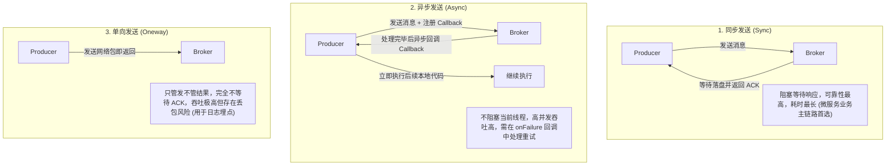
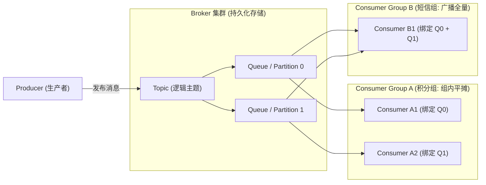
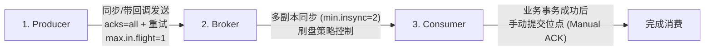
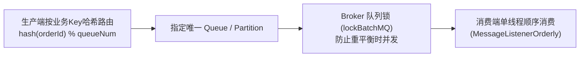
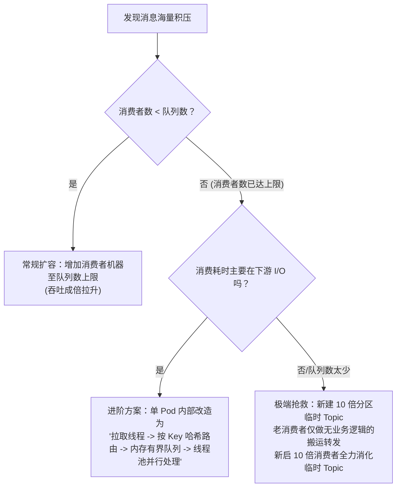
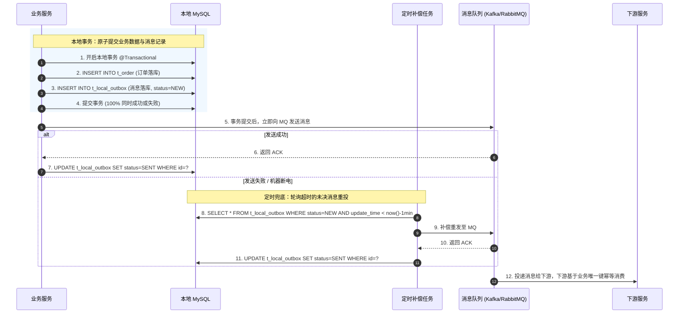

# 01 · 消息队列基础与核心问题处理

> [!abstract] 一句话第一性原理
> 消息队列（MQ）的本质是**基于网络的高可靠、持久化 FIFO 缓冲区**。它将分布式系统间的直接强同步依赖解耦为异步事件驱动，但必然引入分布式三难：**防丢、防重（幂等）、防乱序**。

---

## 一、 MQ 核心价值、引入代价与发送模型

### 1. 三大核心作用与代价

| 核心作用 | 痛点（无 MQ） | 解法（引入 MQ） | 典型场景 |
| :--- | :--- | :--- | :--- |
| **异步提速** | 串行同步调用全部下游，RT 随调用链线性累加 | 主流程完成核心持久化后发消息即返回，下游异步消费 | 支付成功后异步加积分、发短信 |
| **系统解耦** | 上游硬编码调用所有下游，下游接口变更或故障波及主干 | 上游只向 Topic 发布事件，下游各系统自主订阅，互不影响 | 新增大数据分析系统无需修改主服务 |
| **流量削峰** | 突发洪峰直击数据库，连接池耗尽导致全站宕机 | 消息进入高吞吐队列暂存，后端按稳定速率匀速拉取消费 | 秒杀大促下单排队缓冲 |

- **引入代价**：
  1. **系统可用性降低**：链路新增 MQ 依赖，集群宕机将直接阻断异步流转；
  2. **复杂度剧增**：必须在应用层防御消息丢失、重复投递、乱序与积压；
  3. **一致性弱化**：由 ACID 强一致性退化为 BASE 最终一致性。
- **选型红线**：若调用方必须**实时同步依赖下游执行结果**（如登录验密、扣款前查余额），严禁使用 MQ，必须走 HTTP/RPC 同步调用。

### 2. 生产端三种消息发送模式



---

## 二、 核心组件与消费模型

### 1. 核心架构拓扑



### 2. 消费模型规则与并发度铁律

1. **组间广播（Pub/Sub）**：不同的消费者组（Consumer Group）独立订阅同一 Topic，各自获得一份全量消息拷贝。
2. **组内单播（P2P）**：同一个消费者组内的多个实例共同分摊队列消息，**单条消息在组内仅被消费一次**。
3. **并发度铁律**：**一个队列（Partition/Queue）在同一时刻只能分配给同组内的一个消费者线程**。
   - 若消费组实例数 > 队列数，多余的实例将处于**空闲饥饿状态**；
   - 提高消费端并行度的唯一物理途径是：**先扩容 Topic 的队列/分区数，再等比例扩容消费者实例数**。

---

## 三、 五大核心问题深度剖析与生产级方案

### 1. 如何保证消息绝对不丢失？（三端协同防护）

消息流转经过三阶段，任意一环出错都会丢消息，必须全链路设防：



#### （1）生产端防丢机制与硬核参数
- **丢失根因**：网络抖动导致丢包、异步发送未注册异常回调、发送超时未重试。
- **防御配置（以 Kafka 为例）**：
  1. `acks=all`（或 `-1`）：Leader 必须等待本地日志写入且所有 ISR 集合中的 Follower 全部同步成功后，才向生产端返回成功 ACK；
  2. `retries = Integer.MAX_VALUE`：遇到可重试异常（如网络闪断、Leader 选举中）无限重试；
  3. `max.in.flight.requests.per.connection = 1`：限制客户端与单个 Broker 连接上未决请求数为 1。**若不配置此项，当消息 1 发送失败重试、消息 2 却发送成功时，会导致单分区内消息乱序**（开启幂等性 `enable.idempotence=true` 时可放宽至 5）。
  4. **兜底补偿**：重试耗尽后，在 Callback 的 `onFailure` 中将消息写入本地数据库的“消息重发补偿表”，后台定时任务扫表重投。

#### （2）Broker 端防丢机制
- **丢失根因**：消息驻留在 PageCache 内存尚未落盘时宿主机断电、主节点磁盘损坏。
- **防御配置**：
  1. **多副本同步复制**：Topic 副本因子 `replication.factor >= 3`，且设置 `min.insync.replicas = 2`（至少 2 个副本写入成功才允许提交）；
  2. **禁用脏选举**：设置 `unclean.leader.election.enable = false`，严禁不在 ISR 中的落后副本在 Leader 宕机时被选为新 Leader，防止未同步数据被强行截断截丢；
  3. **刷盘控制**：对极高可靠金融业务，RocketMQ 可配置为 `SYNC_FLUSH`（同步刷盘，数据真正写进磁盘物理介质才响应 ACK）。

#### （3）消费端防丢与位点提交机制
- **丢失根因**：开启了自动提交（`enable.auto.commit = true`）。拉取消息后后台定时器自动提交了 offset，而此时业务逻辑正在执行，若应用抛出异常或 OOM 重启，未处理完的消息位点已向前推进，造成永久丢消息。
- **位点提交机制对比**：

| 提交方式 | 机制与优缺点 | 生产落地准则 |
| :--- | :--- | :--- |
| **自动提交（Auto Commit）** | 定时自动提交位点，极易发生消息丢失或重复拉取 | **生产环境必须显式禁用（`enable.auto.commit=false`）** |
| **同步手动提交（commitSync）** | 阻塞当前线程直到 Broker 确认位点写入成功。可靠性高，但吞吐受限 | 在批次处理完毕、本地事务提交后调用 |
| **异步手动提交（commitAsync）** | 异步发送位点提交请求，不阻塞消费线程。若遇到网络错误不重试（防止旧位点覆盖新位点） | 平时大吞吐消费使用 |
| **异步 + 同步兜底（推荐最佳实践）** | 平时正常消费使用 `commitAsync` 保障吞吐；当消费者关闭（Shutdown）或触发重平衡前，在 `finally` 中调用一次 `commitSync` 确保最终位点强制持久化 | 兼顾超高吞吐与停机位点安全 |

> [!CAUTION] 避坑红线
> 严禁在消费逻辑内部将消息丢给本地异步线程池后立即调用 ACK！一旦异步线程池任务积压丢弃或应用宕机，消息将彻底丢失。

---

### 2. 为什么消息必然重复？如何实现消费幂等？

#### （1）重复投递的分布式必然性

在分布式网络中，消费者处理完业务后向 Broker 发送 ACK 时，若发生网络抖动或超时，Broker 无法区分是处理失败还是 ACK 丢包。为保证**至少投递一次（At-Least-Once）**，Broker 必然重发消息。因此**消费端必须具备业务幂等性**。

#### （2）三大工业级幂等设计方案

##### 方案一：状态机版本控制（适用于状态流转）
利用业务状态单向流转的约束，旧状态不匹配则更新受影响行数为 0：
```sql
UPDATE t_order 
SET status = 'PAID', pay_time = NOW() 
WHERE order_id = 2026100501 AND status = 'UNPAID';
```
若重复投递，第二次执行时 `status` 已为 `PAID`，更新影响行数 `rows = 0`，业务直接判定为重复消息并正常提交 ACK。

##### 方案二：本地事务防重表（通用兜底，推荐）
建立基于业务唯一键的防重表，在同一个本地数据库事务内先插入防重表，再执行业务写入：

```sql
CREATE TABLE t_idempotent_token (
    token_key VARCHAR(128) NOT NULL COMMENT '业务唯一键: order_id + biz_type',
    create_time DATETIME NOT NULL DEFAULT CURRENT_TIMESTAMP,
    PRIMARY KEY (token_key)
) ENGINE=InnoDB;
```

```java
@Transactional(rollbackFor = Exception.class)
public void handleOrderPaid(OrderPaidMsg msg) {
    String tokenKey = msg.getOrderId() + ":GRANT_POINTS";
    try {
        // 1. 利用唯一主键强约束拦截重复消费
        idempotentMapper.insert(tokenKey, LocalDateTime.now());
    } catch (DuplicateKeyException e) {
        // 捕获唯一键冲突，说明历史已成功处理，直接跳过并提交 ACK
        log.warn("消息已消费，幂等返回: key={}", tokenKey);
        return;
    }
    // 2. 核心业务操作（与防重表在同一个本地事务中原子提交）
    userPointsMapper.addPoints(msg.getUserId(), msg.getPoints());
}
```

##### 方案三：Redis 分布式锁前置过滤 + DB 唯一索引兜底
高并发场景下，使用 Redis `SET lock:order:1001 1 EX 30 NX` 前置拦截瞬时并发重复请求，降低数据库主键冲突引发的死锁开销。

---

### 3. 如何保证消息顺序性？

#### （1）乱序根因
- **生产端**：默认轮询发送，同一业务对象的多条事件被发往不同队列；
- **消费端**：单队列内部开启了多线程并发消费，或者消费失败重试时打乱了先后次序。

#### （2）标准解法：局部有序



1. **生产端定向分区路由**：发送消息时指定业务唯一键（如 `orderId`），底层做一致性哈希或取模，保证**同一订单的所有事件严格写入同一个物理队列**。
2. **消费端单队列单线程锁定**：
   - 在 RocketMQ 中使用 `MessageListenerOrderly`。其底层实现原理是：**消费者线程启动时，必须先向 Broker 发送网络请求，成功锁定该队列（申请到分布式 `lockBatchMQ`）后，才允许拉取并消费该队列的消息**；
   - 本地消费时，针对该队列加进程级互斥锁，确保由单个线程串行处理完毕一条后再拉取下一条；
   - 发生 Rebalance 重平衡时，旧消费者必须等待当前处理中的消息完成并向 Broker 释放队列锁，新消费者才能接管该队列，杜绝跨节点并发消费。

---

### 4. 线上突发海量消息积压如何抢救？

#### （1）排查与止血
1. **排查消费端**：优先排查消费者是否出现大面积报错、数据库死锁、慢 SQL 或依赖的下游外部接口超时。
2. **紧急止血**：修复消费端 Bug、杀死数据库长阻塞事务，对非核心外部调用实施熔断降级。

#### （2）扩容与纵深加速方案



- **单 Pod 内部内存队列分发加速模型**：
  若分区只有 4 个，无法增加 Pod，且单条消息处理受限于下游外部 HTTP 调用（耗时 200ms）：
  - 消费者单线程仅负责从 Broker 拉取消息；
  - 根据业务 `orderId` 做哈希，路由分发到本地内存的 8 个独立的 `BlockingQueue` 中；
  - 后台启动 8 个工作线程分别绑定处理这 8 个队列。
  - **收益**：既保证了同一订单的消息在同一个内存队列中严格单线程串行处理，又利用了 8 个线程并发等待外部 I/O，单机吞吐瞬间提升 8 倍！

---

### 5. 延时消息与分布式事务消息（本地消息表实战）

#### （1）延时消息（定时超时关单）
- **核心逻辑**：解决“下单 30 分钟未支付自动取消”等场景，避免定时轮询全表扫库造成磁盘 I/O 枯竭。
- **机制**：Broker 收到消息后将其改写暂存入系统内部定时主题，待延迟时间满足后再还原投递给目标业务 Topic。

#### （2）分布式事务消息：本地消息表（Outbox Pattern）工业级落地

如果不使用 RocketMQ 的二阶段半消息，任何通用 MQ 均可采用**本地消息表**实现分布式事务的最终一致性：



```sql
-- 本地消息表标准 DDL
CREATE TABLE t_local_outbox (
    id BIGINT NOT NULL AUTO_INCREMENT,
    biz_id VARCHAR(64) NOT NULL COMMENT '业务主键(如订单号)',
    topic VARCHAR(64) NOT NULL COMMENT '目标MQ主题',
    payload TEXT NOT NULL COMMENT '消息体JSON',
    status TINYINT NOT NULL DEFAULT 0 COMMENT '0:待发送(NEW), 1:已发送(SENT), 2:死亡(DEAD)',
    retry_count INT NOT NULL DEFAULT 0 COMMENT '重试次数',
    create_time DATETIME NOT NULL DEFAULT CURRENT_TIMESTAMP,
    update_time DATETIME NOT NULL DEFAULT CURRENT_TIMESTAMP ON UPDATE CURRENT_TIMESTAMP,
    PRIMARY KEY (id),
    INDEX idx_status_time (status, update_time)
) ENGINE=InnoDB;
```

---

## 四、 高频面试自测

> [!question]- Q1：为什么生产环境 Kafka 发送端配置了重试参数，还可能会导致消息乱序？如何彻底解决？
> 根因：Kafka 生产端默认允许在收到前一个请求的 ACK 前，管道化发送后续请求（由 `max.in.flight.requests.per.connection` 控制，默认 5）。若消息 1 发送网络超时触发重试，而消息 2 发送成功并落盘，重试成功的消息 1 随后落盘，单分区内原本的先 1 后 2 就变成了先 2 后 1。
> 解决：设置 `max.in.flight.requests.per.connection = 1`（严格限制单个连接未决请求数为 1）；或者开启生产端幂等性 `enable.idempotence = true`（此时参数允许设为 $\le 5$，Broker 会依据 Sequence Number 自动保证物理落盘顺序）。

> [!question]- Q2：消息队列只提供 At-Least-Once，如何设计消费端的绝对幂等？
> 消息队列因网络重传必然存在重复投递。消费端必须实现幂等：
> 1. 状态流转操作：用乐观锁状态机（`UPDATE ... WHERE status = 'UNPAID'`）；
> 2. 累加与创建操作：基于唯一业务号在本地事务中插入防重表或利用数据库唯一索引拦截 `DuplicateKeyException`。

---

## 🔗 上下篇导航
- **上一篇**：[[00-中间件全景与心智模型]]
- **下一篇**：[[02-多级缓存架构实战]]
- *(如需具体中间件深入，可查阅：[[05-Kafka架构原理与实战手册]]、[[06-RocketMQ架构原理与实战手册]])*
