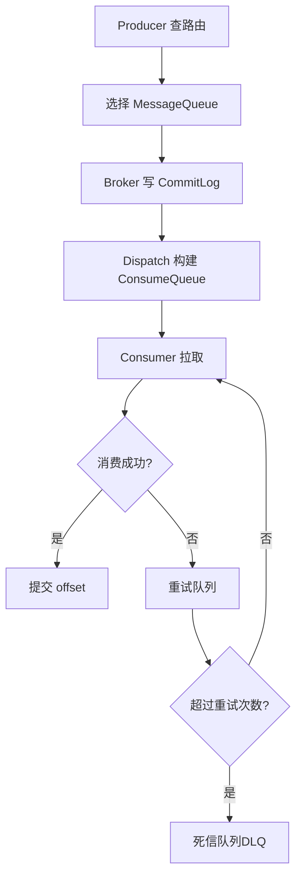
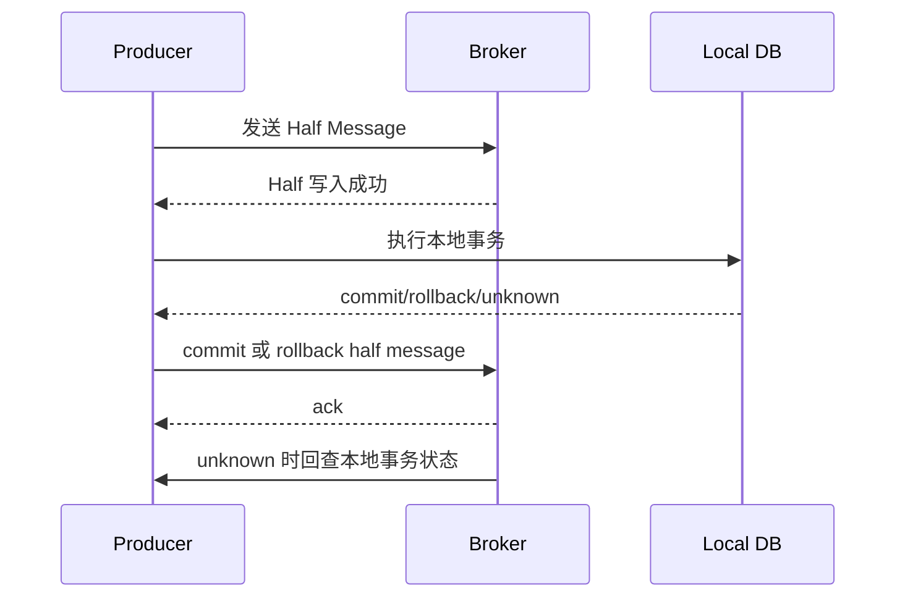

# RocketMQ原理

> [!abstract] 一句话总结
> RocketMQ 面向业务消息，核心是 NameServer 路由、Broker 存储、CommitLog 顺序写、ConsumeQueue 索引和消费重试/事务/延迟能力；面试重点是事务消息、顺序消息、重试死信和业务幂等。

## 📌 精准定位

- 负责业务异步解耦、事务消息、延迟消息、顺序消息和可靠消费。
- 不负责替代数据库事务，事务消息解决的是本地事务与消息投递一致。
- 关键边界：顺序消息的顺序范围是同一 MessageQueue。
- RocketMQ 更贴近业务消息场景，订单、支付、延迟关单等场景常见。

## 🧩 核心概念

| 概念 | 具体含义 | 精通要点 |
| ---- | -------- | -------- |
| NameServer | 轻量路由注册中心。 | Broker 定时上报，客户端定时拉路由。 |
| Broker | 消息存储和转发节点。 | 主从、刷盘、复制影响可靠性。 |
| CommitLog | 所有消息顺序追加存储。 | 高吞吐来自顺序写。 |
| ConsumeQueue | topic/queue 的逻辑索引。 | 消费者按队列拉取。 |
| 事务消息 | 半消息 + 本地事务 + 回查。 | 生产者必须实现可靠回查。 |
| 延迟消息 | 指定延迟级别投递。 | 支付超时关单常用。 |
| DLQ | 死信队列。 | 超过重试次数进入人工处理。 |

## ⚙️ 工作原理 / 主流程



1. 客户端从 NameServer 获取 Topic 路由并缓存。
2. Broker 先写 CommitLog，再异步分发 ConsumeQueue 和 IndexFile。
3. PushConsumer 本质也是长轮询拉取。
4. 消费失败按重试策略投递，多次失败进 DLQ。
5. 事务消息先发 half message，本地事务后提交/回滚，未知由 Broker 回查。

## 📬 事务消息流程



关键点：

- Half message 对消费者不可见。
- 本地事务成功后提交消息，失败后回滚消息。
- 如果生产者返回 unknown 或超时，Broker 会回查。
- 回查接口必须根据业务表状态可靠判断事务结果。

回查示例：

```java
public LocalTransactionState checkLocalTransaction(MessageExt msg) {
    String orderNo = msg.getKeys();
    Order order = orderMapper.findByOrderNo(orderNo);
    if (order == null) return LocalTransactionState.ROLLBACK_MESSAGE;
    if (order.isCreated()) return LocalTransactionState.COMMIT_MESSAGE;
    return LocalTransactionState.UNKNOW;
}
```

## ⏰ 延迟消息场景

支付超时关单：

1. 创建待支付订单。
2. 发送 30 分钟延迟消息。
3. 延迟消息触发后查询订单状态。
4. 如果仍是 `WAIT_PAY`，关单并释放库存。
5. 如果已支付，忽略。

关键：延迟消息只负责触发检查，不能不查状态直接关单。

## 🔁 顺序消息边界

顺序发送：

```java
producer.send(msg, (mqs, msg1, arg) -> {
  long orderId = (Long) arg;
  return mqs.get((int) (orderId % mqs.size()));
}, orderId);
```

顺序边界：

- 同一 `orderId` 固定同一 MessageQueue。
- 消费端使用顺序消费监听器。
- 一个坏消息可能阻塞同队列后续消息。
- 全局顺序通常不现实，也没必要。

## 🧱 消费幂等

消费者伪代码：

```java
@Transactional(rollbackFor = Exception.class)
public void handle(OrderPaidEvent event) {
    if (!processedMessageMapper.tryInsert(group, event.eventId(), event.orderNo())) {
        return;
    }
    orderFulfillmentService.createFulfillmentIfAbsent(event.orderNo());
    processedMessageMapper.markSuccess(group, event.eventId());
}
```

幂等方式：

- 消费记录表。
- 业务唯一键。
- 状态机条件更新。
- 版本号或乐观锁。

## 🔥 重试与死信

| 阶段 | 行为 |
| ---- | ---- |
| 消费失败 | 返回失败状态或抛异常 |
| 重试 | Broker 按策略稍后再次投递 |
| 多次失败 | 进入 DLQ |
| DLQ 处理 | 告警、分析原因、修复后重放 |

注意：

- 不可重试错误不要无限重试。
- 重放 DLQ 前必须保证消费者幂等。
- DLQ 不是垃圾桶，要有告警和处理 SLA。

## 🧪 典型案例

### 案例 1：事务消息回查不可靠

现象：订单创建成功，但消息迟迟不可见或被回滚。

原因：回查逻辑只查缓存，缓存未命中返回 rollback。

修复：回查必须以本地数据库事务状态为准，不能只依赖缓存。

### 案例 2：延迟关单误关已支付订单

原因：延迟消息触发后直接关单，没有判断订单当前状态。

修复：关单 SQL 必须带条件：

```sql
UPDATE orders
SET status = 'CANCELLED'
WHERE order_no = ? AND status = 'WAIT_PAY';
```

### 案例 3：顺序消息被坏消息阻塞

原因：同一队列中的一条消息持续失败，后续消息无法处理。

修复：设置重试上限，超过进入 DLQ；业务状态机保证跳过或重放安全。

## 🧭 排查路径

- 消息查不到：按 topic、key、msgId 查轨迹，确认是否发送成功、是否 half message、是否被回滚。
- 消费堆积：看 queue 维度 lag、消费者线程、下游耗时、是否坏消息阻塞。
- 重复消费：确认重试、ack 超时、重启、rebalance 和幂等表。
- 事务消息卡住：查 half topic、回查日志、本地事务表。
- 延迟消息不准：确认延迟级别、Broker 时间、消费堆积。

## ⚠️ 生产坑与注意事项

- 只按 Topic 讲顺序，没有固定到同一 MessageQueue。
- 事务消息回查不可靠导致状态悬挂。
- 消费失败无限重试且无告警。
- 大消息拖慢存储和网络。
- 消费者幂等缺失导致重复扣款。
- 延迟消息触发后不查状态，误关已支付订单。
- DLQ 没人处理，最终一致变最终不一致。

## 🔍 源码入口 / 关键组件

- NameServer route info
- CommitLog、ConsumeQueue、IndexFile
- `DefaultMQProducer`、`DefaultMQPushConsumer`
- `TransactionalMessageService`
- `RebalanceService`
- `mqadmin` 运维命令

## 🎯 面试问题

> [!question] 高频问题
> - Q: RocketMQ 存储结构？
>   - A: CommitLog 顺序写全量消息，ConsumeQueue 是 topic/queue 维度的逻辑索引，IndexFile 支持按 key 查找。
> - Q: 事务消息流程？
>   - A: 半消息、本地事务、提交/回滚、未知状态回查。回查必须以本地事务状态为准。
> - Q: 如何保证顺序？
>   - A: 同一业务 key 固定同一 MessageQueue，消费端顺序消费；顺序范围不是整个 Topic。
> - Q: 消费失败怎么办？
>   - A: 返回重试状态，超过次数进死信，业务侧必须幂等。
> - Q: 延迟消息如何用于关单？
>   - A: 延迟消息只触发检查，真正关单要查订单当前状态并条件更新。
> - Q: NameServer 特点？
>   - A: 轻量维护路由，不做强一致协调，Broker 定时上报，客户端定时拉取。

## 🎤 面试 3 层回答

### 30 秒版

RocketMQ 的核心是 NameServer 路由、Broker 顺序写 CommitLog、ConsumeQueue 做逻辑索引。它的业务能力强在事务消息、延迟消息、顺序消息、重试和死信。

### 2 分钟版

Producer 从 NameServer 拿路由后选择 MessageQueue，把消息写到 Broker 的 CommitLog，再构建 ConsumeQueue 给消费者拉取。事务消息通过 half message、本地事务、commit/rollback 和回查保证本地事务与消息投递一致。顺序消息只能保证同一 MessageQueue 内有序，所以要按 orderId 这类业务 key 路由。消费失败会重试，超过次数进 DLQ，业务消费者必须幂等。

### 项目版

在订单履约项目里，我会用 RocketMQ 事务消息或 outbox 推送 OrderPaid 事件，用延迟消息做超时关单。关单消息触发后必须条件更新 `WAIT_PAY` 状态，避免误关已支付订单。消费者用 orderNo 做幂等，重复消息不会重复发货。

## ✅ 精通检查清单

- 能解释 NameServer、Broker、CommitLog、ConsumeQueue。
- 能讲清事务消息和回查。
- 能说明延迟消息关单的正确姿势。
- 能讲清顺序消息边界。
- 能排查消费堆积、重复消费、DLQ。
- 能结合订单项目讲消息幂等和补偿。

## 🔗 关联笔记

- [[_index]]
- [[20-Java后端/00-总览/学习仪表盘]]
- [[03-消息可靠性-顺序-幂等]]
- [[../09-项目实战/03-项目-订单履约系统]]

## 📚 参考资料

- Apache RocketMQ Documentation
- RocketMQ store/broker/client 源码
