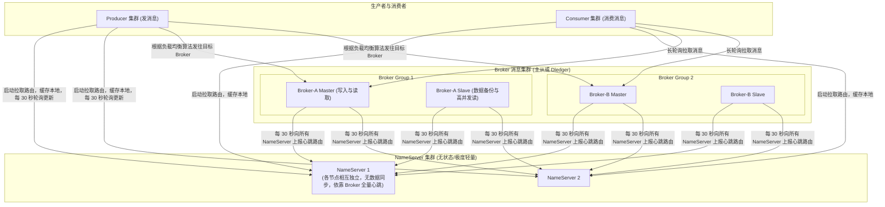
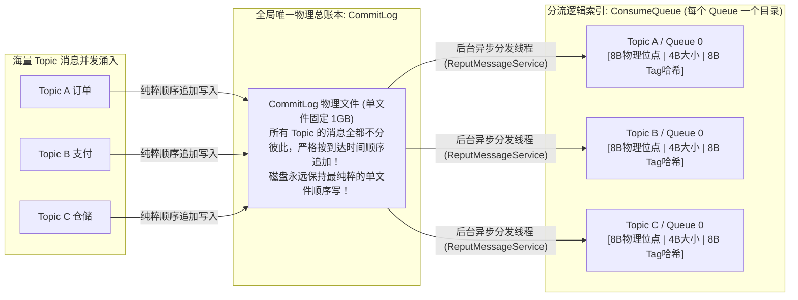
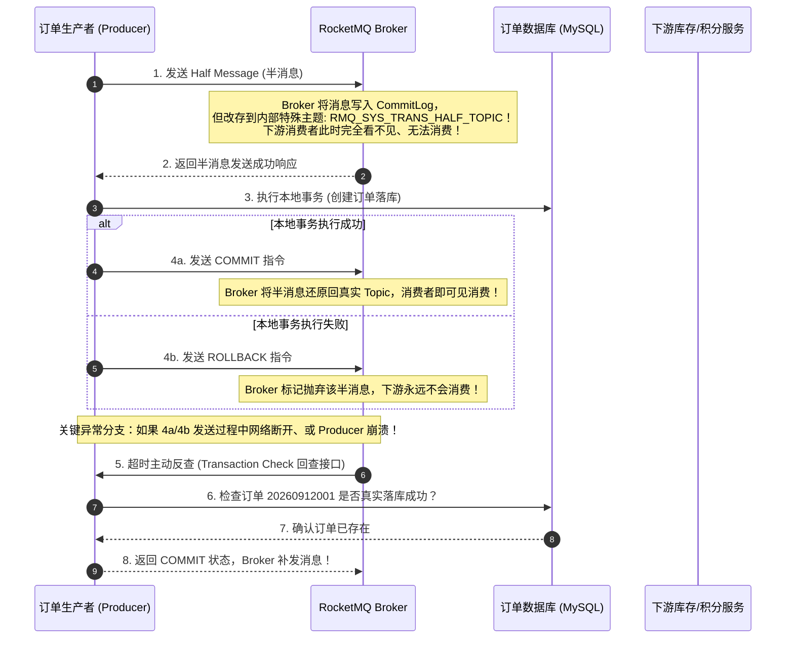

# RocketMQ 原理

> [!abstract] 一句话心智模型
> 如果说 Kafka 是为了海量大数据日志而生的高速载货重轨，那么 RocketMQ 就是**阿里巴巴双十一血统的金融级电商物流调度总站**：
> - **物理账本大一统（CommitLog）**：千军万马（上万个 Topic）的消息全都不分彼此，**顺序追加写进同一个物理总账本 CommitLog 中**，磁盘永远只做单文件顺序 I/O，从根源上破除了 Kafka 在海量 Topic 下的随机 I/O 性能滑铁卢；
> - **微型导航索引（ConsumeQueue）**：专为消费者拉取准备的 20 字节轻量目录，全部命中内存 PageCache；
> - **金融级二阶段事务消息（Half Message）**：通过“预发半消息 + 本地事务 + Broker 主动超时回查”组合拳，彻底解决“订单写了库但消息发送失败”的跨系统分布式事务难题！

---

## 🏗️ 一、RocketMQ 整体架构组件

### 为什么 RocketMQ 的 NameServer 比 ZooKeeper 优秀且轻量？
- **ZooKeeper 的重**：ZK 依靠 Paxos/Zab 强一致性协议，节点之间需要频繁交互同步，网络抖动容易触发选举，且对客户端 Watch 监听消耗巨大。
- **NameServer 的轻**：
  - 各个 NameServer 之间**没有任何网络通信与数据同步，彼此完全解耦**！
  - 每个 Broker 在启动时，会与**配置列表中的每一个 NameServer 分别建立长连接**，每 30 秒向所有 NameServer 上报自己的全量路由信息；
  - 生产者和消费者也是每 30 秒向某一台 NameServer 轮询拉取一次最新路由缓存到本地。
  - **即使挂掉一半的 NameServer，甚至 NameServer 全部瞬间宕机，客户端依然可以依靠本地内存缓存的路由信息继续正常生产和消费数分钟！** 这种基于“最终一致性”的设计极其契合大规模分布式生产场景。

---

## 💾 二、存储架构底层揭秘：CommitLog + ConsumeQueue

### 1. 为什么 Kafka 怕海量 Topic，而 RocketMQ 能顶住上万 Topic？（第一性原理）

- **Kafka 的存储死穴**：Kafka 每一个 Partition 在磁盘底层就是一个独立的物理日志文件目录。如果业务拆得太细，单集群建了 2000 个 Topic，每个 Topic 分 8 个 Partition，磁盘上就同时存在 **16000 个物理文件**！
  - 当并发请求涌入时，操作系统磁头必须在 16000 个文件之间来回切换跳转，原本引以为傲的“顺序 I/O”当场退化为极度缓慢的“随机寻道”，吞吐量发生雪崩断崖！
- **RocketMQ 的大一统设计**：

### 2. 三大核心文件分工

1. **CommitLog（真实数据总账本）**：
   - 物理上存放在 `${storePath}/commitlog/` 目录下。
   - 每个 CommitLog 文件固定为 **1GB（1073741824 字节）**，文件名以该文件起始的物理偏移量命名（如 `00000000000000000000`）。写满 1GB 自动滚动创建下一个文件。
   - **所有 Topic、所有 Queue 的消息全部顺序混排在里面**。
2. **ConsumeQueue（消费逻辑轻量索引）**：
   - 专为 Consumer 快速拉取消息而设计的索引。
   - **极其微型紧凑**：ConsumeQueue 中的每一个条目大小固定只有 **20 个字节**：
     - `8 字节`：该消息在 CommitLog 中的物理起始偏移量（Physical Offset）；
     - `4 字节`：该消息的物理大小（Size）；
     - `8 字节`：消息 Tag 的 HashCode（用于在 Broker 端做快速消息过滤）。
   - 因为每条仅 20 字节，一个包含 30 万条记录的 ConsumeQueue 文件只有 6MB，**几乎可以百分之百常驻在操作系统的 PageCache 内存中**！
3. **IndexFile（基于哈希槽的业务 Key 索引）**：
   - 如果用户需要根据业务订单号 `OrderNo: 20260912001` 查找某条消息，不可能去遍历几十个 G 的 CommitLog。
   - IndexFile 底层类似一个持久化在磁盘上的 HashMap（由 Header + 500万个 Hash 槽 + 2000万个 Index 条目组成），支持通过业务 Key 在几毫秒内极速定位到 CommitLog 的物理偏移量！

---

## 💼 三、金融级事务消息底层全流程（Half Message 破解分布式难题）

跨系统业务中最棘手的问题：**如何保证“本地数据库修改”与“MQ 发送消息”两者要么同时成功，要么同时失败？**

### 事务消息核心精髓：
- **半消息隔离**：Broker 拦截半消息并替换为系统内置 Topic，使消费者绝对不可见，杜绝了下游提前误消费。
- **主动回查兜底**：如果 Producer 执行本地事务后突然宕机或网络中断，Broker 在超时后会主动向 Producer 集群发起状态回查（`checkLocalTransaction`）。
- **幂等要求**：Producer 本地必须维护清晰的事务状态表或业务主键，供 Broker 回查时做出确切的 Commit 或 Rollback 裁决。

---

## ⏰ 四、延时消息与死信队列机制

### 1. 延时消息（Scheduled / Delay Message）
在电商场景中，“下单后 30 分钟未付款自动关单”是延时消息的最经典应用。

- **开源版本经典延时级别**：
  - RocketMQ 开源版本默认预设了 **18 个延时级别**：
    `1s 5s 10s 30s 1m 2m 3m 4m 5m 6m 7m 8m 9m 10m 20m 30m 1h 2h`
  - 代码设定：`message.setDelayTimeLevel(3);`（对应延时 10 秒）。
- **底层实现奥秘**：
  - 消息到达 Broker 后，如果带有延时级别，Broker 不会把它写入目标 Topic，而是将其**改写写入系统专用延时主题 `SCHEDULE_TOPIC_XXXX`**，不同的延时级别对应不同的队列编号（Queue ID 0~17）。
  - Broker 内部的 `ScheduleMessageService` 为每个延时队列启动独立的定时任务，扫描到期的消息。
  - **一旦时间到期，后台线程把消息内容重新还原为用户原始的 Topic 和 Queue，重新写回 CommitLog 并分发给 ConsumeQueue，消费者立即感知拉取！**
  - （注：RocketMQ 5.x 已经全新支持基于时间轮的高精度任意秒级延时消息）。

### 2. 消费重试与死信队列（DLQ，Dead-Letter Queue）
- **自动重试机制**：如果消费者消费失败返回 `RECONSUME_LATER`，RocketMQ 不会卡死当前队列，而是把这条失败消息悄悄转存到该消费组的**重试队列（`%RETRY%消费组名`）**。
- **阶梯退避**：重试队列的消息会按照延时级别逐步拉长重试间隔（10秒、30秒、1分钟……），最大重试 **16 次**！
- **死信队列（DLQ）**：如果一条消息连续重试了 16 次依然顽固报错，RocketMQ 认定该消息为“有毒消息（Poison Message）”。为了不影响其他消息的正常流转，系统会自动将该消息打入**死信队列（`%DLQ%消费组名`）**。
  - 只有人工在控制台介入分析日志、修复 Bug 后，才能手动将死信队列里的消息重新投递回业务队列消费。

---

## ⚡ 一分钟面试必杀卡

> [!NOTE] 面试高频问题标准答题套路
> 
> **Q1：RocketMQ 的底层存储设计与 Kafka 有什么本质区别？**
> - **A**：
>   - **Kafka** 是“分区分治”：每个 Topic 的每个 Partition 对应独立的物理文件。在海量 Topic 场景下，并发写会导致操作系统磁头在成千上万个文件之间频繁随机寻道，性能急剧衰退。
>   - **RocketMQ** 是“大一统顺序写”：所有 Topic 的消息全部混排顺序追加写进同一个物理总文件 **CommitLog** 中，磁盘在任何时刻都只维护一个纯粹的单文件顺序追加，因此能稳定承受数万个海量 Topic 的高并发冲击；再通过只占 20 字节的微型索引 **ConsumeQueue** 提供高效的消费分流。
> 
> **Q2：RocketMQ 的事务消息是如何实现的？**
> - **A**：采用**二阶段提交 + 补偿回查**机制。
>   1. 生产者先向 Broker 发送 Half Message（半消息），Broker 存入特殊的内部主题，下游消费者不可见。
>   2. 生产者开始执行本地数据库事务。
>   3. 本地事务成功则向 Broker 发送 Commit 指令使消息对下游可见；失败则发送 Rollback 抛弃消息。
>   4. 若在第 3 步发生网络中断或生产者宕机，Broker 会在超时后主动向生产者集群发起**事务状态回查**，根据本地业务订单状态最终决定 Commit 还是 Rollback。
