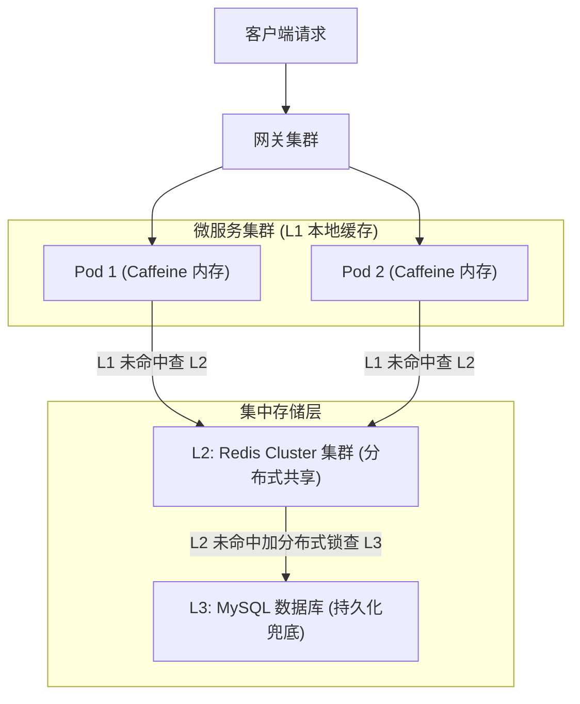
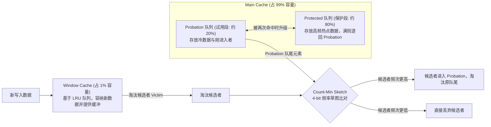
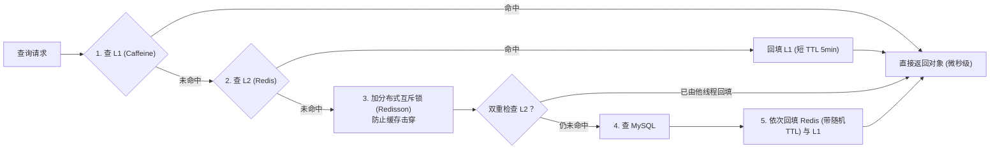
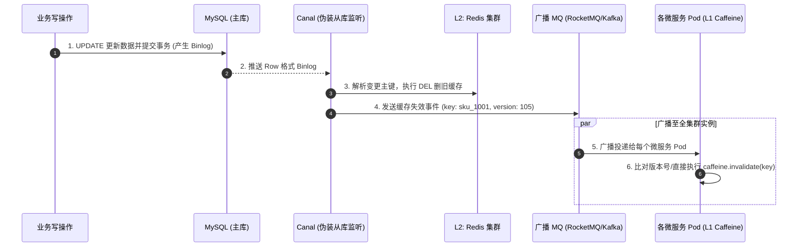
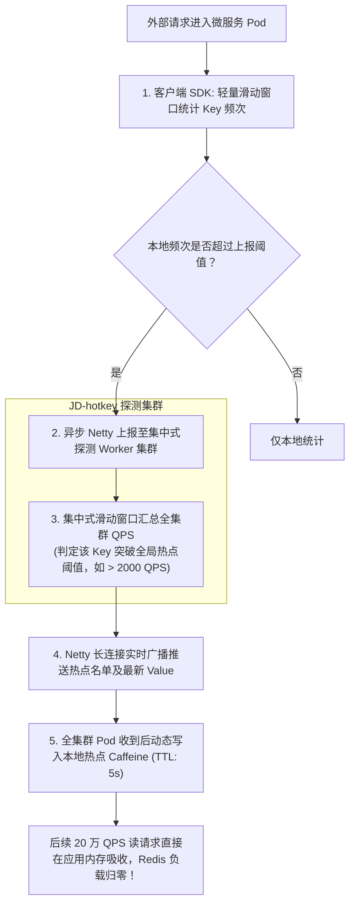

# 02 · 多级缓存架构实战

> [!abstract] 一句话第一性原理
> 多级缓存的本质是**利用访问局部性，在靠近计算端（JVM 进程内）构筑微秒级低延迟防线，分担分布式缓存的单点热点与跨网络 I/O 瓶颈**。

---

## 一、 为什么单级 Redis 不够用？

在超高并发（数十万 QPS）场景下，单纯依赖远端 Redis 会遭遇两大物理瓶颈：

| 瓶颈维度 | 物理成因 | 导致后果 | 多级缓存解决方案 |
| :--- | :--- | :--- | :--- |
| **网络 I/O 与序列化** | 跨主机/跨机房 TCP 往返耗时（1~2ms），高频调用导致序列化与网卡开销巨大 | 接口 RT 难以下降，微服务与 Redis 内网带宽被打满 | **引入 L1 本地缓存（Caffeine）**：直接读 JVM 内存（纳秒/微秒级），零网络与序列化开销 |
| **单 Key 热点打满** | 单个 Key 根据 CRC16 永远固定落在一台 Redis 节点，Redis 单线程执行命令 | 极热点 Key（如秒杀爆品 30 万 QPS）瞬间打垮单台 Redis 节点 | **热点前置拦截**：本地 Caffeine 拦截 95% 以上请求，根本不打到远端 Redis |



---

## 二、 本地缓存之王：Caffeine 底层 W-TinyLFU 淘汰算法原理

Java 本地缓存历史上经历过从 `ConcurrentHashMap` 到 `Guava Cache`（LRU），再到 `Caffeine` 的演进。Caffeine 能够以极高命中率超越 Guava，核心就在于其底层的 **W-TinyLFU（Window TinyLFU）** 淘汰算法。

### 1. 传统 LRU 与 LFU 的致命缺陷

- **LRU（最近最少使用）**：仅看时间新旧，不看访问频率。
  - **致命缺陷（冷数据批量污染）**：若发生一次全表批处理扫描或突发爬虫遍历，大量仅访问一次的冷数据会瞬间将真正的热点数据全部挤出缓存。
- **LFU（最不经常使用）**：仅看历史累计访问频次。
  - **致命缺陷（历史热点滞留与高内存开销）**：某个过去的大热点（如昨天的爆款活动）积累了上万次计数，今天即使完全不被访问，依然会长久驻留缓存霸占内存；且为每个对象维护整型计数器开销巨大。

### 2. W-TinyLFU 的三级队列与频次判定机制

Caffeine 创新性地结合了两者的优点，将物理内存划分为 **Window Cache** 与 **Main Cache（包含 Probation 与 Protected）**：



#### 关键机制拆解：
1. **Window Cache（新客保护区，1% 容量）**：
   新进入的数据首先进入 Window Cache（采用标准 LRU 淘汰）。它的作用是**提供一个短暂的缓冲窗口**，让突发请求能够在这里快速获取频次积累，避免直接被淘汰。
2. **Main Cache 的分层设计（99% 容量）**：
   - **Probation（试用段，约 20%）**：候选者被 Window 淘汰后尝试进入这里。若 Probation 中的元素被再次命中，立即**晋升升级**至 Protected 队列；
   - **Protected（保护段，约 80%）**：存放系统最高频的核心热点。若 Protected 满了，最早未被命名的元素降级退回 Probation 队列。
3. **TinyLFU：Count-Min Sketch 4-bit 频率草图**：
   - 为了解决 LFU 维护高计数器的内存浪费，Caffeine 采用了 **Count-Min Sketch（类似布隆过滤器的哈希计数数组）**。每个 Key 经过 4 个独立 Hash 函数映射到二维数组中，且每个计数槽位仅分配 **4 个 bit（最大值 15）**，单条记录统计仅消耗 8 字节；
   - **时间衰减（Decay）机制**：当全局累积计数达到采样阈值（`sampleSize`）时，所有槽位的计数器全部**除以 2（右移 1 位）**。这一操作巧妙地让历史久远的热点频次快速衰减，彻底解决了传统 LFU 历史热点赖着不走的缺陷。

---

## 三、 读写执行链路与多级缓存一致性保障

### 1. 读请求执行链路（逐级穿透与回填）



### 2. 写请求一致性：Canal 监听 Binlog + 广播失效链路

在多节点集群环境下，各 Pod 拥有独立的 JVM 堆内存。业务写操作若由应用层硬编码清理各层缓存，极易出现漏删或并发乱序。工业级生产方案采用 **无侵入的 Binlog 广播失效链路**：



#### 生产关键细节：
1. **MQ 必须配置为广播模式**：
   - RocketMQ：设置 `MessageModel.BROADCASTING`；
   - Kafka：每个微服务 Pod 启动时动态生成唯一的 `group.id`（如拼接本机 IP 与端口 `cache-sync-${pod.ip}:${port}`），确保全集群所有 Pod 均能独立拉取并消费该消息。
2. **多节点写覆写与并发乱序防范（版本号机制）**：
   若并发进行更新操作，事务 1 更新版本 101，事务 2 更新版本 102。由于网络抖动，失效消息 102 先到达 Pod、101 后到达，若无约束会导致旧数据回填覆盖。
   - **对策**：在数据库行记录与缓存 Value 中增加 `version` 递增版本号。本地回填与更新时，若发现传入版本号小于当前本地缓存版本号，直接丢弃，不予覆写。
3. **本地缓存兜底防御**：
   - 必须配置硬性写入过期时间（如 `expireAfterWrite(5, TimeUnit.MINUTES)`）与最大容量（`maximumSize(10_000)`），即使极端情况下网络广播丢包，旧数据最多存活 5 分钟即被强制淘汰，且彻底杜绝 JVM OOM。

---

## 四、 多级缓存生产级代码模板

```java
@Service
public class MultiLevelCacheService {

    // L1: 本地缓存，容量 10000，写入 5 分钟后硬性过期兜底
    private final Cache<String, ProductDTO> localCache = Caffeine.newBuilder()
            .maximumSize(10_000)
            .expireAfterWrite(5, TimeUnit.MINUTES)
            .build();

    @Autowired
    private StringRedisTemplate redisTemplate;

    @Autowired
    private RedissonClient redissonClient;

    @Autowired
    private ProductMapper productMapper;

    private static final String KEY_PREFIX = "product:sku:";

    public ProductDTO getProduct(Long skuId) {
        String cacheKey = KEY_PREFIX + skuId;

        // 1. 优先读 L1 本地缓存
        ProductDTO product = localCache.getIfPresent(cacheKey);
        if (product != null) return product;

        // 2. 查 L2 分布式缓存
        String json = redisTemplate.opsForValue().get(cacheKey);
        if (StringUtils.hasText(json)) {
            product = JSON.parseObject(json, ProductDTO.class);
            localCache.put(cacheKey, product);
            return product;
        }

        // 3. 互斥锁回源防击穿
        RLock lock = redissonClient.getLock("lock:" + cacheKey);
        lock.lock();
        try {
            // 双重检查
            String recheckJson = redisTemplate.opsForValue().get(cacheKey);
            if (StringUtils.hasText(recheckJson)) {
                product = JSON.parseObject(recheckJson, ProductDTO.class);
                localCache.put(cacheKey, product);
                return product;
            }

            // 4. 查库与依次回填
            product = productMapper.selectById(skuId);
            if (product != null) {
                // Redis 加随机 TTL (30~35 分钟) 防雪崩
                long ttl = 30 + ThreadLocalRandom.current().nextInt(5);
                redisTemplate.opsForValue().set(cacheKey, JSON.toJSONString(product), ttl, TimeUnit.MINUTES);
                localCache.put(cacheKey, product);
            }
            return product;
        } finally {
            lock.unlock();
        }
    }

    // 供 MQ 广播消费者监听到 Binlog 变更后调用
    public void evictLocalCache(Long skuId) {
        localCache.invalidate(KEY_PREFIX + skuId);
    }
}
```

---

## 五、 缓存两大杀手：热点 Key 与大 Key 深度治理

### 1. 热点 Key（Hot Key）探测与动态晋升架构

单 Key 访问过载（如秒杀爆品 20 万+ QPS）会打满所在单个 Redis 节点的单核 CPU 与网卡。工业界标准的热点治理架构（如京东开源 JD-hotkey）包含三大核心闭环：



### 2. 大 Key（Big Key）的危害与拆解治理

- **行业标准定义**：String 类型 Value > 10KB；集合类型（Hash/List/Set/ZSet）元素数 > 5000 或大小 > 10MB。
- **核心危害**：阻塞 Redis 单线程主事件循环、打满网卡带宽、引发集群节点内存倾斜。
- **标准治理四步法**：

| 维度 | 规范做法 | 严禁行为 |
| :--- | :--- | :--- |
| **对象瘦身** | **冷热字段分离**：高频字段存小 Key，大段富文本图文详情存独立对象或静态化至 CDN | 严禁把全量图文详情、评论列表整体打包存单个巨型 String |
| **分桶打散** | **Hash 取模分桶（Bucket）**：将大 Hash 按 Key 哈希取模拆为 100 个小 Hash（`hash_bucket_${id % 100}`），每个小 Hash 元素严格控制在 500 以内 | 严禁单个 Hash 挂载数万个字段 |
| **安全读取** | 遍历集合使用 **`HSCAN` / `SSCAN` / `ZSCAN`** 游标分批拉取 | **生产严禁执行 `HGETALL`、`SMEMBERS`、`KEYS *`** |
| **异步删除** | 使用 **`UNLINK key`**（主线程将键从命名空间摘除，内存由后台异步 Bio 线程释放） | **生产严禁对大 Key 执行同步 `DEL`**（导致主线程卡死数百毫秒） |

---

## 六、 高频面试自测

> [!question]- Q1：Caffeine 为什么能超越 Guava Cache 成为性能最高、命中率最高的本地缓存？W-TinyLFU 是怎么运作的？
> Guava Cache 采用传统 LRU，容易被全表扫描等偶发冷数据污染冲垮；而标准 LFU 历史计数开销大且存在历史热点滞留问题。
> Caffeine 采用 **W-TinyLFU**：
> 1. **Window Cache（1%）**：新数据进入小 LRU 缓冲，给予新请求频次积累的机会；
> 2. **Main Cache（99%）**：分为 Probation（试用段，20%）与 Protected（保护段，80%）。多次命中的数据升级进入 Protected；
> 3. **TinyLFU 淘汰判定**：淘汰时利用 **Count-Min Sketch（4-bit 计数草图）**，以极小内存比对新淘汰者与试用段队尾的访问频率，优胜劣汰；配合**定期半衰期除以 2** 机制，彻底清除历史过期热点。

> [!question]- Q2：多级缓存中，微服务修改了数据库，如何保证全集群各节点本地缓存的数据一致性？
> 采用 **Canal 监听 MySQL Binlog + MQ 广播通知** 方案：
> 1. 业务更新数据库提交后，Canal 捕获 Binlog 变更并解析主键；
> 2. Canal 先主动删除 Redis (L2) 缓存，然后向 MQ 发送广播消息；
> 3. 全集群所有微服务实例以广播模式订阅该消息，调用 `caffeine.invalidate(key)` 同步清除各自进程的 L1 缓存；
> 4. 本地 Caffeine 设置较短的硬性写入过期时间（如 5 分钟）兜底，即便网络丢包也能在短时间内自动失效。

---

## 🔗 上下篇导航
- **上一篇**：[[01-消息队列基础与核心问题处理]]
- **下一篇**：[[03-服务注册与配置中心原理]]
