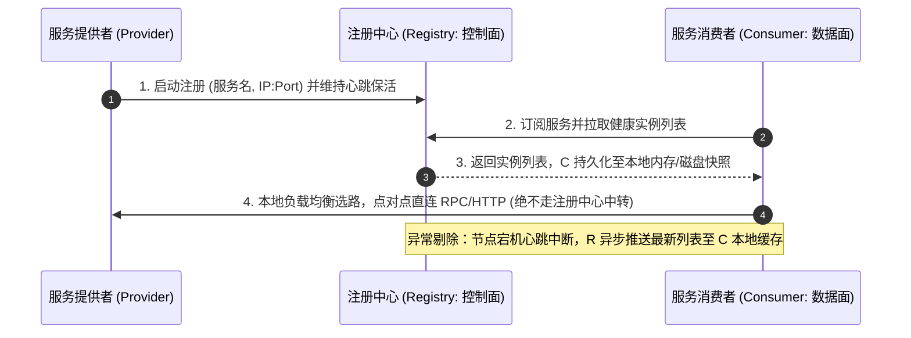
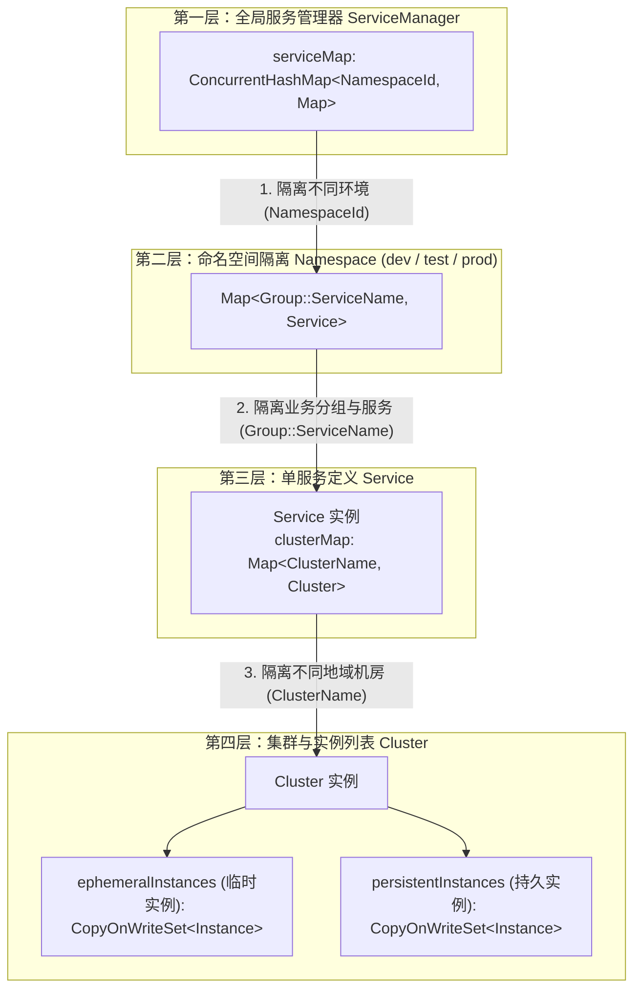
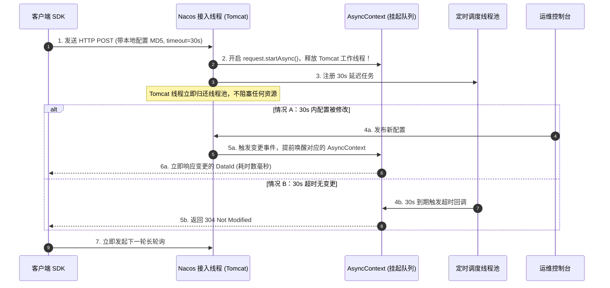
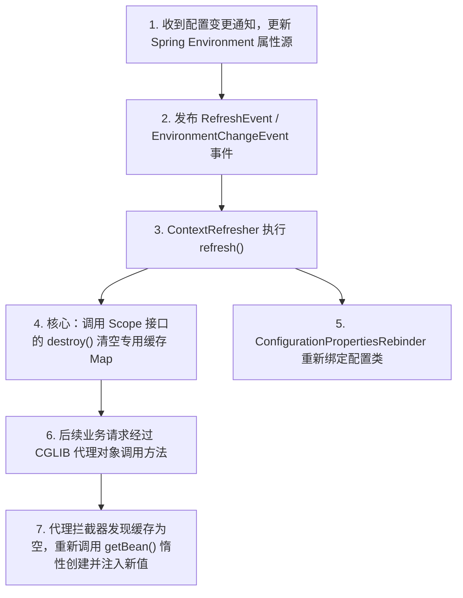
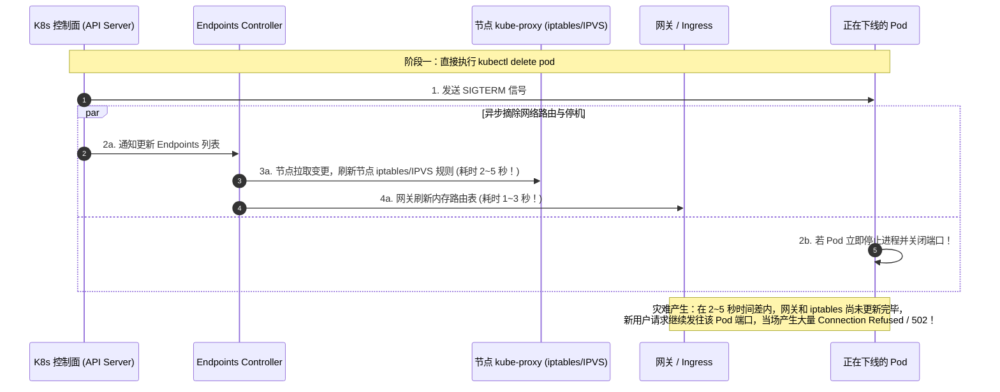
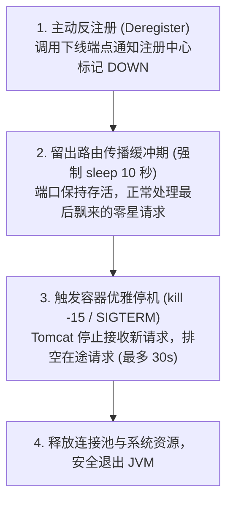

# 03 · 服务注册与配置中心原理

> [!abstract] 一句话第一性原理
> 注册与配置中心的本质是**微服务架构的分布式元数据控制面（Control Plane）**。它将不可靠的静态配置与物理网络拓扑解耦为动态感知体系，解决“服务节点动态寻址”与“参数热更新而不停机”两大核心问题。

---

## 一、 服务注册与发现底层机制

### 1. 核心架构与请求链路



### 2. 注册中心底层内存数据结构（以 Nacos 为例）

注册中心为了支持十万级超高并发读写，在服务端物理内存中维护了多层嵌套的并发哈希表与写时复制集合：



- **三层嵌套映射结构（源码定义）**：
  `serviceMap: ConcurrentHashMap<NamespaceId, ConcurrentHashMap<Group::ServiceName, Service>>`
- **读写分离与无锁读取机制**：
  在 `Cluster` 内部，实例分为 `ephemeralInstances`（临时实例，走心跳与 gRPC 保活）和 `persistentInstances`（持久实例，走 Raft 协议落盘）。
  当有节点上线、下线或健康状态变更时，服务端采用 **CopyOnWrite（写时复制）** 机制生成新的 Set 并原子替换引用指针。这样成千上万个服务消费者的并发拉取请求**完全无需加锁，直接读取最新的不可变内存快照**，读 QPS 轻松达到十万级。

### 3. 两大核心设计原则

| 原则 | 核心机制 | 生产设计边界 |
| :--- | :--- | :--- |
| **控制面与数据面分离** | 业务流量处于数据面，客户端本地根据路由表直连下游，**业务请求绝不经过注册中心转发**。 | 注册中心只承担心跳与元数据下发，避免成为全局性能瓶颈与流量单点。 |
| **客户端本地缓存容灾** | 消费者在本地内存（及磁盘快照）持久缓存拉取到的可用实例列表。 | **即使注册中心集群全宕机，现有微服务间的业务调用依然完全正常**（仅丧失新节点感知与故障自动剔除能力）。 |

---

## 二、 动态配置中心：长轮询底层实现与 `@RefreshScope` 源码链路

### 1. HTTP 长轮询（Long Polling）服务端底层实现

在 Nacos 1.x / Apollo 中，长轮询能够在保持毫秒级实时性的同时避免轮询压垮 CPU，依托于 **Servlet 3.0 异步上下文（AsyncContext）**：



### 2. Spring Cloud `@RefreshScope` 源码关键链路

Spring 默认单例 Bean 在容器启动时已完成属性赋值，`@RefreshScope` 实现了**不停机刷新 Bean 属性**：



#### 关键源码机制：
1. **`Scope` 扩展点实现**：
   `RefreshScope` 继承自 `GenericScope`，实现了 Spring 的 `org.springframework.beans.factory.config.Scope` 接口：
   - 内部维护 `BeanLifecycleDecorator` 线程安全 Map 缓存目标实例；
   - 注入给外界的是由 Spring 创建的 **CGLIB 动态代理对象**。
2. **惰性重建（Lazy Reinitialization）**：
   清空缓存后，Spring 绝不会当场遍历重新创建所有的 Bean。只有当用户下一次发起请求、CGLIB 代理拦截到方法调用时，发现内部缓存为 `null`，才现场触发 `createBean` 生命周期，从最新的 `Environment` 中读取 `@Value` 并回填缓存。

> [!CAUTION] 避坑红线
> 严禁在 `DataSource`（数据库连接池）、`KafkaListener` 等重型基础设施上添加 `@RefreshScope`！销毁重建会强制中断正在执行的数据库事务与长连接。连接池调参应通过组件原生的 JMX/API 平滑修改。

---

## 三、 生产实战：微服务优雅上下线（Kubernetes 网络协同与根治 502）

### 1. 发版 502/Connection Refused 的底层网络根因

在 Kubernetes 容器化部署中，很多人以为只要应用进程退出了就没事了，实际上底层网络存在**两道不可避免的异步传播时间差**：



### 2. 优雅下线标准 4 步 SOP 与 K8s 配置

要实现发版期间 **零 502 报错**，必须将顺序倒置：**“先主动断开业务流量 -> 留出足够时间让全网路由表更新完毕 -> 再排空存量在途请求 -> 最后退出进程”**：



#### 生产配置基线：

```yaml
# 1. Spring Boot application.yml 开启优雅停机
server:
  shutdown: graceful # 停止接收新请求，等待在途请求处理完毕
spring:
  lifecycle:
    timeout-per-shutdown-phase: 30s # 给在途请求最多留出 30 秒的排空时间
```

```yaml
# 2. Kubernetes Deployment 配合 preStop 钩子
apiVersion: apps/v1
kind: Deployment
metadata:
  name: order-service
spec:
  template:
    spec:
      containers:
        - name: order-service
          lifecycle:
            preStop:
              exec:
                # 先反注册摘除流量，强制等待 10 秒让全网 iptables/网关完成路由刷新
                command: 
                  - "/bin/sh"
                  - "-c"
                  - "curl -X POST http://127.0.0.1:8080/actuator/service-registry?status=DOWN; sleep 10"
```

### 3. 优雅上线：流量预热（Warm-up）

新启动的 Java 进程 JIT 尚未完成热点代码编译，本地缓存和连接池均为空。
- **对策**：在注册中心/负载均衡器中配置 **3 分钟权重预热**。新实例刚注册时分配 5%~10% 的小流量，随时间线性爬升至 100%，避免瞬间高并发打满 CPU 造成请求超时。

---

## 四、 高频面试自测

> [!question]- Q1：注册中心集群全部宕机，微服务之间的调用会立即瘫痪吗？
> 不会。因为微服务遵循**控制面与数据面分离**原则，业务调用由客户端根据本地缓存直连下游；且客户端会在 JVM 内存和本地磁盘持久化一份实例快照。注册中心全宕机期间，现有微服务仍可根据本地缓存正常通信，仅无法感知新节点扩容和故障节点自动剔除。

> [!question]- Q2：Spring Cloud 的 `@RefreshScope` 是怎么在不重启服务的情况下动态更新 Bean 属性的？
> `@RefreshScope` 采用 **CGLIB 动态代理 + 专用缓存 Map + 惰性重建** 机制。监听到配置变更后，Spring 首先更新 `Environment`，随后清空 `RefreshScope` 缓存 Map 中的目标 Bean 实例。当下次业务请求经过代理对象时，发现缓存不存在，便重新触发 Bean 的完整实例化与 `@Value` 依赖注入，实现无缝热替换。

> [!question]- Q3：为什么生产环境微服务发版时经常出现 502/Connection Refused？为什么仅配置 `server.shutdown: graceful` 还不够，必须加 `sleep 10`？
> 根因是 Kubernetes 控制面通知更新 Endpoints 与各节点 kube-proxy 刷新 iptables/IPVS 路由转发规则存在 **2~5 秒的异步网络传播延迟**。
> 如果仅配置优雅停机，Pod 在收到信号的瞬间即关闭了网络监听端口，而在网络规则刷新完成前的几秒内，网关和负载均衡器依然会把新请求转发过来，导致连接被拒绝报 502。通过在 `preStop` 钩子中先反注册并 **强制 `sleep 10` 秒**，可以确保全集群网络路由规则彻底完成切换后，再正式执行优雅停机排空在途请求。

---

## 🔗 上下篇导航
- **上一篇**：[[02-多级缓存架构实战]]
- **下一篇**：[[04-API网关与流量治理]]
- *(如需具体注册配置中心落地，可查阅：[[07-Nacos架构原理与实战手册]])*
