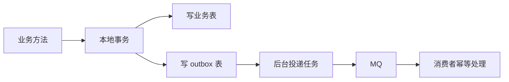
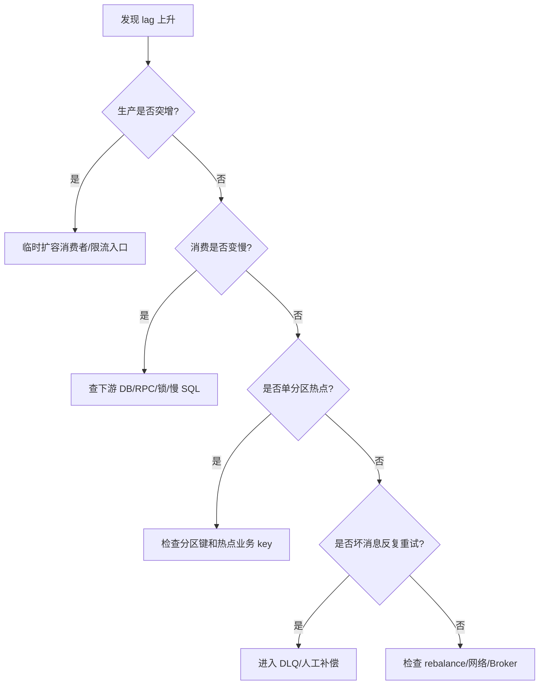

# 消息可靠性-顺序-幂等

> [!abstract] 一句话总结
> 消息正确性要拆成生产不丢、Broker 可恢复、消费可重试且业务幂等；顺序和 Exactly Once 都只能在明确边界内成立。

## 📌 精准定位

- 负责把异步链路的丢失、重复、乱序、积压变成可设计、可观测、可补偿的问题。
- 不负责让非幂等业务天然安全，消费者必须定义去重和状态机。
- 关键边界：多数 MQ 提供至少一次投递，业务侧要接受重复。
- 面试重点：不能只说“MQ 解耦削峰”，要能讲清消息在哪些阶段会丢、为什么会重复、顺序的边界在哪里、业务怎么兜底。

## 🧩 核心概念

| 概念 | 具体含义 | 精通要点 |
| ---- | -------- | -------- |
| 生产可靠 | 发送确认、重试、事务消息、本地消息表。 | 重试必须配合业务幂等 key。 |
| 存储可靠 | 副本、刷盘、ISR/同步复制。 | 可靠性与延迟吞吐冲突。 |
| 消费可靠 | 手动 ack、失败重试、DLQ。 | 先处理后 ack。 |
| 幂等 | 同一消息多次处理结果一致。 | 唯一键、状态机、去重表、版本号。 |
| 顺序 | 同一业务键按发送顺序处理。 | 固定分区/队列 + 单 key 串行消费。 |
| 积压 | 生产速度大于消费速度。 | 要区分消费慢、下游慢、热点分区和坏消息。 |

## ⚙️ 工作原理 / 主流程


1. 生产端要有业务 `messageId` 或 `bizKey`，重试不生成新业务语义。
2. DB+MQ 一致用 outbox、事务消息或 CDC。
3. Broker 可靠性依赖刷盘、副本、ISR、同步复制等配置。
4. 消费端先做幂等占位，再执行业务，最后确认消息。
5. 顺序消息固定分区/队列，并避免多线程破坏同 key 顺序。
6. 失败消息要有重试上限、退避、死信和人工补偿入口。

## 🧱 可靠性分层

| 阶段 | 可能问题 | 方案 | 观测指标 |
| ---- | -------- | ---- | -------- |
| 业务事务 -> MQ | DB 成功但消息没发，消息发了但 DB 回滚 | Outbox、事务消息、CDC | outbox 堆积、发送失败率 |
| Producer -> Broker | 网络超时、发送失败、重复发送 | confirm/ack、重试、业务幂等 key | 发送失败率、重试次数 |
| Broker 存储 | Broker 宕机、磁盘损坏、副本落后 | 副本、同步刷盘、ISR、主从复制 | ISR 数量、刷盘延迟、复制延迟 |
| Broker -> Consumer | 拉取失败、rebalance、重复投递 | 手动 ack/offset、重试 | lag、rebalance 次数 |
| Consumer 处理 | 业务失败、下游慢、重复消费 | 幂等表、状态机、DLQ、限流降级 | 消费 TPS、失败率、DLQ 数 |

## 💻 幂等表设计

```sql
CREATE TABLE processed_message (
  consumer_group varchar(64) NOT NULL,
  message_id varchar(128) NOT NULL,
  biz_key varchar(128) NOT NULL,
  status varchar(32) NOT NULL,
  processed_at timestamp NOT NULL DEFAULT CURRENT_TIMESTAMP,
  PRIMARY KEY (consumer_group, message_id),
  UNIQUE KEY uk_consumer_biz(consumer_group, biz_key)
);
```

消费者伪代码：

```java
@Transactional(rollbackFor = Exception.class)
public void consume(OrderCreatedEvent event) {
    boolean inserted = processedMessageMapper.tryInsert(
        group, event.messageId(), event.orderId());
    if (!inserted) {
        return; // 重复消息，直接确认
    }

    orderService.createOrUpdateByStateMachine(event);
    processedMessageMapper.markSuccess(group, event.messageId());
}
```

关键点：幂等记录和业务更新要在同一个本地事务里，否则可能出现“幂等记录成功但业务失败”或反过来。

## 📬 DB + MQ 一致性方案

### 方案 1：Outbox 本地消息表



优点：业务表和消息表同库同事务，容易理解和排查。缺点：需要投递任务、重试、状态管理和清理策略。

### 方案 2：事务消息

适合 MQ 原生支持事务消息的场景，例如 RocketMQ。流程是先发半消息，再执行本地事务，最后提交或回滚消息。Broker 会回查本地事务状态。

风险：回查接口必须能根据业务主键准确判断本地事务状态。

### 方案 3：CDC

通过监听数据库 binlog，把 outbox 或业务变更转换成消息。优点是侵入较小，缺点是链路更复杂，需要治理延迟、顺序、重复和监控。

## 🧭 顺序消息边界

顺序只能在明确范围内保证。

| 级别 | 是否现实 | 说明 |
| ---- | -------- | ---- |
| 全局顺序 | 很难 | 会牺牲吞吐，通常没必要 |
| 分区/队列顺序 | 可行 | 同一队列内有序 |
| 业务键顺序 | 最常用 | 同一订单、同一用户、同一商品固定到同一分区 |

示例：订单状态消息必须按 `orderId` 分区。

```java
String partitionKey = event.orderId();
producer.send(topic, partitionKey, event);
```

消费者侧仍要用状态机防乱序：

```sql
UPDATE orders
SET status = 'PAID'
WHERE id = ? AND status = 'WAIT_PAY';
```

即使消息乱序，状态机条件更新也能兜底。

## 🔥 典型事故案例

### 事故 1：先 ack 后处理导致消息丢失

错误流程：消费者收到消息后先提交 offset/ack，再写数据库。进程在写 DB 前崩溃，消息不会再投递，业务丢失。

修复：

- 先执行业务并提交本地事务。
- 再提交 ack/offset。
- 业务处理必须幂等，因为 ack 失败也可能重复投递。

### 事故 2：生产重试换 messageId 导致幂等失效

现象：同一个订单事件被处理多次。

根因：每次发送重试都生成新的 messageId，消费者用 messageId 去重失效。

修复：

- 使用业务稳定 key，如 `orderId + eventType`。
- messageId 可以用于链路追踪，但幂等不能只依赖不稳定的技术 id。

### 事故 3：顺序消息被坏消息阻塞

现象：某个队列 lag 持续增长，其他队列正常。

根因：同一分区中有一条坏消息反复失败，阻塞后续同 key 或同队列消息。

修复：

- 设置最大重试次数和 DLQ。
- 对可跳过消息进入人工处理队列。
- 消费者逻辑区分可重试错误和不可重试错误。

### 事故 4：无限重试放大下游故障

现象：下游接口已经慢，MQ 消费者失败后立即重试，导致下游进一步雪崩。

修复：

- 指数退避。
- 消费端限流。
- 熔断和降级。
- 超过阈值进 DLQ，人工或定时补偿。

## 📈 MQ 堆积排查



关键指标：

- lag 总量和增长速度。
- 单分区 lag 是否倾斜。
- 消费 TPS、失败率、重试次数。
- 下游 DB/RPC 延迟。
- rebalance 次数。
- DLQ 数量。

## 🔍 Kafka / RocketMQ 关键点

### Kafka

- `acks=all`：等待 ISR 中副本确认，可靠性更高但延迟增加。
- `enable.idempotence=true`：幂等生产者，避免生产重试导致分区内重复写入。
- ISR：同步副本集合，ISR 过少说明副本落后或故障。
- offset：消费进度，提交过早可能丢，提交过晚可能重复。
- rebalance：消费者组变化会导致分区重新分配，可能带来重复消费。

### RocketMQ

- 事务消息：半消息 + 本地事务 + 提交/回滚 + 回查。
- 延迟消息：适合支付超时关单等场景。
- 重试队列：消费失败按策略重试。
- 死信队列：超过最大重试次数后进入 DLQ。
- 顺序消息：同一 sharding key 进入同一队列，消费侧串行处理。

## ⚠️ 生产坑与注意事项

- 生产重试换 messageId 导致无法去重。
- 先 ack 再处理，进程崩溃丢消息。
- 幂等表和业务更新不在同一事务。
- 顺序消息遇到坏消息阻塞整个队列。
- 无限重试把下游故障放大成堆积。
- 消费者扩容超过分区数后不能继续提升单 topic 并行度。
- 事务消息回查接口实现不可靠，导致消息状态错误。
- 只监控发送成功率，不监控 lag、DLQ 和业务最终状态。

## 🧭 排查路径

- 丢消息按 producer、broker、consumer ack 三段定位。
- 重复看重试、超时、rebalance、幂等键。
- 乱序检查分区键、消费者并发、重试投递和业务状态机。
- 堆积分清生产突增、消费慢、下游慢、单分区热点和异常消息。
- DB+MQ 不一致按业务表、outbox 表、MQ 日志、消费者幂等表串联排查。

## 🎯 面试问题

> [!question] 高频问题
> - Q: MQ 如何不丢？
>   - A: 分三段：生产端确认和重试，Broker 持久化/副本，消费端处理成功后再 ack。DB+MQ 一致还要 outbox、事务消息或 CDC。
> - Q: 为什么要幂等？
>   - A: 至少一次投递、生产重试、消费超时、ack 失败、rebalance 都可能造成重复处理。
> - Q: 如何保证顺序？
>   - A: 同一业务键固定到同一分区/队列并串行消费；业务侧再用状态机条件更新兜底。
> - Q: DB 和 MQ 一致怎么做？
>   - A: 本地消息表、事务消息或 CDC outbox。直接在本地事务里发 MQ 不能保证一致。
> - Q: 死信怎么处理？
>   - A: 告警、分析、修复后人工或自动重放。重放前要保证幂等，并记录处理结果。
> - Q: MQ 堆积怎么排查？
>   - A: 先看生产是否突增，再看消费 TPS、失败率、下游延迟、单分区热点、坏消息和 rebalance。

## 🎤 面试 3 层回答

### 30 秒版

MQ 可靠性要分生产、Broker、消费三段看。生产要确认和重试，Broker 要持久化和副本，消费要先处理成功再 ack，并且业务必须幂等。顺序只能在业务 key 的分区范围内保证，DB+MQ 一致通常用 outbox 或事务消息。

### 2 分钟版

我不会说 MQ 天然不丢。生产端可能发送失败或超时，Broker 可能宕机，消费者可能处理成功但 ack 失败，也可能处理失败后重复投递。所以生产端要有稳定业务 key 和重试，Broker 侧根据可靠性要求配置副本和刷盘，消费端用幂等表或状态机处理重复。涉及数据库事务时，用本地消息表或事务消息保证业务数据和消息最终一致。

### 项目版

在秒杀项目里，Redis 预扣成功后不能只依赖同步发送 MQ。我会写 outbox 事件，后台任务投递 MQ；消费者用 `requestId` 和 `(activity_id,user_id)` 唯一键保证幂等。消费失败进入重试，超过阈值进入 DLQ，并由对账任务校验订单数、库存数和消息状态，确保不会超卖或资格悬挂。

## ✅ 精通检查清单

- 能按 producer、broker、consumer 三段解释消息丢失风险。
- 能讲清重复消息来源和业务幂等方案。
- 能说明顺序消息的边界和热点问题。
- 能解释 outbox、事务消息、CDC 的取舍。
- 能给出 MQ 堆积、DLQ、重复消费的排查路径。
- 能结合秒杀/订单项目讲消息一致性和补偿。

## 🔗 关联笔记

- [[_index]]
- [[20-Java后端/00-总览/学习仪表盘]]
- [[01-Kafka原理与应用]]
- [[02-RocketMQ原理]]
- [[../04-Spring生态/03-Spring事务管理]]
- [[../07-分布式与微服务/03-分布式事务-2PC-TCC-Saga]]
- [[../09-项目实战/01-项目-高并发秒杀系统]]

## 📚 参考资料

- Enterprise Integration Patterns
- Kafka Documentation: Producer, Consumer, Transactions
- RocketMQ Documentation: Transaction Message, Retry, DLQ
- Microservices Patterns: Transactional Outbox
