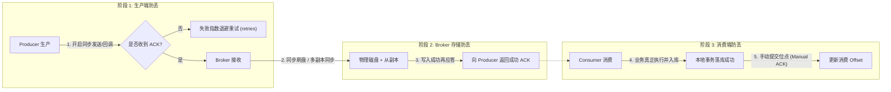
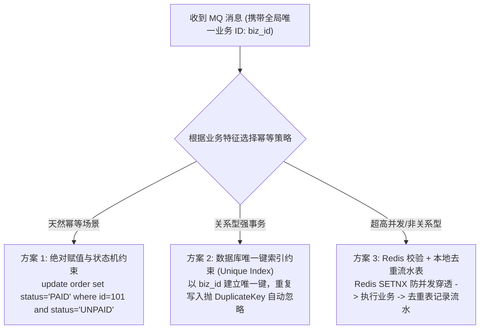
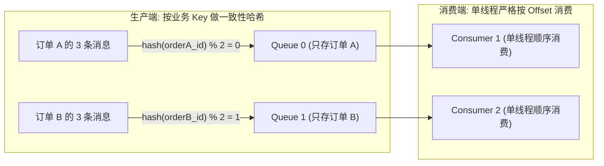
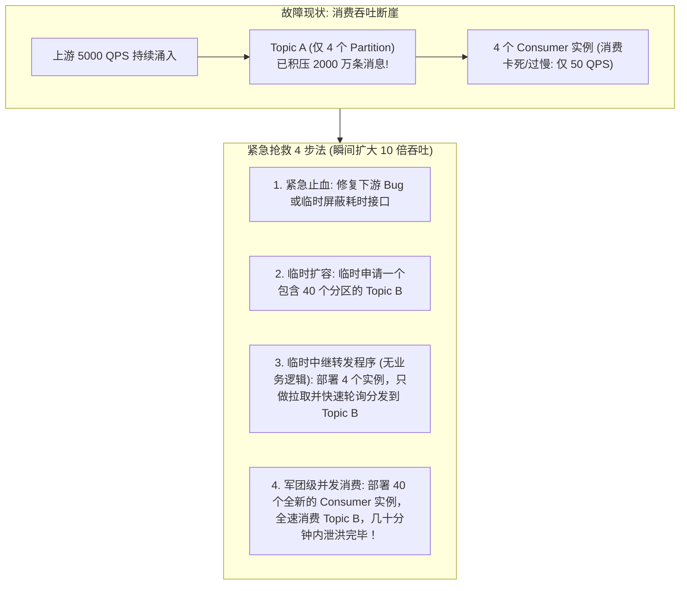

# 消息可靠性、顺序性与幂等性

> [!abstract] 一句话心智模型
> 在分布式消息网络中，面对不可靠的物理网络与可能随时崩溃的服务器：
> - **可靠性（绝不丢件）** 靠的是**端到端三方联合确认机制**：生产端“发了必须收到签字（ACK）”，Broker 端“双机备份+落盘才敢应答”，消费端“业务真正落库后才交还回执”；
> - **幂等性（重复投递不乱套）** 是分布式系统的根本法则：由于网络超时重试的存在，MQ 只能承诺“至少送达一次（At Least Once）”，**必须由消费端依靠唯一业务流水号或状态机建立免死金牌**；
> - **顺序性（先下单再发货）** 靠的是**专人专道局部有序**：同一个订单的事件全部 Hash 到同一个队列中单线程按序提货；
> - **积压救火（千万货物堵死港口）** 靠的是**临时借道大分流**：紧急扩容临时高并发分区分流，将消费吞吐瞬间拉升十倍！

---

## 🛡️ 一、消息“零丢失”端到端全链路闭环

一条消息从产生到最终消费，需要跨越三个物理节点：**Producer -> Broker -> Consumer**。在这三段链路上，任何一处出现疏漏都会导致消息丢失。



### 1. 阶段 1：生产端防止丢消息
- **致命坑点**：使用 `producer.send(msg)` 之后不管不顾（发后即忘 One-Way），或者发送异步消息时没有注册回调函数。如果此时发生网络闪断，消息根本没进 Broker，但业务代码误以为已经发送成功。
- **坚守准则**：
  - **同步发送并校验返回结果**：必须拿到明确的 `SendResult` 且状态为 `SEND_OK`；
  - **异步发送必须注册 Callback**：在 `onException` 回调中将失败消息记录到本地补偿表，由定时任务重试报警；
  - **配置重试次数**：设置 `retries = 3` 以上，配合指数退避重试。

### 2. 阶段 2：Broker 端防止丢消息
- **致命坑点**：Broker 收到消息只写入了系统的 PageCache 内存，还没来得及刷入磁盘，机器突然断电；或者 Master 节点写入成功但还没同步给 Slave 节点，Master 硬盘损坏。
- **坚守准则**：
  - **刷盘策略**：金融级业务开启**同步刷盘（Sync Flush）**，消息必须写入磁盘物理扇区才返回应答；常规高并发业务采用异步刷盘，但必须配合**多副本同步复制**。
  - **多副本机制**：
    - **Kafka**：配置 `acks=all` 且 `min.insync.replicas=2`；
    - **RocketMQ**：配置 `SYNC_MASTER`（主从同步双写）或基于 Raft 的 **Dledger** 集群，只有从节点也写入成功，才向 Producer 返回 ACK。

### 3. 阶段 3：消费端防止丢消息
- **致命坑点**：
  - 开启了**自动提交位点（Auto Commit）**。
  - Consumer 刚把一批消息拉到本地内存，自动提交了 Offset；紧接着在执行 `orderService.process()` 时抛出空指针异常或进程突然 OOM 重启。
  - 此时 Broker 认为这批消息已经被成功消费过了，重启后直接从下一个 Offset 开始，**导致报错的那批消息被永久漏掉！**
- **坚守准则**：
  - **强制关闭自动提交**（Kafka 设置 `enable.auto.commit=false`）；
  - **严格遵循“业务成功才提交”**：必须在本地数据库事务提交、业务逻辑完全执行无误后，再显式调用 `commitSync()` 或返回 `CONSUME_SUCCESS`！

---

## ⚡ 二、消息幂等性：防范重复消费的终极防线

### 1. 为什么 MQ 无法做到绝对的 Exactly-Once（精准一次送达）？
- **网络两将军问题**：Consumer 成功消费了消息并完成了数据库落库，在准备向 Broker 发送 ACK 确认时，网络突发抖动断开。Broker 超时未收到 ACK，判定消费失败，在网络恢复后**再次向 Consumer 投递了同一条消息！**
- **结论**：在不可靠的网络世界中，任何成熟的分布式消息队列都只能承诺 **At Least Once（至少送达一次）**！**消息幂等的重任必须交由消费端的业务系统来捍卫！**

---

### 2. 工业级三大幂等落地设计方案



#### 方案 1：状态机条件更新（天然幂等）
- **场景**：订单状态流转（未支付 -> 已支付 -> 已发货）。
- **SQL 设计**：
  ```sql
  UPDATE t_order 
  SET status = 'PAID', update_time = NOW() 
  WHERE order_id = '20260912001' AND status = 'UNPAID';
  ```
- **原理解析**：如果同一条“已支付”消息被投递了 5 次，第 1 次执行更新成功返回 `rows = 1`；后 4 次执行由于 `status` 已经不是 `UNPAID`，数据库匹配不到记录直接返回 `rows = 0`。业务毫无受损，零额外存储成本！

#### 方案 2：数据库唯一键防重（最稳健方案）
- **场景**：增加用户积分、插入流水账单等非幂等累加操作。
- **设计实战**：建立一张专用的 `t_idempotent_token` 幂等防重表，以 `msg_id` 或 `order_no + 业务类型` 作为**唯一主键索引（Unique Key）**：
  ```sql
  CREATE TABLE `t_idempotent_log` (
    `biz_key` varchar(64) NOT NULL COMMENT '唯一业务主键(如订单号+操作类型)',
    `create_time` datetime NOT NULL,
    PRIMARY KEY (`biz_key`)
  ) ENGINE=InnoDB DEFAULT CHARSET=utf8mb4;
  ```
- **执行流程**：将业务逻辑与防重表的插入包裹在**同一个本地数据库事务**中。重复消息到达时，数据库直接抛出 `DuplicateKeyException`，事务自动回滚，Consumer 直接捕获异常并吞掉，返回 ACK 成功！

#### 方案 3：Redis 分布式锁 + 最终确认（高并发场景）
- **场景**：秒杀扣减内存库存、无法频繁读写数据库的高频操作。
- **执行流程**：
  1. 收到消息，首先执行 `SET lock:order:20260912001 "1" NX EX 30`；
  2. 若返回 false，说明当前有别的线程正在并发消费同一条消息，直接等待或放弃；
  3. 若返回 true，继续检查 Redis 中是否存在 `finish:order:20260912001` 标记；
  4. 业务执行成功后，将 `finish:order:...` 写入 Redis 并持久化，最后释放锁。

---

## 🧭 三、消息顺序性保障（局部有序设计）

很多新手常问：“如何让整个系统成千上万条消息严格按照发送顺序被消费？”
- **第一性原理思考**：**全局绝对有序是一个伪需求，并且代价是系统的吞吐量暴跌到单机极限！**
  - 如果要全局绝对有序，整个 Topic 只能建一个 Partition，全系统只能有一个 Consumer 单线程消费，并发能力瞬间降为几十 QPS！
- **业务真相：我们只需要“局部顺序（分区间有序）”**！
  - 订单 A 的“创建 -> 支付 -> 发货”必须按顺序执行；
  - 订单 B 的“创建 -> 支付 -> 发货”也必须按顺序执行；
  - **但订单 A 和订单 B 之间谁先谁后根本无所谓！**



### 顺序消费三道防御锁：
1. **生产端**：发送消息时指定 **MessageQueueSelector**（RocketMQ）或 Partition Key（Kafka），传入订单 ID，底层计算 `hash(order_id) % 分区数`，**确保同一订单的所有消息绝对进入同一个 Queue**！
2. **Broker 端**：单个 Queue/Partition 本身就是 FIFO 先进先出的单向日志，单分区内天然绝对有序！
3. **消费端**：
   - **RocketMQ**：使用 `MessageListenerOrderly`（有序监听器），其底层会对目标 MessageQueue 加分布式锁，确保同一时刻只有一个线程独占该队列顺序消费。
   - **严禁踩坑**：在有序监听器内部，**严禁使用自定义线程池异步处理**！如果内部开了线程池，多个子线程争抢执行，单分区内的有序性在消费端会瞬间被打乱！

---

## 🚒 四、千万级消息线上严重积压（Lagging）紧急抢救 SOP

在双十一大促或系统故障时，下游系统由于慢 SQL、网络超时或逻辑卡死，导致处理速度暴跌，MQ 监控大盘瞬间报警：**当前积压消息超过 2000 万条，且积压曲线呈垂直上升趋势！**



### 生产救火绝命步骤：
1. **第一步：先解决消费端的致命瓶颈（止血）**
   - 检查消费端日志：是不是数据库死锁？慢 SQL？第三方接口超时？
   - 紧急优化：临时扩容数据库连接池、给耗时字段加索引、关闭非核心业务日志，或者在消费逻辑中把耗时的发短信、推统计功能临时降级为异步。
2. **第二步：为什么直接给 Consumer 加机器可能完全没用？**
   - **核心铁律**：**如果 Topic A 只有 4 个 Partition，你就算临时拉起 20 台 Consumer 机器，也只有 4 台机器能抢到分区消费，剩下 16 台全在摸鱼！**
3. **第三步：终极大招——“临时大分流”（扩容 10 倍吞吐泄洪）**：
   - 紧急新建一个名为 `Topic_Temp` 的临时主题，**直接分配 32 或 64 个 Partition**！
   - 写一个极其轻量、**完全不做任何业务处理的临时中转分发服务**，接入原来的 4 个 Partition。它的唯一逻辑就是：把消息从原 Topic 拉下来，**不查库、不做运算，无脑批量轮询发送进 `Topic_Temp` 的 32 个分区中！**（因为只做转发，耗时极短，每秒可吞吐几万条）。
   - 迅速申请并部署 **32 台全新的消费者机器**，挂载到 `Topic_Temp` 上全速进行真实的业务消费！
   - 原本 4 台机器的吞吐瓶颈瞬间放大至 32 台机器全并发，千万级积压通常可以在 15~30 分钟内被迅速打平！
   - 积压消化完毕后，平滑切回原有系统，下线临时中间件与分流消费者。

---

## ⚡ 一分钟面试必杀卡

> [!NOTE] 面试高频问题标准答题套路
> 
> **Q1：如何保证消息消费的幂等性？**
> - **A**：
>   - 在分布式网络中，由于网络超时与重试，MQ 只能保障 At Least Once（至少一次），因此必须在消费端做幂等。
>   - 常用落地方案：
>     1. **状态机前置过滤**：更新数据时带上前置状态约束（如 `where status = 'UNPAID'`），执行更新返回影响行数为 0 则自动忽略。
>     2. **业务唯一索引防重表**：以全局唯一业务主键（如 `order_id`）在数据库建立唯一索引，与业务操作放入同一本地事务，重复消息抛出主键冲突异常直接捕获并确认。
>     3. **Redis 分布式锁/去重标记**：针对非关系型高并发场景，使用 Redis `SETNX` 拦截并发重入。
> 
> **Q2：如果线上 MQ 突然发生了数千万条消息的严重积压，你的排查和解决思路是什么？**
> - **A**：
>   1. **快速排查定位**：看消费端监控指标，判断是上游流量洪峰突增，还是消费端由于慢 SQL、下游依赖超时或死锁导致消费停滞。
>   2. **快速止血**：修复消费端故障，针对非核心下游调用（发通知、推统计等）执行快速降级。
>   3. **临时分流泄洪（核心方案）**：如果当前 Topic 的 Partition 数较少，直接加 Consumer 实例无法提高并发度。此时新建一个拥有 30~50 个 Partition 的临时 Topic；上线一组只做转发的临时消费程序，将原积压消息迅速搬移到临时 Topic；再部署 30~50 个真实的业务 Consumer 并发消费，快速泄洪打平积压，最后回切。
