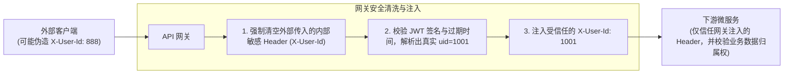
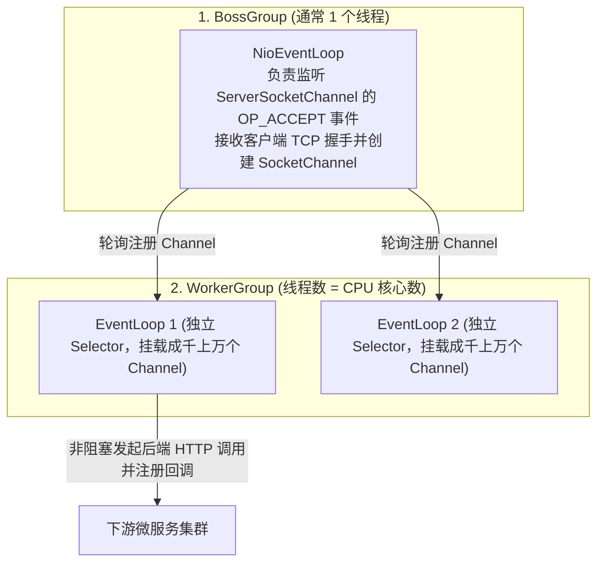
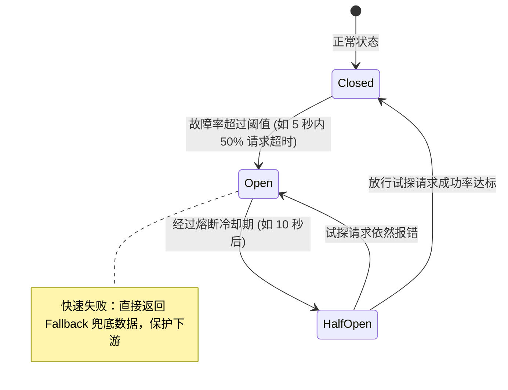

# 04 · API 网关与流量治理

> [!abstract] 一句话第一性原理
> API 网关是**微服务流量的统一前置控制面与反向代理入口**。通过将全站流量收拢于单点，实现协议转换、统一鉴权、安全清洗与限流熔断，同时依赖**响应式非阻塞 I/O** 规避线程池耗尽雪崩。

---

## 一、 网关核心定位与安全边界

### 1. 核心职责

- **统一路由与服务发现**：对外暴露单一入口域名，依据请求 Path/Header 结合注册中心实现动态负载均衡路由。
- **公共横切关注点收拢**：CORS 跨域、SSL 卸载、统一 JWT 鉴权、链路追踪 ID 注入与全局访问日志。
- **流量安全防线**：黑白名单、防刷限流、恶意攻击拦截与接口熔断降级。

### 2. 身份头传递与防伪造安全规范



---

## 二、 底层并发模型：Netty + Reactor 响应式非阻塞深度剖析

### 1. Netty 主从多 Reactor 线程模型

Spring Cloud Gateway 底层完全基于 Netty 构建，其核心线程模型分为两组：



### 2. 为什么在 Gateway 的 Filter 中严禁编写任何阻塞代码？

- **物理根因**：
  在全网关中，负责处理所有网络请求的 `EventLoop` 线程数通常**严格等于 CPU 核心数（例如 8 核机器只有 8 个线程）**。
  每个 `EventLoop` 线程维护着一个独立的 Linux Epoll `Selector`，上面同时注册挂载着数千个客户端连接的读写事件。
- **灾难推导**：
  若在自定义 Filter 中调用了同步阻塞方法（如传统的 `RestTemplate`、同步 JDBC 查询、`Thread.sleep()` 或 `.block()`）：
  1. 当前 `EventLoop` 线程会被操作系统当场挂起，暂停执行；
  2. **挂载在同一个 EventLoop 线程上的其余几千个客户端连接的网络 I/O 事件将全部无法被调度**；
  3. 只要同时有 8 个请求触发了该阻塞调用，整台网关的 8 个工作线程全部卡死，全站 QPS 瞬间断崖式跌零！
- **响应式背压（Backpressure）机制**：
  Gateway 基于 Project Reactor 规范，下游处理慢时通过响应式流的 `request(n)` 机制控制上游数据流入速率，防止因生产者过快导致内存堆积 OOM。

---

## 三、 Gateway 核心组件与 GlobalFilter 实战

### 1. 三大核心概念

- **Route（路由）**：基本路由单元，包含 `id`、`uri`、`predicates`（断言列表）与 `filters`（过滤器列表）。
- **Predicate（断言）**：匹配条件（Path、Method、Header、Cookie、Weight 灰度权重等），全真则命中路由。
- **Filter（过滤器）**：分 Pre 阶段（转发前改写请求/鉴权/限流）与 Post 阶段（下游响应后统计耗时/打印日志）。

### 2. 生产级 GlobalFilter 代码模板

```java
@Component
@Slf4j
public class AuthAndMetricGlobalFilter implements GlobalFilter, Ordered {

    private static final String START_TIME = "reqStartTime";
    private static final String USER_ID_HEADER = "X-User-Id";

    @Override
    public Mono<Void> filter(ServerWebExchange exchange, GatewayFilterChain chain) {
        // 记录入口时间戳
        exchange.getAttributes().put(START_TIME, System.currentTimeMillis());
        ServerHttpRequest request = exchange.getRequest();
        String path = request.getURI().getPath();

        // 1. 白名单放行
        if (path.startsWith("/api/public/") || path.startsWith("/api/auth/login")) {
            return chain.filter(exchange);
        }

        // 2. JWT 鉴权
        String token = request.getHeaders().getFirst("Authorization");
        if (!StringUtils.hasText(token) || !JwtUtils.verify(token)) {
            exchange.getResponse().setStatusCode(HttpStatus.UNAUTHORIZED);
            return exchange.getResponse().setComplete();
        }

        String userId = JwtUtils.getUserId(token);

        // 3. 清理外部伪造 Header，重新注入可信 Header
        ServerHttpRequest mutatedRequest = request.mutate()
                .headers(h -> h.remove(USER_ID_HEADER))
                .header(USER_ID_HEADER, userId)
                .build();

        // 4. 异步转发下游并在 Post 回调统计耗时
        return chain.filter(exchange.mutate().request(mutatedRequest).build())
                .then(Mono.fromRunnable(() -> {
                    Long start = exchange.getAttribute(START_TIME);
                    if (start != null) {
                        long cost = System.currentTimeMillis() - start;
                        log.info("[Gateway] path={}, uid={}, status={}, cost={}ms",
                                path, userId, exchange.getResponse().getStatusCode(), cost);
                    }
                }));
    }

    @Override
    public int getOrder() {
        return -100; // 确保在路由转发前最先执行
    }
}
```

---

## 四、 四大限流算法对比与分布式 Redis + Lua 源码实战

### 1. 四种限流算法直观对比

| 算法 | 核心机制 | 边界缺陷 | 应对瞬时突发 | 典型适用场景 |
| :--- | :--- | :--- | :--- | :--- |
| **固定窗口** | 固定时间片内维护计数器，到期清零 | **临界突刺**：窗口切换前后短时间内可出现 2 倍阈值流量打死下游 | 否 | 粗粒度防刷（如单日调用上限） |
| **滑动窗口** | 拆分为多个小时间格滚动统计累加（如 Sentinel `LeapArray` 环形数组） | 解决临界突刺问题，但超过阈值直接截断拒绝 | 否 | Sentinel 实时 QPS 限流 |
| **漏桶算法** | 请求先入固定容量漏桶，以恒定速率流出 | 过于死板，即使下游完全空闲也无法利用空闲处理合法小突发 | 否 | 流量绝对整形、保护脆弱的老旧第三方接口 |
| **令牌桶算法** | 恒定速率发牌，桶内存量令牌可吸收瞬时洪峰 | 无明显缺陷，兼顾突发弹性与长期平均限速 | **能（以桶内余量令牌平滑吸收）** | **API 网关（Spring Cloud Gateway 首选）** |

---

### 2. 生产级分布式令牌桶 Redis + Lua 脚本源码实战

网关集群部署下，为了保证全局统一限流且不依赖后台定时任务，采用 **惰性计算（Lazy Evaluation） + Lua 脚本原子执行**。

以下为 Spring Cloud Gateway 内置的生产级标准 Redis Lua 脚本核心实现：

```lua
-- KEYS[1]: 令牌桶 Key (tokens_key)
-- KEYS[2]: 上次刷新时间戳 Key (timestamp_key)
-- ARGV[1]: 令牌补充速率 replenishRate (每秒放入多少个)
-- ARGV[2]: 令牌桶最大容量 burstCapacity
-- ARGV[3]: 当前系统时间戳 (秒)
-- ARGV[4]: 本次请求消耗的令牌数 (通常为 1)

local rate = tonumber(ARGV[1])
local capacity = tonumber(ARGV[2])
local now = tonumber(ARGV[3])
local requested = tonumber(ARGV[4])

-- 计算桶填满所需的时间，用于设置 Redis Key 的自动过期时间 (防止冷数据泄漏占用内存)
local fill_time = capacity / rate
local ttl = math.floor(fill_time * 2)

-- 1. 获取当前桶内剩余令牌数与上次刷新时间
local last_tokens = tonumber(redis.call('get', KEYS[1]))
if last_tokens == nil then
    last_tokens = capacity -- 初始状态默认满桶
end

local last_refreshed = tonumber(redis.call('get', KEYS[2]))
if last_refreshed == nil then
    last_refreshed = 0
end

-- 2. 惰性计算：根据两次请求的时间差，补充新令牌
local delta = math.max(0, now - last_refreshed)
local filled_tokens = math.min(capacity, last_tokens + (delta * rate))

-- 3. 判断令牌是否足够扣减
local allowed = filled_tokens >= requested
local new_tokens = filled_tokens

if allowed then
    new_tokens = filled_tokens - requested
end

-- 4. 原子写回更新后的令牌数与时间戳，并刷新过期时间
redis.call('setex', KEYS[1], ttl, new_tokens)
redis.call('setex', KEYS[2], ttl, now)

-- 5. 返回结果: 1 为允许放行，0 为限流拦截；以及剩余可用令牌数
return { allowed and 1 or 0, new_tokens }
```

#### 机制精髓：
1. **完全免去后台定时加令牌线程**：通过两次请求间的时间差 `delta * rate` 现场计算新生成令牌数；
2. **绝对原子性**：读、算、扣、写全过程由单个 Lua 脚本在 Redis 单线程中完成，**0 锁竞争，0 并发超卖**。

---

## 五、 流量防护兜底：熔断降级（Circuit Breaker）

网关除了限流，面对下游服务持续报错或慢查询，必须配合熔断器（如 Resilience4j / Sentinel）切断故障传播：



- **Closed（关闭）**：熔断器闭合，流量正常放行，在滑动窗口内统计慢调用与异常比例；
- **Open（开启）**：当失败率超过阈值，熔断器打开，后续所有请求**不再打向下游，直接在网关短路返回降级 Fallback 响应**；
- **Half-Open（半开）**：经过预设熔断时间后进入半开状态，放行少量探测流量：若成功则重置为 Closed，若失败则重新开启熔断。

---

## 六、 高频面试自测

> [!question]- Q1：Spring Cloud Gateway 为什么性能远超 Zuul 1.x？为什么严禁在网关 Filter 中写阻塞代码？
> Zuul 1.x 采用 Servlet 传统的“一请求一线程”阻塞模型，工作线程在等待下游响应时被挂起，下游慢调用极易占满 200 个线程导致网关雪崩。
> Spring Cloud Gateway 基于 Netty + Project Reactor 响应式非阻塞模型，仅用等于 CPU 核心数的 EventLoop 线程，异步发起非阻塞请求并挂载回调后立即脱身处理下一请求。全网关仅有数个工作线程，一旦在 Filter 中执行阻塞 I/O，该线程承载的上千个客户端连接将全部卡死瘫痪。

> [!question]- Q2：为什么分布式网关限流首选令牌桶算法，且必须结合 Redis + Lua 脚本实现？
> 漏桶算法流出速率恒定，无法利用下游空闲弹性应对合理的瞬时高峰；令牌桶算法允许桶内存量令牌吸收瞬时突发，并在令牌耗尽后按稳定速率发牌，兼顾弹性与限速。
> 集群部署下需依托 Redis 集中存储令牌状态，采用“惰性计算（当前时间差 × 速率）”免去定时任务开销；将读取、计算、扣减封装在 Lua 脚本中，利用 Redis 执行 Lua 的单线程原子性，规避高并发下的并发超卖与失效。

---

## 🔗 上下篇导航
- **上一篇**：[[03-服务注册与配置中心原理]]
- **下一篇**：[[05-Kafka架构原理与实战手册]]
